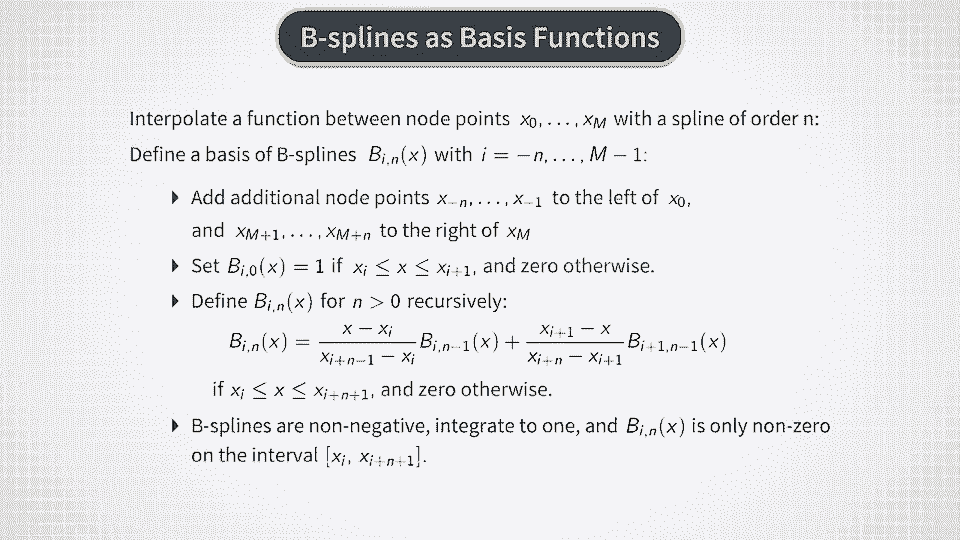

# 19：蒙特卡洛与基函数 🧮


在本节课中，我们将学习如何计算马尔可夫决策过程（MDP）期权定价模型中的条件期望。具体来说，我们将探讨在离散状态和连续状态两种设定下，如何利用基函数来近似这些期望值，并介绍一种名为B样条的常用基函数。


---

在上节课中，我们推导了MDP期权定价模型中最优对冲和定价问题的算法解。


为了便于回顾，这些方程再次展示如下。


反向递归算法要求我们从时间点 `T-1` 开始，向后执行上述两个方程，直到当前时间 `T`。


然而，正如我们多次提到的，这些关系涉及不同的条件期望。核心问题在于：我们应如何计算这些条件期望？需要提醒的是，我们假设一个蒙特卡洛设置，其中在时间点 `t` 的信息条件集 `F_t` 由所有直到时间 `t` 的蒙特卡洛路径组成。因此，在明确了条件期望的定义后，剩下的任务就是学习如何计算它们。

## 离散状态下的期望计算

首先，我们来看看如何在离散状态设置中计算这样的期望值。上节课提到，如果我们想用马尔可夫链逼近布莱克-斯科尔斯模型，可以对MDP模型进行离散化。

在这种设置下，状态变量 `X_t` 会有一系列有限的可能取值 `X_m`，其中 `m` 的取值范围是 `1` 到 `M`，`M` 是离散状态的总数。

在每个节点上，我们会得到一些值 `Q_m`。这些值也可以看作是状态变量 `X_t` 的离散值函数。我们可以使用无索引符号，将其写成 `X` 的离散值函数 `Q(X)`。具体做法是将所有 `Q_m` 乘以 **克罗内克δ函数** `δ(X, X_m)` 后求和。当 `X` 等于 `X_m` 时，δ函数值为 `1`，否则为 `0`。

**公式表示如下：**
```
Q(X) = Σ_{m=1}^{M} Q_m * δ(X, X_m)
```

这个公式为 `Q(X)` 在每个可能的 `X` 值上生成了一个恒等式。使用这个公式的好处是，它现在对任何输入 `X` 都有效，类似于线性代数中对向量所有元素都成立的向量表达式。

现在，我们可以用更具提示性的符号 `φ_m(X)` 来代替δ函数，将δ函数的两个参数分开。`φ_m(X)` 的计算方式与δ函数相同，但现在我们可以将其解释为 `X` 特征的 **独热编码**。

以下是其工作原理：
考虑一个固定的 `m` 值及其对应的函数 `φ_m(X)`。对于给定的输入 `X`，除非 `X` 与节点值 `X_m` 完全匹配，否则该函数值为零。具有这种 **独热编码** 特性的函数可以称为 **独热基函数**。此时，`Q(X)` 的整个求和可以解释为这些基函数的展开。

你可能会想，既然这种展开非常稀疏（只有一个项非零），研究它有何意义？确实如此。但以这种方式书写的主要目的，是为了将其推广到连续状态的形式。

## 推广到连续状态

对于连续状态的情况，我们需要将离散状态下类似δ函数的尖峰基函数，替换为平滑的版本。

这里展示了一组我们将使用的12个基函数。虽然这不是连续空间公式的唯一选择，但它非常方便，能满足我们的需求。



这些基函数被称为 **B样条**。接下来，我们简要讨论一下B样条的构建方式。

## B样条基函数介绍

B样条在插值问题中非常有用，特别是当我们想通过一个连续且平滑的 `n` 阶样条函数，在节点 `X_0` 到 `X_m` 之间插值某个函数时。

构建过程首先需要插入额外的节点：
*   在 `X_0` 左侧添加节点 `X_{-n}` 到 `X_{-1}`。
*   在 `X_m` 右侧添加节点 `X_{m+1}` 到 `X_{m+n}`。

接着，我们递归地定义一组B样条 `B_{i,n}(X)`：
1.  当 `n = 0` 时，定义 `B_{i,0}(X) = 1`（若 `X` 在区间 `[X_i, X_{i+1})` 内），否则为 `0`。
2.  对于 `n > 0`，通过以下递推公式定义：
    ```
    B_{i,n}(X) = (X - X_i) / (X_{i+n} - X_i) * B_{i,n-1}(X) + (X_{i+n+1} - X) / (X_{i+n+1} - X_{i+1}) * B_{i+1,n-1}(X)
    ```
    这个公式在区间 `[X_i, X_{i+n+1}]` 内有效，在此区间外，`B_{i,n}(X)` 为 `0`。

从公式可以看出，如果我们取 `n = 3`，那么 `B_{i,3}(X)` 就是非负的三次多项式。这些B样条被称为 **三次B样条**，也是我们接下来将使用的。

B样条非常有用，因为它们具有非负性、积分和为1，并且只在有限区间 `[X_i, X_{i+n+1}]` 上非零。因此，它们为表示非负量提供了良好的基础——如果所有系数都是非负的，那么整个表达式也将是非负的，因为基函数本身是非负的。

## 其他基函数与扩展

B样条提供了一个非常好的基函数选择，但并非唯一选择。文献中也考虑了其他规格，例如：
*   傅里叶余弦基函数
*   小波基函数


一个更复杂的问题是，当标的资产不止一个，而是多个时，如何选择一组基函数。在处理多资产投资组合时，我们将面对这些更复杂的设置。但目前，我们将继续专注于单一股票和单一标的期权的组合，这已足够我们现阶段深入探讨。


[空白音频]


---

## 总结


本节课中，我们一起学习了如何计算MDP期权定价模型中的条件期望。我们从离散状态下的 **独热编码** 基函数展开开始，理解了其稀疏表示的原理。接着，为了处理更一般的连续状态问题，我们引入了平滑的 **B样条** 基函数，并了解了其递归构建方法及优良特性（如非负性、局部支撑）。最后，我们简要提及了其他可能的基函数选择以及未来处理多资产问题时将面临的挑战。掌握基函数方法，是连接理论算法与蒙特卡洛模拟实践的关键一步。