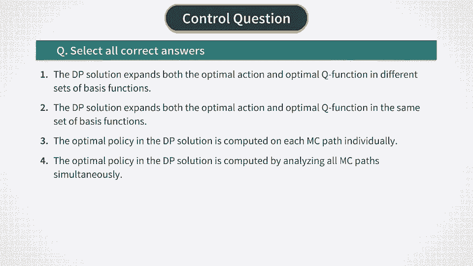

# 20：使用蒙特卡罗方法进行最优对冲 🎲

在本节课中，我们将学习如何利用蒙特卡罗模拟和基函数展开法，将无限维的最优对冲函数优化问题，转化为一个有限维的参数优化问题，从而实际计算最优对冲策略。

---

上一节我们介绍了基函数的概念及其构建方法。本节中，我们来看看如何将基函数应用于蒙特卡罗模拟，以实现最优Q函数的回溯递归计算。

我们之前提到，条件期望中的条件应理解为对所有蒙特卡罗模拟路径的全集进行条件化。现在，我们获得了一种利用基函数计算此类期望的有效方法。

假设我们定义了一组基函数 **φ_n(x)**，其中参数 **x** 代表当前状态变量的值。我们可以选择上一视频中讨论的特定点作为这些函数，但我们将保持符号的通用性，以便其他基函数也能适用。

基函数 **φ_n(x)** 可以灵活选择。特别地，我们可以将一些外部风险因子纳入基函数集合。例如，可以包括标准普尔500指数的价格或波动率指数作为描述市场状态的风险因子。换句话说，我们的股票头寸可以影响特定股票的价格。

我们还可以使用这些因子与股票价格的组合。这可以捕捉股票价格和因子之间的相互作用效应。简而言之，在选择基函数时有很大的自由度，因此我们将继续使用一般形式。这样，我们的问题中有两个未知函数：最优动作 **A*(x)** 和最优Q函数 **Q*(x)**。

如果我们的基函数集合 **φ_n(x)** 足够具有代表性，我们可以用它来近似这两个函数。我们将两者分别表示为同一基函数集合的展开式。此外，由于问题是时间依赖的，我们使这些展开式的系数随时间变化。

因此，我们有两个展开式：
*   最优动作的系数：**φ_{n,t}**
*   最优Q函数的系数：**ω_{n,t}**

现在，期权定价和对冲问题就转化为寻找这些系数。总体来说，我们总共有 **2M** 个未知系数。因此，如果我们有12个基函数，那么 **M=12**，我们将有24个未知系数需要计算。这将原本的无限维函数优化问题简化为一个有限维度的参数优化问题。

---

现在，回溯递归应重新表述为一个用于计算系数 **φ_{n,t}** 和 **ω_{n,t}** 的方案，通过从时间 **T-1** 开始反向推导来计算。

我们从计算最优动作的系数 **φ_{n,t}** 开始。为此，让我们再次查看之前推导的Q函数的回溯递归公式。

如之前所提到的，这个关系的右侧是 **A_t** 的二次函数。因此，它也将是系数 **φ_{n,t}** 的二次函数。为了通过蒙特卡洛计算这些系数，我们对此关系做了几件事：
1.  代入 **A_t** 的基函数展开式。
2.  将所有期望值替换为蒙特卡洛平均值。
3.  去掉所有与 **A_t** 无关的项。
4.  翻转整个表达式的符号，将 **A_t** 的最大化问题转化为最小化问题。

这为我们提供了关于 **φ** 的目标函数 **g_t**，我们应该最小化它以找到最优的系数 **φ_{n,t}**。值得高兴的是，因为这是 **φ_{n,t}** 的二次函数，它可以通过半解析方法来最小化。

通过对目标函数 **g_t** 关于某个系数 **φ_{m,t}** 的导数设为零并重新排列项，我们得到一个关于系数 **φ_{n,t}** 的线性方程组。该方程组以一个 **M×M** 维的方阵 **A** 和一个长度为 **M** 的向量 **B** 的形式定义，它们通过特定公式计算得出。

矩阵 **A** 是正定的，或者可以通过正则化使其变为正定。因此，它存在逆矩阵。所以，系数 **φ_{n,t}** 的解仅仅是矩阵 **A** 的逆与向量 **B** 的乘积。

```math
φ_t = A^{-1} B
```

因此，整个计算与之前的解析公式一样简单，但现在我们有了一个可计算的最优行动 **A*** 的表达式，而不是一个涉及两个条件期望的理论公式。

我们实际上可以更详细地将结果表达式与之前的解析公式进行比较。需要注意的一点是，由于涉及到矩阵求逆，最好为矩阵 **A** 添加一个正则化项，以防止可能的数值不稳定。一个简单的调整方法是向矩阵 **A** 中添加一个单位矩阵并乘以一个小的正则化参数 **ε**。

```math
A_{reg} = A + εI
```

另一个需要注意的点是，得到的表达式与我们之前的最优对冲解析公式非常相似。实际上，两个公式中的分子和分母结构相似，唯一的区别是在当前表达式中基函数的存在。这些基函数在这个公式中正好做到了我们想要的事情：它们对我们需要计算最优对冲的整个蒙特卡洛路径集合进行了条件化。

现在，我们的 **φ_{n,t}** 公式为我们提供了最优行动 **A*** 的解，当它被代入 **A*** 的基函数展开式中时，就得到了时间步 **t** 时的最优对冲策略。

---

因此，我们的下一个任务是找到一种方法来计算系数 **ω_{n,t}**，这些系数决定了最优Q函数。让我们在下一个视频中继续这个任务。



---


本节课中，我们一起学习了如何将蒙特卡罗模拟与基函数展开法结合，将最优对冲问题转化为一个可求解的线性方程组。我们推导了用于计算最优对冲系数 **φ_{n,t}** 的矩阵公式，并讨论了数值稳定性的正则化方法。这为实现动态对冲策略的计算提供了实用的框架。