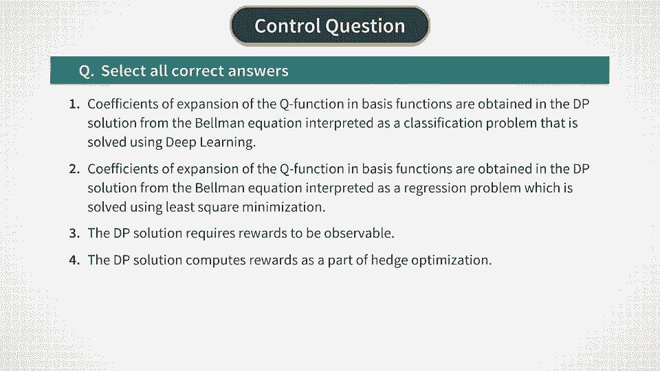

# 21：蒙特卡洛方法 - 最优 Q 函数 🎯

在本节课中，我们将学习如何利用蒙特卡洛方法和贝尔曼最优性方程，求解期权定价与对冲问题中的最优 Q 函数系数。我们将从回顾贝尔曼方程开始，逐步推导出求解系数的回归方法，并通过一个具体的例子来展示整个过程。

---

## 概述

上一节我们介绍了如何寻找最优动作的系数。本节中，我们将转向寻找最优 Q 函数的系数问题。为此，我们需要再次回顾贝尔曼最优性方程，并将其转化为一个回归问题，通过最小化损失函数来求解系数。

---

## 回顾贝尔曼最优性方程

为了找到最优 Q 函数的系数 ω_t，我们考虑贝尔曼最优性方程在最优动作 A_t^* 下的情况。

该方程可以解释为：最优 Q 函数 Q_t^* 是对即时奖励 R_t 与经过折扣的下一步最优 Q 函数 Q_{t+1}^* 之和进行回归。对等式两边取期望，可以验证这两种表述是等价的。

---

## 构建回归问题

为了将其用作回归以求解参数 ω_t，我们需要知道方程中的即时奖励 R_t。奖励的理论表达式由投资组合价值的增量给出：

**R_t = γ (π_{t+1} - π_t) - λ Var(π_t)**

其中，γ 是折扣因子，π_t 是投资组合价值，λ 是风险厌恶参数。如之前所见，奖励 R_t 也可以明确地写成时间 t 动作 A_t 的二次函数。

在反向递归过程中，一旦我们计算出最优动作 A_t^*，就可以将其代入奖励公式中，计算出对应的最优即时奖励 R_t^*。

---

## 定义回归的因变量与预测变量

现在，回归的因变量 Y_t 定义为：

**Y_t = R_t^* + γ Q_{t+1}^* (S_{t+1}, A_{t+1}^*)**

其中的预测变量，即右侧部分，是时间 t 的最优 Q 函数 Q_t^* (S_t, A_t^*)。通过将 Q_t^* 用基函数展开，系数 ω_t 便成为此回归中的待求参数。

---

## 求解回归系数

我们通过最小化平方损失函数 F_t 来寻找系数 ω_t：

**F_t(ω_t) = 𝔼[ (Y_t - Q_t^* (S_t, A_t^*; ω_t))^2 ]**

由于这是一个关于系数 ω_t 的二次函数，最小化过程可以通过半解析方法执行。

我们引入一个时间相关的矩阵 C_t（维度 m×m，元素为 C_{mn}）和一个向量 d_t（长度为 m，元素为 d_n）。回归问题中系数 ω_t 的解可以用向量形式表示为：

**ω_t = C_t^{-1} d_t**

在实际计算中，为了避免矩阵求逆可能出现的数值问题，通常加入一个小的正则化参数 ε：

**ω_t = (C_t + εI)^{-1} d_t**

这样就得到了每个时间步 t 下最优 Q 函数的系数。

---

## 计算流程总结

整个反向递归过程从到期时间 T-1 开始，回溯至初始时间 t=0。在每个时间步 t，我们依次执行以下操作：

以下是每个时间步的具体计算步骤：
1.  计算矩阵 A_t 和向量 B_t。
2.  求解系数 φ_t，确定最优动作 A_t^*。
3.  将 A_t^* 代入奖励公式，计算最优即时奖励 R_t^*。
4.  计算矩阵 C_t 和向量 d_t。
5.  求解系数 ω_t，并计算在最优动作下的最优 Q 函数值 Q_t^*。
6.  将计算出的 Q_t^* 作为下一步（t-1 时刻）反向递归的输入。

当递归进行到 t=0 时，最终得到的最优动作序列即为期权的最优对冲策略，而期权的最优价格由在初始状态和最优动作下评估的最优 Q 函数的负值给出：

**价格 = -Q_0^* (S_0, A_0^*)**

---

## 动态规划方法示例

我们来看一个使用动态规划方法为看跌期权定价的具体例子。

该例子中，看跌期权的初始股票价格 S_0 = $100，行权价 K = $100（平值期权）。其他参数设置为：风险厌恶系数 λ = 0.001，股票波动率 σ = 15%，期权期限 T = 1 年，股票漂移率 μ = 5%，无风险利率 r = 3%。

以下是模拟结果的可视化分析：
*   左上图：展示了蒙特卡洛模拟中股票价格的 10 条随机路径。
*   右上图：显示了对应的状态变量 X_t 的演变。正如预期，X_t 的路径没有明显的漂移。
*   中左图：显示了沿每条路径计算出的最优对冲动作 A_t^*。
*   中右图：显示了相应的复制投资组合的价值 π_t。
*   下左图：显示了通过执行最优动作所获得的即时奖励 R_t^*。
*   下右图：显示了最优 Q 函数 Q_t^* 的值。它在 t=0 时收敛到约 4.9，而作为基准的布莱克-斯科尔斯理论价格（黑色曲线）为 4.53。

通过调整风险厌恶系数 λ 和对冲频率，可以使蒙特卡洛动态规划得出的价格向理论价格收敛。这将是本周作业的一部分，需要你亲自实现这个动态规划方案。

---

## 总结

本节课中，我们一起学习了如何利用蒙特卡洛动态规划方法求解期权定价中的最优 Q 函数。我们回顾了贝尔曼方程，将其转化为回归问题，并详细推导了求解系数 ω_t 的步骤。最后，通过一个实例演示了整个方法的计算流程和结果。这个方法的核心在于通过两次线性回归（分别针对最优动作和最优Q函数）在反向递归中完成定价与对冲。下周，我们将探讨在不完全知晓模型参数（如 λ）的情况下，如何使用强化学习方法来实现类似的反向递归。