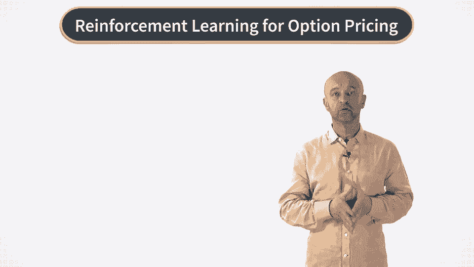

# 22：第三周内容介绍 🚀

在本节课中，我们将要学习强化学习（RL）方法在金融领域的应用，特别是如何从基于模型的动态规划转向数据驱动的、与模型无关的解决方案，以解决最优期权定价和对冲问题。

## 本周学习重点 📚

上一节课程我们主要探讨了基于模型的动态规划方法。本节中，我们来看看本周的核心内容。

本周课程将非常有趣。我们将离开基于模型的动态规划方法，转向数据驱动和与模型无关的方式来解决最优期权定价和对冲问题。

这里需要说明“与模型无关”的含义。尽管我们仍然会讨论一个模型，即马尔可夫决策过程（MDP），但在此语境下，“与模型无关”意味着在数据驱动的环境中，我们只保留模型的一般结构，而不假设其转移概率和奖励函数是已知的。

传统的定量金融范式认为，为了最优定价和对冲金融资产，必须首先构建并估算一个世界模型。强化学习范式则不同，它使我们能够直接关注主要目标——最优控制。根据所使用的具体算法，任务可能涉及也可能不涉及先构建世界模型的问题。本周讨论的方法让我们能够以“与模型无关”的方式进行操作。

## 主要内容概览 🗺️

以下是本周课程将涵盖的几个关键部分：

*   **批量模式强化学习**：我们将从这种方法开始学习。
*   **Q学习算法**：这是强化学习中最著名的算法之一，我们将介绍其基本版本。
*   **适应性-优化算法**：在介绍基本算法后，我们将讨论一个更实用的版本，称为适应性-优化算法（fit-of-cute-ration）。

所有这些内容不仅会以抽象的方式呈现，而且会直接在我们的马尔可夫几何过程（MGP）模型中展开讨论。在期权定价方面，我们将立即看到这些方法在金融环境中的应用。

在你本周的作业中，你将亲自实现这些解决方案，并观察它们在实践中的表现。

## 总结与展望 🎯

本节课中，我们一起学习了第三周课程的总体安排和核心思想。我们明确了将从基于模型的方法转向数据驱动的、与模型无关的强化学习方法，并预览了即将学习的批量模式RL、Q学习及其变体等关键算法。这些方法将直接应用于金融领域的期权定价与对冲问题，并通过实践作业加以巩固。