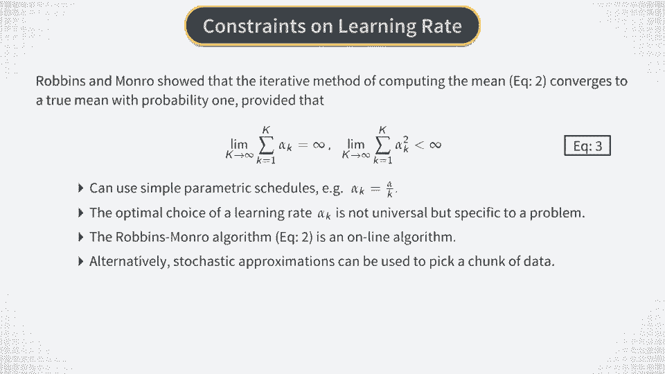

# 24：强化学习方法 - 随机逼近 🧠

在本节课中，我们将要学习强化学习中的一个核心算法——随机逼近，特别是罗宾斯-门罗算法。我们将探讨当环境模型未知时，如何利用在线交互数据来迭代地估计价值函数，并理解其收敛的关键条件。

在上一节中，我们讨论了批量强化学习的设置及其使用的数据类型。本节中，我们来看看当模型未知时，强化学习是如何通过样本数据在线工作的。

## 贝尔曼方程与期望值问题

我们处理的核心是贝尔曼最优性方程。该方程表明，在时间 `t` 的最优 `q` 函数等于即时奖励的期望值，加上折现后的下一步最优 `q` 函数的期望值。公式表示如下：

`q*(s_t, a_t) = E[ r_t + γ * max_{a_{t+1}} q*(s_{t+1}, a_{t+1}) | F_t ]`

这里的期望 `E` 是基于时间 `t` 的信息集 `F_t` 的条件期望。

如果模型已知，这个期望值可以通过求和（离散状态）或积分（连续状态）精确计算。然而，在模型未知的强化学习设置中，我们无法直接进行这种计算。

## 从理论期望到经验均值

面对模型未知的情况，统计学和机器学习中一个常见的技巧是：用经验均值来替代理论期望值。

这意味着，如果我们有多个样本，每个样本都能提供贝尔曼方程右侧的一个可能值，那么最优 `q` 函数的估计值就可以通过这些样本值的平均值来获得。这本质上是蒙特卡罗模拟的思想。

在我们之前的动态规划方法中，我们通过已知模型模拟路径来生成数据。而在强化学习中，我们使用的是与环境实时交互产生的实际历史数据（如股价和奖励），这些数据构成了我们的信息集 `F_T`。

## 在线学习与随机逼近

现在，考虑一种更动态的场景：在线强化学习。智能体与环境实时互动，数据量随时间不断增加。问题在于，我们能否仅依靠逐个到来的样本（而非固定数据集）来迭代地估计期望值？

答案是肯定的，这可以通过**随机逼近**方法实现。其中最著名的算法是**罗宾斯-门罗算法**。

## 罗宾斯-门罗算法详解

罗宾斯-门罗算法用于在线估计一个随机变量的均值。它不要求所有数据同时可用，而是随着每个新数据点的到来，迭代更新均值估计。

算法定义如下：设 `x_k` 为第 `k` 个观测到的数据点，`\hat{x}_k` 为第 `k` 步时的均值估计。更新规则为：

`\hat{x}_{k} = \hat{x}_{k-1} + \alpha_k (x_k - \hat{x}_{k-1})`

让我们解析这个公式中的各个部分：
*   `x_k`：第 `k` 个数据点。
*   `\hat{x}_{k-1}`：第 `k-1` 步时的均值估计（即之前的估计值）。
*   `\alpha_k`：第 `k` 步的**学习率**，是一个介于 0 和 1 之间的数。它控制着新观测值 `x_k` 对当前估计的影响程度。

学习率 `\alpha_k` 通常随迭代次数 `k` 变化。如果学习率较小，新数据对估计的更新幅度就小；如果学习率较大，更新幅度就大。

## 算法的收敛条件

关于这个简单的迭代更新规则，最重要的事实是：在特定条件下，估计值 `\hat{x}_k` 能以概率 1 收敛到真实均值。

这些条件由罗宾斯和门罗提出，具体如下：
1.  `∑_{k=1}^{∞} \alpha_k = ∞`
2.  `∑_{k=1}^{∞} \alpha_k^2 < ∞`

第一个条件确保学习率衰减得不能太快，以保证算法有足够的“动力”探索并最终收敛到真值。第二个条件确保学习率最终衰减得足够快，以平滑掉随机噪声，使估计稳定下来。

## 学习率调度

在实践中，我们需要为学习率 `\alpha_k` 选择一个具体的衰减方案，这通常被称为**学习率调度**。

以下是常见的选择：
*   **罗宾斯-门罗原始选择**：`\alpha_k = c / k`，其中 `c` 是一个正常数。
*   **更通用的分数衰减**：`\alpha_k = c / k^γ`，其中 `0.5 < γ ≤ 1`。

学习率的具体调度方案并非通用，它可能因问题和数据生成过程而异，在实际应用中通常需要一些实验来调整。

## 从在线到离线：小批量扩展

罗宾斯-门罗算法本质是一种在线算法，非常适合与环境实时交互的智能体。然而，通过适当的泛化，它也可以应用于离线（批量）设置。

在离线工作中，我们不是用单个数据点来更新，而是使用一块数据（称为**小批量**或 **mini-batch**）。使用小批量数据而非单个数据点，可以使参数更新更加稳定，因为它平滑了单个数据点带来的波动。这与我们在讨论随机梯度下降法时提到的使用小批量的优势是一致的。

---

本节课中，我们一起学习了随机逼近的核心思想以及罗宾斯-门罗算法。我们了解到，当模型未知时，可以通过在线数据迭代更新来估计价值函数。算法的成功依赖于恰当衰减的学习率。最后，我们还看到了如何将该算法从在线设置扩展到使用小批量的离线设置，以获得更稳定的更新。这是将理论强化学习算法应用于实际问题的关键一步。