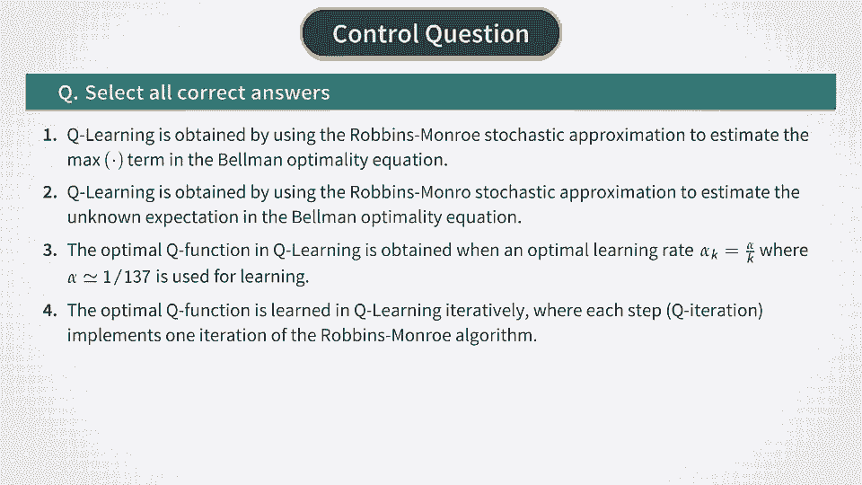

# 25：强化学习方法 - Q学习 🧠

在本节课中，我们将学习强化学习中最著名的算法之一——Q学习。我们将了解它的核心思想、工作原理、更新规则，并探讨其在实际应用中的特点与局限。

---

## 概述

Q学习是一种用于估计最优动作价值函数的算法，由Watkins于1989年在其博士论文中提出。它基于随机逼近理论，能够在离散状态和动作空间中，通过迭代更新逐步逼近真实的最优Q函数。本节课我们将深入探讨其原理、更新规则及特性。

---

## Q学习简介

在我们讨论了随机逼近法之后，现在来讨论著名的Q学习算法。这个算法是Watkins在1989年提出的，其论文被引用了超过一千次。Q学习及其扩展在许多强化学习应用中得到使用。例如，Google DeepMind曾使用Q学习教授智能体玩Atari电子游戏。

在Watkins提出的原始形式中，Q学习仅在离散状态和离散动作的情况下有效。此时，Q函数不是连续值，而是以离散表格形式表示，每个状态和动作的组合都有一个对应的Q值。

我们可以说，Q函数是以表格形式给出的。

---

## Q学习的核心观点

Watkins Q学习的主要观点是：给定足够的数据，并按照顺序处理所有数据点，该算法会像Robbins-Monro随机逼近法一样，随着数据量增大，逐渐收敛到真实的Q函数。

更具体地说，收敛证明假设每个可能的状态-动作组合都会在数据中遇到无限次。当然，实践中数据总是有限的，因此数值收敛性需要实际检验。

---

## Q学习的工作原理

Q学习具体做什么？它简单地采取下一个观察到的状态转移，并更新在此转移中观察到的状态-动作对的值。

以下是一个常用来说明Q学习工作原理的例子：解决迷宫问题。

**迷宫问题示例：**
*   一个简单的迷宫，包含一个障碍物（用黑色方块表示）。
*   右上角有一个出口。
*   智能体需要学习一个最优策略，根据其当前位置决定移动方向。
*   在每个单元格中，智能体可以向上、向下、向左、向右移动（四个自由度）。
*   某些动作可能被禁止（例如，左边有墙则不能向左移动）。

在这个问题中，有11种可能的单元格位置，每个单元格最多有4个可能的动作。这带来了44种可能的单元格-动作组合，这个数量相对较小，可以用查找表存储所有Q值。

在这样一个简单环境中，学习可以通过模拟完成。每次模拟生成一个特定的数据点（状态转移）后，就用它来更新对应的Q函数值。

---

## Q学习的更新规则

在我们讨论了Q学习的作用之后，接下来看看它是如何做到的。本质上，Q学习是Robbins-Monro随机逼近法在估计贝尔曼最优方程右侧未知期望值时的应用。

让我们将贝尔曼最优方程与Robbins-Monro更新进行比较。

*   在贝尔曼方程中，最优Q函数由右侧的期望值给出。
*   另一方面，Robbins-Monro公式展示了如何更新均值的运行估计。

因此，我们可以进行以下替代：
*   将当前观测值 `x_t` 替换为当前观测到的即时奖励 `R_t` 加上下一步最优Q函数的估计值。
*   将当前的均值估计 `x_t` 替换为我们对最优Q函数的当前估计。

如果我们为学习率 `alpha_k` 指定一个调度方案，这些替代将生成著名的Q学习更新规则。

**Q学习更新规则（公式）：**
`Q_{new}(S_t, A_t) = (1 - alpha) * Q(S_t, A_t) + alpha * [R_t + gamma * max_a Q(S_{t+1}, a)]`

用文字描述：在状态 `S_t` 和执行动作 `A_t` 处的Q函数值的新估计，等于其旧估计值乘以 `(1 - alpha)`，再加上 `alpha` 乘以贝尔曼最优方程右侧量的最新观测值（即时奖励加上下一状态的最大Q值折扣）。

---

## Q学习的特性

Q迭代规则揭示了Q学习的两个重要特性：它是**无模型**且**离策略**的算法。

*   **无模型**：这意味着它不对产生当前观测数据的过程（即环境模型）做任何假设。它只是将数据视为给定，并更新给定状态-动作对的Q值。
*   **离策略**：Q学习要奏效，唯一重要的是所有状态-动作对会被多次访问。至于它们被访问的原因（即遵循何种策略）并不重要。在极限情况下，如果所有状态-动作对被无限次访问，Q迭代保证渐近收敛到真正的最优值函数。

你可以在本周的阅读材料中了解更多关于Q学习算法的收敛性质。

---

## 经典Q学习的局限与批处理模式

考虑到我们在上一课中讨论的基于模型的动态规划解法，尽管经典的在线Q学习算法保证渐近收敛，但对于实际应用可能耗时过长。

其原因在于，最优解是通过所有蒙特卡罗路径的横截面信息获得的。然而，任何在线逐点更新Q值的方法都会掩盖这种横截面信息。

不过，解决办法是明确的：我们需要同时更新所有蒙特卡罗路径上的Q值，就像我们在上一节课计算最优解时做的那样。因为我们现在处于**批处理强化学习**的设置中，数据已经准备就绪，实际上不需要像传统Q学习中那样逐一获取数据点。

在下一节视频中，我们将看到如何调整经典Q学习以适应批处理模式的学习。

---

## 总结

本节课我们一起学习了Q学习算法。我们了解了它是基于随机逼近理论、用于在离散空间中估计最优动作价值函数的无模型、离策略算法。我们学习了其核心的迭代更新规则，并讨论了经典在线Q学习的局限性，引出了向批处理模式学习的必要性。