# 29：RL方法 - RL解决方案 - 讨论与示例 📊

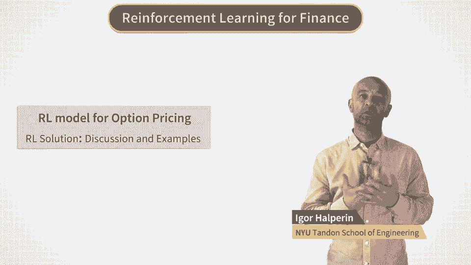

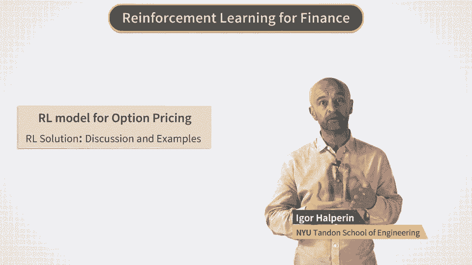

在本节课中，我们将总结并讨论将强化学习应用于期权定价和对冲的MGP模型。我们将从机器学习和金融建模两个角度进行回顾，并通过示例展示模型在策略和离策略学习中的表现。

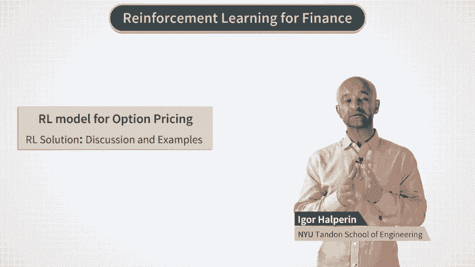

***

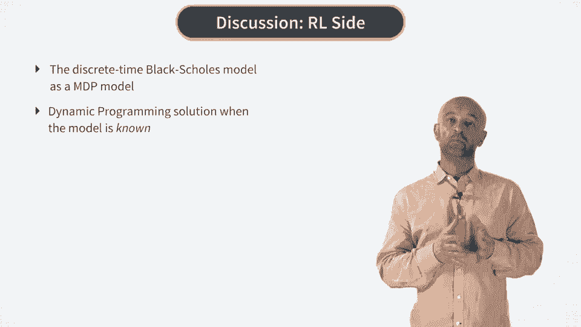

## 一、 机器学习视角总结 🤖

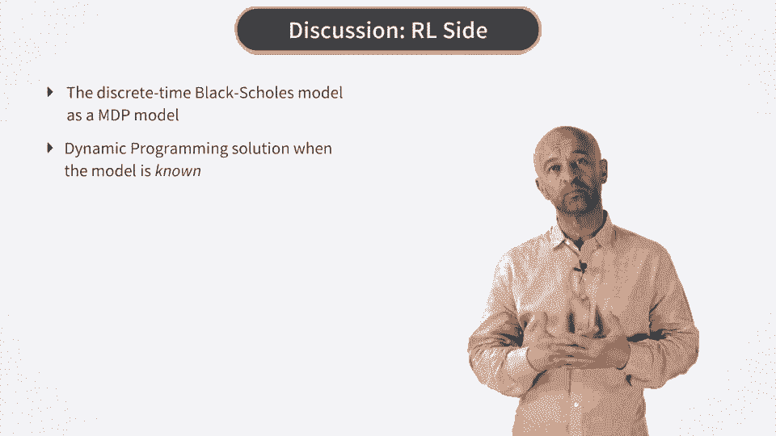

上一节我们介绍了MGP模型的基本框架。本节中，我们来看看如何从强化学习和机器学习的角度来理解它。

我们首先将离散时间的布莱克-斯科尔斯模型表述为一个马尔可夫决策过程。然后，我们为该模型提供了两种解决方案。

以下是两种主要的解决方案：

1.  **动态规划解决方案**：当模型动态已知时，我们可以应用此方法。我们在蒙特卡洛设置中实现了它，具体步骤是：
    *   首先模拟股票价格的路径。
    *   然后通过反向递归来解决最优控制问题。
    *   使用基函数展开来近似最优行动 `A*` 和最优Q函数 `Q*`。

    这种方法为我们提供了贝尔曼最优性方程的基准解。我们可以验证，当时间步长趋近于零且风险厌恶系数 `λ` 趋近于零时，此动态规划解能重现经典的布莱克-斯科尔斯模型结果。

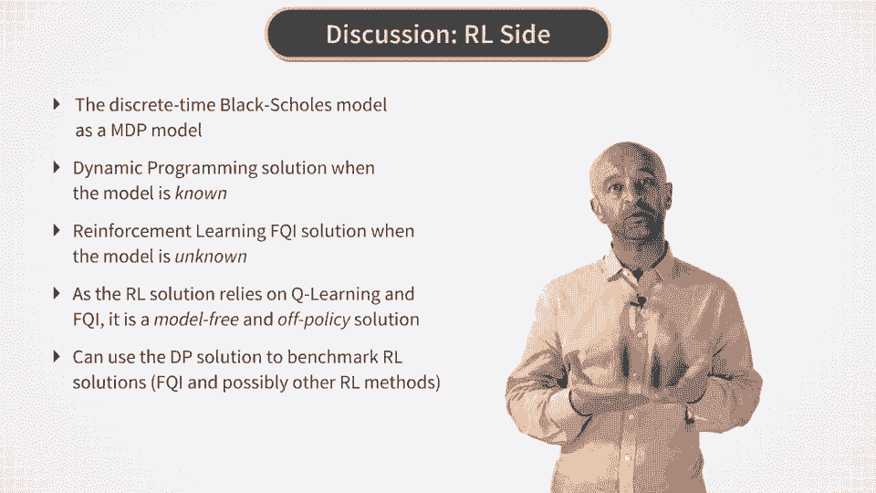

2.  **数据驱动的模型无关解决方案**：我们转向完全基于数据的方法来解决相同的MGP模型。该模型可以使用Q学习及其更实用的版本——**拟合Q迭代**——来求解。这意味着我们可以使用实际的股票价格和期权交易数据来训练模型。

    由于Q学习和拟合Q迭代是**离策略**方法，算法可以从非最优的行动记录数据中学习。MGP模型的一个关键优势在于，它既可以通过动态规划求解，也可以通过强化学习方法求解。因此，动态规划解可以作为基准，用于测试包括拟合Q迭代在内的各种强化学习算法。

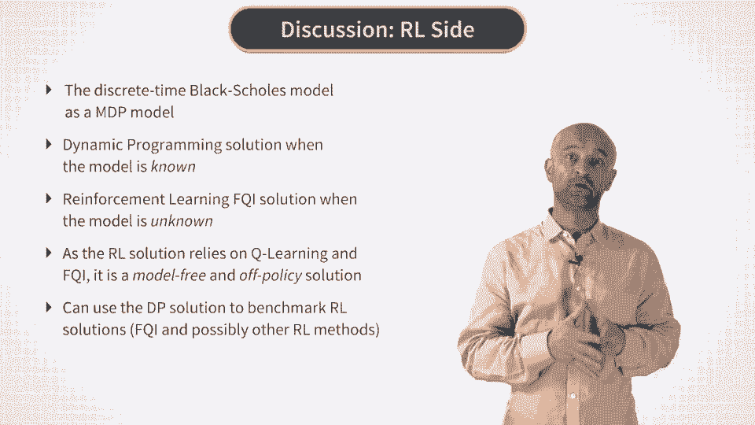

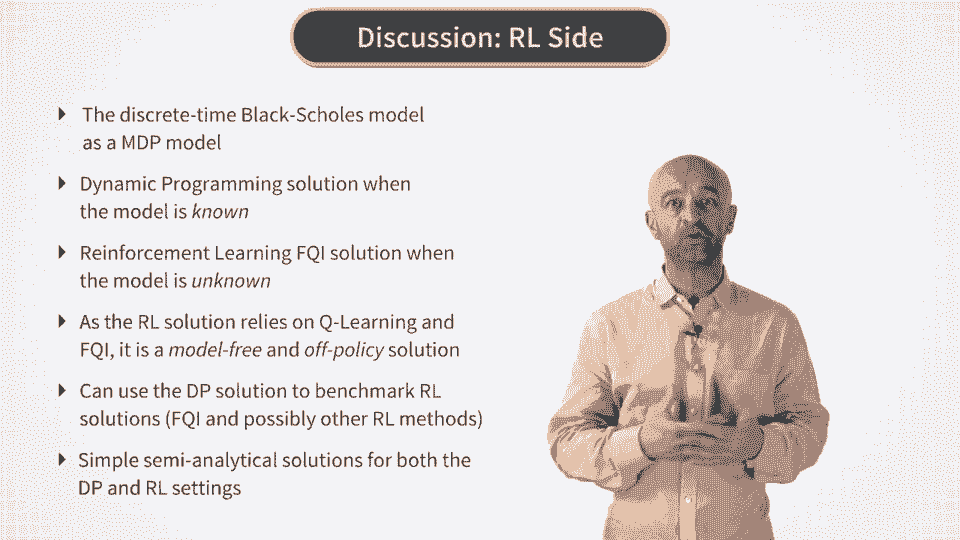

尽管目前我们仅考虑了单一股票模型，但该框架可以扩展以包含更复杂的动态。在这种更复杂的设定下，动态规划解决方案同样可以作为测试各种强化学习算法的基准。

关于强化学习和动态规划解法在该模型中的另一个优点是，它们都只涉及简单的线性代数运算。由于模型本身较为简单，两种解法都可以进行解析优化，从而保证较快的运行速度。

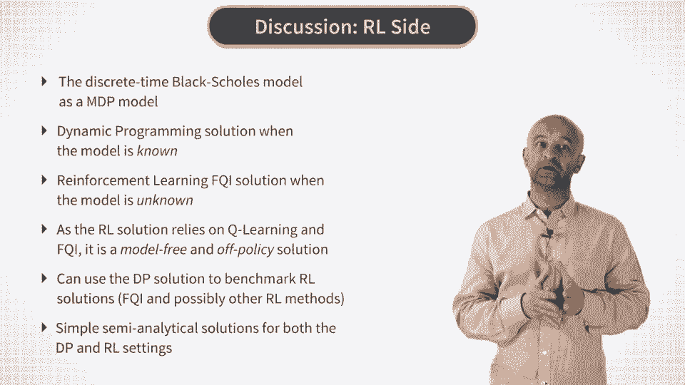

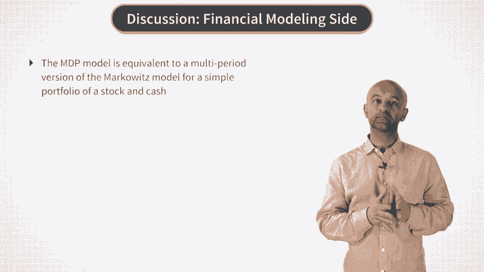

***

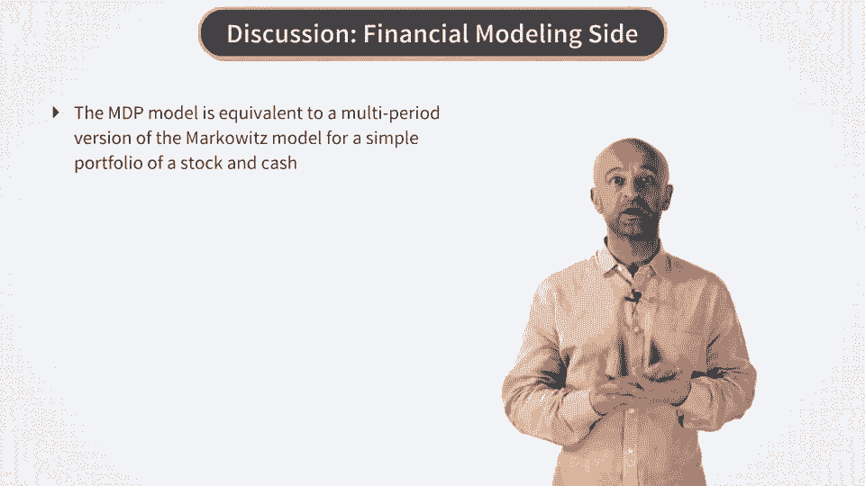

## 二、 金融建模视角总结 💹

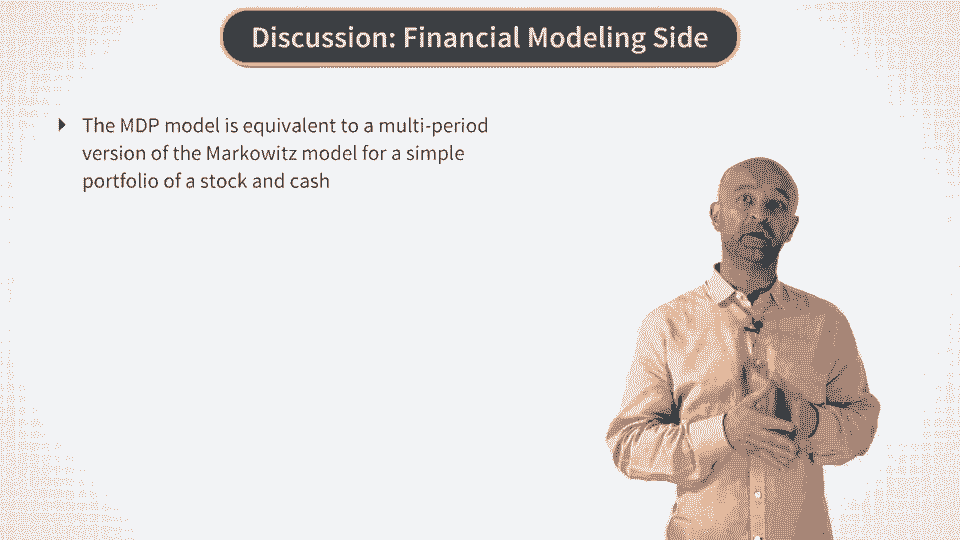

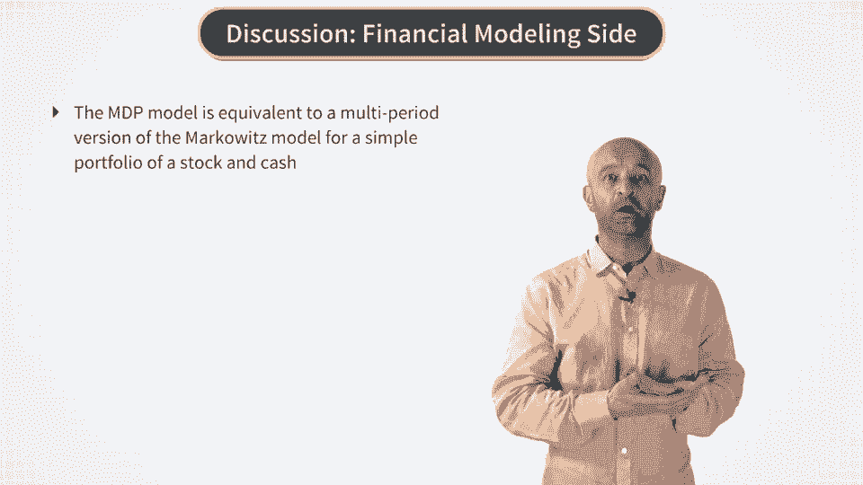

讨论完机器学习方面，现在我们来探讨MGP模型在金融建模方面的意义。

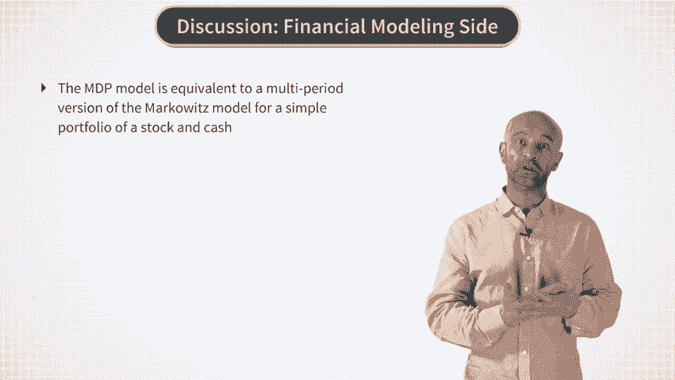

我们发现，著名的布莱克-斯科尔斯期权定价模型，可以理解为另一个著名模型——马科维茨投资组合理论——的连续时间极限，尽管它应用于一个非常特殊的环境。

在我们的MGP问题中，期权的最佳对冲和定价问题，等价于马科维茨理论的多期版本，其中投资组合仅包含一只股票和现金。该模型假设股票动态服从对数正态分布，与布莱克-斯科尔斯模型一致。

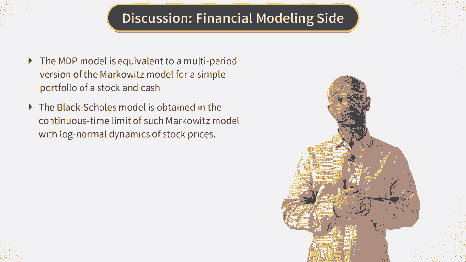

以下是该模型的核心金融见解：

*   如果构建一个投资组合，旨在在期权到期时匹配期权的收益，那么该期权的价格和对冲策略可以通过对此投资组合进行动态优化来计算，其原理类似于经典的马科维茨投资组合理论。
*   通过使期权的复制投资组合达到马科维茨最优，并在时间步长趋于零、风险厌恶系数 `λ` 趋于零的极限下，我们重现了布莱克-斯科尔斯模型。

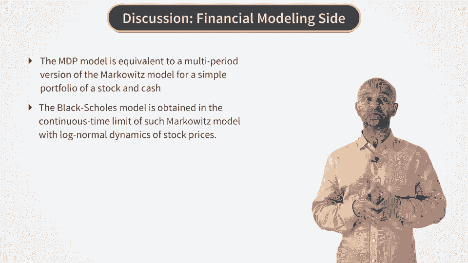

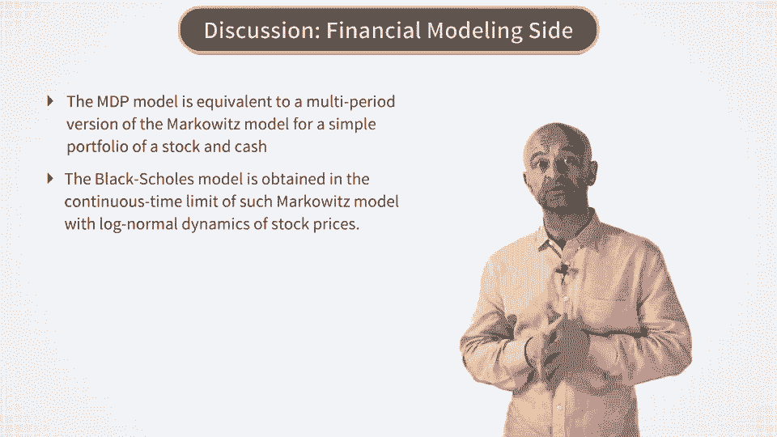

然而，当前的MGP模型不仅仅是在极限下重现布莱克-斯科尔斯模型。它做得更多：

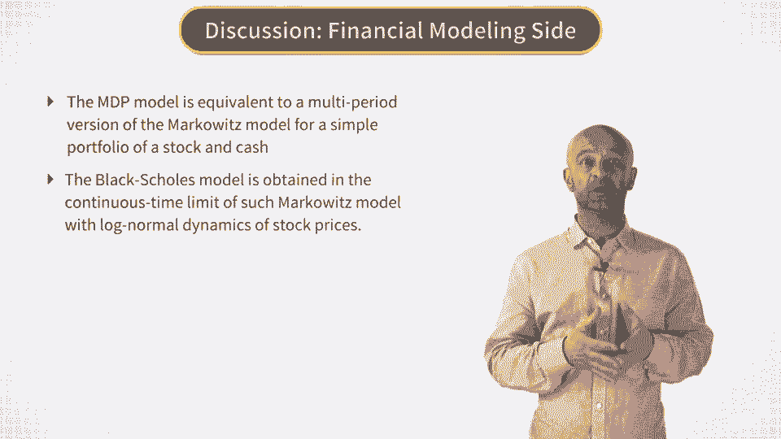

1.  **定价与对冲的一致性**：MGP模型不仅生成期权价格，还同时给出最优对冲策略。在传统的数学金融模型（如布莱克-斯科尔斯模型或各种随机波动率模型）中，主要关注的是所谓的“公平”或“风险中性”价格，而对冲误差被视为二阶效应。但在现实中，对冲风险（二阶效应）可能与价格（一阶效应）同等重要。MGP模型以一种与模型无关、数据驱动的方式捕捉了这种风险。更重要的是，定价和对冲都源自同一目标函数的最大化，保证了结果的一致性。
2.  **模型无关性**：我们的方法无需事先构建和校准复杂的股票动态模型，而这正是传统数学金融模型的主要挑战之一。这使得方法更加灵活和实用。

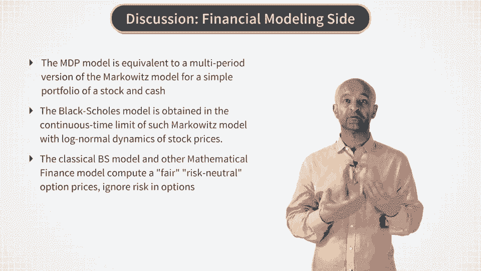

***

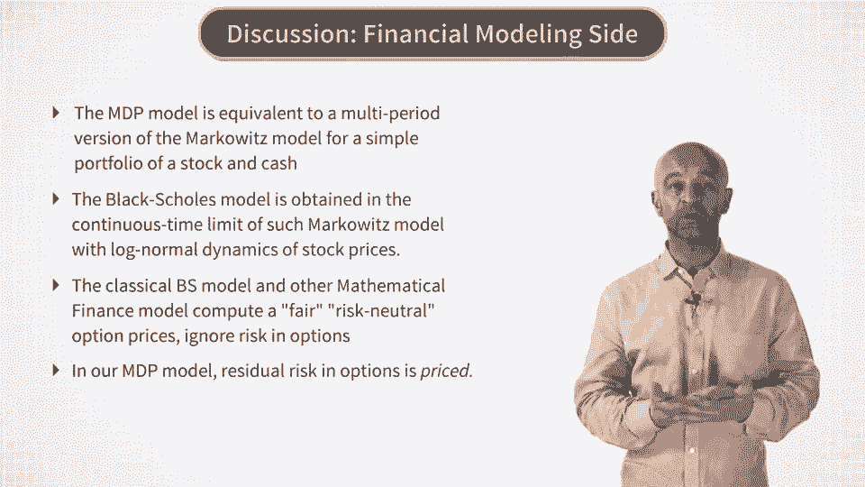

## 三、 模型示例与实验 🧪

现在让我们总结MGP期权定价模型，并查看一些实验示例。

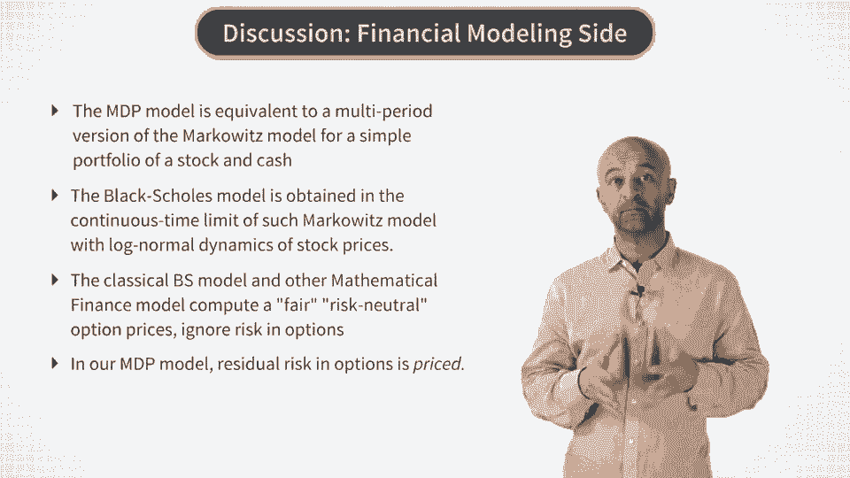

在第一组实验中，我们测试了拟合Q迭代在**在策略**设置中的表现。我们直接使用通过动态规划获得的最优对冲和Q值作为拟合的目标。

实验结果显示，在策略学习下，算法学习到的最优Q函数 `Q_T*` 和最优行动 `A*` 与动态规划基准几乎完全一致。例如，在给定参数下，期权价格计算为 `4.90 ± 0.12`，与动态规划结果相同。通过减小风险厌恶系数 `λ`，该价格可以恢复至布莱克-斯科尔斯价格 `4.53`。

接下来，我们测试拟合Q迭代在**离策略**学习中的表现。

为了生成离策略数据，我们将通过动态规划计算出的最优对冲策略 `A_DP`，乘以一个在 `[1-η, 1+η]` 区间内均匀分布的随机数，其中参数 `η` 用于控制数据的噪声水平。

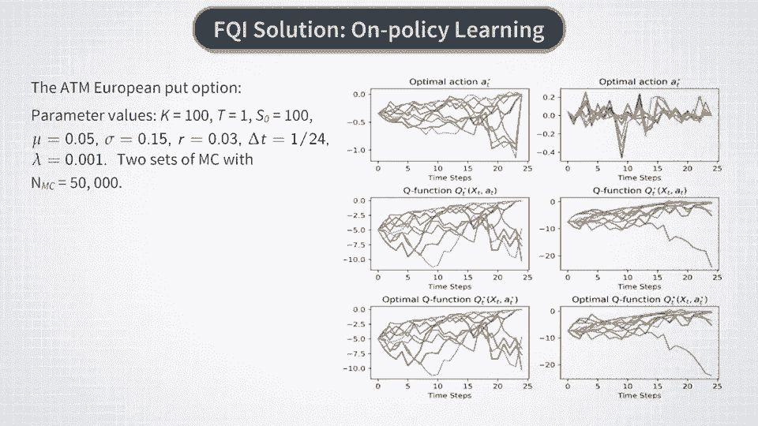

以下是我们在实验中测试的 `η` 值：
*   `η = 0.15`
*   `η = 0.25`
*   `η = 0.35`
*   `η = 0.50`

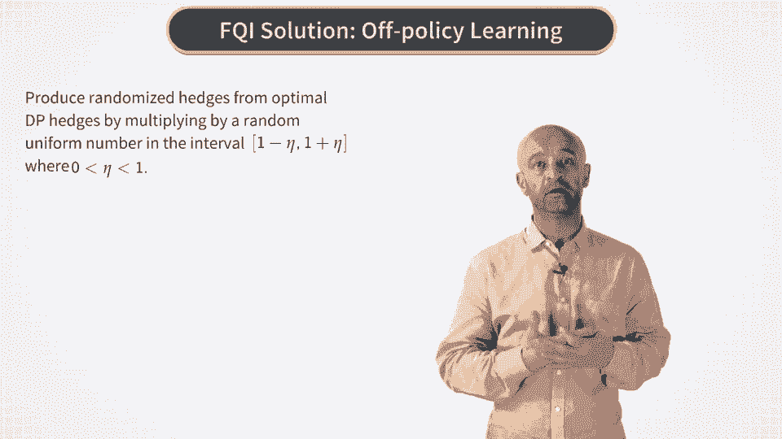

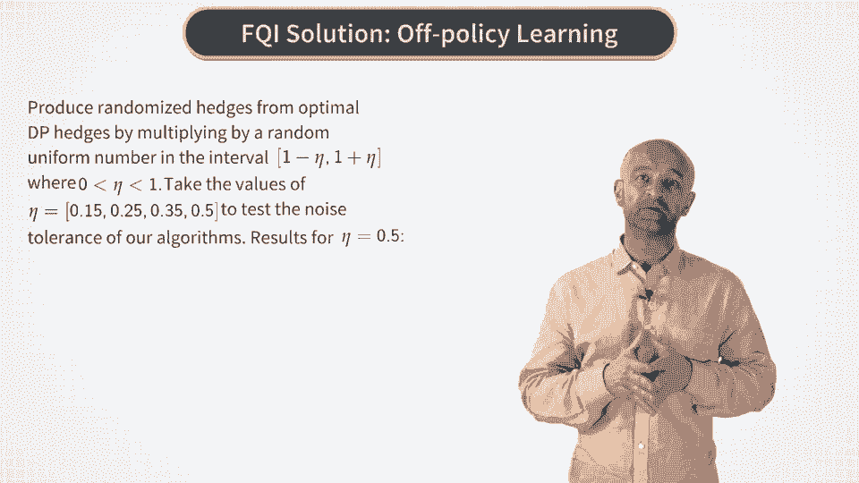

实验旨在测试算法对噪声的容忍度。结果显示，即使数据中包含次优行动，只要噪声水平适中（`η` 值不过大），拟合Q迭代仍能较好地学习。这是因为拟合Q迭代本质上是离策略算法，当数据集足够大时，它甚至能够从纯随机动作的数据中学习到接近最优的策略。这尤其证明了其作为无模型方法的有效性。

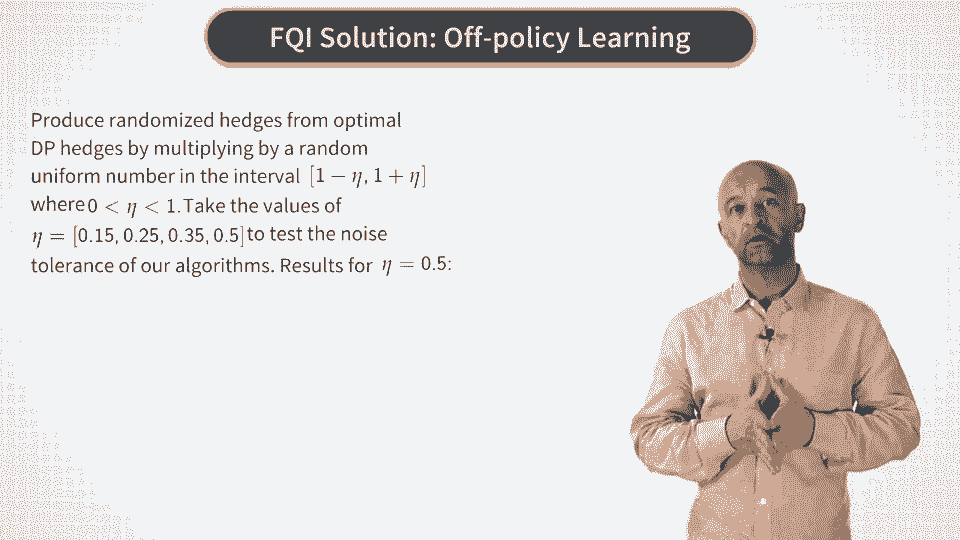

***

## 总结 📝

本节课中，我们一起学习了：
1.  从机器学习视角，MGP模型可以通过动态规划（模型已知时）和强化学习（如拟合Q迭代，数据驱动时）两种方式求解，且前者可为后者提供基准。
2.  从金融视角，MGP模型将期权定价与对冲统一到马科维茨投资组合优化框架下，在极限情况下重现布莱克-斯科尔斯模型，同时以一致且模型无关的方式处理了对冲风险。
3.  通过实验示例，我们验证了拟合Q迭代算法在MGP模型中，无论在策略还是离策略设置下，都能有效学习到接近最优的定价和对冲策略。

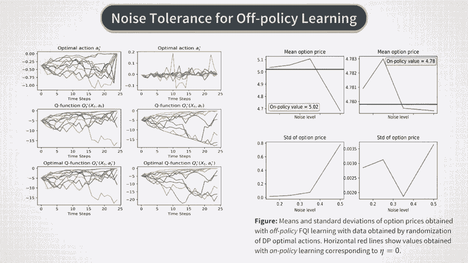

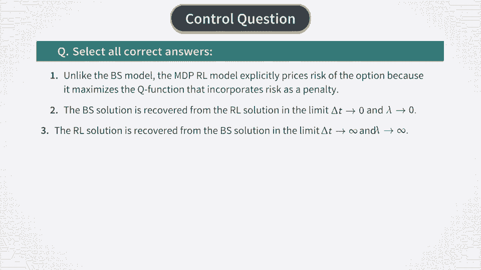

这就结束了我们课程的第三周内容。在你们的作业中，将需要动手实现拟合Q迭代算法，并评估其在离策略和在策略设置下的性能。祝你们在这项工作中好运，我们下周再见。