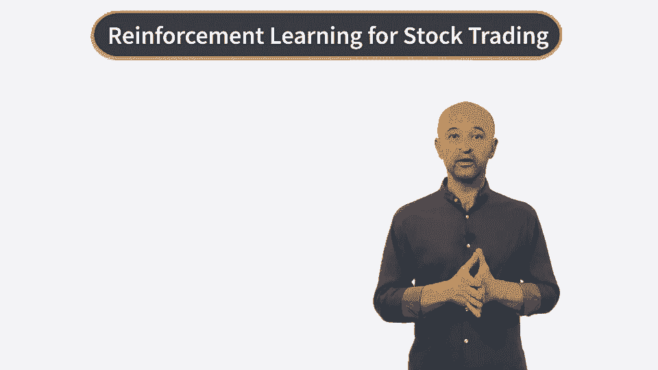

# 30：股票交易的强化学习 - 第四周 📈

在本节课中，我们将学习如何将强化学习应用于股票交易领域。我们将探讨量化交易中的核心问题，并学习如何构建模型来寻找最优的交易或执行策略。

上一周，我们学习了如何将期权定价和对冲问题构建为强化学习模型。本节中，我们来看看强化学习在股票交易中的具体应用。

## 🎯 本周学习目标

以下是本周课程将要涵盖的核心内容：

*   **问题定义**：讨论量化交易中可归结为强化学习任务的各种问题。
*   **模型构建**：开发一个简单的投资组合模型，为不同问题提供统一的建模框架。
*   **解决方案**：介绍使用强化学习方法，直接从数据中学习最优策略。
*   **进阶应用**：探讨逆强化学习在无法直接观察奖励场景下的应用及其优势。
*   **市场层面分析**：将模型扩展至整个市场，展示如何学习市场的最优交易策略。

## 🔄 从直接学习到逆向学习

在直接强化学习中，智能体通过与环境交互，根据观察到的**状态 (State)**、采取的**动作 (Action)** 和获得的**奖励 (Reward)** 来学习策略。其目标是最大化累积奖励，公式可表示为：

`Maximize E[Σ γ^t * R_t]`

其中，`R_t` 是时间 `t` 的奖励，`γ` 是折扣因子。

然而，在许多实际金融问题中，我们无法直接观察到明确的奖励信号。这时，逆强化学习方法就显得更为有用。它试图从专家（如成功投资者）的行为中逆向推导出隐含的奖励函数（即效用函数）。

## 💡 核心概念与总结

本节课中，我们一起学习了强化学习在股票交易中的应用框架。我们从定义问题开始，建立了统一的投资组合模型，并介绍了直接通过数据学习策略的强化学习方法。接着，我们探讨了在奖励函数未知时更为强大的逆强化学习方法，并展示了如何用它来学习投资者或市场的效用函数。

本周内容不仅是本课程的收官之章，也为后续更深入的金融强化学习应用课程奠定了基础。希望你能通过这些知识，对智能交易策略的学习有更清晰的认识。