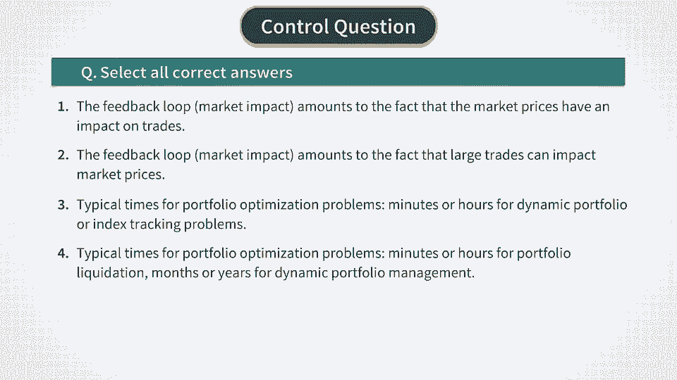

# 31：股票交易的强化学习 📈

## 概述
在本节课中，我们将学习如何将强化学习应用于股票交易领域。我们将从回顾上一节关于期权定价的内容开始，然后探讨股票交易问题的特点、常见任务类型，并分析其与期权定价问题的核心区别。

## 从期权定价到股票交易
上一节我们介绍了如何使用强化学习进行期权定价和对冲。我们建立了一个简单且可分析的模型，解决了单一欧式看跌期权的定价问题。

本节中，我们来看看强化学习如何应用于更广泛的股票交易问题。你可能会问，为什么先讨论期权再讨论股票交易？原因是期权定价是金融领域中最简单的强化学习设置之一，它本身具有实际意义，并且能帮助我们理解基础概念。接下来我们将看到，股票交易中的应用在技术上更为复杂。

## 期权定价模型回顾
首先，我们简要总结在期权方面的工作。我们发现，通过经典的Black-Scholes期权复制理论，股票期权的定价等价于对一个非常简单的**股票和现金组合**进行动态优化。

在这个问题中，目标是最优地动态复制期权。我们进一步发现，如果我们将该组合的风险调整后收益视为强化学习中的一步奖励函数，就可以应用标准的风险中性Q学习算法，该算法只优化预期奖励而不控制方差。

在我们的案例中，这样做是可行的，因为风险惩罚已经包含在风险调整后的预期奖励中。另一个重要观察是，只有当风险厌恶参数 **λ ≠ 0** 时，奖励函数才是二次的。此外，我们是从小型投资者的视角看待问题，因此假设交易行为不会影响市场，并且为了简化，我们忽略了交易成本。

这个简单模型易于解决，主要基于两个简化假设：
1.  无交易成本，因此我们无需将当前股票持仓作为状态变量存储。
2.  忽略市场影响，这使得问题保持线性。

这两个假设使得使用Q学习解决期权定价和对冲问题相对容易。

## 股票交易问题的挑战
现在，让我们看看当我们将目光转向与股票交易相关的投资组合任务时，情况发生了哪些变化。

一般来说，大多数股票交易中的实际问题都可以视为**股票投资组合优化问题**。以下是此类问题的一些关键特征，它们与期权定价案例有显著不同：
1.  **状态变量**：现在我们需要将**股票仓位**作为状态变量的一部分。
2.  **市场影响**：通常需要考虑交易行为对股票价格产生的**反馈回路**影响。
3.  **高维性**：许多问题在状态和动作空间上都具有高维性，即使是单一股票问题。
4.  **大数据**：这些问题通常与大数据相关，例如大额订单数据或高频交易数据。

由于状态空间维度可能高达几十、几百甚至几千维，传统的基于状态空间离散化的动态规划方法不再适用。这促使我们使用强化学习等更适合处理高维连续空间的方法。

## 股票交易中的常见任务
以下是股票交易中几类典型的强化学习任务，我们将逐一简要介绍。

### 1. 最佳执行
这个问题描述如下：我们持有大量（例如N股）某公司股票，需要在特定时间T内（通常是分钟级别）全部卖出。经纪人每天需要解决数千次此类问题。

从数学上讲，这相当于一个带有反馈回路（市场影响）的动态优化问题。经纪人会将大额订单拆分成较小的块逐步交易，以最小化市场冲击。问题复杂性在于，交易中可能涉及**市价单**（以当前市价成交）和**限价单**（以指定价格成交，但不保证成交）。

### 2. 最佳投资组合清算
这个问题与最佳执行非常相似，区别在于起始状态是一个**由不同股票构成的投资组合**，而不仅仅是单一股票。其规划周期可能稍长，例如几小时或几天。

### 3. 动态投资组合优化
这本质上是上一个问题的反向问题：目标不是清算一个现有投资组合，而是**动态构建一个最优投资组合**。其目标函数同样是风险与成本调整后的投资组合回报。

主要区别在于定量层面：这类任务的规划周期更长，可能延伸至几周、几个月甚至几年，因此需要考虑更多预测变量，如宏观经济因素。

### 4. 最佳指数跟踪
此类任务的目标是使用一个由较少数量（N只）股票构成的代理投资组合，来跟踪一个市场指数（如S&P 500）。时间跨度可以是几周、几个月，也可以是较短的日内周期。

交易所交易基金（ETF）就是为此目的设计的工具，它提供了一个高流动性的、旨在紧密跟踪某个指数的投资组合。数学公式与前述问题相似，主要区别在于终止条件的设计。

## 总结与后续计划
本节课中，我们一起学习了强化学习在股票交易中的应用概览。我们回顾了期权定价的基础模型，探讨了股票交易问题的新挑战（如高维状态、市场影响），并介绍了几类核心任务：最佳执行、投资组合清算、动态优化和指数跟踪。

基于以上分析，我们后续的计划如下：
1.  所有这些问题都可表述为**最优控制问题**，适合用强化学习方法求解。
2.  由于问题具有**高维性**，我们将直接使用连续的数学模型，而非离散化状态或动作空间。
3.  我们将尝试建立一个**简单但通用的数学公式**，使其能够涵盖上述所有问题，并在特定上下文中保持分析上的可处理性。

在下一个视频中，我们将深入探讨这些问题的具体数学模型和解决方法。

---
感谢观看。