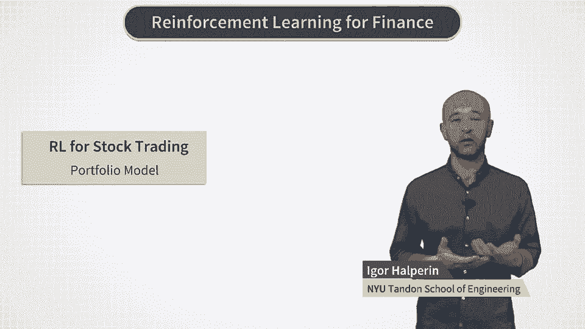
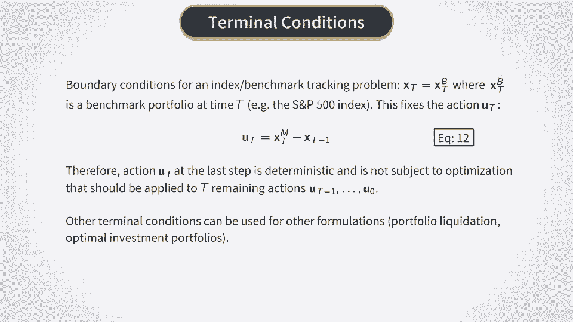
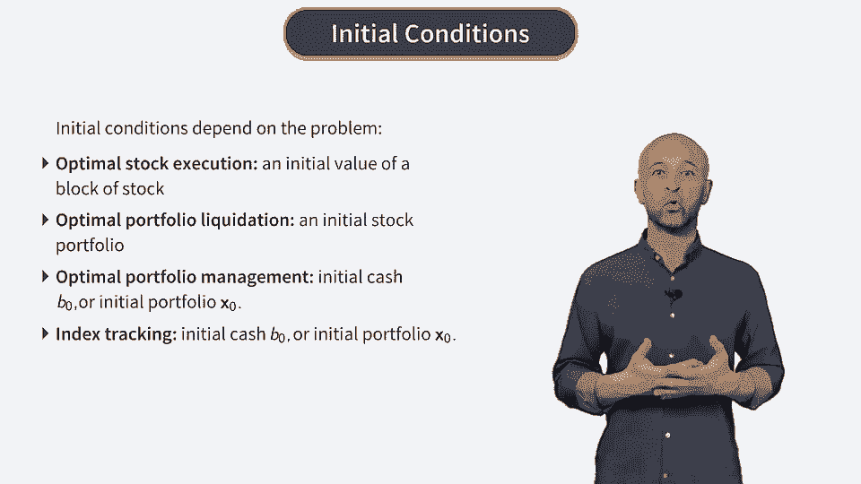
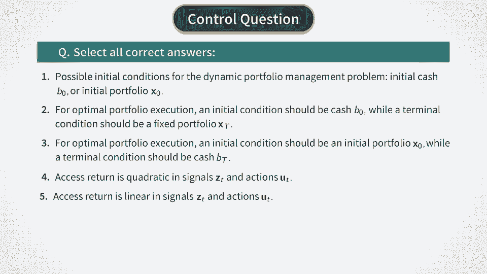

# 32：RL股票交易 - 投资组合模型 📊

在本节课中，我们将学习如何构建一个用于强化学习的简单股票投资组合模型。我们将定义模型的核心组成部分，包括资产、头寸、操作以及投资组合价值的动态变化过程。

## 模型概述

我们假设一个由N只股票或其他资产（如ETF）组成的投资宇宙。在时间T，资产的价格向量表示为 **P_T**，它是一个大小为N且所有元素均为正值的向量。投资者可以投资这些股票，同时也可以将财富以无风险利率 **R_F** 存放在现金账户中，现金金额记为 **B_T**。

## 头寸与操作

一个向量 **X_T** 用于描述所有资产中的美元头寸，其大小同样为N。**X_T** 的正分量表示股票的多头头寸，负分量则表示空头头寸。具体持有的股票数量可以通过将 **X_T** 的各分量除以市场价格 **P_T** 并四舍五入得到。

向量 **U_T** 描述在时间步T开始时执行的操作。操作完成后，头寸的新值 **X_T^+** 是即时确定的，它等于当前头寸与操作向量的和：
**X_T^+ = X_T + U_T**

## 投资组合价值

投资组合在时间T的总价值 **V_T** 是所有资产头寸的总和加上现金金额。我们可以用1向量（所有元素为1）与 **X_T** 的点积来表示总和：
**V_T = 1^T · X_T + B_T**  (公式 2)

如果将操作后的头寸 **X_T^+** 和现金 **B_T^+** 代入，可以得到操作后的投资组合价值 **V_T^+**：
**V_T^+ = 1^T · X_T^+ + B_T^+**  (公式 3)

## 自融资条件与交易成本

我们假设投资组合是自融资的，即所有股票头寸的变化只能通过现金头寸来融资，投资组合的总价值不能仅通过现金与股票间的重新分配而瞬间改变。其价值变化仅源于资产的随机回报。自融资条件表示为：
**1^T · U_T + (B_T^+ - B_T) = 0**  (公式 4)

目前我们暂不考虑交易成本，但可以在后续加入。

## 投资组合的动态变化

投资组合的变化过程如下：在时间间隔开始时进行一次再平衡操作，然后进入持有期，直到间隔结束。

我们定义资产在持有期内的回报 **R_T** 为：
**R_T = (P_{T+1} - P_T) / P_T**  (公式 6)

下一个周期开始时的头寸 **X_{T+1}** 与当前周期结束时的头寸相同，其计算涉及元素级乘法（Hadamard积）：
**X_{T+1} = X_T^+ ◦ (1 + R_T)**  (公式 7)

## 资产回报模型

我们需要为回报向量 **R_T** 指定一个模型。这里我们使用一个简单的参数化模型：
**R_T - R_F · 1 = W_T · Z_T + M_T · U_T + ε_T**  (公式 8)

其中：
*   **Z_T** 是预测因子向量。
*   **W_T** 是预测因子的权重矩阵。
*   **M_T** 是交易的市场影响矩阵。
*   **ε_T** 是均值为0、协方差为 **Σ_T** 的残差向量。

## 投资组合价值演进

利用以上关系，我们可以计算时间T+1的投资组合价值 **V_{T+1}**：
**V_{T+1} = 1^T · [X_T^+ ◦ (1 + R_T)] + B_T^+**  (公式 10)

进而，我们可以计算投资组合价值超出无风险增长部分的变化 **ΔV_{T+1}**：
**ΔV_{T+1} = V_{T+1} - (1 + R_F) V_T = (X_T^+)^T · (R_T - R_F · 1)**  (公式 11)

## 终端条件

上述关系适用于除最后一个时间步外的所有时间步。对于最终时间步T，我们需要施加适当的终端条件。

例如，在处理指数跟踪或基准匹配问题时，终端头寸 **X_T** 应与给定的基准投资组合 **X_B**（如标普500投资组合）匹配。这可以用来确定最终操作 **U_T**：
**U_T = X_B - X_T**  (公式 12)
由于最终操作是确定性的，它可以从操作优化问题中移除，我们只需优化剩余的操作 **U_0** 到 **U_{T-1}**。

对于其他情况，可以设定不同的终端条件。例如，在最优投资组合或最优清算问题中，可以对 **X_T** 施加零终端条件，意味着所有股票头寸在T时刻被转换为现金价值。

## 初始条件

问题的初始条件取决于具体的应用场景：
*   **最优股票执行**：初始条件是待卖出股票的初始美元价值。
*   **投资组合清算**：初始条件由给定的初始投资组合 **X_0** 定义。
*   **最优投资组合管理**：初始条件可以是全现金头寸 **B_0**，或一个给定的初始投资组合 **X_0**。
*   **指数/基准跟踪**：初始条件同样可设为全现金或给定的初始投资组合 **X_0**。

---

本节课中，我们一起学习了构建强化学习股票交易投资组合模型的核心框架。我们定义了资产、头寸、操作以及自融资条件，并描述了投资组合价值随资产回报变化的动态过程。同时，我们探讨了适用于不同场景（如指数跟踪、最优清算）的终端条件和初始条件，为后续应用强化学习算法解决具体交易问题奠定了基础。