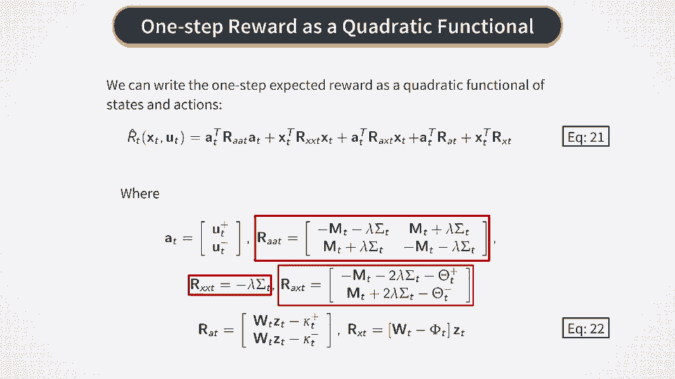

# 33：股票交易的强化学习 - 一期奖励 🧮

在本节课中，我们将学习如何为股票交易强化学习模型定义一期奖励。一期奖励是智能体在采取一个交易动作后获得的即时回报，它综合考虑了交易收益、风险惩罚和交易成本。

上一节我们介绍了投资组合的动态变化模型，本节中我们来看看如何计算执行交易动作后获得的即时奖励。

## 瞬时随机奖励

通过将投资组合变化公式代入，可以得到采取行动后获得的瞬时随机奖励，其公式如下：

**公式 13：**
`R_t^0 = u_t^T (μ_t + σ_t ε_t) - (1/2) u_t^T Γ_t u_t`

该公式是二次方程，因为市场影响项与度量 `M_t` 成正比。奖励是有风险的，因为它依赖于噪声项 `ε_t`。

## 风险惩罚

我们将增加风险惩罚来补偿这种风险。风险惩罚是因承担交易风险而获得的负奖励。我们假设风险惩罚与瞬时奖励 `R_t^0` 的条件方差成比例。

**公式 14：**
`风险惩罚 = -λ * Var[R_t^0 | X_t, u_t]`

其中，`λ` 是风险厌恶参数。计算该方差后，可得到最终表达式。该表达式是 `X_t` 加 `u_t` 的二次函数。由于噪声的协方差矩阵是非负定的，整个表达式是非正定二次型。

## 交易成本

一步奖励中需要包含的下一个元素是费用惩罚或交易成本。交易成本取决于 `u_t` 的符号，因为交易者以买入价买入，以卖出价卖出。

以下是处理买卖不同成本的方法：
我们将每个 `u_t` 分解为两个非负值的差值，即 `u_t^+` 和 `u_t^-`。然后：
- `u_t = u_t^+ - u_t^-`
- `|u_t| = u_t^+ + u_t^-`

通过这些定义，可以指定交易成本公式：

**公式 17：**
`交易成本 = -κ^+ * u_t^+ - κ^- * u_t^-`

其中，`κ^+` 和 `κ^-` 是买卖订单的不同交易成本参数。

## 市场输入缺陷

我们假设市场输入与所有股票的总头寸成比例。它包含以下几项：
- 两项与订单大小 `u_t` 成正比，系数分别为 `θ^+` 和 `θ^-`。
- 一项依赖于信号 `f_t`，权重由矩阵 `Φ` 给出。

## 总一期奖励

最后，我们将所有这些贡献汇总，定义总的一步奖励为它们的和。

**公式 18：**
`R_t = R_t^0 + 风险惩罚 + 交易成本 + 市场输入缺陷`

请注意，这是一个随机奖励，因为第一项 `R_t^0` 依赖于噪声 `ε_t`。对于给定的 `X_t` 和 `u_t` 值，剩余项是非随机的。

## 期望一期奖励

当我们给定动作 `u_t` 时，可以定义期望的一步奖励，即公式18给出的表达式的期望值。

**公式 19：**
`\hat{R}_t = E[R_t | X_t, u_t]`

其中，`\hat{R}_t^0` 是瞬时奖励 `R_t^0` 在给定状态和动作下的期望值。

**公式 20：**
`\hat{R}_t^0 = u_t^T μ_t - (1/2) u_t^T Γ_t u_t`

## 简化表达式

我们可以简化这个表达式，并将其转换为更简洁的形式。使用向量表示法，引入一个大小为 `2m` 的向量 `a_t`，它通过将 `u_t^+` 和 `u_t^-` 的分量堆叠在一起来构造。

然后，一步奖励的整个表达式可以表示为 `X_t` 和 `a_t` 的二次泛函。

**公式 21：**
`\hat{R}_t = a_t^T A_{aa} a_t + X_t^T A_{xx} X_t + a_t^T A_{ax} X_t + B_a^T a_t + B_x^T X_t`

我们在这里有三个二阶项和两个一阶项，分别与 `X_t` 和 `a_t` 成正比。这里没有常数项，因为如果没有采取行动 `a_t` 或没有头寸 `X_t`，就没有奖励。

请注意，矩阵 `A_{aa}`, `A_{xx}`, `A_{ax}` 都依赖于风险厌恶系数 `λ`，以及市场输入矩阵 `M` 和系数 `θ`。如果它们都为零，那么一步奖励就变成了线性泛函，而不是二次泛函。

---

本节课中我们一起学习了如何构建股票交易强化学习模型中的一期奖励函数。我们推导了包含瞬时收益、风险惩罚、交易成本和市场影响的随机奖励公式，并最终将其简化为状态和动作的二次期望奖励形式，为后续求解最优交易策略奠定了基础。