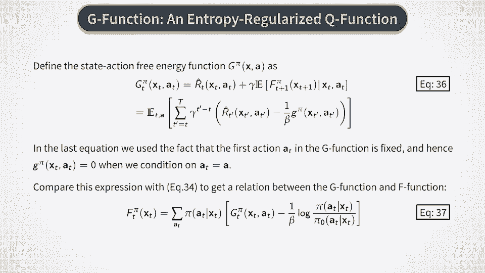

# 36：股票交易的强化学习 - 熵正则化强化学习 📈🧠

在本节课中，我们将深入探讨强化学习中的一个高级概念——熵正则化。我们将从回顾标准的贝尔曼方程开始，逐步引入信息成本、KL散度等概念，并最终推导出熵正则化后的价值函数（自由能函数）及其贝尔曼方程。内容涉及一些数学公式，但我们会力求解释清晰，让初学者也能跟上思路。

## 概述与背景回顾

上一节我们介绍了强化学习中的基本价值函数和贝尔曼方程。本节中，我们来看看如何通过引入“熵正则化”来改进这些方程，使其在处理有噪声的环境（如金融市场）时更加鲁棒。

首先，让我们回顾一下最优价值函数 **V*** 的标准贝尔曼最优性方程。它定义为在所有策略 **π** 下，期望折现未来奖励的最大值，如公式所示：

**V\*(s) = max\_a [ R(s, a) + γ E[ V\*(s') | s, a ] ]**

这个方程的第二项是在给定当前状态和动作下，对未来价值函数的期望。最优策略 **π*** 可以通过解决另一个优化问题（策略改进步骤）从 **V*** 中推导出来。

## 显式引入策略：费恩索尔表示

为了使策略 **π** 在方程中显式出现，我们使用一个称为“费恩索尔表示”的技巧。新公式如下：

**V\*(s) = max\_{π ∈ P} E\_{a∼π(·|s)} [ R(s, a) + γ E[ V\*(s') | s, a ] ]**

这里，我们改为对策略分布 **π** 进行最大化，而非直接对动作 **a**。集合 **P** 是所有有效策略分布的集合。

这个公式与原始公式等价的原因在于一个简单的恒等式：一组数字 **{x\_i}** 的最大值，等于所有可能权重分布 **π** 与 **x\_i** 点积的最大值。最优的权重分布会给具有最大值的 **x\_i** 赋予权重1，其余赋0。

## 引入信息成本与KL散度

现在，我们迈出关键的一步：引入从某个参考策略 **π₀** 更新到新策略 **π** 所产生的“信息成本”。该成本由以下公式定义：

**信息成本 = log( π(a|s) / π₀(a|s) )**

如果我们对此表达式用分布 **π** 取期望，就得到了著名的KL散度（Kullback-Leibler Divergence），用于衡量两个分布 **π** 和 **π₀** 的差异：

**KL( π || π₀ ) = E\_{a∼π} [ log( π(a|s) / π₀(a|s) ) ] ≥ 0**

KL散度总是非负的，且仅当 **π** 等于 **π₀** 时为零。

接下来，我们对所有时间步的折扣信息成本求和，得到轨迹的总折扣信息成本：

**总信息成本 = E\_π [ Σ\_{t=0}^{∞} γ^t log( π(a\_t|s\_t) / π₀(a\_t|s\_t) ) ]**

## 构建熵正则化的奖励函数

我们可以将原始奖励与信息成本结合起来，形成一个正则化后的奖励函数。引入一个参数 **β**（称为逆温度参数）来控制正则化的强度：

**修改后的单步奖励 = R(s, a) - (1/β) log( π(a|s) / π₀(a|s) )**

参数 **β** 的意义如下：
*   当 **β → ∞** 时，正则化项消失，我们恢复原始问题。
*   当 **β → 0** 时，正则化项主导，智能体的行为将主要致力于使策略接近参考策略 **π₀**。

## 自由能函数：熵正则化的价值函数

基于修改后的奖励，我们定义“自由能函数” **F(s)**，它本质上是熵正则化后的价值函数：

**F(s) = max\_{π} E\_π [ Σ\_{t=0}^{∞} γ^t ( R(s\_t, a\_t) - (1/β) log( π(a\_t|s\_t) / π₀(a\_t|s\_t) ) ) | s₀=s ]**

这个函数对应的贝尔曼方程为：

**F(s) = max\_{π(·|s)} E\_{a∼π(·|s)} [ R(s, a) - (1/β) log( π(a|s) / π₀(a|s) ) + γ E[ F(s') | s, a ] ]**

可以验证，当 **β → ∞** 时，此方程退化为标准的贝尔曼最优性方程。熵正则化在环境噪声大时特别有用，它能帮助找到对噪声更鲁棒的最优策略。

## 正则化的动作价值函数：G函数

类似于对状态价值函数 **V** 进行正则化得到 **F**，我们也可以对动作价值函数 **Q** 进行正则化，得到 **G** 函数。**G** 函数的贝尔曼方程如下：

**G(s, a) = R(s, a) + γ E\_{s'} [ F(s') | s, a ]**

将 **F(s)** 的表达式代入，我们可以得到 **G** 函数的另一种形式，它表示在给定状态和动作下，修改后奖励的期望折扣和。

**G** 函数与 **F** 函数之间存在明确的关系：

**F(s) = (1/β) log( E\_{a∼π₀(·|s)} [ exp( β G(s, a) ) ] )**

这个关系类似于 softmax 函数，将 **G** 值“软化”后得到状态价值 **F**，其中 **β** 控制着“软化”的程度。

## 总结

本节课中，我们一起学习了熵正则化强化学习的核心内容。

我们首先回顾了标准贝尔曼方程，然后通过费恩索尔表示将策略显式引入优化目标。接着，我们引入了信息成本和KL散度的概念来量化策略变化。通过引入逆温度参数 **β**，我们构建了熵正则化的奖励函数，并由此定义了自由能函数 **F** 及其贝尔曼方程。最后，我们将其扩展到动作价值函数，得到了 **G** 函数。

熵正则化通过惩罚策略与参考策略的偏离，使学习过程更加平滑，并能有效提升在噪声环境（如股票交易）中的鲁棒性。理解这些公式是应用高级强化学习算法解决实际金融问题的重要基础。