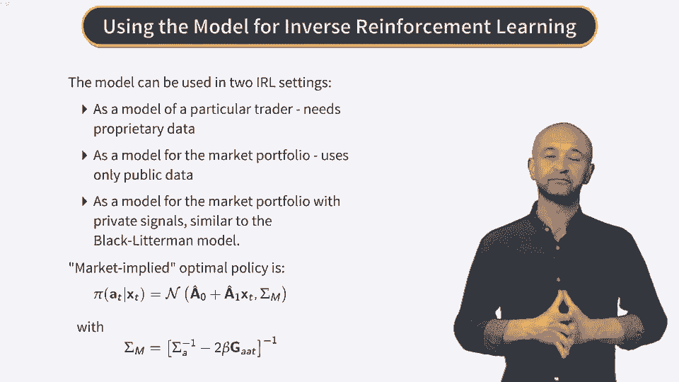

# 38：股票交易的强化学习 - 强化学习与反向强化学习解决方案 📈

在本节课中，我们将学习如何整合一个反向迭代方案，用于通过数据计算股票交易中的最优策略。我们将涵盖从常规强化学习到反向强化学习的完整算法流程，并解释其在实际市场数据中的应用。

---

## 整合反向迭代方案

上一节我们介绍了模型的基础。本节中，我们来看看如何将所有内容整合成一个用于计算最优策略的反向迭代方案。

我们首先更新最优策略，通过增量 `delta A(t)` 来实现。`A(t)` 的后验概率如以下公式所示：

**公式 50:**
`P(delta A(t) | data) ∝ exp(...)`

这里，`delta A(t)` 的先验分布 `pi0` 被重新表达为关于 `delta A(t)` 的高斯分布。由于指数中的表达式是二次的，结果仍是高斯分布，其新的均值和协方差在公式51中给出。

**公式 51:**
`均值更新: mu_new = ...`
`协方差更新: Sigma_new = ...`

我们可以将此方程视为对这些量的先验值进行贝叶斯更新。

---

## 寻找自洽轨迹

现在我们已经接近完成，但还需要找到方案中使用的轨迹。这种轨迹是通过在前向传递和反向传递之间进行多次迭代，自洽地找到的。

以下是计算中使用的方法，称为迭代二次高斯调节器：

*   **初始轨迹**：使用先验策略分布的均值构建。
*   **前向传递**：在每一步，将先验的当前均值作为确定性动作，使用原始状态方程（不含噪声项）计算新状态。
*   **反向传递**：递归计算 `g` 函数，为策略的均值提供更新。
*   **迭代**：基于更新后的均值生成新轨迹，重新开始前向传递。此过程持续直到收敛，产生一个自洽的动力学解。

最终结果是一个最优的数据隐含策略，其函数形式与先验策略相同，但具有更新的参数。系数 `A0` 和 `A1` 的显式表达式可在原始文献中找到。

在每一步轨迹优化中，更新后的协方差矩阵 `sigma_m` 如图所示。`Sigma_m` 是先验的正则化协方差矩阵，其中正则化项等于 `beta` 乘以矩阵 `G_aa_t`。

---

## 常规强化学习算法总结

现在让我们总结并把整个方案整合起来。这是一个适用于传统强化学习设定（当奖励可观察时）的算法。

该算法从初始轨迹开始，作为一系列状态-动作对 `(x_bar, u_bar)`，涵盖从 `t=0` 到 `t=T` 的所有时间步。这是第一次前向传递。然后，我们开始在反向和前向传递之间迭代，直到收敛。

以下是算法的具体步骤：

首先，执行一个从 `t=T-1` 时刻回溯到 `t=0` 时刻的后向传递。对于每个时间步 `t`：
1.  计算从下一时期得到的 `F` 函数的期望值。
2.  使用计算出的值和观察到的奖励，计算 `G` 函数。
3.  计算相同时间步的 `F` 函数。
4.  通过更新其均值和方差，重新计算此时间步的策略。

重复步骤1到4，直到所有时间步都完成后向传递。然后，通过使用新的均值和方差构建新的轨迹进行前向传递，整个过程重复进行。这总结了在我们的模型下进行常规强化学习的过程（奖励可观察）。

---

## 扩展到反向强化学习

上一节我们介绍了奖励可观察的情况。本节中，我们来看看当奖励不可观察时，模型如何解决更有趣的问题。

这种设置被称为**反向强化学习**。在这种设置下，我们观察状态和动作，但无法直接观察奖励。通常，这比直接强化学习更加困难。

然而，对我们的模型来说，这个案例相对容易处理，因为模型中的策略是高斯策略，其均值和方差依赖于奖励函数的参数。因此，我们可以利用观察到的状态-动作数据，应用常规的**最大似然估计**方法。

这给出了数据的负对数似然，如公式54所示：

**公式 54:**
`负对数似然 = -log L(data | theta)`

由于该高斯似然的参数依赖于奖励函数的原始参数，我们可以通过最小化负对数似然，使用梯度下降法来计算这些参数。

这一过程应在上述前向-后向方案的每次迭代中进行。对于每次迭代 `K`，我们需要使用在该迭代中计算出的 `A0`、`A1` 和 `sigma_M` 值。这一过程将强化学习设置中的观察奖励替换为反向强化学习设置中的估计奖励。

现在我们为反向强化学习引入了这一附加元素，并提出了完整的方案。与强化学习模型相比，唯一的新元素是第二步：使用最大似然法来估计奖励参数和其他参数（包括逆温度参数 `beta`）。接下来的步骤使用这个估计的奖励值来计算 `G` 函数，其余步骤相同。这表明，在这个模型中，反向强化学习在计算上并不比直接强化学习更复杂。

---

## 模型的实际应用

现在我们如何利用这个模型来关注强化学习的相关内容呢？

回想一下，这个模型可以作为特定交易员的模型，或作为市场投资组合（如S&P 500）的模型。

*   **专有数据应用**：如果需要学习特定交易员的奖励函数和最优策略，我们需要该交易员的专有交易数据。例如，可以计算出该交易员的隐含风险厌恶参数 `lambda`。但这类数据通常难以获得。
*   **公开市场数据应用**：我们可以使用公开市场数据，将模型应用于市场投资组合。这可以视为Black-Litterman模型的动态、概率性和数据驱动的扩展。在这种情况下，我们计算出的最优策略将是**市场隐含的最优策略**。我们可以使用一组常见的预测因子 `Z_t`，通过之前描述的方法直接估计出这个策略。
*   **私人信号应用**：如果我们拥有不为市场其他参与者所知的私人信号（私人观点），我们可以将这些信号添加到常见预测因子的列表中，通过我们改进的最优策略来尝试超越市场。

你可以在原始文献中找到更多关于该模型的细节，因为你将在课程的最终项目中使用它。

---

## 总结

本节课中，我们一起学习了：
1.  如何整合一个反向迭代方案来计算股票交易中的最优策略。
2.  常规强化学习（奖励可观察）下的完整算法流程，包括前向与反向传递的迭代。
3.  如何将模型扩展到反向强化学习（奖励不可观察）场景，并通过最大似然估计来学习奖励函数。
4.  该模型在专有数据、公开市场数据及私人信号等多种实际场景中的应用方式。

本周关于强化学习的课程内容到此结束。我们将在下一个视频中对所学内容进行总结。