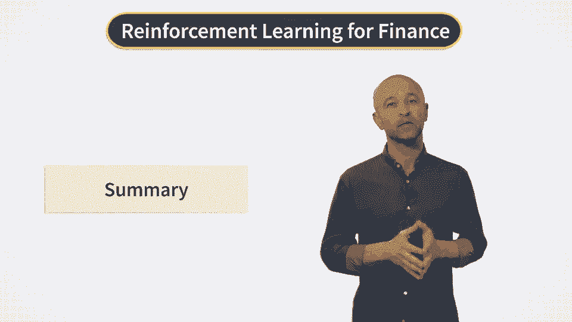
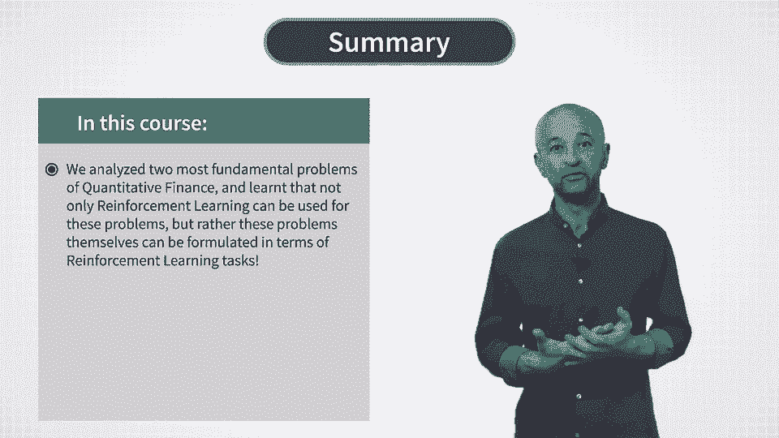
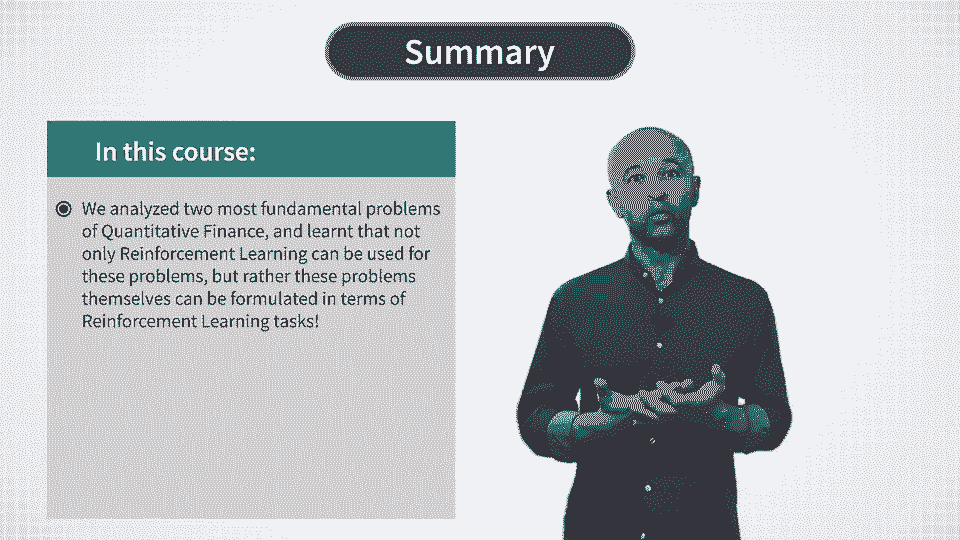
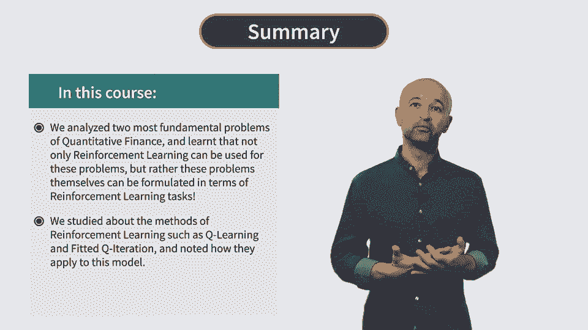
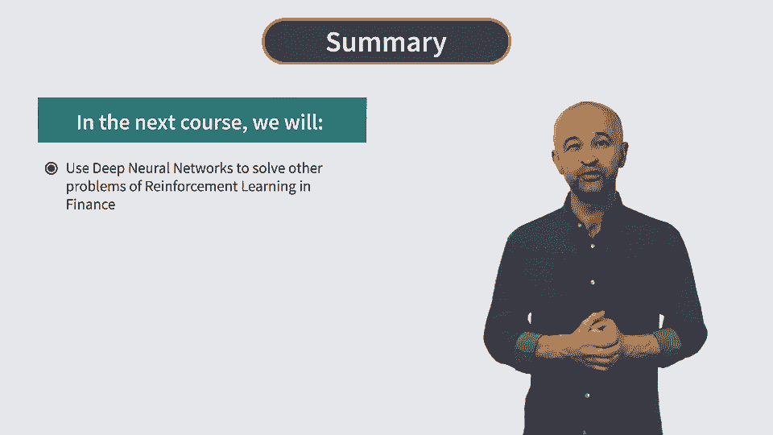

# 39：课程总结 📚

在本节课中，我们将回顾并总结过去四周课程的核心内容。我们将看到强化学习如何被应用于两个基础的量化金融问题，并理解这些问题的强化学习表述方式。

---

## 课程内容回顾

上一节我们介绍了本课程的整体框架，本节中我们来详细回顾所学到的具体知识。

在这门课程中，我们讨论了两个最基本的量化金融问题，并展示了强化学习不仅可以应用于这些问题，而且这些问题本身可以用强化学习任务的方式来表述。

---

## 第一部分：期权定价与对冲

我们从期权定价和对冲的问题开始，展示了如何解决这个问题。

该问题可以重新表述为一个离散时间的马尔可夫决策过程。然后，我们学习了强化学习的方法，如Q学习和拟合Q迭代。

以下是这些方法如何应用于该模型的要点：
*   在单一期权的情况下，整个方案在计算上相当简单。
*   为了计算期权的最优价格和对冲，我们只需要进行一系列线性回归。
*   这个模型直接从期权的复制投资组合的交易数据中学习，因为它是一个强化学习模型。
*   我们使用了基于模型的强化学习，其中奖励函数是一个二次函数。

其参数使得模型变得非常易处理。特别是，在这种简单的设置下，我们不需要像神经网络这样复杂的函数逼近方法。

---

## 第二部分：投资组合优化

在掌握了期权定价的基础后，本节中我们来看看一个更广泛的问题类别。

在本周的课程中，我们研究了一个非常大的投资组合优化问题类。我们再次首先构建了一个简单的投资组合模型，可以应用于所有此类任务。

该模型的应用范围包括：
*   最优投资组合清算
*   最优投资组合构建
*   指数跟踪

通过这个模型，我们学习了强化学习本身的新话题，包括随机策略和熵正则化强化学习。这种熵正则化强化学习在学习和噪声环境中非常有用，这在金融中几乎总是适用。

最后，我们看到了如何通过相同的动态投资组合模型进行逆向强化学习，以及如何使用它来提供市场观点和私有信号的价值，这与著名的Black-Litterman模型的精神非常相似。

由于模型相当简单，我们再次能够在不调用其他复杂方法（例如神经网络）的情况下推进这个模型。

---

## 总结与展望

本节课中我们一起学习了如何将强化学习应用于期权定价和投资组合优化两大金融核心问题。

正如我们将在下一门课程中看到的，强化学习在金融中的其他问题确实使用了神经网络，特别是深度神经网络，从而产生了深度强化学习。我们将在这门课程的下一部分详细讨论深度强化学习。

目前，祝你在课程项目中好运，下一门课程再见。