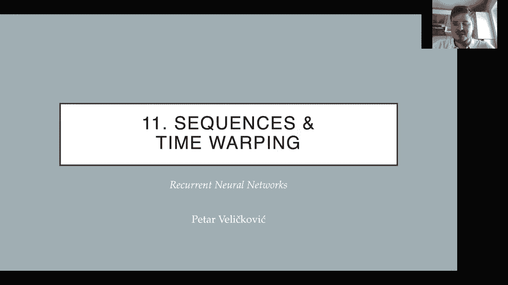
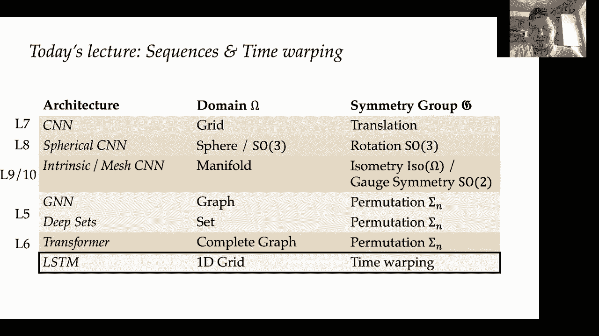
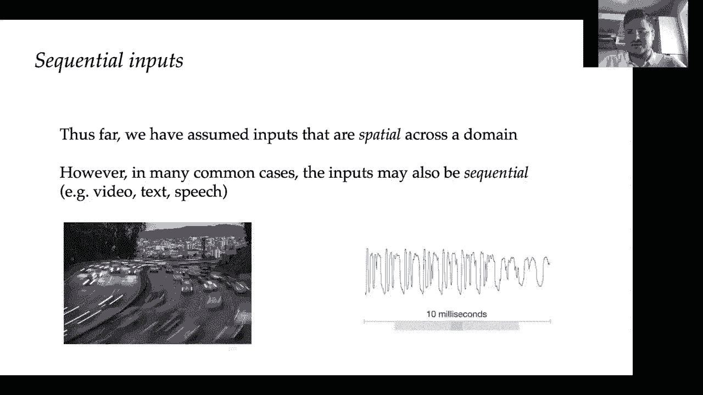
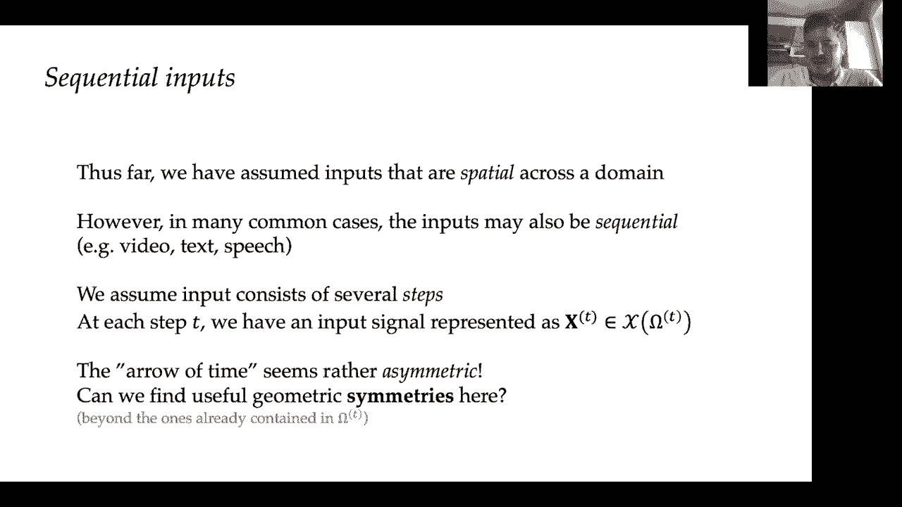
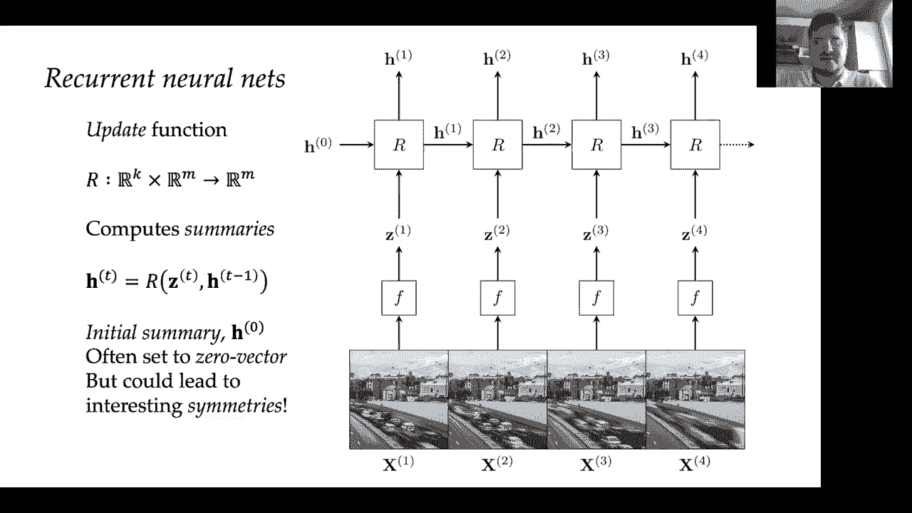
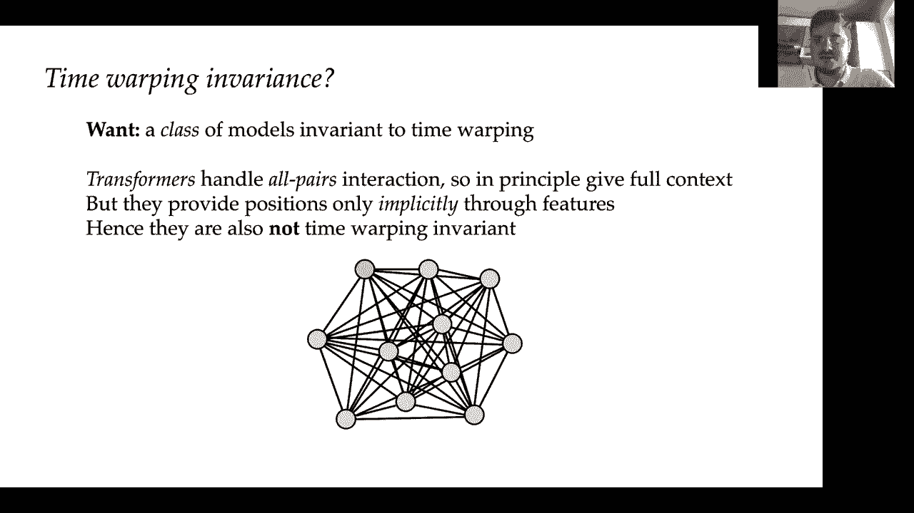
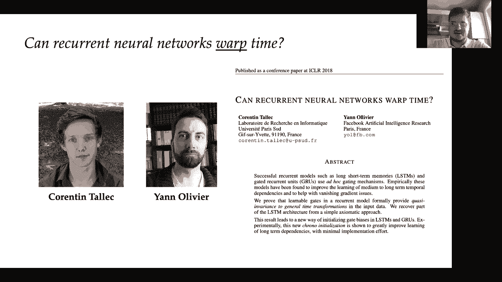
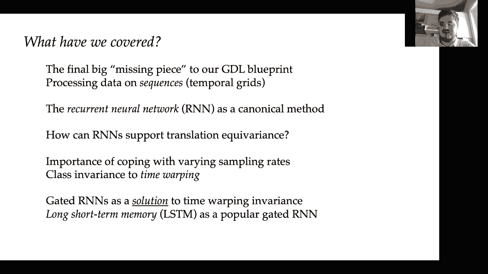
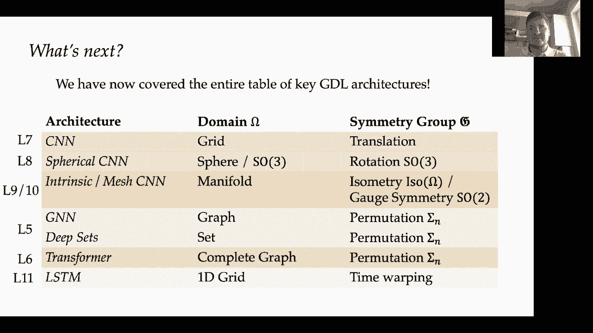
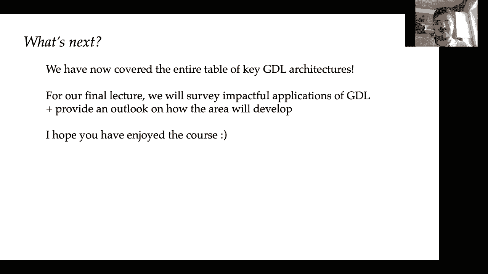

# 课程 P11：L11 - 序列与时间扭曲 📚



在本节课中，我们将学习如何处理序列数据，特别是那些受到时间扭曲变换影响的数据。我们将探讨循环神经网络（RNN）及其各种类型，并揭示一个有趣的结果：一个广受欢迎的循环神经网络类别，正是源于对时间扭曲不变性的要求。

---

## 🔍 回顾：几何深度学习蓝图

上一节我们介绍了几何深度学习蓝图在不同领域的应用。具体来说，作为几何蓝图分析的直接结果，我们推导出了几种或多或少流行的深度学习架构。我们涵盖了广泛的领域，包括深度集合、图神经网络、CNN、球面CNN和内在网格CNN。



然而，如果我们观察在集合和图论课程开始时展示的流行架构列表，会发现仍有一个非常著名的架构——长短期记忆网络（LSTM）——尚未被纳入蓝图。与其他架构相比，将其融入蓝图确实更具挑战性。

但近期关于时间扭曲及其变体的研究，提供了一种很好的方式，让我们可以从特定变换不变性的视角来观察LSTM和类似的循环模型。这正是我们今天要研究的内容。

---

## ⏳ 序列数据与时间维度



今天的内容与之前课程的一个重要区别在于，迄今为止我们总是假设域中存在某种空间几何结构。然而，在许多感兴趣的情况下，输入不仅仅是空间配置，例如视频、文本和语音。

从数学上讲，这意味着我们假设输入由多个步骤组成，在每个步骤中，我们有一个信号，用大写的 **X(t)** 表示。我们假设一个离散域，这意味着我可以使用矩阵来表示输入信号。在时间 **t**，我将有来自某个输入空间的信号，定义在时间 **t** 的域上。

我们在这里要研究的是，当这些输入随时间变化时会发生什么。我们有一种单向的时间箭头，这似乎是内在不对称的。因此，问题在于，考虑到时间只朝一个方向前进，是否存在任何有用的几何对称性可供我们利用？



---

## 🔧 固定域假设

在我们进一步讨论之前，需要做一个非常重要的区分：定义信号的域是否也随时间与信号一起演化？在一般情况下，这完全可能。然而，在本节课中，我将假设一个简单得多的情形：域在整个观察期间被假定为保持静态。

我们将假设所有的 **Ω_t** 实际上是相等的，并且等于一个特定的域 **Ω**，该域将在所有时间存储我们的信号。在许多情况下，这是一个可以接受的近似。

何时需要建模域与信号一起变化？这实际上取决于信号 **X** 变化的时间尺度与域 **Ω** 变化的时间尺度之比。

---

## 🧠 抽象域对称性：编码器函数

正如之前所说，我们感兴趣的不是 **Ω** 中的对称性，这我们已经在前面的课程中假设涵盖了。因此，我们想从一开始就抽象掉 **Ω** 可能包含的任何对称性。

我们将要做的，是使用一个编码器函数 **f**。该函数将对 **Ω** 具有的特定对称性保持不变性或等变性，并为每个输入步骤编码一个 **k** 维实向量。对于每个时间步的信息，我们称之为 **z(t)**。

如果希望域中每个节点都有一个向量，我们可以将不变函数 **f** 替换为等变函数 **f**，然后它会为域的每个节点提供一个向量。但现在，我们只假设 **f** 是一个不变函数，为每个时间步附加一个向量。

---

## 🎬 从视频帧到摘要向量

为了使其更具体，考虑一个交通中汽车移动的视频。这里给出了四个这样的帧，这些就是之前提到的 **X**。我们取一个平移不变的CNN，将所有 **X** 转换为视频每个时间步的摘要向量 **z(t)**。

现在我们的问题是：如何处理这些 **z**？这将是今天课程的主要主题。

---

## 🔄 循环神经网络（RNN）简介

由于这些集合基本上存在于一维网格上，这意味着可以使用任何先前介绍的、在网格上操作的架构来处理它们，例如卷积神经网络甚至Transformer。然而，我们今天不讨论这些模型，部分原因是它们不能满足我们对时间信号的某个特定要求。

我们希望研究一个能明确模拟时间箭头的模型，因为它能在线处理数据。你可能听说过这个模型，它就是循环神经网络（RNN）。

其核心是所谓的更新函数，我们用大写 **R** 表示。它消耗一个对应于当前时间步的向量 **z**，并维护另一个 **m** 维的向量，我们称之为摘要向量 **h**。通过将先前的摘要向量与当前的输入向量 **z** 结合，它更新摘要以产生下一个时间步的 **h**。

因此，**h(t)** 的计算公式为：
```
h(t) = R(z(t), h(t-1))
```



---

## ❓ RNN是否具有平移等变性？

让我们先问一个问题：循环神经网络是否具有平移等变性？因为它们在一个网格上顺序操作，所以可能很想将CNN平移等变性的结果简单地扩展到RNN。但实际上，RNN通常不具有平移等变性。

让我们尝试将序列左移一步，得到新序列 **z'**。如果我们希望RNN是平移等变的，那么处理 **z'** 得到的 **h'** 应该等于原始 **h** 移动一步的结果。

通过分析，我们发现要使RNN平移等变，初始摘要向量 **h(0)** 需要满足特定条件。然而，**h(0)** 是一个需要预先决定的超参数，它无法真正了解输入时间步的信息。因此，平移等变性通常无法成立。

---

## 🛠️ 通过填充实现平移等变性

我们可以研究一个稍微不同的问题，并展示等变性。具体来说，我们需要确保左移操作不会丢失信息。相应地，我们可以做的是用零左填充序列。

我们创建一个新的填充序列 **z̄**，它在最初的 **t'** 步是零，之后是原始序列。现在，我们可以将 **z̄** 移动最多 **t'** 步，而不会丢失原始序列的任何信息。

实际上，如果研究 **z̄** 而非 **z** 的平移等变性，确实有可能保证RNN的平移等变性。然而，这有一个条件：初始摘要 **h(0)** 必须满足特定要求。

---

## 🧩 RNN的更深层理论吸引力

除了在线数据处理效率之外，RNN是否还有其他更深层的理论吸引力？答案是肯定的，如果设置得当，RNN可以支持一种非常有用的对称性。这种对称性源于一个简单的问题：时间序列通常来自哪里？

当你拥有按时间序列组织的数据时，通常这些数据本身并非天然的时间序列。它是你正在采样的某种连续过程。有一个连续时间信号，你从中抽取样本，并将这些样本呈现给像RNN这样的离散模型。

一个非常重要的问题是：我们能否真正彻底控制数据点到达的采样率？我们甚至能保证它是固定的吗？

---

## ⏱️ 时间扭曲操作

采样率变化在数学上意味着什么？这意味着在某种意义上修改了测量单位。如果我们假设时间是连续的，会更容易推理这个问题。

在连续时间空间中，我们可以定义一个所谓的时间扭曲操作 **τ**。**τ** 将时间步映射到时间步，它必须是单调递增且可微的，即时间的平滑变换。

时间扭曲的一个非常简单的特例是时间重缩放，即用一个常数因子 **α** 乘以时间。但现实中，采样可能会自由地加速或减速，**τ** 可能是一个比 **α * t** 复杂得多的函数。

---

## 🎯 时间扭曲不变性的目标

我们想要的是，当我们在现实世界中采样数据时，存在一个精确的时间扭曲函数。我们真正希望的是，有一类模型对时间扭曲保持不变性。

这意味着对于任何序列和应用于该序列的任何时间扭曲，都存在某个模型，它以相同的方式处理扭曲后的序列和原始序列。因此，如果我们有正确的模型类别，就不必担心应用了哪种时间扭曲。

---

## 🤔 CNN与Transformer的局限性

卷积神经网络不具有时间扭曲不变性。这里给出了一个简单的一维CNN示例，其核大小为3。你可以看到，一个4层CNN在时间步16的输出只能看到第12到16步。如果我在输入之间插入大量零，我可以插入足够多的零，使得输出点16无法看到某些输入。

人们已经意识到CNN中的这个问题，并找到了一种非常经济高效的方法使它们对这种变化更具弹性。一种非常流行的方法是使用所谓的扩张卷积（或空洞卷积）。

扩张卷积通过在第一层之后，在核中插入人工零，使核越来越分散，其增长速度是指数级的。然而，一旦选择了扩张卷积架构，它仍然具有固定的感受野。因此，我仍然可以插入可能大量的零，之后我将失去对序列某部分的可见性，并且无法抵抗那种时间扭曲。

最近，Transformer在处理序列方面越来越受欢迎。在每个序列步骤，Transformer都有完整的上下文信息。但正如之前的课程所记得的，Transformer本质上不在网格上操作，它们在完全图上操作，不支持平移等变性。因此，虽然Transformer可能能够很好地感受序列中的时间对齐，但它们肯定对时间扭曲不具有不变性。

---

## 📄 关键研究：RNN能否扭曲时间？

我们排除了所有明显的选择，只剩下循环神经网络。我们今天讨论的基础将是一篇开创性论文：《Can Recurrent Neural Networks Warp Time?》（Cohen, Talek & Jan Olivier, ICLR 2018）。该论文表明，在循环神经网络的某些约束条件下，它们可以对时间扭曲操作保持不变性。

这是一个非常重要的结果，因为它展示了仅仅从我们希望模型实现的原则出发，我们就可以证明，已经最受欢迎的循环神经网络类别，正是满足这些约束条件的类别。

---

## 🔬 连续时间分析

时间扭曲很自然地在连续域中定义，当你试图从连续回到离散时，事情会变得有点奇怪。因此，我将从连续域开始分析时间扭曲和不变性。



当我们看到粗体的 **h** 和 **z(t)** 时，那是在时间步 **t** 的离散向量信号。当我们看到斜体的 **h** 和 **z(t)** 时，那是一个为每个实数定义的连续函数。

我们可以考虑离散RNN的连续模拟，称之为连续RNN。它接收一个连续输入信号 **z(t)**，并计算一个摘要信号 **h(t)**。我们将通过观察这些泰勒展开式来链接连续和离散。

具体来说，我们将看到 **h(t)** 如何大致由围绕时间 **t** 的一阶多项式近似。围绕时间 **t** 的一步泰勒展开告诉我们，**h** 在点 **t + δ** 的值近似等于 **h(t)** 加上 **δ** 乘以 **h(t)** 对 **t** 的导数。



如果我们取这个泰勒展开并设 **δ = 1**，那么这给出了 **h(t+1)** 与 **h(t)** 之间的关系，这在某种程度上是循环网络更新 **R** 所做的。

通过一些代数运算和交换，并设 **δ = 1**，我们可以发现循环网络的更新规则满足以下常微分方程（ODE）：
```
dh/dt = R(z(t+1), h(t)) - h(t)
```

---

## 🌀 应用时间扭曲

现在我们有了一个很好的起点，将连续的 **h** 和 **z(t)** 信号链接到循环更新 **R**。现在我们可以尝试对信号应用时间扭曲 **τ**，看看它如何处理。

如果我们的模型类别是时间扭曲不变的，那么当它观察到扭曲信号 **z(τ(t))** 时，它应该产生扭曲摘要 **h(τ(t))**。

使用相同的泰勒级数论证，并获得该模型必须满足的ODE，你基本上得到与之前相同的方程。唯一的区别是，现在你对扭曲时间 **τ(t)** 求导。

但我们实际想要的是扭曲摘要 **h(τ(t))** 相对于原始时间流 **dt** 的导数。这意味着我们需要结合链式法则。

结合这些，我们得到扭曲信号相对于原始时间的导数必须等于扭曲导数乘以应用于扭曲输入和先前扭曲摘要的循环网络规则，再减去扭曲导数乘以先前的扭曲摘要。

如果我们的循环神经网络能够满足这个ODE，那么它将是时间扭曲不变的。

---

## 🔁 从连续空间到离散空间

目前，我们已经表达了RNN必须满足的要求才能实现时间扭曲不变性，但我们一直停留在连续空间。现在我们需要从连续空间跃迁到离散空间。

具体来说，我们可以再次从泰勒级数开始，在这种情况下必须是扭曲摘要。**h(τ(t+δ))** 可以取线性泰勒展开，在我们将提到的某些属性下，这是一个不错的近似。

再次设 **δ = 1**，并注意到离散RNN看到的是 **z(t)**（在扭曲情况下是 **z(τ(t))**），并计算 **h(t)**（即 **h(τ(t))**）。利用之前展示的事实，你可以推导出时间扭曲不变的RNN必须在当前幻灯片底部实现这样一个方程。

因此，计算下一步摘要的方式必须是：时间扭曲导数乘以RNN对当前步骤和先前摘要的更新，再加上 **1** 减去时间扭曲导数乘以先前摘要的值。

---

## 🧮 解释更新规则

这个规则的一种解释方式是，时间扭曲的导数控制了你应该覆盖多少先前的摘要。导数越大，时间移动越快，当前信号对摘要越相关，你应该更多地使用它，更少地使用先前的摘要。

非常重要的一点是，我们不假设我们事先知道 **τ(t)**。这使得实现变得棘手。如果我们立即知道导数，我们可以直接将其代入规则，并获得一个能正确拟合的循环神经网络模型。

---

## 🚫 简单RNN的局限性

最早引入RNN的应用之一是所谓的简单RNN模型，由Jordan（1986）和Elman（1990）以各种形式独立提出。它只是做一个简单的MLP来更新摘要。

对于它们，RNN计算 **h(t+1)** 作为输入、先前摘要和某个偏置向量的某个激活函数。这些 **W**, **U**, **b** 只是可学习参数。你可以将其视为应用于 **z** 和 **h** 的多层感知机。

这里没有显式的残差项来保留先前的 **h(t)**。如果你记得时间扭曲不变性的形式，你需要有一个残差项，允许部分旧的 **h(t)** 被保留。如果该项不存在，那么这些简单RNN实际上隐含地假设时间扭曲导数始终为 **1**。如果时间扭曲导数始终为 **1**，那意味着实际上没有扭曲，**τ(t) = t**。

因此，简单RNN仅在理论上适用于没有时间扭曲的场景，结果就是它们对时间扭曲不具有不变性。

---

## 🎛️ 学习时间扭曲导数

正如所说，我们不能指望事先知道时间扭曲导数，除非它确实给了我们。因此，我们通常必须做的是学习一个近似这个导数的神经网络。

基于当前的 **z** 和 **h**，这个新函数 **γ** 将尝试近似真实值，该值会告诉你在这一点上的扭曲导数。同样，这个 **γ** 仅处理 **z(t+1)** 和 **h(t)** 就足够了，因为它们存储了你迄今为止观察到的一切。

如果你将这个可学习的 **γ** 插入到我们知道时间扭曲不变模型必须具有的形式中，那么 **h(t+1)** 等于 **γ** 乘以循环模型的输出，再加上 **1 - γ** 乘以先前的摘要。

---

## 🔒 对 γ 的约束

到目前为止，一切顺利。这看起来是一个我们可以使用的好规则。再次，你可以看到当设置 **γ** 始终等于 **1** 时，简单RNN是如何产生的。

我们能否对 **γ** 附加任何其他约束？实际上，是的。因为自从我使用第一个泰勒近似以来，我一直在做一个非常重要的假设：泰勒近似是一个足够好的近似。

原则上，只要时间扭曲导数不是非常大，泰勒近似中就会有一个足够小的误差项。具体来说，只要 **dτ/dt** 不是很大，扭曲就不应该变得非常快，它不应该过度压缩时间。

然而，任意的时间扩张是完全允许的。这对于RNN处理非常重要，因为你经常期望它们必须捕获非常长时间尺度上的信息。

由于我们知道，只要我们假设数据没有被破坏性地丢失，扭曲导数就不会太大，所以它不会超过 **1**。而且从我们的初始假设中，我们知道时间必须是单调递增的，我们不能倒退时间，所以 **τ** 的导数永远不能小于零，也永远不能等于零。

因此，基本上我们知道，对于我们正在研究的合理场景，这些 **γ** 函数的值必须始终在 **0** 和 **1** 之间。

---

## 🚪 门控机制

如果我们有一个函数 **γ**，它接受一些输入并产生一个介于 **0** 和 **1** 之间的输出，这可以解释为各种架构（如GRU或LSTM）中的所谓门控。

我们通常通过使用逻辑S型激活函数来获得深度学习中的门控机制。这是标准的激活函数，给你一个介于 **0** 和 **1** 之间的输出。某种应用于 **z** 和 **h** 的MLP，带有一些偏置和权重向量，然后你对结果应用逻辑激活以获得介于 **0** 和 **1** 之间的值。

这可以是建模 **γ** 的好方法。任何使用这种 **γ** 的循环神经网络都称为门控RNN。

---

## 🔢 向量输出的门控

到目前为止，我一直在暗示唯一的要求是 **γ** 输出一个标量。但原则上，大多数这些门控RNN试图通过使 **γ** 输出一个 **0/1** 概率向量来增加其表达能力。

这在语义上意味着你可以选择覆盖 **h(t)** 的维度。这使你更容易分离不同时间尺度的数据处理。

事实上，你可能听说过门控RNN，因为它们是当今循环神经网络的主要变体。诸如长短期记忆网络（LSTM）或门控循环单元（GRU）等模型都是门控RNN架构的特例，因为它们在各个部分都有门。

---

## 🧠 长短期记忆网络（LSTM）

为了结束讨论并最终将其链接回一个实际的架构，我想快速展示一下长短期记忆网络架构及其与这个蓝图的关系。

LSTM你可能听说过，它们是最古老和最受欢迎的门控RNN之一。它们使用一个显式的记忆单元 **c(t)**，在不同时间步之间持久保存数据。

我只展示了一个门原则上足以建模时间扭曲导数，但LSTM更进一步，它们实际上以门控方式决定了几件事：应该允许多少在时间步 **t+1** 到来的新特征进入细胞；忘记多少先前的细胞向量；然后，一旦你最终基于所有这些计算了输出，应该允许多少输出向量离开LSTM。

最初，它们是为了建模和解决梯度消失问题而提出的。本质上，因为它们有所有这些门，LSTM以纯数据驱动的方式决定应该消失多少数据。

因为它们解决了许多像逻辑或双曲正切这样的S型函数通常具有的梯度消失问题，所以在LSTM中，你可以自由使用tanh激活，并且它们是更常见的选择。

---

## 📊 LSTM方程摘要

这是你可能以前遇到过的、最常用的LSTM方程的摘要：



1.  基于当前时间步和先前摘要，我们计算一些应该进入记忆单元的候选特征向量，称之为 **c̃**。
2.  基于当前时间步和先前摘要，计算各种门（输入门、输出门、遗忘门），这些门告诉你所有这些不同的设计决策。
3.  最后，使用这些门和候选特征，你可以计算应该放置在细胞中的下一个值。





因此，进入细胞的下一个值是这些新候选特征（由输入门调制）和先前细胞特征（由遗忘门调制）的组合。遗忘门告诉你应该忘记多少先前的上下文。