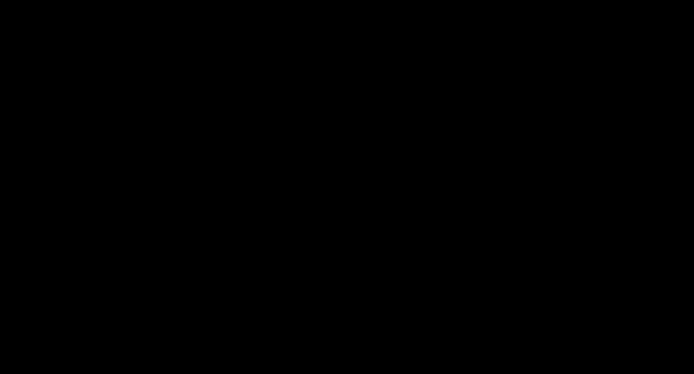
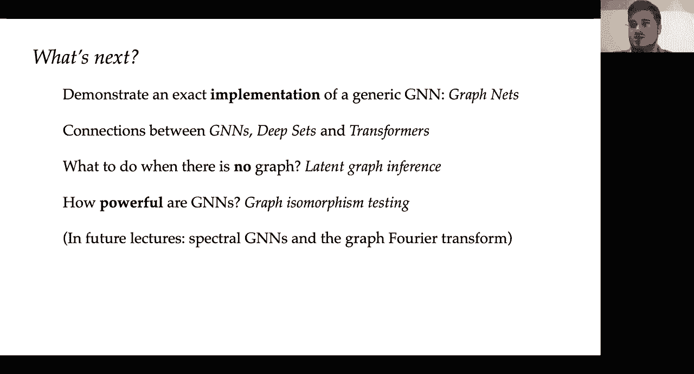
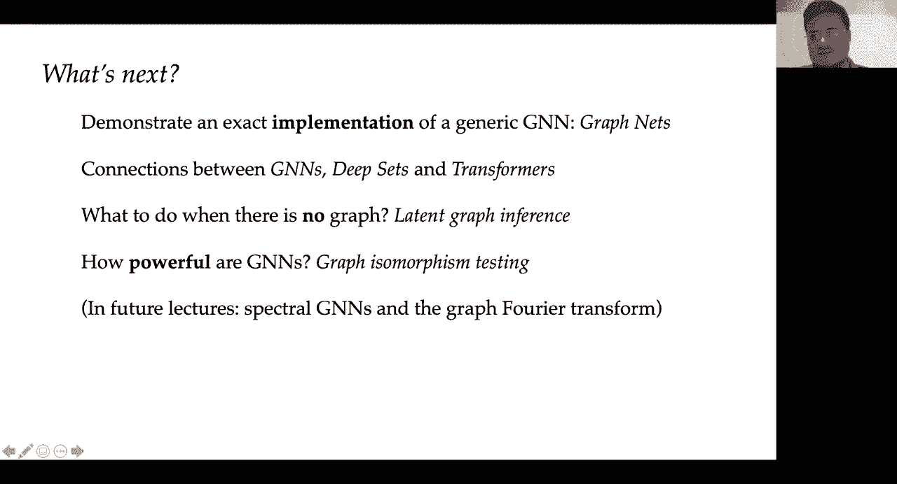
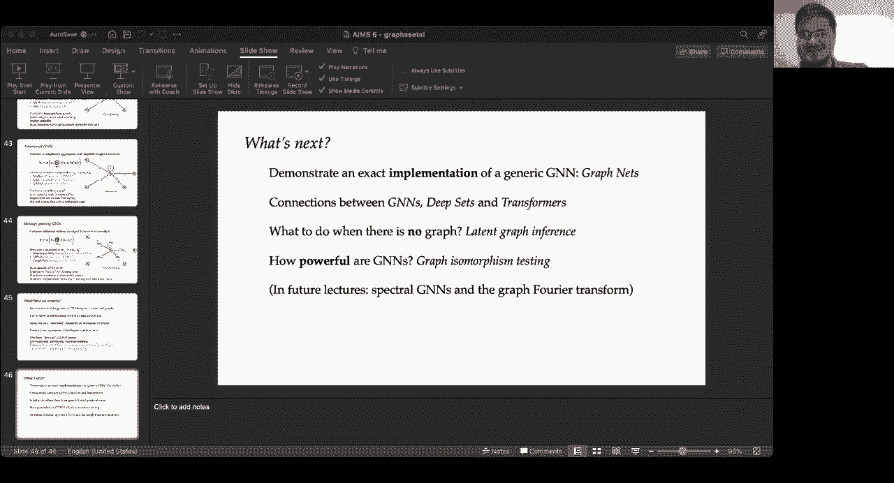

# 课程 P5：L5 - 图与集 1 📚



在本节课中，我们将学习如何将几何深度学习蓝图应用于**图**和**集合**这两种数据结构。我们将深入探讨**置换不变性**和**置换等变性**的概念，并了解它们如何指导我们设计处理图与集合数据的神经网络架构。

---

## 🧠 几何深度学习蓝图回顾

在之前的课程中，我们学习了如何利用一组指导原则（如对称性、等变性、不变性、局部性和尺度分离）来合成和指导深度学习架构的设计。

这个通用蓝图包含几种核心层：
*   **等变层**：以等变的方式抵抗特定对称群的变换。
*   **局部池化层**：用于在需要时对域进行粗化。
*   **全局池化层**：通常放在架构末尾，以不变的方式聚合整个域的信息，输出域级别的答案。

线性G-等变层满足线性性，并能以等变的方式抵抗群作用。在深度学习中，我们通常将线性等变层与逐点非线性函数（如Sigmoid或ReLU）组合，从而获得在域上的通用逼近能力。

这个蓝图非常强大，它不仅帮助我们理解和统一现有的流行架构（如CNN、Transformer、GNN），还为我们设计处理非标准域的新架构提供了思路。

---

## 🎯 本节课焦点：图与集合

本节课，我们将深入探讨蓝图在**图**和**集合**域上的具体应用。我们将研究图神经网络、Deep Sets和Transformer等模型。

我们选择从图开始演示蓝图，原因如下：
1.  **易于分析**：图和集合为我们提供了一个非常清晰的离散域，便于分析其性质。
2.  **通用性强**：几乎所有我们遇到的域都可以被视为图。因此，本课程中推导的许多架构都可以看作是图神经网络的实例。
3.  **历史原因**：多年来，几何深度学习几乎与图表示学习同义。

图结构数据在自然界和工业应用中无处不在，例如分子图、交通网络、社交网络和人脑连接组。图神经网络已在抗生素发现、芯片设计、路线规划等领域产生重大影响，因此学习图表示学习至关重要。

---

## 📦 从集合开始：Deep Sets 模型

为了简化分析，我们首先考虑一个更简单的域：只有节点、没有连接的图，即**无序集合**。集合数据本身也很重要，例如点云数据。

我们假设有 `n` 个节点，每个节点 `i` 具有 `k` 维特征向量 `x_i`。我们可以将这些特征堆叠成节点特征矩阵 `X`。但请注意，堆叠操作隐含地为节点指定了一个顺序，而集合本质上是无序的。

我们希望神经网络函数 `f` 的输出不依赖于输入节点的顺序。在几何深度学习蓝图中，这对应于使用 **n元置换群** 作为对称群 `G`。置换操作可以用置换矩阵 `P` 表示，左乘 `P` 会置换 `X` 的行。

### 置换不变性

如果我们需要对整个集合进行预测（例如集合分类），则要求函数 `f` 是**置换不变**的。这意味着无论我们以何种顺序输入节点特征，只要集合内容相同，输出 `y` 就应该相同。

**公式**：`f(PX) = f(X)` 对所有置换矩阵 `P` 成立。

一个构建置换不变函数的通用方法是 **Deep Sets** 模型：
1.  首先，使用一个逐点神经网络 `ψ`（如MLP）独立处理每个节点的特征。
2.  然后，使用一个**置换不变聚合函数**（如求和 `∑`、求平均或求最大值）将所有节点的处理结果聚合起来。
3.  最后，可选地使用另一个MLP `φ` 对聚合后的特征进行变换。

**核心代码逻辑**：
```python
# 假设 node_features 形状为 [n_nodes, feature_dim]
processed_features = MLP_psi(node_features) # 逐点处理
aggregated_feature = torch.sum(processed_features, dim=0) # 聚合（求和）
output = MLP_phi(aggregated_feature) # 最终变换
```
聚合操作（如求和）是保证置换不变性的关键。

### 置换等变性

如果我们需要对集合中的每个节点进行预测（例如节点分类），则要求函数 `F` 是**置换等变**的。这意味着如果我们先置换输入节点，再应用函数 `F`，得到的结果应该与先应用 `F`，再对输出进行同样的置换相同。

**公式**：`F(PX) = P F(X)` 对所有置换矩阵 `P` 成立。这里 `F` 输出一个矩阵，其行对应于每个节点的输出。

在集合上，实现局部等变层的最简单方法是应用一个**共享的逐点函数** `ψ` 到每个节点特征上，然后堆叠结果。这正是Deep Sets模型的前半部分。

**核心代码逻辑**：
```python
# 节点级等变变换
node_outputs = shared_MLP(node_features) # 对每个节点应用相同的MLP
# node_outputs 的形状是 [n_nodes, output_dim]，其行顺序与输入对应
```

通过遵循几何深度学习蓝图的指导，我们自然地推导出了处理集合数据的标准模型——Deep Sets。

---

## 🕸️ 扩展到图：图神经网络

现在，我们考虑更一般的结构：**图** `G = (V, E)`，它包含节点集合 `V` 和边集合 `E`。我们可以用邻接矩阵 `A` 来表示边，其中 `A_ij = 1` 表示节点 `i` 和 `j` 之间有边。

与集合类似，我们希望图神经网络对节点的置换是**稳健**的。当我们置换节点时，节点特征矩阵 `X` 和邻接矩阵 `A` 都需要相应变换：`X -> PX`，`A -> PAP^T`。

### 图的置换不变性与等变性

*   **置换不变性**：对于图级任务，函数应满足 `f(PX, PAP^T) = f(X, A)`。
*   **置换等变性**：对于节点级任务，函数应满足 `F(PX, PAP^T) = P F(X, A)`。

### 局部性与邻居聚合

在图域上，局部性意味着一个节点的更新应依赖于其自身及其**邻居**的信息。对于节点 `i`，我们定义其邻居特征集合 `X_N(i)`。

我们可以构建一个**局部置换不变函数** `φ`，它以节点 `i` 自身的特征及其所有邻居的特征集合作为输入，输出节点 `i` 的新特征 `h_i`。为了保证由此构建的全局函数 `F` 是置换等变的，这个局部函数 `φ` 本身必须对其输入的邻居集合是置换不变的。

**核心思想**：将 `φ` 独立地应用于图中每个节点的邻居，然后将结果堆叠起来，就得到了一个置换等变的图神经网络层。

### 图神经网络层的三种空间类型

如何设计局部函数 `φ` 是图神经网络研究的核心。大多数方法可以归纳为三种主要类型，其表达能力和计算复杂度依次递增：

以下是三种主要类型的简介：

1.  **卷积式GNN**
    *   **思想**：预先根据图拓扑（如节点度数）定义固定的邻居聚合权重 `c_ij`（例如，取平均）。每个节点聚合其邻居经变换后的特征。
    *   **特点**：计算高效（稀疏矩阵乘法），适用于边表示同质性的图（相连节点标签相似）。代表模型：GCN, ChebNet, SGC。

2.  **注意力式GNN**
    *   **思想**：聚合权重 `α_ij` 不是固定的，而是由发送节点和接收节点的特征动态计算得出（通过注意力机制）。
    *   **特点**：比卷积式更灵活，允许模型学习节点间不同的交互强度。计算仍然相对高效。代表模型：GAT, MoNet, GATv2。






3.  **消息传递式GNN**
    *   **思想**：最通用的形式。每条边 `(i, j)` 上计算一个消息向量 `m_ij`，该消息由发送节点和接收节点的特征共同决定。然后，接收节点以置换不变的方式（如求和）聚合所有传入的消息。
    *   **特点**：表达能力最强，可以建模复杂的边交互，常用于计算化学和物理模拟。计算和参数化成本更高。代表模型：MPNN, Interaction Networks, GraphNets。

**表达力关系**：卷积式 ⊆ 注意力式 ⊆ 消息传递式。这意味着后两者可以模拟前者的行为。

### 图上的预测任务

基于GNN层，我们可以构建深度网络来执行多种任务：
*   **节点分类**：在最终的节点特征 `h_i` 上应用分类器。
*   **图分类**：首先使用置换不变聚合函数（如求和）将所有节点特征聚合成一个图级向量，然后在该向量上应用分类器。
*   **边预测/链接预测**：使用一对节点 `(i, j)` 的特征 `h_i` 和 `h_j`（以及可能的边特征）来预测边属性或是否存在边。

---

## 📝 本节课总结

在本节课中，我们一起学习了如何将几何深度学习蓝图具体应用于**集合**和**图**的领域。

1.  我们首先回顾了蓝图的核心组件：等变层、局部性和全局池化。
2.  接着，我们研究了**集合**数据，引入了**置换不变性**（用于集合级预测）和**置换等变性**（用于节点级预测）的关键概念，并由此自然推导出了 **Deep Sets** 模型。
3.  然后，我们将讨论扩展到**图**结构，将不变性和等变性的概念与图的邻接关系相结合。我们了解到，通过设计一个作用于节点及其邻居的**局部置换不变函数**，并将其应用于所有节点，可以构建出置换等变的图神经网络层。
4.  最后，我们介绍了图神经网络层的三种主要空间类型：**卷积式**、**注意力式**和**消息传递式**，并简要讨论了它们的特点、适用场景以及表达力上的包含关系。




本节课为我们理解图神经网络奠定了理论基础。在下节课中，我们将深入更多细节，包括处理边特征、连接GNN与Transformer、潜在图推理以及分析GNN的表达能力。