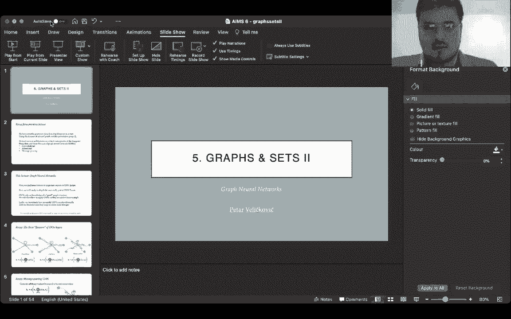
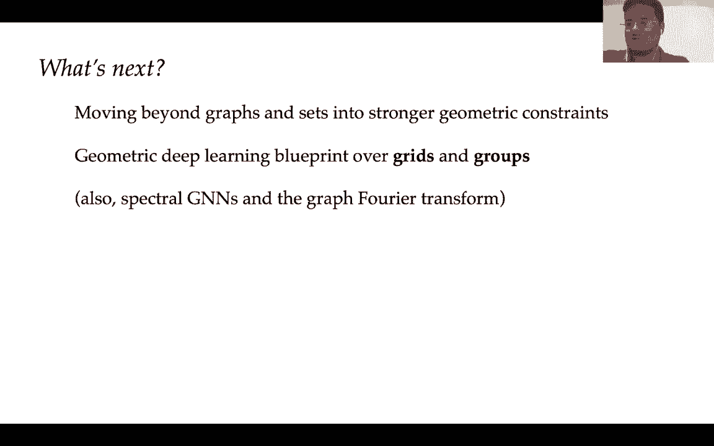
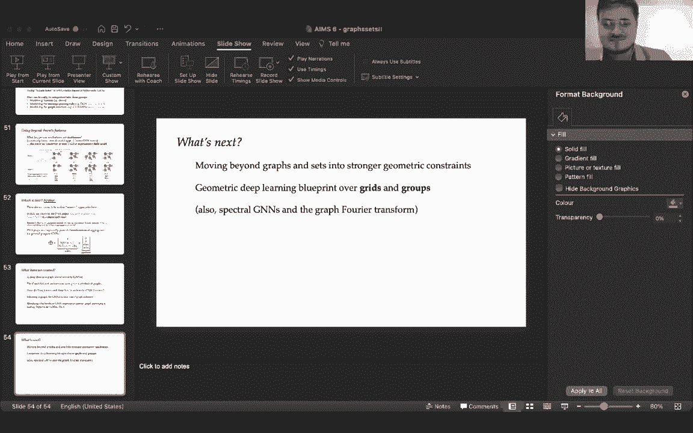

# 课程 P6：L6 - 图形与集合 2 📚

## 概述
在本节课中，我们将深入学习图神经网络（GNN）的更多设计细节。我们将首先探讨一种表达能力最强的GNN变体，然后研究两个前沿且紧密相关的领域：潜在图推断和图神经网络的表达能力。我们将了解如何在没有给定图结构的情况下应用GNN，并分析GNN在解决某些问题时的能力极限。

---

## 🧠 回顾：图神经网络的三种类型
上一节我们介绍了图神经网络的几何深度学习蓝图，并基于置换群推导出了集合神经网络和图神经网络的关键特性。本节中，我们来看看图神经网络的三种主要类型，它们涵盖了当前约95%的图表示学习方法。

从左到右，它们分别是卷积式、注意力式和消息传递式。随着向右移动，我们对底层图结构的假设逐渐放宽，模型的复杂性也随之增加。

*   **卷积式图网络**：通常假设边编码了标签相似性。
*   **注意力式图网络**：通过注意力机制动态计算节点间的影响权重。
*   **消息传递式图网络**：边仅作为在图中传递数据的通道，可以拟合更广泛的问题，但可能面临可扩展性问题。

消息传递式GNN是表达能力最强的一种，我们今天讨论的许多内容都可以看作是它的特例。

---

## 🏗️ 表达能力最强的图网络模型
在消息传递框架中，我们通过考虑发送节点和接收节点的特征来计算沿边传递的消息向量，然后接收节点聚合所有收到的消息来计算其下一层特征。之前我们主要关注节点特征，但在许多实际应用（如计算化学）中，边和整个图也可能带有丰富的特征信息。

以下是一个通用的属性图数据定义：
*   **节点特征**：记为 `x_u`，例如原子类型、电荷等。
*   **边特征**：记为 `x_uv`，例如化学键的类型（单键、双键等）。
*   **图级特征**：记为 `x_g`，例如整个分子的分子量。

我们的目标是通过图神经网络层，将这些输入特征 `x` 转换为可用于分类或回归任务的潜在特征 `h`。

我们将定义一个通用的空间消息传递图神经网络蓝图，它概括了之前提到的所有三种类型。这里我们选择 **图网络模型** 来描述，因为它专为处理这种通用的属性图而设计。

整个数据流分为三步，并广泛使用了跳跃连接以确保信息不丢失：

1.  **更新边特征**：基于图特征、相关节点特征和该边之前的特征来更新每条边的特征。
    *   **公式**：`h_uv = ψ(x_u, x_v, x_uv, x_g)`
2.  **更新节点特征**：基于节点自身之前的特征、图特征以及所有入射边特征的聚合来更新每个节点的特征。
    *   **公式**：`h_u = φ(x_u, ⨁_{v∈N(u)} h_uv, x_g)`，其中 `⨁` 表示置换不变的聚合操作（如求和、平均、最大值）。
3.  **更新图级特征**：基于图之前的特征、所有节点特征的聚合以及所有边特征的聚合来更新整个图的特征。
    *   **公式**：`h_g = ρ(x_g, ⨁_{u∈V} h_u, ⨁_{(u,v)∈E} h_uv)`

函数 `ψ`、`φ` 和 `ρ` 的特定选择决定了具体的图神经网络架构。这个计算图完全符合几何深度学习蓝图的构建模块：涉及聚合的操作是置换不变的，而不涉及聚合的操作是置换等变的。

一个有益的练习是思考如何指定 `ψ`、`φ` 和 `ρ` 来得到文献中你喜欢的图神经网络（如图卷积网络、图注意力网络），并假设存在边和图特征需要处理。

---

## 🔍 潜在图推断
到目前为止，我们都假设图的边结构是给定的。然而，这个假设远非无害。在许多情况下，给定的图对于手头的任务可能并非最优，甚至可能根本没有给定的图结构。

当我们只有节点特征矩阵而没有邻接矩阵信息时，有两种极端处理方法：

*   **假设图为空（仅自连接）**：这等价于 **Deep Sets** 模型，节点间没有信息交互。
*   **假设图为全连接**：每对节点之间都有边。在这种情况下：
    *   如果没有边特征，**卷积式GNN** 会退化为 Deep Sets。
    *   **注意力式GNN** 则变得非常强大。实际上，**Transformer 模型** 可以看作是在全连接图上运行的注意力式图神经网络。注意力系数本质上推断了一个“软”邻接矩阵，让网络自己选择重要的连接。

然而，空图忽略了大量信息，全连接图则在可扩展性上面临挑战。理想的方法介于两者之间：**推断一个稀疏的、任务相关的邻接矩阵 `A`**，然后将其用作GNN的边。这就是 **潜在图推断**，一个非常具有挑战性的问题，因为选择边是一个离散的、通常不可微的决策。

以下是几种解决该问题的方法：

*   **神经关系推断（NRI）**：采用概率方法，将边的存在视为随机变量。使用一个在全连接图上运行的GNN来编码节点特征，并输出每条边存在的后验概率。然后根据该概率采样得到硬边，用于第二个GNN进行预测。训练时使用Gumbel-Softmax技巧实现可微采样。
*   **K最近邻（K-NN）图**：这是当前许多方法的主流选择。根据节点潜在特征 `h_u` 的欧氏距离，每个节点只连接到其K个最近邻。这种方法计算高效且能产生稀疏图。例如，**动态图CNN（DGCNN）** 在每一层GNN后，根据节点特征的点积相似度重新计算K-NN图，从而捕捉语义相似性而非单纯的空间接近性。
*   **强化学习**：将选择边的过程建模为序列决策问题。一个智能体根据当前节点特征计算的选择概率（策略）来选取K条边，然后用选出的边运行GNN。下游任务的性能可以作为奖励来优化智能体的策略。
*   **监督边缘选择**：如果有关于哪些边可能有用的先验知识（例如，从传统算法中得到的边），可以直接监督策略函数去模仿这些边，同时允许网络进行优化调整。

---

## 💪 图神经网络的表达能力
图神经网络功能强大，但并非能解决图上的所有任务。一个评估其表达能力的关键测试是 **图同构判别**：GNN能否区分两个不同构的图？如果两个不同构的图被映射到相同的图级特征，那么任何基于此的判别任务都将失败。

**Weisfeiler-Lehman（WL）测试** 是一个经典而强大的图同构启发式算法。其核心是迭代地“着色”节点：每个节点聚合其邻居的颜色，并将聚合结果哈希成一个新的颜色。当颜色不再变化时停止，比较两个图的颜色直方图。若直方图相同，则图可能同构；否则不同构。

研究表明，对于离散节点特征，**消息传递式GNN的表达能力上限就是WL测试**。为了达到这个上限，聚合函数必须是单射的（例如 **求和**）。平均或最大聚合会丢失信息，表达能力较弱。**图同构网络（GIN）** 就是基于此原理设计的。

然而，WL测试（以及同等能力的GNN）也会失败。一个经典例子是无法区分一个 **六元环** 和 **两个三角形**。对于GNN来说，这两个图中所有节点的邻居结构看起来都是一样的。

为了突破WL测试的限制，发展出了 **高阶GNN** 的研究方向。主要思路有三类：

1.  **增强节点特征**：
    *   **随机特征**：为每个节点添加一个随机数，有助于区分某些结构（例如，节点能否在固定步数内看到自己）。
    *   **位置特征**：添加依赖于图中位置信息的编码。
    *   **子图计数特征**：预先计算并添加重要子结构（如环）的计数作为特征。
2.  **修改消息传递规则**：例如，利用图拉普拉斯信息来改变消息传递的方式。
3.  **修改消息传递的图结构**：在更高阶的单元（如节点对、三元组）上进行消息传递。例如 **k-GNNs** 在k元组上操作，表达能力严格强于WL测试。

最后需要指出，上述关于WL测试和求和聚合最优的结论基于 **离散特征**。对于现实世界中更常见的 **连续特征**，情况更为复杂。研究表明，没有一种聚合函数（求和、平均、最大值等）是绝对最优的。**主邻域聚合（PNA）** 提出同时使用多种聚合器（如均值、标准差、最大值、最小值）并将结果拼接起来，以更好地捕捉连续特征邻域的多样性。

---

## 总结
本节课我们深入探讨了图神经网络。我们展示了通用的图网络架构如何处理属性图，并说明了Transformer和Deep Sets如何融入我们描述的框架中。我们研究了如何通过潜在图推断来为GNN推断合适的图结构。最后，通过分析图同构测试、高阶GNN和PNA，我们探讨了如何突破图神经网络表达能力的极限。

在接下来的课程中，我们将超越图和集合，进入具有更强几何约束的领域，具体研究网格和齐次群上的几何深度学习。