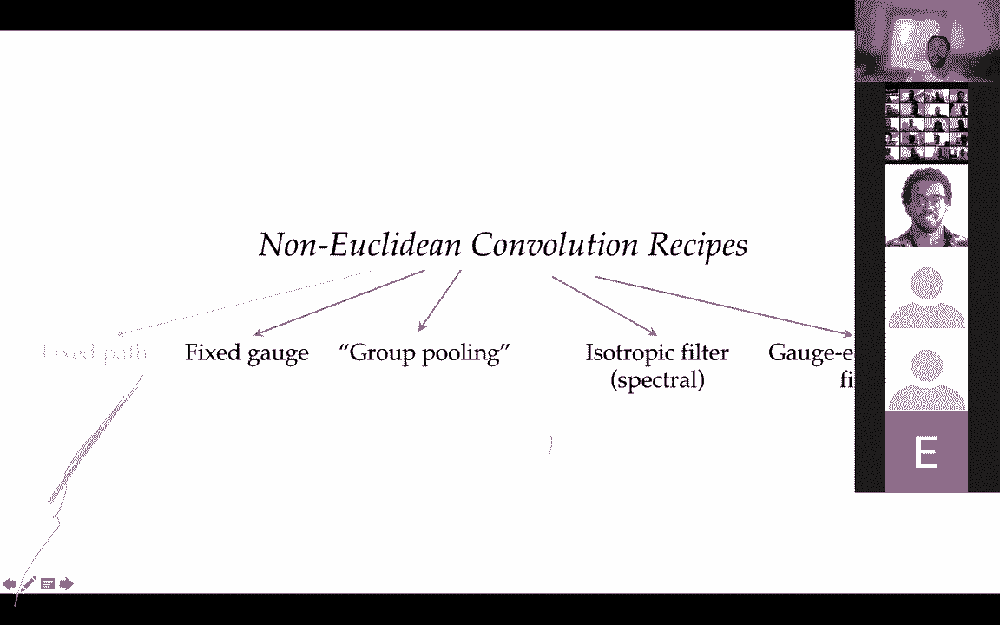
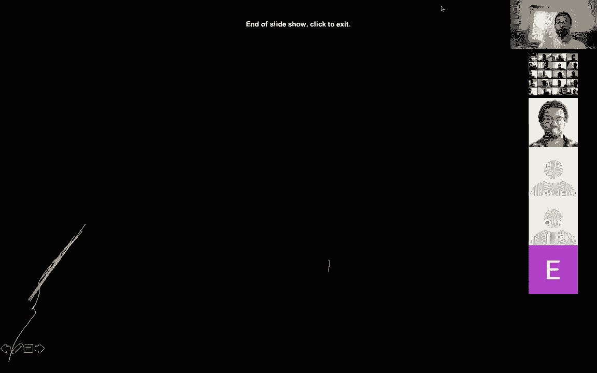

# 课程 P9：L9 - 流形与网格 📘


在本节课中，我们将学习几何深度学习中的流形与网格。我们将探讨流形的基本概念、局部结构、测地线、等距变形以及流形上的谱分析。这些概念对于理解三维物体建模、计算机图形学和计算机视觉中的几何深度学习至关重要。

---

## 🌐 为什么需要流形？

对于计算机科学家而言，流形可能是一个相对陌生的概念。在计算机图形学和计算机视觉中，流形是三维物体的良好模型，主要有两个原因。

首先，三维物体可以通过其边界表面（即二维流形）来描述，而不是通过其内部体积。这种表示方式更加高效，因为许多应用（如渲染）只关心物体的外部表面。

其次，当处理可变形形状（如人体）时，流形表示能够自然地建模其变形，这在虚拟现实、增强现实和三维化身等应用中非常有用。

此外，蛋白质建模等领域也广泛使用流形表示，因为蛋白质分子的相互作用通常只涉及其外部表面。

---

## 🔄 流形上的局部结构与对称性

在之前的课程中，我们讨论了齐次空间，其中任意一点都可以通过群元素变换到另一点。然而，在一般流形上，我们无法做到这一点。这意味着我们需要考虑路径，并且从一点到另一点可能存在多条路径。

这种路径依赖性导致了局部规范对称性，即我们在流形上工作时，必须依赖于局部坐标系的选择，而这种选择是任意的。这种对称性称为规范对称性，将在下一节课中详细讨论。

另一种对称性是全局等距变形，即我们希望流形在变形时，滤波器仍能产生相同的结果。这在图形学应用中尤为重要。

---

## 📏 流形的定义与局部结构

流形是一个拓扑空间，局部类似于欧几里得空间。具体来说，对于流形上的每一点，都存在一个邻域，可以映射到欧几里得空间。我们通常考虑光滑流形，这意味着流形上的过渡函数是光滑的。

在流形上，每一点都有一个切空间，用于描述局部位移。切空间中的向量是坐标无关的抽象概念，但在计算机中表示时，我们需要通过局部基（规范）将其表示为坐标数组。

---

## 📐 黎曼度量与测地线

为了在流形上测量长度、角度和面积，我们需要引入黎曼度量。黎曼度量是切空间上的局部内积，用 $g_u$ 表示。通过黎曼度量，我们可以定义曲线的长度，并找到连接两点的最短路径，称为测地线。

测地线的长度可以通过积分速度向量的内积来计算：
$$
L(\gamma) = \int_0^T \sqrt{g_{\gamma(t)}(\dot{\gamma}(t), \dot{\gamma}(t))} \, dt
$$
其中 $\gamma(t)$ 是曲线参数化。

---

## 🧭 平行移动与指数映射

在流形上移动向量时，我们需要保持向量的长度和与速度向量的角度不变。这种移动方式称为平行移动。通过测地线，我们可以定义一种规范的平行移动方式。

指数映射是一种将切空间中的向量映射回流形的方法。它通过沿测地线移动一步来实现。指数映射是局部微分同胚，但其全局性质可能不理想。

---

## 🌀 流形上的卷积与规范对称性

在流形上定义卷积时，我们需要处理规范对称性。具体来说，卷积的结果依赖于局部坐标系的选择。为了解决这个问题，我们可以采用以下方法：

1. **固定规范**：通过某种方式为流形上的每一点分配一个局部坐标系。
2. **各向同性滤波器**：设计不依赖于方向的滤波器，从而避免规范对称性问题。
3. **谱分析**：通过流形上的拉普拉斯算子定义谱卷积，这种方法天然具有等距不变性。

以下是各向同性滤波器的示例代码：
```python
def isotropic_filter(signal, laplacian, alpha):
    # 计算拉普拉斯算子的特征值和特征向量
    eigenvalues, eigenvectors = np.linalg.eigh(laplacian)
    # 对信号进行傅里叶变换
    fourier_signal = eigenvectors.T @ signal
    # 应用滤波器系数
    filtered_signal = eigenvectors @ (alpha * fourier_signal)
    return filtered_signal
```

---

## 🌊 等距变形与内在性质

等距变形是指保持流形上黎曼度量不变的变形。这种变形保持流形上的局部几何结构，因此内在性质（如测地线距离）在等距变形下保持不变。

在实际应用中，我们通常处理近似等距变形，例如人体的不同姿态。通过设计内在滤波器，我们可以确保滤波器在近似等距变形下具有稳定性。

---

## 📡 流形上的傅里叶变换与谱分析

流形上的傅里叶变换可以通过拉普拉斯算子的特征函数来定义。具体来说，信号在流形上的傅里叶变换是其与拉普拉斯特征函数的内积：
$$
\hat{f}(\lambda_i) = \langle f, \phi_i \rangle = \int_M f(u) \phi_i(u) \, du
$$
其中 $\phi_i$ 是拉普拉斯算子的第 $i$ 个特征函数，$\lambda_i$ 是对应的特征值。

谱卷积可以通过在傅里叶域中逐点乘积来实现：
$$
(f * g)(u) = \sum_{i} \hat{f}(\lambda_i) \hat{g}(\lambda_i) \phi_i(u)
$$

然而，谱卷积存在一些缺点，例如计算复杂度高、滤波器缺乏方向性以及对变形的不稳定性。

---

## 🧩 网格离散化与图拉普拉斯算子

在实际应用中，流形通常通过网格（如三角网格）进行离散化。三角网格由节点、边和面组成，并且需要满足流形性质。

在网格上，我们可以定义离散的拉普拉斯算子。一种常用的定义是余切权重拉普拉斯算子：
$$
L_{ij} = \begin{cases}
-\frac{1}{2} (\cot \alpha_{ij} + \cot \beta_{ij}) & \text{if } i \neq j, \\
\sum_{k \neq i} -L_{ik} & \text{if } i = j,
\end{cases}
$$
其中 $\alpha_{ij}$ 和 $\beta_{ij}$ 是边 $(i, j)$ 对应的两个三角形的对角。

离散拉普拉斯算子可以表示为稀疏矩阵，从而高效计算。

---

## 🌐 图上的谱卷积与图神经网络

谱卷积的思想可以推广到图上。图上的傅里叶变换通过图拉普拉斯算子的特征向量定义。然而，计算特征向量的复杂度较高，因此通常采用多项式滤波器来近似谱卷积。

多项式滤波器的形式如下：
$$
g_{\theta}(L) = \sum_{k=0}^{K} \theta_k L^k
$$
其中 $L$ 是图拉普拉斯算子，$\theta_k$ 是多项式系数。

这种方法避免了显式计算特征向量，并且具有局部性和稳定性。

---

## 🧠 总结

在本节课中，我们一起学习了流形与网格的基本概念及其在几何深度学习中的应用。我们探讨了流形的局部结构、黎曼度量、测地线、平行移动、等距变形以及流形上的谱分析。此外，我们还讨论了网格离散化和图上的谱卷积方法。





通过本节课的学习，你应该对流形与网格在几何深度学习中的重要性有了更深入的理解，并能够应用这些概念解决实际问题。在下一节课中，我们将进一步探讨规范对称性与规范等价滤波器。