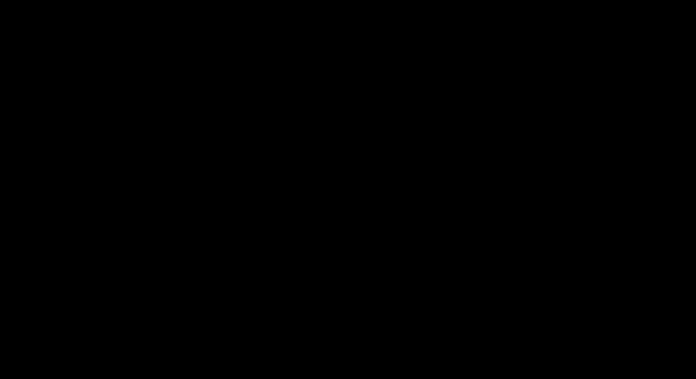
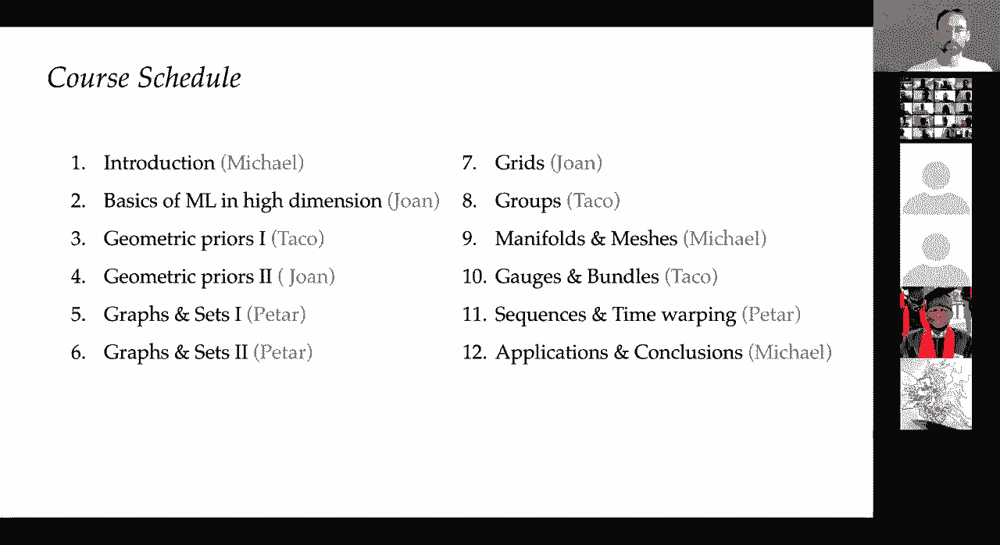

# 1：L1 - 几何深度学习介绍 📚

在本节课中，我们将学习几何深度学习的基本概念、其背后的核心思想——对称性，以及如何利用对称性原理来统一理解现代深度学习中的各种神经网络架构。

---

## 概述

几何深度学习旨在为深度学习提供一个统一的数学框架，其核心思想源于19世纪克莱因的埃尔朗根纲领：**几何学是对称性的研究**。我们将看到，从卷积神经网络到图神经网络，许多成功的架构都可以从对称性原理中推导出来。这不仅有助于我们理解现有方法，更能为我们设计新的、更强大的模型提供指导原则。

---

## 对称性：科学与艺术的核心

对称性在科学和艺术中占据着特殊地位。从古希腊人认为圆形因其旋转对称性而完美，到柏拉图认为柏拉图立体是构成物质世界的基本单元，对称性一直是人类理解美与和谐的核心概念。

数学家赫尔曼·外尔曾写道：“对称性，无论你如何定义其含义的宽窄，都是人类世世代代试图理解和创造美与完美的一个理念。”

在科学史上，对称性也扮演了关键角色：
*   开普勒在1611年研究雪花六重对称性时，就预见了物质的原子和分子结构。
*   诺特定理指出：物理系统的每一个可微对称性，都对应着一个守恒定律。例如，能量守恒源于时间的平移对称性。
*   现代物理学的标准模型，统一描述了除引力外的所有基本力，其数学基础正是群论和规范对称性。

可以说，**物理学在很大程度上就是对对称性的研究**。

---

## 深度学习：现状与挑战

过去十年，深度学习在数据科学领域引发了一场真正的革命，实现了计算机视觉、语音识别、自然语言处理等领域的突破。

然而，当前的深度学习领域也面临着与19世纪几何学相似的困境：我们拥有适用于不同数据类型的各种神经网络架构（如CNN、GNN、Transformer等），但缺乏统一的原则。这导致不同方法之间的关系难以理解，甚至出现同一概念在不同领域被重复发明和命名的情况。

因此，我们需要一种统一的理论框架，这正是**几何深度学习**的目标。

---

## 几何深度学习蓝图

几何深度学习提供了一个通用蓝图，其核心是识别并利用数据中的**几何先验**（即对称性结构）。

### 核心概念

考虑一个监督学习问题，我们试图学习一个函数 **f**。输入信号 **x** 定义在某个几何域 **Ω** 上（例如，图像是二维网格，分子是图）。该域的结构由一个对称群 **G** 描述（例如，图像的平移群，图的置换群）。

根据任务不同，我们期望学习的函数 **f** 具有以下两种关键属性之一：

1.  **不变性**：函数的输出不随输入在对称群 **G** 下的变换而改变。
    *   **公式**：`f(ρ(g)x) = f(x)`，对于所有 `g ∈ G`。
    *   **例子**：图像分类。无论猫在图片中的哪个位置，分类结果都应是“猫”。

2.  **等变性**：函数的输出以与输入相同的方式随对称变换而改变。
    *   **公式**：`f(ρ(g)x) = ρ'(g)f(x)`，对于所有 `g ∈ G`。
    *   **例子**：图像分割。输入图像平移，输出的像素级标签掩码也应同步平移。

### 通用架构蓝图

基于不变性和等变性，我们可以构建一个通用的神经网络架构蓝图：

1.  **一系列等变层**：这些层处理数据，同时保持域的对称结构。
2.  **（可选的）局部池化层**：通过粗化域来构建多尺度层次结构，分离不同尺度的相互作用。
3.  **全局不变池化层**：聚合所有信息，产生一个单一的、不变的输出（适用于分类等任务）。

这个蓝图可以应用于各种几何结构，我们称之为几何深度学习的 **5G**（Grids， Groups， Graphs， Gauges， Geodesics）。

---

## 实例解析：从图到网格

以下是几何深度学习蓝图在不同数据类型上的具体体现。

### 图与置换对称性

图是表示关系系统的通用结构，从分子（原子为节点，化学键为边）到社交网络皆是如此。

图的关键几何先验是**置换对称性**：节点的编号顺序是任意的，不应影响模型的结果。

*   **置换不变函数**：整个图输出一个值（如预测分子能量）。无论节点如何重新排序，输出不变。
*   **置换等变函数**：为每个节点输出一个值（如社交网络中检测恶意用户）。节点重新排序时，输出值的顺序同步改变。

典型的图神经网络架构遵循我们的蓝图：
*   **等变层（消息传递）**：每个节点聚合其邻居的特征。聚合函数 `φ` 必须是置换不变的，因为邻居没有固定顺序。
    *   **常见形式**：`h_i^(l+1) = φ( h_i^(l), ⨁_{j∈N(i)} ψ(h_i^(l), h_j^(l)) )`
    *   其中 `⨁` 是置换不变聚合操作（如求和、求最大值），`ψ` 是计算“消息”的函数。
*   **全局池化层**：将所有节点特征聚合，得到图级表示。

图神经网络的思想源远流长，与图论中的Weisfeiler-Lehman算法和化学信息学中的分子指纹方法有着深刻联系。

### 网格与平移对称性：卷积的诞生

网格（如图像像素阵列）可以看作具有规则邻接结构的特殊图。其关键的几何先验是**平移对称性**。

在网格上，我们拥有固定的邻域顺序（例如，一维链中每个节点有左、右两个邻居）。因此，我们不再需要置换不变的聚合，而是可以设计**平移等变**的线性操作。

*   **平移等变线性操作**：一个线性算子 **W** 如果与平移算子 **T** 满足 `WT = TW`，则它是平移等变的。
*   **数学结论**：所有与平移算子交换的线性算子都是**循环矩阵**，而循环矩阵定义的运算正是**卷积**。
    *   **代码/公式**：`(x * ψ)_u = ∑_{v∈Ω} x_v ψ_{u-v}`，其中 `*` 表示卷积。
*   **傅里叶分析**：由于循环矩阵可被傅里叶基对角化，卷积在傅里叶域中变为逐点乘积。这解释了卷积定理。

因此，**卷积神经网络中的卷积操作，本质上是平移对称性所要求的线性等变操作的必然形式**。它不再是一个凭空而来的公式，而是对称性原理的自然产物。

---

## 扩展领域：流形与规范对称性

对于更复杂的非欧几里得空间，如球面或一般流形（可视为弯曲的多维曲面），对称性的表现形式更加丰富。

### 齐次空间：球面卷积

以球面为例，其对称群是三维旋转群 **SO(3)**。我们可以定义球面上的卷积，其输出定义在整个 **SO(3)** 群上（而不仅仅是球面点）。这体现了**全局对称性**。

### 一般流形与规范理论

一般流形可能没有全局对称性。它们只是局部类似于欧几里得空间。关键区别在于**平行移动**：在弯曲表面上移动一个向量，结果取决于路径。

为了在流形上定义类似卷积的操作，我们需要在每点引入一个局部参考系，称为**规范**。选择规范的方式（即允许的变换）构成了**结构群**（如旋转群 **SO(2)**）。滤波器必须在规范变换下进行相应的变换，即满足**规范等变性**。

这种**本征的**、**与度量无关**的卷积定义，使得网络对流形的等距变形（如弯曲、拉伸而不撕裂）具有不变性，这在3D形状分析、计算机图形学中至关重要。

---

## 应用与展望

几何深度学习，特别是图神经网络，已在众多领域得到广泛应用：
*   **自动驾驶**：场景理解、轨迹预测。
*   **药物发现**：分子属性预测、新抗生素设计。
*   **蛋白质结构预测**：如AlphaFold2的核心组件。
*   **物理科学**：粒子碰撞事件识别、材料发现。
*   **组合优化**：芯片布局设计。
*   **计算机图形学**：3D形状匹配、合成、动作捕捉。

这些应用表明，处理几何结构化数据的能力已成为现代机器学习不可或缺的一部分。

---

## 课程安排总结

在本节课中，我们一起学习了几何深度学习的核心动机与基本蓝图。我们了解到，对称性是统一理解众多神经网络架构的关键原理。

后续课程将逐步深入：
*   **基础数学**：高维机器学习、群论、表示论。
*   **核心架构**：图神经网络、序列模型（LSTM/Transformer）。
*   **进阶领域**：流形、网格、规范与纤维丛理论。

通过本课程，我们希望为你提供一个强大的理论透镜，不仅用以理解现有的深度学习模型，更能用于未来创造性地设计新的算法。

---