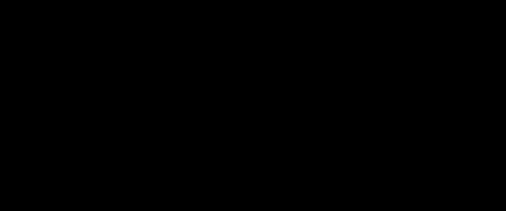
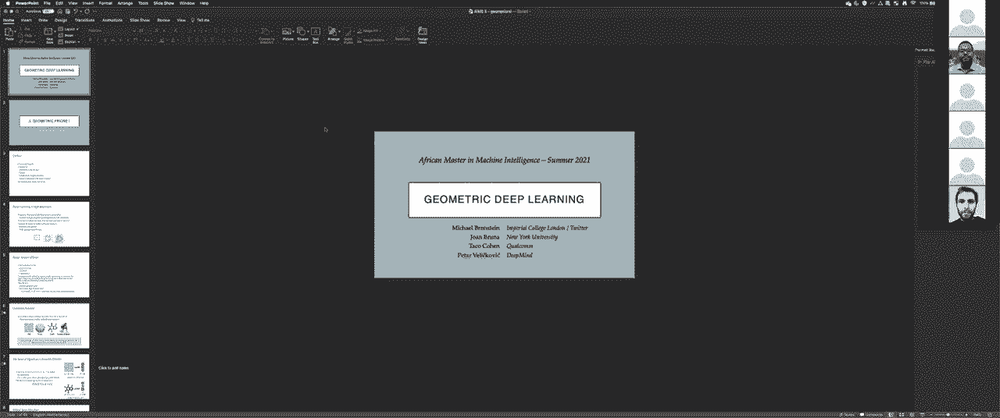

# 3：L3 - 几何先验 1 📐

在本节课中，我们将学习几何深度学习中的核心概念——几何先验。我们将重点探讨**对称性**和**尺度分离**，这些先验知识能帮助我们更好地处理高维诅咒问题。具体来说，我们将深入研究一些基础的数学思想，如**群**、**表示**、**不变性**和**等变性**。

---

## 🗺️ 域与信号

上一节我们回顾了高维学习的挑战，本节中我们来看看几何深度学习如何处理数据。在几何深度学习中，数据通常存在于一个我们称之为 **域** 的结构上，记为 Ω。域可以是网格、图、流形等。

数据本身并不是域，而是域上的**信号**。信号本质上是一个函数，通常记为 **x**。它将域 Ω 中的一个元素映射到某个向量空间 **C** 中的一个向量，**C** 的维度通常被称为通道数。

以下是几个例子：
*   **网格（图像）**：域 Ω 是 Z_n × Z_n（一个网格）。信号 x 将每个网格点映射到一个 RGB 值向量（R³）。
*   **图（分子）**：域 Ω 是图的节点集合。信号 x 为每个节点分配一个独热编码向量，表示原子类型（如碳、氮、氧）。

信号空间 X(Ω; C) 具有一个有趣的结构：它总是一个**向量空间**。即使域本身没有向量空间结构（如图的节点无法相加），我们也可以逐点地加和信号与标量相乘。数学上，对于信号 x, y 和标量 α, β，有：
`(αx + βy)(u) = α x(u) + β y(u)`
其中 u ∈ Ω。

此外，在定义了通道空间 C 上的内积和域 Ω 上的测度后，信号空间可以成为一个**希尔伯特空间**，从而允许我们进行模式匹配（如卷积中的滤波器比较）。

---

## 🔄 对称性

现在，让我们进入本节课的核心：对称性。对称性是指**使对象保持不变的变换**。

在几何深度学习中，“对象”可以非常抽象。我们关注几种在机器学习中出现的对称性：

1.  **参数化对称性**：指神经网络权重空间的变换，该变换不改变网络实现的输入-输出函数。例如，交换同一层内神经元的顺序及连接。
2.  **标签函数对称性**：指输入空间的变换，该变换不改变真实的标签。例如，在图像分类中，旋转或平移图像通常不改变其类别。如果已知标签函数的所有对称性，理论上就解决了分类问题。
3.  **域对称性**：这是几何深度学习的重点。它源于数据所在域 Ω 本身的结构。变换 g 是域 Ω 的对称性，如果它**保持了 Ω 的结构**（例如，集合的排列、欧几里得空间的等距变换、流形的微分同胚）。

所有对称性的集合具有特定的代数结构，这由**群**的概念来形式化。

---

## 👥 群与群作用

一个**群** (G, ·) 是一个集合 G 配上一个二元运算（记作 juxtaposition），满足：
*   **结合律**： (gh)l = g(hl)
*   **单位元**： 存在唯一元素 e，使得 ge = eg = g
*   **逆元**： 对每个 g，存在唯一 g⁻¹，使得 g g⁻¹ = g⁻¹ g = e
*   **封闭性**： 对任意 g, h ∈ G，有 gh ∈ G

域的对称性自然构成一个群。这个群可以**作用**在域 Ω 上，也可以进而**作用**在信号空间 X 上。

域 Ω 上的群作用：对于 g ∈ G, u ∈ Ω，将 u 映射到 g·u。
信号空间 X 上的群作用（由 Ω 上的作用诱导）：对于信号 x，定义变换后的信号 (g·x) 为：
`(g·x)(u) = x(g⁻¹ · u)`
这个作用的一个重要性质是它是**线性**的，即：
`g·(αx + βy) = α(g·x) + β(g·y)`
这种线性的群作用也称为**群表示**。

---

## 🧮 群表示

一个群 G 的 **n 维实表示** ρ 是一个映射，它将每个群元素 g 对应到一个 n×n 可逆矩阵 ρ(g)，并且满足同态性质：ρ(gh) = ρ(g)ρ(h)。

表示的空间维度（n）与群本身的大小或结构无关。例如：
*   **循环平移群**： 群 G = ℤ（整数加法）。域 Ω = ℤ₅（5个点）。表示空间是5维向量（5个信号值）。表示 ρ(n) 是一个循环移位矩阵。
*   **图上的对称群**： 群 G = S_n（n个元素的排列群）。根据特征类型，表示不同：
    *   **图级特征（输出）**： 使用**平凡表示**，即 ρ(g) = 1，对所有排列不变。
    *   **节点特征**： 使用**置换表示**，即 ρ₁(g) 是相应的置换矩阵。
    *   **边特征/邻接矩阵**： 使用**张量表示** ρ₂(g)，同时作用于行和列：ρ₂(g)·M = P M Pᵀ，其中 P 是置换矩阵。

---

## ⚖️ 不变性与等变性

在深度学习中，我们如何利用对称性？我们引入两个关键概念：**不变函数**和**等变函数**。

假设我们有一个对称性（如旋转），它是标签函数的对称性。一个理想的分类器应该是**不变的**：无论输入如何旋转，输出（类别）应保持不变。

然而，在构建深度网络时，过早地强制所有中间表示都是不变的可能有害。因为要识别整体，需要先识别部分，而部分之间的**相对空间关系**至关重要。如果每个部分的表示都对旋转不变，那么“旋转每个部分”和“旋转整个图像”会产生相同的中间表示，导致错误。

解决方案是使用**等变网络**。在等变网络中，每一层的变换与输入的变换“同步”进行。

形式化定义：设网络层为 f: X → Y。设 ρ_X 和 ρ_Y 分别是群 G 在输入空间 X 和输出空间 Y 上的表示。如果对于所有 g ∈ G 和 x ∈ X，有：
`f( ρ_X(g) x ) = ρ_Y(g) f(x)`
则称层 f 是 **等变的**。如果 ρ_Y 是平凡表示（即 ρ_Y(g) = 1），则称 f 是 **不变的**。

等变性确保了网络内部对特征的变换与输入数据的变换保持一致，从而在最终层自然地实现整体不变性，同时保留各部分之间的重要关系。

与**数据增强**相比，等变网络提供了**层级的、结构化的约束**，通常能带来更好的数据效率和泛化性能，尤其对于对称群很大（如图的排列群）或难以通过采样覆盖所有变换的情况。

---

## 📝 总结

本节课中我们一起学习了：
1.  **域与信号**：几何深度学习中的数据存在于具有结构的域上，数据本身是域上的信号，信号空间具有向量空间结构。
2.  **对称性**：分为参数化对称性、标签函数对称性和域对称性。域对称性是几何深度学习的重点。
3.  **群与群作用**：对称性的集合构成群，群可以作用在域和信号空间上。信号空间上的作用是线性的。
4.  **群表示**：线性的群作用称为群表示，它将群元素对应为作用在特征空间上的矩阵。
5.  **不变性与等变性**：利用对称性的两种方式。等变网络通过约束每一层与对称变换可交换，来优雅地处理对称性，比单纯的数据增强更具结构优势，并能更好地泛化。

通过引入对称性先验，我们可以设计出更高效、更强大的神经网络架构来处理几何数据。