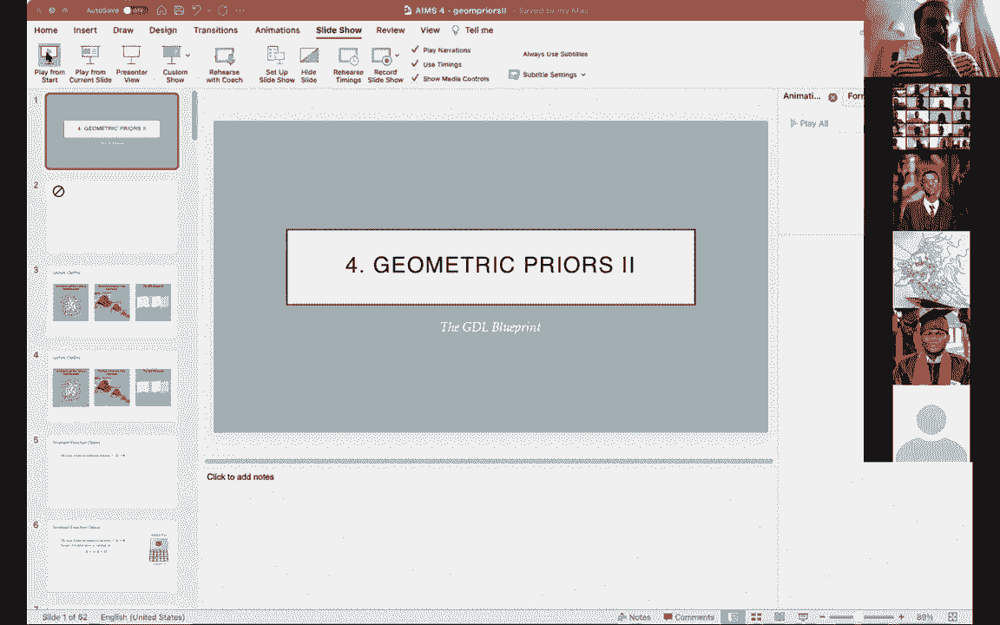
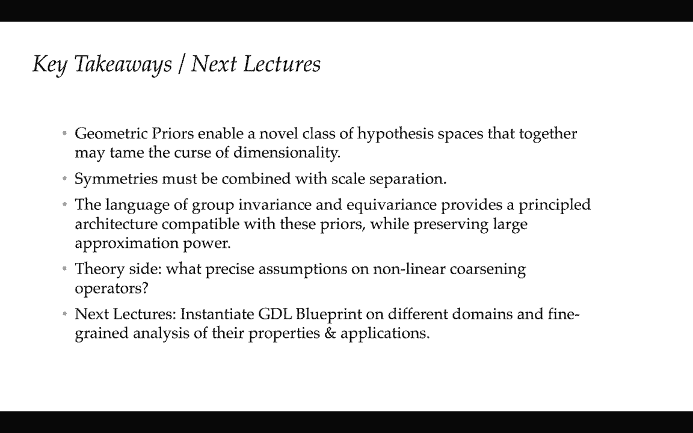
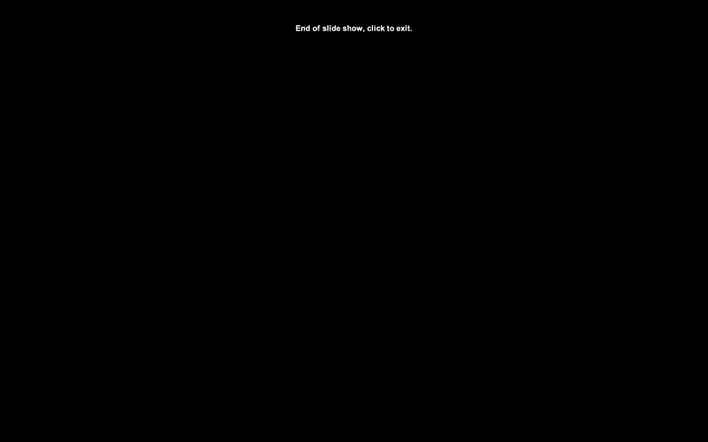
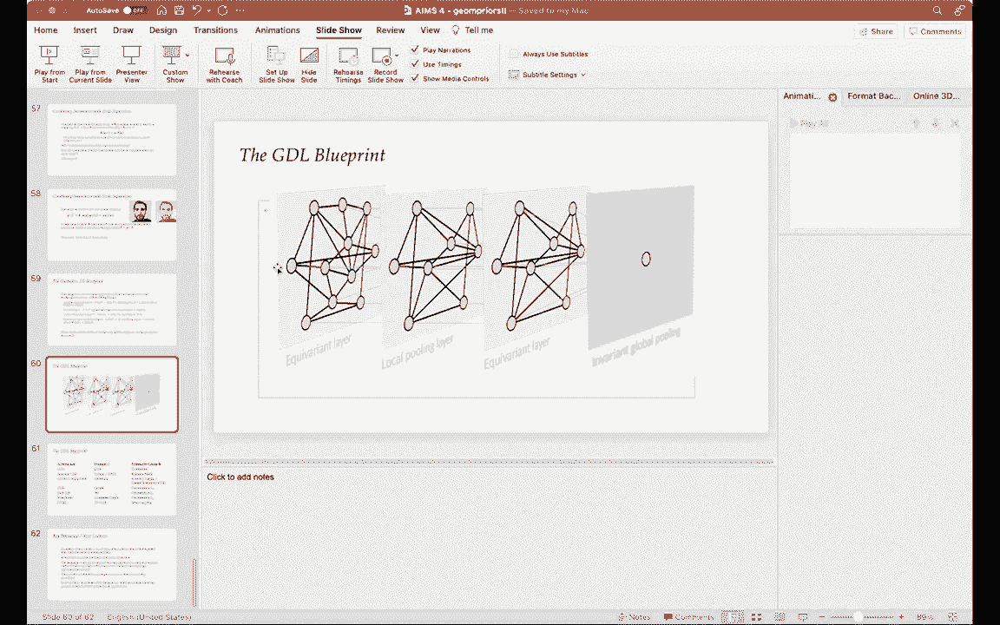
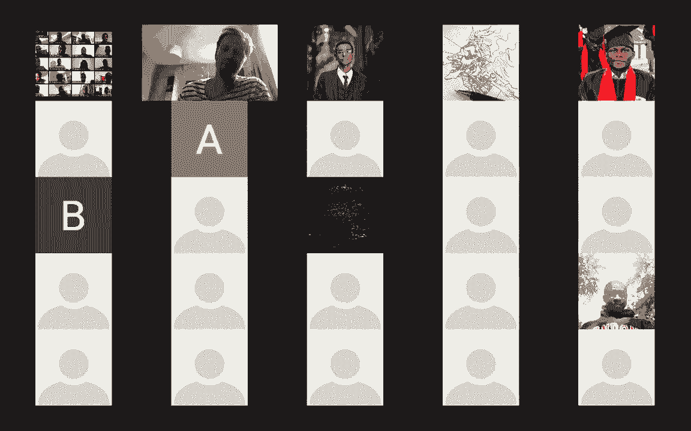

# 4：L4 - 几何先验2 🧠

在本节课中，我们将继续探讨如何利用实际问题中的几何结构来突破维数灾难。我们将把上一节课介绍的**不变性**和**等变性**工具与维数灾难的概念联系起来，并引入另一个重要的先验概念——**尺度分离**。最后，我们将学习如何将这两个先验结合起来，形成一个我们称之为“几何深度学习蓝图”的、基于第一性原理的构造方法。

---

## 1. 回顾：利用群不变性

上一节我们介绍了如何利用群不变性来构建假设空间。本节中，我们来看看如何形式化地利用这一先验。

在统计学习的设定中，我们的目标是学习一个未知的目标函数 `f*`。我们做出的**承诺**是：目标函数 `f*` 对于某个变换群 `G` 是**不变**的。这意味着对于群 `G` 中的任何元素和任何输入，函数值不会改变。

一个很自然的想法是：如何利用这个承诺来改进我们的假设类？一个直接的方法是引入**群平滑算子**。这个算子将任何假设函数 `f` 替换为它在整个群 `G` 上的平均值。

**公式**：群平滑算子 `S_G` 定义为：
`S_G[f](x) = (1/|G|) * Σ_{g∈G} f(g·x)`

更形象地说，这相当于在预测时，对输入在群轨道上的所有变换结果进行平均预测。

一个关键的观察是：如果目标函数 `f*` 本身是 `G` 不变的，那么对它应用平滑算子不会改变它。这启发我们，可以取任何假设类 `F`，然后通过应用平滑算子 `S_G` 使其变得 `G` 不变。

**重要结论**：
*   **近似误差不受影响**：将假设类限制为不变函数，并不会增加对不变目标函数的最佳近似误差。这是因为平滑算子是一个正交投影。
*   **统计误差可能减小**：由于假设类变小了，统计误差（由样本复杂性体现）有望降低。

然而，一个关键问题是：仅靠全局对称性能否**突破**维数灾难？研究表明，虽然统计误差的**前置因子**可能因群的大小而显著减小（甚至是指数级的），但误差随维度衰减的**速率**本身可能并未改变。这意味着，仅靠全局对称性可能不足以从根本上解决维数灾难问题。

---

## 2. 引入尺度分离先验

既然全局对称性可能不够，我们需要引入新的先验。本节我们将探讨另一个强大的概念：**尺度分离**。

在计算机视觉、物理学和计算生物学等多个领域，**多尺度**是一个核心思想。许多系统在不同尺度上表现出不同的行为，理解它们需要分层处理信息。

在几何域上处理信息时，我们可以通过**多分辨率分析**来形式化这一直觉。以二维图像网格为例，多分辨率分析旨在将信号分解为生活在更粗尺度（分辨率更低）上的信号，加上恢复原信号所需的细节。

**核心思想**：通过改变网格的分辨率（即像素数量），我们实际上是在攻击维数灾难的根源——输入维度。降低分辨率意味着降低有效维度。

以下是尺度分离可能起作用的几种情况：

1.  **粗尺度主导**：某些函数（例如，判断图像中是海滩还是山脉）可能只需要粗尺度信息就能很好地近似。此时，使用降采样后的低维输入 `x̃` 即可，从而规避了高维诅咒。
2.  **局部尺度主导**：某些函数（例如，纹理识别）可以很好地近似为局部项的和。此时，相关维度不再是整个图像的像素数，而是局部补丁的大小。
3.  **局部马尔可夫随机场**：许多高维概率模型（如图像的联合分布）可以表示为局部势函数的和，这同样将复杂度从图像大小转移到局部团的大小。

然而，现实通常是混合的。我们需要一个能结合粗尺度和细尺度信息的模型。这引出了**组合模型**的一般形式：

**公式**：`f*(x) ≈ f̃( P(x) )`
其中 `P` 是一个非线性局部粗化算子（提取多尺度特征），`f̃` 是在粗化特征上操作的函数。

---

## 3. 结合不变性与尺度分离：几何深度学习蓝图

上一节我们看到了尺度分离的威力，本节我们将学习如何将其与不变性先验结合起来，形成一个通用的架构蓝图。

首先，我们思考如何构建与群结构良好互动的算子。我们从**线性算子**开始。

**关键观察**：如果一个线性算子 `f` 是 `G` 不变的，那么它只能是输入在群轨道上平均值的函数。这意味着仅靠线性不变算子，我们只能得到像全局平均池化这样的简单操作，表达能力非常有限。

为了获得更丰富的特征，我们需要引入**等变性**。等变算子 `Φ` 满足：`Φ(g·x) = g'·Φ(x)`，即它与群作用“交换”。我们可以先使用等变算子提取特征，然后再从中提取不变信息。

但直接组合一个线性等变算子 `B` 和一个线性不变算子 `A` 行不通（`A∘B` 可能不再是等变或不变的）。解决方案是引入**非线性**。

一个有效的组合是：**线性等变层** → **逐点非线性激活函数** → **（可选）粗化/池化**。可以证明，这个组合保持了所需的等变或不变性质。

综合以上所有要素，我们得到了**几何深度学习蓝图**的构建模块：

以下是构建模块列表：
1.  **线性等变层**：在不同域（网格、图、流形等）上实现，用于传播信息。
2.  **逐点非线性**：如 ReLU，增加模型的表达能力。
3.  **粗化/池化**：实现多分辨率分析，逐步降低空间分辨率并扩大感受野。
4.  **不变化层**：在网络的最后或中间，通过群平均等方式提取不变特征。

这个蓝图的强大之处在于其**通用性**。相同的设计原则可以应用于不同的数据域（网格、群、图、流形），只需根据域的对称性具体化等变层的形式。许多著名的神经网络架构（如 CNN、GNN）都可以看作是这个蓝图的特例。

---

## 4. 总结与问答环节

本节课我们一起学习了如何利用几何先验来设计机器学习模型。

**总结**：
*   我们回顾了**群不变性**先验，它可以通过平滑算子融入假设类，降低统计误差，但可能不足以单独突破维数灾难。
*   我们引入了**尺度分离**先验，它通过多分辨率分析处理信息，是突破维数灾难的关键思想，体现在局部性、层次化和粗化等操作中。
*   我们看到了如何将**不变性**与**等变性**、**非线性**和**尺度分离**结合起来，形成一个通用的**几何深度学习蓝图**。这个蓝图为我们提供了从第一性原理构建神经网络架构的语言和工具。

理论方面，关于尺度分离的精确量化及其对泛化误差的贡献，仍然是开放且活跃的研究领域。在接下来的课程中，我们将把这个蓝图具体应用到不同的数据域上，深入分析其性质。

---

**课堂问答精选**：

*   **问**：粗化如何减少维数灾难？
    *   **答**：维数灾难指所需样本数随输入维度指数增长。对于图像，维度约等于像素数。粗化减少了像素数，从而直接降低了样本复杂度的指数项。但关键是不能简单地丢弃信息，而需要通过非线性处理进行智能的、层次化的粗化。

*   **问**：尺度分离如何处理数据中的噪声？
    *   **答**：设计良好的多分辨率分析（如小波）本身对噪声是稳定的。在多层表示中，噪声通常不会在粗化过程中被放大。事实上，多尺度表示中的稀疏性使得我们可以通过阈值化等方法有效去噪，这在像素域是难以直接做到的。

*   **问**：蓝图中的操作顺序是否重要？
    *   **答**：是的，顺序很重要。如果一开始就进行全局平均（不变化），会丢失所有空间信息。典型的、有效的顺序是：交替进行**等变变换+非线性**和**粗化**，最后阶段再进行**不变化**以得到最终输出。这与主流深度网络架构的设计是一致的。

*   **问**：网络的深度与尺度有何关系？
    *   **答**：在多尺度架构中，深度通常与处理的尺度数量相关，每一层可能对应一个尺度。然而，在现代非常深的网络（如 ResNet）中，深度的作用超越了简单的尺度提取，它更关乎梯度流动、特征复用和复杂函数的表示能力。深度的确切角色在理论上仍是一个具有挑战性的开放问题。