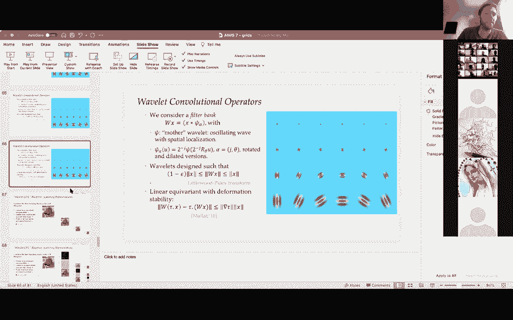

# 7：L7 - 网格 🏁

在本节课中，我们将学习网格（Grid）这一特定几何域上的几何深度学习蓝图。我们将从平移群和傅里叶变换开始，探讨其局限性，然后引入多尺度表示（如小波变换），并最终理解卷积神经网络（CNN）如何自然地成为这些概念的集大成者。

***

## 平移群与网格结构

上一节我们回顾了在不同域（如集合、图）上实例化蓝图的方法。本节中，我们来看看一个更简单的域：网格。

网格可以有不同的形式，例如一维的离散点线、二维的图像像素或三维的视频体素。在这些网格上，最自然的操作是**平移**。

为了数学上的便利，我们通常假设网格具有**周期性边界条件**。这意味着当我们将一个点移出边界时，它会从另一侧重新进入。这样，平移操作就形成了一个**循环群**，其代数结构与模 `d` 的算术运算同构。

对于 `s` 维网格，其平移群是 `s` 个循环群的笛卡尔积。在连续域的情况下，带有周期性边界条件的正方形域等价于一个**环面**（Torus）。网格的一个有趣特性是，其变换群的集合结构恰好与域本身的集合结构重合。

***

## 信号与线性表示

我们关心的是这些域上的变换如何作用于定义在域上的**信号**。我们将域上的变换“提升”为信号空间上的线性变换。

对于一个离散的一维网格，其上的信号可以表示为一个 `d` 维向量。平移操作作用于信号上，可以表示为一个矩阵。这个矩阵被称为**移位算子** `S`。

移位算子 `S` 是一个 `d × d` 的矩阵，其主对角线之上有一条由1组成的线，并且在左下角也有一个1。任何平移操作都可以表示为移位算子 `S` 的某个整数次幂 `S^k`。这个事实可以用来证明平移群是一个**阿贝尔群**（交换群）。

***

## 线性不变性与等变性

根据几何深度学习蓝图，关键在于充分理解**线性不变**和**线性等变**的结构。

### 线性不变性

线性不变算子是一个从 `R^d` 到 `R` 的线性函数 `Φ`，满足对于任何平移 `g`，有 `Φ(g·x) = Φ(x)`。

这样的函数可以表示为与某个向量 `v` 的点积：`Φ(x) = x^T v`。将不变性条件代入，并利用平移可表示为 `S^k` 的性质，我们可以推导出 `v` 必须是移位算子 `S` 的对应于特征值1的特征向量。可以证明，满足此条件的唯一解是 `v` 为全1向量。

### 线性等变性

线性等变算子是一个从 `R^d` 到 `R^d` 的线性算子 `C`（即一个矩阵），满足对于任何平移 `g`，有 `C(g·x) = g·C(x)`。

利用平移的矩阵表示，等变性条件等价于矩阵 `C` 与移位算子 `S` **可交换**：`C S = S C`。

***

## 傅里叶变换与频谱分析

为了刻画所有与 `S` 可交换的矩阵 `C`，我们需要研究 `S` 的**特征结构**。移位算子 `S` 是一个正规矩阵，因此可以被酉对角化。

`S` 的特征向量是一系列**复指数向量**，对于 `k = 0, 1, ..., d-1`，第 `k` 个特征向量 `v_k` 的第 `j` 个分量为：
`v_k[j] = exp(2πi * j * k / d)`

这些特征向量构成了**离散傅里叶变换（DFT）**的基。将所有这些特征向量作为列向量排列成一个矩阵 `V`，则信号 `x` 的傅里叶变换为 `x̂ = V^H x`（其中 `V^H` 是 `V` 的共轭转置）。傅里叶变换是一个等距映射，并且有高效的快速算法（FFT）。

由于矩阵 `C` 与 `S` 可交换，而 `S` 在傅里叶基下是对角矩阵，因此 `C` 在傅里叶基下也必然是对角矩阵。这意味着等变算子 `C` 在傅里叶域中表现为**逐点乘法**（或称频谱滤波）。

将这一结论转换回空间域，我们得到了一个关键结论：所有与平移等变的线性算子都是**卷积算子**。具体地，`(Cx)[j] = Σ_{l} α[l] x[j-l]`，其中 `α` 是卷积核（滤波器）。

***

## 傅里叶不变量的局限性

我们可以尝试利用傅里叶变换直接构建不变表示。例如，考虑一个仅保留傅里叶系数模长（幅度）而丢弃相位信息的表示：`Φ(x) = |x̂|`。

这个表示是平移不变的，因为平移在傅里叶域中仅改变相位而不改变幅度。然而，它存在两个严重问题：

1.  **信息丢失严重**：相位信息对于信号重建至关重要。丢弃相位会导致无法区分视觉上完全不同的信号（如图像）。
2.  **对形变不稳定**：我们不仅希望表示对严格的平移不变，更希望它对**微小形变**（如非刚性扭曲）是稳定的。傅里叶模表示对高频分量的小形变极其敏感，会导致表示发生剧烈变化，无法满足形变稳定性要求。

***

## 多尺度表示：小波变换

为了解决傅里叶表示的局限性，我们需要超越纯粹的频谱视角，引入**多尺度表示**。其核心思想不是独立分析每个频率，而是将信息按**尺度**分组处理。

在实践中，这可以通过**小波卷积滤波器组**来实现。它由一组卷积滤波器 `{ψ_α}` 构成，这些滤波器都是由一个**母小波** `ψ` 通过**膨胀**（改变尺度）和**平移**生成的。

小波变换在空间和频率之间提供了一个最优的折衷（受海森堡不确定性原理制约）。更重要的是，精心设计的小波变换具有**形变稳定性**，即当输入信号发生微小形变时，其小波系数的变化是可控的。

***

## 小波散射网络：一个具体的蓝图实例

我们可以将多尺度思想直接嵌入几何深度学习蓝图，构建一个称为**小波散射网络**的表示。它硬编码了等变滤波器的选择，仅在线性分类器层进行学习。

以下是其构建步骤：

1.  **初始低通滤波**：应用一个低通滤波器 `φ`（如高斯平滑）到输入信号 `x`，得到粗尺度的平滑版本 `S_0 x`。这捕获了全局信息但丢失了细节。
2.  **高频信息提取与非线性化**：使用小波滤波器组 `{ψ_λ}` 提取被低通滤波丢失的细节，得到 `|x ∗ ψ_λ|`。非线性函数（这里取模）用于产生稳定的特征。
3.  **迭代与聚合**：对步骤2中产生的每个特征图，再次应用低通滤波 `φ` 以产生一阶散射系数 `S_1 x = { |x ∗ ψ_λ| ∗ φ }`。这些系数对平移稳定。然后，可以重复此过程：对 `|x ∗ ψ_λ|` 再次应用小波滤波器组和非线性，然后再低通滤波，得到二阶散射系数 `S_2 x`，以此类推。
4.  **最终表示**：将所有阶数的散射系数拼接起来，作为整个信号的表示，送入一个线性分类器。

小波散射网络具有坚实的数学基础，被证明是形变稳定的，并且在某些物理建模、宇宙学参数推断等任务上表现良好，因为它不需要大量训练数据。

***

## 通向卷积神经网络

然而，小波散射网络在像ImageNet这样的复杂视觉任务上，性能远不如现代的深度卷积神经网络（CNN）。一个关键原因是散射网络**没有建模不同特征通道之间的交互**。

CNN可以看作是对散射网络蓝图的增强和泛化：

*   **学习滤波器**：CNN不预先硬编码小波滤波器，而是**从数据中学习**最优的卷积核 `α`。
*   **通道间交互**：CNN在每一层卷积之后，通常会引入 `1×1` 卷积或全连接层来处理不同特征通道之间的组合与交互，这是散射网络所缺乏的。
*   **堆叠深度**：通过堆叠多个卷积-非线性层，CNN能够学习越来越复杂和抽象的特征层次。

因此，CNN可以视为在保持平移等变性和形变稳定性等几何先验的同时，极大地增强了模型的**表示能力和适应性**。现代CNN中的其他组件（如残差连接、批量归一化）则进一步优化了优化过程与泛化性能，其与蓝图理论框架的深度融合仍是开放的研究问题。

***

## 总结

本节课中，我们一起学习了网格域上的几何深度学习。

1.  我们从**平移群**及其矩阵表示（移位算子）开始。
2.  通过分析线性不变与等变算子的要求，我们借助**傅里叶变换**发现，等变算子等价于**卷积运算**。
3.  我们指出了纯频谱（傅里叶模）方法在信息保留和形变稳定性上的**局限性**。
4.  为了克服这些局限，我们引入了**多尺度表示**（小波变换），它能更好地处理形变并提取稳定特征。
5.  我们将小波变换嵌入蓝图，实例化为**小波散射网络**，这是一个具有理论保障但表示能力有限的模型。
6.  最后，我们看到**卷积神经网络**如何通过**学习滤波器**和**建模通道交互**，成为融合了多尺度先验与强大学习能力的终极架构，从而在实践上取得了巨大成功。

网格为我们提供了一个理解蓝图核心思想的理想试验场。在接下来的课程中，我们将把蓝图推广到更一般的群和流形等域上。