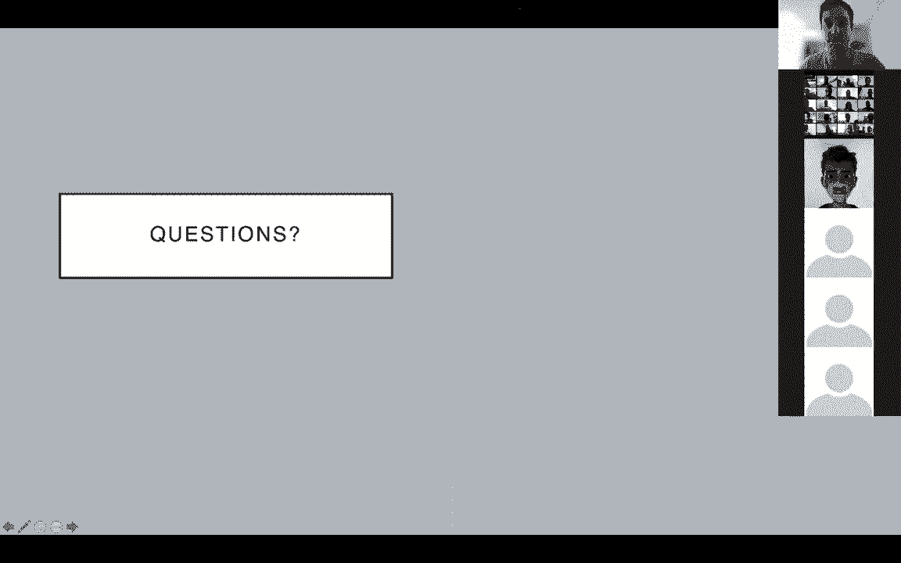
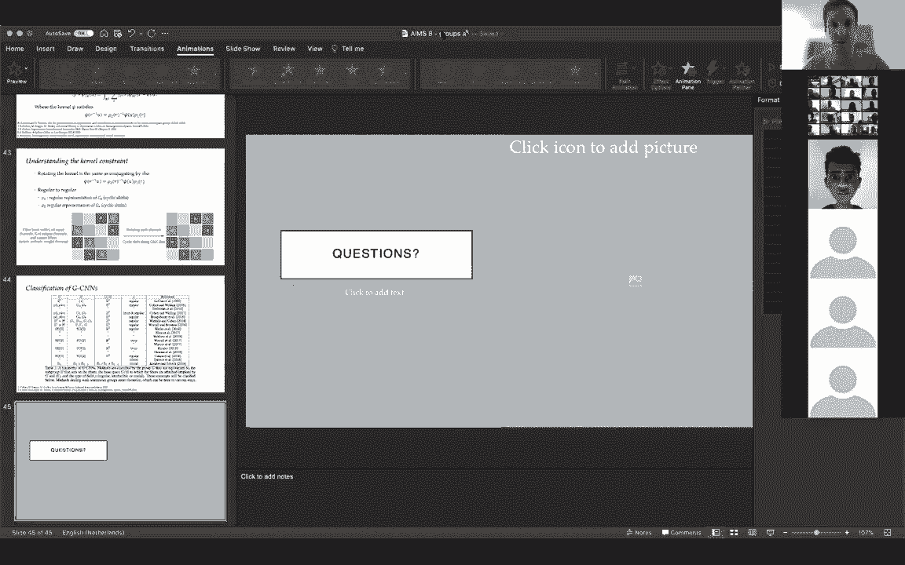

# 8：L8 - 群体与同构空间 🧮

在本节课中，我们将学习群体卷积和可操纵卷积神经网络。我们将从直观理解群体卷积操作开始，探讨如何将卷积从平面上的平移操作推广到其他变换，如平面上的旋转和平移，或球面上的连续三维旋转。接着，我们将深入其背后的数学原理，提炼这些示例中的共同元素，发展适用于任何“同构空间”的通用理论。最后，我们将探讨可操纵卷积神经网络，它允许输入和特征图不仅是流形上的函数，还可以是向量场等其他类型的场。

---

## 群体卷积的直观理解 🔄

上一节我们概述了课程内容，本节中我们来看看群体卷积的直观工作原理。在许多图像识别问题中，我们希望网络对平移和旋转具有等变性。为了简化，我们先考虑离散旋转。

在标准卷积中，我们取一个滤波器（例如眼睛检测器或嘴巴检测器），将其在图像上滑动。当滤波器与图像中的特征（如眼睛）对齐时，会得到强响应。

在群体卷积中，我们不仅平移滤波器，还会对其应用旋转。例如，对于一个眼睛滤波器，我们将其旋转90度后再进行卷积。如果图像中的眼睛方向与旋转后的滤波器不匹配，则响应较弱。我们对多个旋转角度重复此过程。

以下是群体卷积的关键步骤：

1.  **滤波器变换**：对于群体中的每个元素（如特定的旋转和平移组合），我们将该变换应用于滤波器。
2.  **内积计算**：计算变换后的滤波器与输入信号的内积，得到一个响应值。
3.  **输出构成**：所有响应值构成一个在群体上的函数，即输出特征图。

一个有趣的现象是，当我们旋转输入图像并应用相同的群体卷积操作时，输出特征图会以一种特定的方式变换：不仅特征图在空间上旋转，其通道也会发生循环移位。这表明，在网络的不同层，群体可以以不同的表示方式作用在特征空间上。

---

## 从平移卷积到群体卷积的数学形式 📐

上一节我们直观地了解了群体卷积，本节中我们来看看其数学定义，通过与平移卷积类比来理解。

在标准（平移）卷积中，输出特征图 `y` 在位置 `t` 的值是信号 `x` 与平移后的滤波器 `ψ` 的内积：

`y(t) = ∫ x(u) · ψ(u - t) du`

在群体卷积中，我们将变换范围从平移扩展到某个群体 `G`。输出变为群体 `G` 上的一个函数。对于群体元素 `g ∈ G`，其响应计算如下：

`[x ⋆ ψ](g) = ∫ x(u) · ψ(g⁻¹ · u) du`

这里，`g⁻¹ · u` 表示群体 `G` 对定义域 `Ω` 的作用（例如，旋转或平移一个点）。内积在定义域 `Ω` 上对特征向量进行积分（或求和）。

关键观察：**群体卷积的输出是一个定义在群体 `G` 上的函数**。对于网络的更高层，输入和输出都可以是群体上的函数，此时卷积公式依然适用，但群体作用 `ρ` 变为**正则表示**。

---

## 正则表示与等变性证明 ✅

上一节我们给出了群体卷积的公式，本节中我们深入探讨其核心——正则表示，并证明其等变性。

对于群体 `G`，其**正则表示** `ρ_reg` 定义了 `G` 对“群体 `G` 上的函数空间”的作用。具体来说，对于一个信号 `x: G → R^C` 和群体元素 `g`，变换后的信号 `[ρ_reg(g)x]` 在点 `h` 的值为：

`[ρ_reg(g)x](h) = x(g⁻¹ h)`

对于之前讨论的离散旋转平移群，这个数学定义恰好对应了我们观察到的行为：**通道循环移位加上空间旋转**。

现在，我们来证明群体卷积的等变性。假设输入信号 `x` 根据表示 `ρ₁` 变换，我们使用群体卷积将其映射到正则表示 `ρ_reg` 的空间。可以证明，对于任何 `h ∈ G`，有：

`[ (ρ₁(h)x) ⋆ ψ ](g) = [ρ_reg(h) (x ⋆ ψ)](g)`

这意味着，先变换输入再卷积，与先卷积再对输出进行相应的正则表示变换，结果相同。因此，群体卷积是等变的。

此外，一个重要的理论结果是：**在正则表示之间，最一般的等变线性映射就是群体卷积**。这被称为“卷积即所需”定理。

---

## 实现与具体示例 💻

上一节我们探讨了理论，本节中我们来看看如何具体实现群体卷积，并查看其他相关方法。

实现离散旋转平移群的群体卷积主要包含两步：

1.  **滤波器变换**：根据群体元素（如不同旋转角度）对滤波器权重进行变换（旋转和通道置换），生成一个更大的滤波器组。
2.  **标准卷积**：使用变换后的滤波器组，对输入特征图应用标准的 `Conv2D` 操作。

训练完成后，可以将变换和权重共享固化，因此在推理阶段，其计算开销与标准卷积网络相近。

除了基础的群体卷积，还有其他多种方法：

*   **可操纵CNN**：可处理更一般的场（如向量场），而不仅仅是标量函数。滤波器满足特定的约束条件。
*   **球面CNN**：处理定义在球面 `S²` 上的信号，并使其对三维旋转群 `SO(3)` 等变。实现方式包括谱方法、使用特殊网格的图卷积等。
*   **LI-Conv 与 Scale Equivariance**：使用李代数参数化连续滤波器，或构建尺度金字塔来实现尺度等变性。

---

## 同构空间与商空间理论 🌐

上一节我们看了几个具体示例，本节中我们将建立更一般的理论框架——同构空间上的卷积。

一个空间 `Ω` 被称为群体 `G` 的**同构空间**，如果 `G` 在 `Ω` 上的作用是**可传递的**，即对于 `Ω` 中任意两点 `u` 和 `v`，都存在 `g ∈ G` 使得 `g · u = v`。例如：
*   平面是平移群的同构空间。
*   球面 `S²` 是三维旋转群 `SO(3)` 的同构空间。

理解同构空间的关键是**稳定子子群**。对于点 `u ∈ Ω`，其稳定子 `H_u` 是保持 `u` 不变的群体元素集合：`H_u = {h ∈ G | h · u = u}`。在同构空间中，所有点的稳定子彼此同构。

任何同构空间 `Ω` 都可以通过**商空间** `G/H` 来刻画，其中 `H` 是某点的稳定子。商空间 `G/H` 的元素是 `H` 在 `G` 中的**左陪集**。群体 `G` 可以自然地作用在商空间 `G/H` 上。

例如，球面 `S²` 可以看作是旋转群 `SO(3)` 模去绕轴旋转的子群 `SO(2)` 的商空间：`S² ≅ SO(3) / SO(2)`。

---

## 同构空间上的卷积与场 🌟

上一节我们介绍了同构空间，本节中我们探讨如何在其上定义卷积，并引入“场”的概念。

如果我们想在同构空间 `Ω ≅ G/H`（如球面）上直接定义卷积，使得输入和输出都是 `Ω` 上的函数，那么为了保证等变性，**滤波器必须是对稳定子 `H` 不变的（即各向同性的）**。这大大限制了模型的表达能力。

另一种方法是像标准群体卷积一样，在**整个群体 `G`** 上进行操作，使用正则表示。这提供了最大的灵活性（滤波器无约束），但计算成本可能较高，因为特征图定义在 `G` 上，维度更高。

折中的方案是使用**诱导表示**来处理**场**。一个场不仅为空间每个点赋予一个特征向量，还规定了该特征在稳定子 `H` 作用下如何变换（例如，标量场不变，向量场随旋转而旋转）。这种变换规律由 `H` 的一个表示 `ρ` 所决定。

从表示 `ρ` 出发，可以诱导出整个群体 `G` 在“场”的空间上的表示。网络处理这类输入和输出场的，被称为**可操纵CNN**。

对于可操纵CNN，也有一个“卷积即所需”定理：**任何两个诱导表示空间之间的等变线性映射，都可以表示为满足特定约束（可操纵核约束）的卷积**。

---

## 总结 📚

本节课我们一起学习了群体卷积与同构空间的核心知识。

我们首先从直观示例出发，理解了群体卷积如何通过同时考虑平移和旋转来提取特征。接着，我们将其数学化为平移卷积的自然推广，并引入了**正则表示**的概念来刻画特征图在群体作用下的变换规律，同时证明了其等变性。

然后，我们探讨了实现群体卷积的实用方法，并概述了球面CNN等其他相关技术。为了建立统一的理论框架，我们引入了**同构空间**和**商空间**的概念，指出许多常见空间（如平面、球面）都可以视为某个群体模去其稳定子群。

最后，我们讨论了在同构空间上定义卷积的局限性（需要各向同性滤波器），并引入了**场**和**诱导表示**的概念作为解决方案，这引出了表达能力更强且灵活的**可操纵卷积神经网络**。

通过本课程，您应该对如何构建对复杂对称性（如旋转）具有等变性的神经网络有了一个基础而全面的认识。