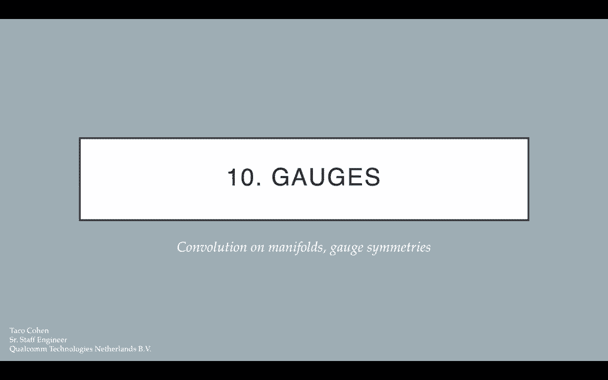
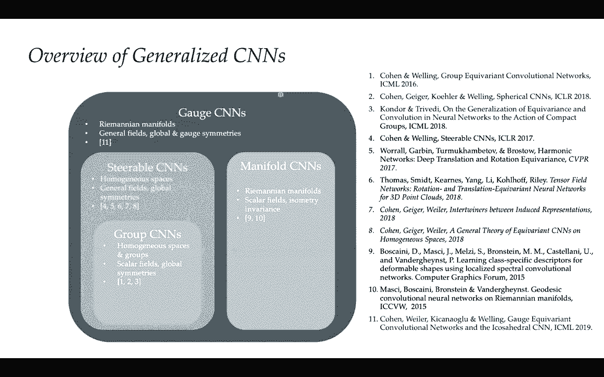
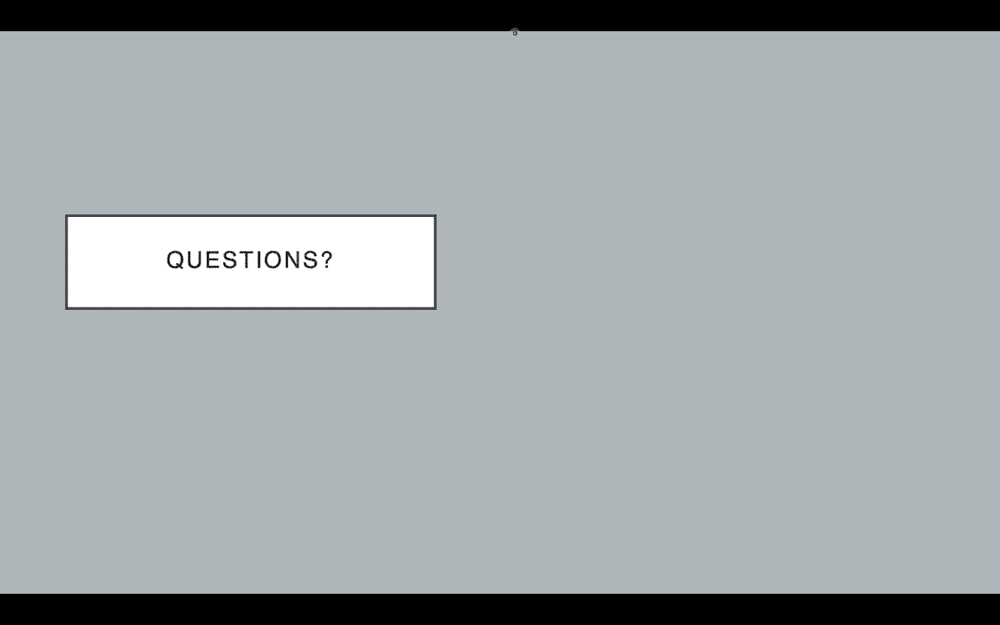

# 10：L10 - 序列数据处理与循环神经网络 📊

在本节课中，我们将学习如何处理序列数据，特别是那些存在于时间序列中的数据。我们将探讨循环神经网络（RNN）及其变体，并揭示一个有趣的现象：一类流行的循环神经网络架构，正是源于对时间扭曲变换不变性的要求。

## 🔄 序列数据与时间扭曲

上一节我们介绍了处理具有空间几何结构数据（如图像、网格、流形）的模型。本节中，我们来看看当数据存在于序列中，尤其是受到时间扭曲变换影响时，我们该如何处理。

在许多实际应用中，输入数据不仅仅是空间配置，还包含时间维度，例如视频、文本和语音。数学上，我们假设输入由多个时间步组成，每个时间步 `t` 都有一个信号 `X(t)`。我们主要研究这些输入随时间变化的情况。

一个重要的问题是：时间只朝一个方向流动，是否存在有用的几何对称性可供我们利用？我们所说的“有用对称性”，不包括各个快照域 `Ω_t` 中已存在的对称性。我们想看看除了这些域之外，是否还有其他可以挖掘的对称性。

在深入之前，我们需要明确一个关键区别：定义信号的域 `Ω_t` 是否也随时间与信号一起演化？在本讲座中，我们将假设一个更简单的情况：域在整个观察期间保持静态。我们假设所有 `Ω_t` 实际上都等于一个特定的域 `Ω`。在许多情况下，这是一个合理的近似。

## 🧠 循环神经网络简介

既然我们假设域 `Ω` 是固定的，并且我们已经通过编码器函数 `f` 抽象了 `Ω` 可能包含的任何对称性，那么剩下的任务就是总结这些 `z` 向量。

我们处理的域是一种一维网格，但带有向前的时间箭头。我们可以用之前介绍过的任何处理网格的架构（如卷积神经网络CNN或Transformer）来处理这些 `z` 向量序列。然而，我们今天不讨论这些模型，部分原因是它们无法满足我们对时间序列模型的一个关键期望：明确模仿时间箭头，并支持在线数据到达。

你可能听说过这个模型，它就是循环神经网络。其核心是所谓的更新函数 `R`。它消耗当前时间步对应的向量 `z(t)`，并维护另一个 `m` 维的摘要向量 `h`。结合先前的摘要向量 `h(t-1)` 和当前输入向量 `z(t)`，它更新摘要以产生下一个时间步的 `h(t)`。

**公式表示：**
`h(t) = R(z(t), h(t-1))`

我们需要为 `h(0)` 提供一个初始值，通常在没有额外先验知识的情况下，人们倾向于将 `h(0)` 设置为零向量。

## 🔁 RNN的平移等变性

一个自然的问题是：循环神经网络是否具有平移等变性？因为它们在一维网格上操作，我们可能想将CNN的平移等变性结果简单地扩展到RNN。但事实上，RNN通常**不具有**平移等变性。

让我们尝试将序列左移一步，得到新序列 `z'`。平移等变性要求处理 `z'` 得到的 `h'` 与原始 `h` 左移一步的结果相同。通过分析，我们发现这要求初始摘要向量 `h(0)` 满足特定条件，而 `h(0)` 是一个无法预知输入数据的超参数。因此，等变性无法成立。

然而，如果我们对问题稍作转换——不是左移序列，而是用零左填充序列——那么在某些条件下，RNN可以实现平移等变性。这个条件与初始摘要 `h(0)` 有关，并且可能对循环网络 `R` 本身也有要求。我们将其留作一个有趣的练习。

## ⏱️ 时间扭曲不变性

尽管使RNN具有平移等变性感觉不那么自然，但RNN有一个更深层次的理论吸引力：在特定条件下，它们可以支持一种非常有用的对称性——**时间扭曲不变性**。

时间序列数据通常来自对连续过程的采样。采样率可能变化很大（例如，医院重症监护室的患者数据）。我们希望深度学习模型能够适应采样率的动态变化。

在连续时间域中，我们可以定义一个**时间扭曲操作** `τ(t)`。它是一个将时间步映射到时间步的自同构，必须是单调递增且可微的。一个简单的例子是时间重缩放：`τ(t) = α * t`。

我们希望有一类模型对时间扭曲具有**不变性**。这意味着对于任何序列和应用于该序列的任何时间扭曲，都存在一个模型，它以相同的方式处理扭曲后的序列和原始序列。

卷积神经网络（CNN）**不具有**时间扭曲不变性。即使使用扩张卷积来增加感受野，理论上仍然可以通过插入足够多的零来“击败”任何固定的感受野大小。Transformer虽然能为序列的每个点提供完整的上下文，但它们本质上不对网格进行操作，也不支持平移等变性，因此理论上也不是时间扭曲不变的。

## 🧮 从连续时间到离散RNN

时间扭曲在连续域中定义更自然。为了分析，我们从连续时间RNN开始，并通过泰勒展开将其与离散RNN联系起来。

连续RNN的摘要 `h(t)` 的泰勒展开（到一阶）近似为：
`h(t+δ) ≈ h(t) + δ * dh(t)/dt`

如果我们设 `δ = 1`，并将其与离散RNN更新规则 `h(t+1) = R(z(t+1), h(t))` 关联起来，我们可以得到一个常微分方程（ODE），描述了RNN应大致满足的条件。

现在，我们对信号应用时间扭曲 `τ(t)`，并分析模型需要满足什么条件才能对扭曲后的信号产生相同处理。通过链式法则和上述ODE，我们推导出时间扭曲不变模型必须满足的ODE。

最后，我们再次使用泰勒展开（这次是针对扭曲后的摘要 `h(τ(t))`），并将 `δ` 设为1，从而从连续空间跳回离散空间。我们得到**时间扭曲不变的离散RNN**必须实现的更新规则：

**核心公式：**
`h(t+1) = γ * R(z(t+1), h(t)) + (1 - γ) * h(t)`
其中，`γ = dτ/dt` 是时间扭曲在时间 `t` 处的导数。

这个规则可以解释为：时间扭曲导数控制着你应该用当前信号覆盖多少先前的摘要。导数越大（时间流逝越快），当前信号对摘要越相关，你应该更多地使用它，并减少使用先前的摘要。

## 🚪 门控机制与流行架构

关键问题是我们无法预先知道时间扭曲导数 `γ`。因此，我们需要学习一个神经网络 `γ` 来近似这个导数。这个函数 `γ` 基于当前的 `z(t+1)` 和 `h(t)` 进行计算。

由于时间扭曲导数 `dτ/dt` 在合理场景下总是介于0和1之间（时间不能倒流或静止，且采样不应过快导致信息丢失），因此函数 `γ` 的输出也应在0和1之间。

在深度学习中，输出介于0和1之间的函数通常通过**逻辑Sigmoid激活函数**实现。这正是一种**门控机制**。任何使用这种 `γ` 的RNN都被称为**门控RNN**。

为了提高表达能力，`γ` 通常输出一个向量（每个维度在0到1之间），这意味着你可以选择性地覆盖 `h(t)` 的各个维度，从而更轻松地分离不同时间尺度的数据处理。

流行的**长短期记忆网络（LSTM）**和**门控循环单元（GRU）** 都是门控RNN的特殊情况。它们广泛使用门控来决定有多少新特征应被允许进入记忆单元、应忘记多少先前的上下文，以及应允许多少输出向量离开单元。

以下是LSTM核心方程组的简要总结（使用向量形式门控）：
*   **候选记忆**：`c̃(t) = tanh(W_c * [h(t-1), z(t)] + b_c)`
*   **输入门**：`i(t) = σ(W_i * [h(t-1), z(t)] + b_i)`
*   **遗忘门**：`f(t) = σ(W_f * [h(t-1), z(t)] + b_f)`
*   **输出门**：`o(t) = σ(W_o * [h(t-1), z(t)] + b_o)`
*   **更新记忆单元**：`c(t) = f(t) ⊙ c(t-1) + i(t) ⊙ c̃(t)`
*   **更新隐藏状态**：`h(t) = o(t) ⊙ tanh(c(t))`

其中，`σ` 是Sigmoid函数，`⊙` 表示逐元素乘法。

## 📝 总结

本节课中，我们一起学习了处理时间序列数据的最后一块重要拼图。我们讨论了循环神经网络作为这一领域的经典方法，并展示了：

1.  **平移等变性**：在特定条件下（如零填充），RNN可以支持平移等变性，但这并非其主要优势。
2.  **时间扭曲不变性**：RNN更深层的动机在于其能够处理变化的采样率。通过分析时间扭曲不变性的要求，我们推导出RNN必须采用一种带有门控机制的更新规则。
3.  **门控RNN**：这类RNN（如LSTM、GRU）通过可学习的门控函数 `γ` 来模拟时间扭曲导数，从而实现了对时间扭曲的**类不变性**。这意味着，对于任何非破坏性的时间扭曲，都存在一个具有相同架构（但权重可能不同）的RNN可以很好地拟合扭曲后的数据。
4.  **与蓝图统一**：我们从不变性的基本原则出发，推导出了整个门控RNN类，而这类模型恰好与实践中最流行的RNN模型（如LSTM）相符。这为这些模型中的门控机制提供了一个清晰的理论解释：它们动态地学习如何适应数据的采样率变化。

至此，我们已经涵盖了几何深度学习蓝图中的关键架构。在接下来的课程中，我们将展望几何深度学习的一些有影响力的应用。