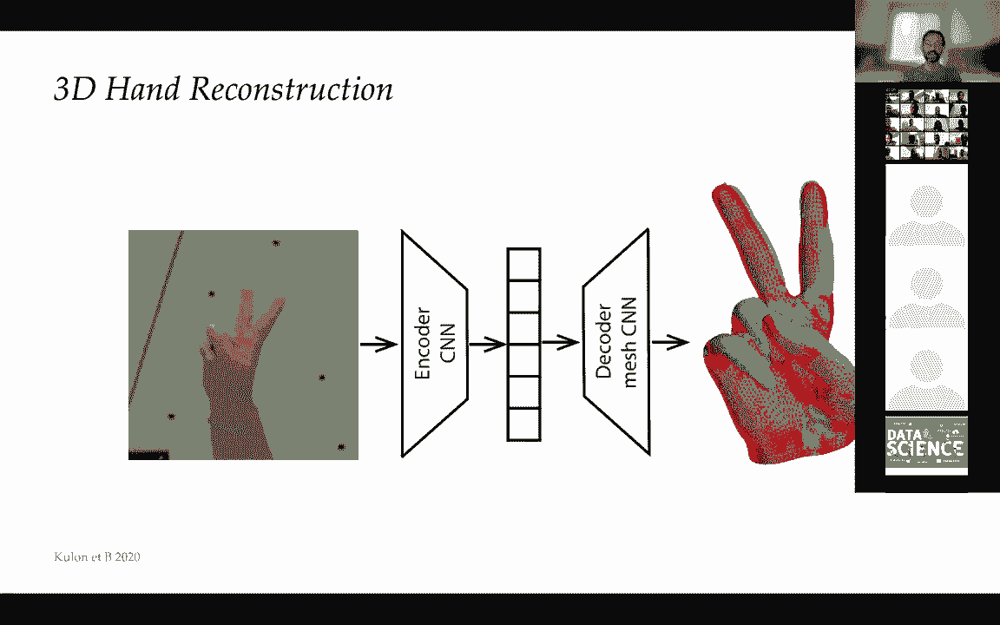
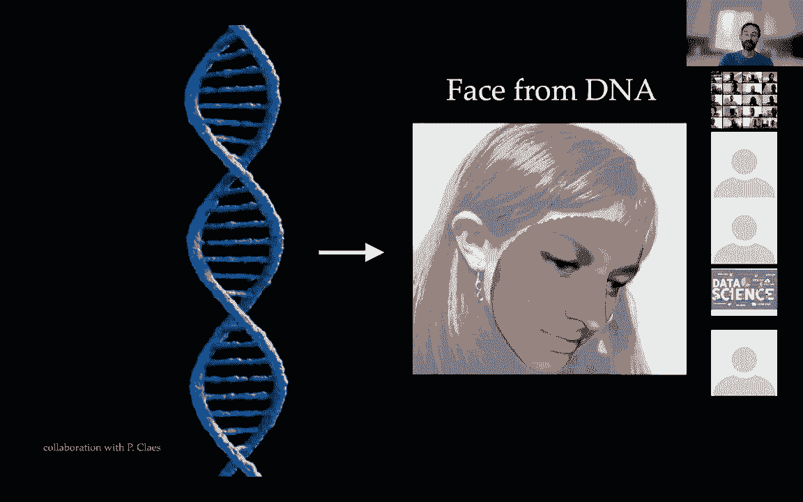
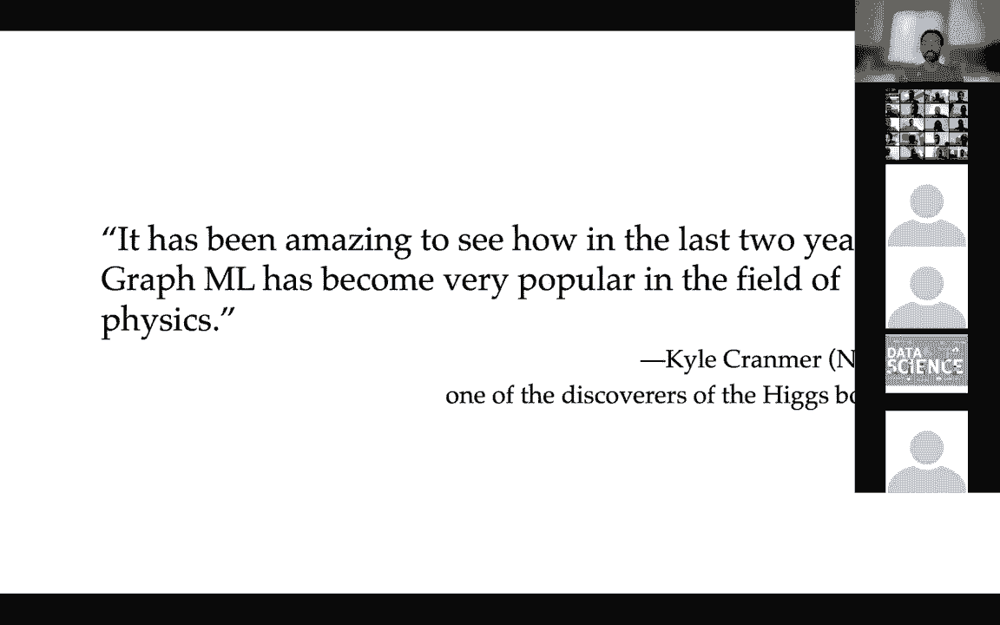
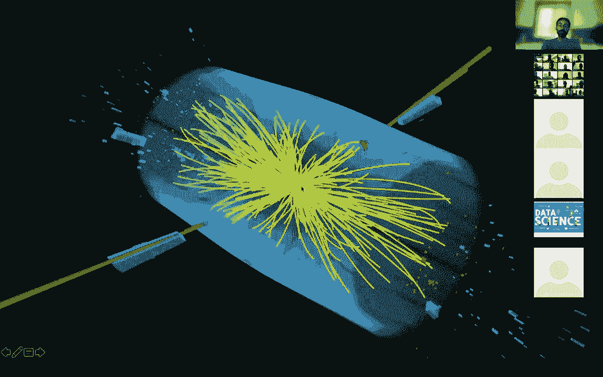
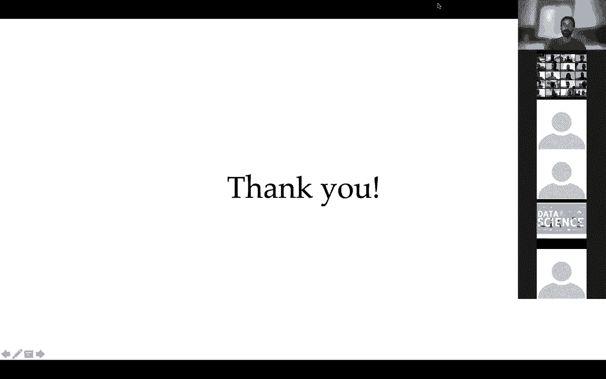

# 12：L12 - 应用与展望 📚

在本节课中，我们将回顾几何深度学习课程的核心思想，并探讨该领域当前的研究方向、开放性问题以及激动人心的实际应用。我们将从对称性这一统一概念出发，展望几何深度学习的未来。

---

## 🧭 课程回顾与核心思想

上一节我们深入探讨了流形和网格上的学习。本节中，我们首先回顾贯穿本课程的核心框架。

本课程从探讨支撑深度学习的**几何原理**开始，然后研究了这些原理在**特定结构**上的具体实现。根据本课程的观点，统一深度学习的**关键概念**是**对称性**。

正如维格纳所言：“**对称性，无论是广义还是狭义，都是人类自古以来试图理解和创造秩序、美与完美的一种思想。**” 我们正是通过对称性这个透镜来理解深度学习，即我们所说的**几何深度学习**。

我们已经看到这些原理在多种结构上的实例，无论是群、图还是流形。基本上，你可以从这些基本原理推导出一些流行的架构，例如：
*   **卷积网络**
*   **图神经网络**
*   **门控循环网络和LSTM**
*   **网格CNN**以及在流形、网格和几何图上的**内在学习**

---

## 🔮 未来研究方向

一个显而易见的问题是：接下来是什么？一个理论或框架的质量可以通过其**预测能力**来判断。几何深度学习框架不仅仅是一种统一和教学的工具，它正在演变成更具实质性的内容。

以下是基于对领域内多位知名研究者的访谈，总结出的一些有趣的研究方向和开放性问题。

### 超越传统消息传递

图机器学习领域已经开始正视**消息传递范式的基本限制**。Battaglia的讲座深入讨论了图神经网络与Weisfeiler-Lehman图同构测试的关系，以及哪些结构无法被消息传递检测到。

问题是：除了消息传递，还能使用什么？消息传递仍然是一个非常强大的范式，但也许我们应该将其应用于其他结构来交换信息，或者使用一些更复杂的构造。过去几年有几篇论文尝试朝这个方向发展。

例如，与剑桥Petr Kellnhofer小组的合作中，我们为**胞腔复形**开发了类似Weisfeiler-Lehman的方案。通过这种高阶消息传递，可以获得比传统图神经网络消息传递**更强大**的架构。在计算化学等领域有有趣的应用，因为分子不仅仅是图，化学家将其视为原始结构的某种组合，而胞腔复形是捕捉这些结构的一种方式。

### 符号化与算法推理

另一个有趣的方向来自NYU的Kyle Cranmer与DeepMind的合作。其思想是，可以不使用通用的消息传递函数，而是使其**符号化**。他们考虑多粒子相互作用的物理系统，相互作用由图捕获。通常使用小型多层感知机作为通用的消息传递函数，然后从中回归出符号方程，并用这些符号方程替换通用函数。这样不仅能获得更好的泛化能力，还能从问题中推导出物理定律。

这体现了**算法推理**的思想。对于图这类抽象数据，我们有成熟的处理算法（例如Dijkstra算法计算最短路径）。算法**极度可解释**且能完美泛化到不同数据，但**不能跨任务泛化**；而神经网络虽然通常是黑箱，但**能跨任务泛化**。算法推理试图**融合两个世界的优点**。

### 因果推断与知识图谱

在生物科学中，**因果推断**是一个特别受关注的课题。典型场景是研究健康与病变细胞中的基因表达，希望理解疾病的成因。你可以在细胞层面构建一个**基因调控网络**来描述基因表达如何导致疾病。为了理解和采取行动，我们通常需要这种**可解释的结果**。

与此相关的是**知识图谱**领域，其中包含描述不同对象之间关系的异构图。这在生物和医学科学中非常常见，例如描述肺炎不同症状和治疗的医学图谱，或关联不同疾病和药物机制的生物图谱。

### 计算结构与数据结构的分离

图机器学习社区的一个趋势是**计算结构与数据结构的分离**。我们不一定需要严格在输入图上进行消息传递。例如，慕尼黑Stephan Günnemann小组的论文表明，如果对一个图进行扩散过程嵌入，然后基于图空间中的最近邻重新连接边（即“重布线”），可以获得更好的性能。这种现象与图的平滑和过度挤压等问题有关，带来了一个有趣的问题：我们是否可以将图视为某个连续空间的离散化或采样？

### 图作为连续空间的离散化

将图视为连续空间的离散化或采样是一个有趣的分支。例如，可以证明社交网络或所谓的无标度网络（具有“六度分隔”现象）实际上可以通过**双曲几何空间**的采样获得。这关联到图布线选择以及如何为图神经网络选择位置编码的问题。

我们最近在ICML上发表的一篇论文中，通过**扩散方程**的视角来研究这个问题。其思想是，可以将图神经网络解释为离散化的**扩散偏微分方程**（我们称之为神经PDE）。图神经网络的每一层或特定架构可以被解释为显式求解器的一个步骤。在这种观点下，你不再有“层”的概念，而是有**扩散时间**的概念。使用哪个图的问题也变得不那么重要，因为你可以将其视为对空间导数的一种离散化方式。

### 动态图与生成模型

在许多情况下，图不是静态的。例如，社交网络中的图一直在变化。不同部分或不同结构的图可能以不同的频率变化。已经有一些现有模型试图将图神经网络推广到图不是静态图，而是添加或删除节点/边的异步事件流的情况。

**生成模型**是另一个重要方向。生成图像已经取得巨大进展，但生成图则困难得多。其中一个问题是，图像有像素的规范顺序，可以计算重建损失；而图没有规范顺序，如何比较输入和输出的图是一个挑战。在计算化学中，生成新的分子图是一个重要的应用领域，但如何评估生成的图是否有意义也是一个问题。

### 基准测试、硬件与应用

推动计算机视觉和机器学习许多领域发展的一个因素是**大型标准化数据集和基准测试**的可用性。虽然有人认为很多工作只是在基准测试上刷分数，但拥有标准化的评估（如Open Graph Benchmark）对于比较不同方法仍然非常重要。

工业应用方面，图神经网络已被用于芯片设计中的组件布局、推荐系统、虚假信息检测、自动驾驶中的轨迹预测、3D人体与面部建模、物理模拟、蛋白质结构预测与药物设计等众多领域。

硬件方面，存在所谓的“硬件彩票”现象：某些算法胜出，不是因为它们最适合解决某个问题，而是因为它们能在现有硬件上良好运行。卷积神经网络与GPU的SIMD架构的契合就是一个幸运的巧合。现在，一些半导体公司（如Graphcore）正在开发专门为图设计的新硬件架构（IPU）。

---

## 🌟 激动人心的应用领域

以下是一些我认为既酷又重要的应用方向。

### 社交网络与推荐系统

在社交网络领域，一个关键应用是**推荐系统**。例如，Pinterest早期采用了由Will Hamilton等人开发的GraphSAGE算法。Uber也使用图学习为UberEats提供推荐。阿里巴巴开发了图学习基础设施AliGraph来支持其众多应用，特别是被视为一种边预测的推荐系统。

在Twitter，我们尝试使用图神经网络从传播模式中检测恶意内容和虚假信息。有经验证据表明，虚假信息在社交网络上的传播方式与正常内容不同。

### 视觉、图形与自动驾驶

在视觉和图形学中，几何数据有多种表示方式：体积（医学成像）、点云（自动驾驶中激光雷达的自然表示）、网格（离散流形）等。Uber最近使用图神经网络在拥挤环境中预测车辆轨迹。在3D人体捕捉和建模方面，几何神经网络被用于从图像重建手部、面部和身体的详细网格模型。

甚至可以从DNA中重建人脸结构，这在法医学或考古学中有潜在应用。几何深度学习技术也被用于预测遗传综合征，这些综合征有时会表现为特定的面部特征。

### 物理学

物理学是一个非常广阔的领域。在实验粒子物理学中，图是表示粒子碰撞事件产生的粒子喷注的一种非常自然的方式。图神经网络已被用于粒子喷注重建、事件检测和探测器建模。

另一个例子是南极的IceCube中微子探测器。这是一个立方公里大小的冰体，用于探测来自遥远星系的中微子。我们曾使用图神经网络对探测器进行建模，并分类其中的事件，以区分背景事件和来自高能物理源的中微子。

DeepMind则使用图神经网络进行**流体模拟**，用大型粒子系统模拟流体，这在计算机图形学中也有应用。

### 结构生物学与药物发现

蛋白质有时被称为“生命分子”。我们的DNA编码氨基酸序列，氨基酸在物理力的作用下折叠成复杂的三维结构，从而赋予蛋白质功能。**蛋白质折叠问题**就是根据氨基酸序列预测其三维结构。

DeepMind的AlphaFold在2018年的CASP竞赛中取得了突破性进展，其最新版本已达到与实验方法相媲美的精度。AlphaFold使用了一种特殊的几何注意力网络。这是一个快速发展的领域，例如，最近有研究声称仅使用单序列和语言模型就能实现可与AlphaFold媲美的结构预测。

蛋白质无处不在，是药物的常见靶点。药物设计通常涉及寻找可以嵌入蛋白质口袋的小分子。然而，许多有趣的靶点（如蛋白质-蛋白质相互作用界面）是平坦的，难以用小分子靶向。这时，可以设计**蛋白质类药物**（生物制剂）。

我们与EPFL的Bruno Correia小组合作，开发了一种基于网格的架构**MaSIF**，用于预测蛋白质功能（特别是结合特性）。我们用它来设计针对癌症靶点PD-L1的全新潜在抑制剂，其中一些设计已通过X射线晶体学证实。

开发新药漫长且昂贵。可合成的小分子空间极其庞大（约10^60），而实验室只能测试其中极小一部分。图神经网络已被证明在预测分子性质方面表现出色。例如，MIT的Jim Collins小组使用图神经网络进行虚拟筛选，发现了可以治疗抗生素耐药性细菌的化合物。

**药物重定位**是另一个方向，即尝试将现有药物用于治疗不同的疾病。这涉及预测药物-药物相互作用，以避免有害的协同效应。甚至可以将这些想法扩展到**食品领域**，因为许多食物中含有类似药物的生物活性分子。我们与帝国理工学院的同事合作，使用图机器学习方法发现食物中的这些化合物，并由厨师将其制成美味菜肴。

---

## 📝 总结

本节课我们一起回顾了几何深度学习以**对称性**为核心的统一框架，并展望了其未来发展方向，包括超越消息传递、算法推理、因果推断、动态图、生成模型等。我们还看到了几何深度学习在社交网络、视觉、自动驾驶、物理学、结构生物学和药物发现等众多领域的强大应用潜力。从对称性群到这些激动人心的应用，我们完成了一次从分类猫狗到开发新药乃至探索健康饮食的宏大旅程。

希望你们喜欢这门课程，教学对我们来说也是一次非常棒的经历。谢谢大家！