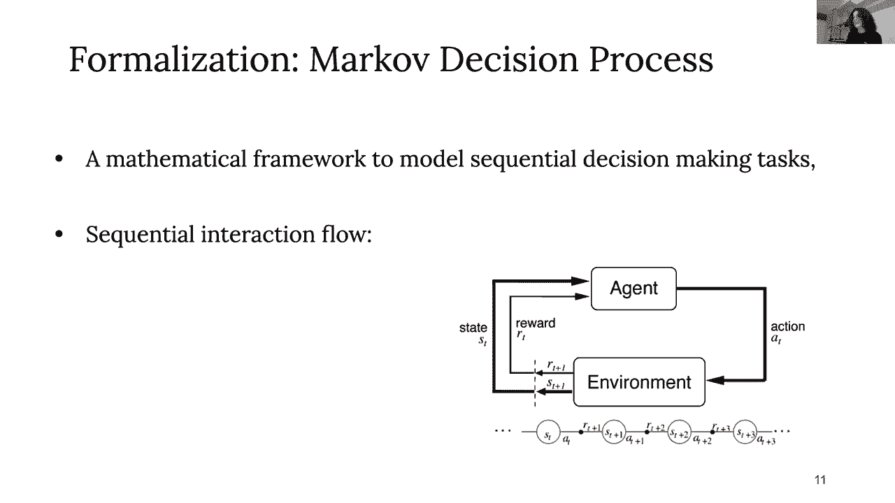
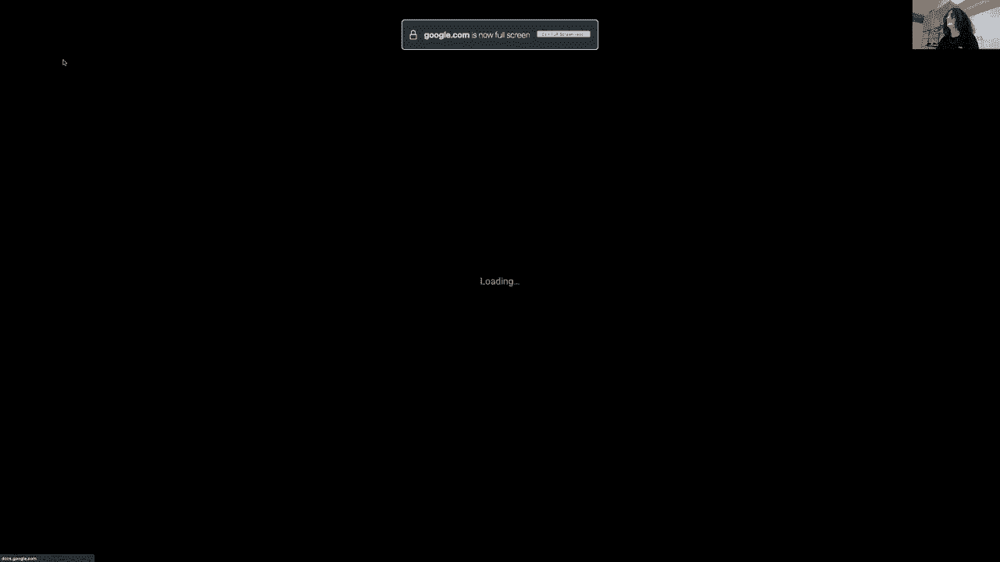
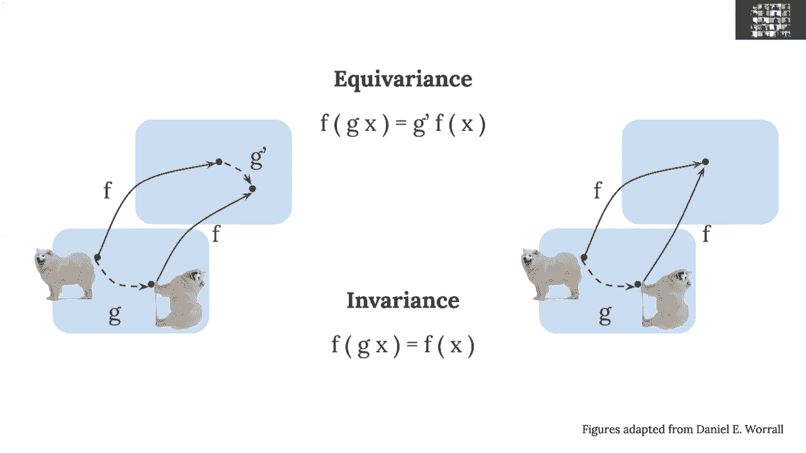

# 13：几何深度学习与强化学习 🧠🤖

在本课程中，我们将探讨几何深度学习（GDL）如何与强化学习（RL）结合，以解决RL领域数据效率低下的核心挑战。我们将学习如何利用数据中的对称性、不变性和等变性来构建更高效、更强大的学习模型。

---

## 强化学习简介

上一节我们概述了课程目标，本节中我们来看看强化学习的基础概念。

机器学习领域大致可分为三个部分：监督学习、无监督学习和强化学习。虽然它们共享技术，但各有其独特的挑战。强化学习尤为特殊，它采用试错法，通过与环境交互来学习最优决策序列，其挑战在于奖励延迟和需要为长远利益牺牲即时回报。

强化学习专注于序列决策问题。智能体在环境中顺序执行动作，以最大化长期累积奖励。其关键特征是通过试错学习，且奖励可能延迟。例如，在迷宫中导航，只有到达终点才能获得正奖励。

与监督学习对比，在强化学习中，当前决策会影响未来的观察结果；而在监督学习中，一个错误的分类不会改变你未来看到的数据。

一个典型的强化学习例子是机器人在迷宫中寻找最短路径到目标。如果状态和动作都是离散且已知的，可以使用经典规划算法。但在现实场景中，我们通常只有对环境的感官观测，动作也是连续的，这使得直接应用规划算法变得困难。

为了形式化这类决策过程，我们使用马尔可夫决策过程（MDP）这一数学框架。MDP 用于对序列决策任务进行建模。

MDP 是一个元组 `(S, A, R, T, γ)`，其中：
*   `S` 是状态集合。
*   `A` 是动作集合。
*   `R` 是奖励函数：`R: S × A → ℝ`。
*   `T` 是转移函数：`T: S × A → S`（可以是确定性的或随机的）。
*   `γ` 是折扣因子（0 ≤ γ ≤ 1），用于权衡即时与未来奖励。

MDP 的目标是找到一个策略 `π: S → A`，该策略将状态映射到动作，以最大化期望的累积折扣奖励（即回报）。

MDP 基于两个关键假设：时间步是离散的，并且环境是完全可观测的。完全可观测性意味着下一状态的概率仅取决于当前状态和动作，无需考虑历史。不符合此假设的则属于部分可观测问题。

为了比较策略的优劣，我们需要一个衡量标准。我们使用**折扣回报** `G_t` 的概念，它是未来奖励的累积和：

`G_t = R_{t+1} + γ R_{t+2} + γ^2 R_{t+3} + ...`

为了评估策略，我们计算在给定策略下，从某个状态（或状态-动作对）出发的期望回报，这分别称为**状态值函数 V^π(s)** 和**动作值函数 Q^π(s, a)**。

---

## 获取优秀策略的方法

上一节我们定义了如何评估策略，本节中我们来看看如何获得优秀的策略。

强化学习领域广阔，方法众多。以下是一些主要途径：

*   **动态规划**： 如果你知道环境的完整模型（即 `R` 和 `T`），并且状态空间离散且不大，可以使用策略迭代或值迭代等算法。
*   **无模型方法**： 如果你只能从环境中采样数据（状态、动作、奖励、下一状态元组），则可以采用无模型方法。这又可分为两类：
    *   **基于值的方法**： 直接学习值函数或Q函数（如DQN）。
    *   **基于策略的方法**： 直接学习策略函数（如REINFORCE及其变体）。
*   **基于模型的方法**： 你也可以学习一个环境动态模型，然后利用这个模型进行规划或辅助策略学习。这种方法通常数据效率更高，但模型不准确会导致规划失败。

并非所有序列决策问题都能被建模为MDP。例如，多臂老虎机问题中动作不影响下一状态；部分可观测问题需要考虑历史；在多智能体非完全合作场景中，则需要用博弈论来建模。

对于初学者，推荐资源包括 Sutton 和 Barto 的《强化学习导论》、David Silver 的RL课程以及 OpenAI 的《Spinning Up in Deep RL》。

需要注意的是，强化学习远非完美。与计算机视觉相比，它通常需要更多数据、训练不稳定、对超参数选择极其敏感，并且结果方差较大。

---

## 数据效率挑战与对称性机遇

上一节我们了解了强化学习的方法与挑战，本节中我们重点关注其数据饥渴特性，并探索利用数据内在结构的解决方案。

深度强化学习非常数据饥渴。几年前的分析显示，一些流行的无模型RL算法在Atari游戏上达到良好性能所需的样本量，远超ImageNet等大型计算机视觉数据集。

造成这种情况的部分原因是，在无模型RL中，许多看似不同的样本实际上共享着相同的底层结构或语义。例如：
*   Pong游戏中两个相似的球拍位置。
*   CartPole（车杆平衡）问题中，小车位于屏幕左侧和右侧的对称状态。
*   网格世界中，智能体位于相同位置但背景颜色不同的状态。

对于无模型算法，这些都被视为独立样本。然而，如果我们能识别并利用数据中的这些**对称性、不变性和等变性**，就有可能大幅提高数据效率。

**等变性** 意味着对输入施加一个变换 `g`，其输出也会以相应方式 `g‘` 变换。在神经网络中，这可以表示为：`f(g(x)) = g'(f(x))`。
**不变性** 是等变性的特例，意味着变换后的输入产生完全相同的输出：`f(g(x)) = f(x)`。

在监督学习（如图像分类）中，我们通常希望模型对旋转等变换具有不变性（旋转后的狗还是狗）。但在强化学习中，情况更微妙：
*   在CartPole中，水平翻转状态会导致最优动作也发生相应翻转（左变右，右变左）。这是一种**等变性**。
*   在网格世界中，仅改变状态颜色而不改变智能体位置时，最优动作不变。这是一种**不变性**。

---

## MDP 同态与基于模型的表示学习

上一节我们看到了对称性在RL中的潜力，本节中我们介绍一个利用对称性进行抽象的关键概念：MDP同态。

MDP同态是一种从原始MDP到简化MDP的映射。它“折叠”了原始问题中的对称性，形成一个状态和动作更少的抽象MDP。关键在于，这个同态映射保持了原始MDP的动态特性。因此，我们可以在简化的MDP中学习策略，然后将其“提升”回原始空间，从而获得原始MDP的最优策略。

这非常具有吸引力，因为它意味着我们无需在原始庞大的状态-动作空间中探索，从而节省大量时间。然而，传统上寻找MDP同态本身可能计算成本很高。

出于数据效率的考虑，我们转向**基于模型的强化学习**。在无模型RL中，智能体必须直接从奖励信号中同时学习视觉表示、环境动态和规划策略，这是一个非常困难的端到端问题。基于模型的方法将动态模型的学习与规划分离开来，使得数据利用更高效。但缺点是，如果模型学得不好，规划也会失败。

我们的研究提出了一种方法，通过强制施加**动作等变性约束**来学习保持MDP结构的表示。具体来说，我们希望在潜在（抽象）空间中，先执行动作再映射的结果，与先映射到潜在空间再执行对应动作的结果相同。

我们使用对比损失（而非重构损失）来学习这种表示，并添加奖励匹配约束。对于稀疏奖励任务，我们还引入负采样（对比学习/三元组损失）来防止表示空间塌缩。

为了评估所学模型的质量，我们在潜在空间进行离散化，并使用值迭代进行精确规划，然后在原始MDP中评估所得策略。

实验表明，与使用自编码器重构的基线方法相比，这种利用MDP同态约束的对比学习方法能以更少的训练周期学习到更易于规划的表征。

该方法在具有连续状态空间的任务上也表现良好，仅需100条轨迹就能学到有效的策略，并且能够泛化到新的视觉外观和目标任务。

---

## MDP 同态网络：在无模型RL中嵌入对称性

上一节我们探讨了在基于模型的RL中利用对称性，本节中我们看看如何将对称性直接嵌入到无模型RL的策略网络中。

我们回到最初的观察：许多RL问题本身具有对称性（如CartPole的水平翻转对称性，网格世界的90度旋转对称性）。我们可以将这些对称性表述为对策略网络的等变性约束。

具体来说，对于状态变换 `l`（如翻转）和相应的动作排列 `ρ`，我们要求策略网络 `π` 满足：`π(l(s)) = ρ(π(s))`。这意味着计算翻转后状态的策略，等价于先计算原状态的策略，然后对动作输出进行相应的排列。

我们称强制实现这种约束的网络为 **MDP同态网络**，它本质上是一种等变网络。我们建立了MDP同态形式化与等变网络理论之间的明确联系。

此外，我们引入了一种称为 **“对称化器”** 的新方法，可以自动为给定对称群构造等变网络权重，避免了手动推导约束的麻烦。

我们在多个具有对称性的RL问题上评估了MDP同态网络（CartPole， 具有旋转对称性的网格世界， Pong）。与标准MLP或CNN相比，等变网络（绿色曲线）能够用更少的环境交互数据获得更好的策略性能。

与数据增强方法相比，直接嵌入对称性约束通常更有效。但需要注意的是，如果问题本身没有这种对称性，强制使用等变网络可能会限制策略空间，排除那些非对称的最优策略。

---

## 总结与未来方向 🚀

在本课程中，我们一起学习了如何利用几何深度学习的思想来提升强化学习的数据效率。

我们了解到，在马尔可夫决策过程中利用**不变性和等变性**，可以帮助我们：
1.  在基于模型的RL中学习到更利于精确规划的结构化表示。
2.  在无模型RL中构建具有内置对称性的策略网络，从而减少达到良好性能所需的环境交互次数。

这些都是将先验知识编码到神经网络中的有效方式。当前研究仅触及表面，未来有许多令人兴奋的开放方向：
*   将群等变网络用于自监督表示学习。
*   研究非群结构的等变性（如对天气变化“下雪”的响应）。
*   处理具有部分可观测性的情况下的对称性。
*   在多智能体系统中利用置换不变性/等变性。
*   学习而非预先定义问题中存在的（可能是近似的）对称性。

强化学习是一个数据饥渴的领域，任何关于问题几何结构的先验知识都可能带来巨大的效率提升。

---

## Q&A 环节精选

**Q： 在基于模型的RL中，学到的模型不完美怎么办？**
A： 有一些工作利用模型不确定性估计来处理这个问题。当使用等变网络时，不确定性会在状态-动作空间的对称部分之间共享，更新一部分的不确定性也会更新其对称部分。

**Q： 等变性是否要求潜在空间中变换前后的距离保持不变？**
A： 不一定。对于群等变性，重要的是存在对应的群作用 `g‘`，而不一定要求距离不变。

**Q： 这些技术能用于不学习环境模型的无模型RL吗？**
A： 是的，本次讲座介绍的第二个工作（MDP同态网络）就是纯粹的无模型方法，它仅将对称性作为先验知识嵌入策略网络。

**Q： 如何将这种方法扩展到高维、复杂或对称性不明显的实际问题（如机器人行走）？**
A： 这更具挑战性。例如，在机器人 locomotion 任务中，左右腿存在镜像对称性，但需要精确的工程实现来定义这些对称性（涉及四元数等）。对于未知的对称性，则需要研究如何从数据中学习它们。

**Q： 在现实物理系统（如机器人）中适用吗？**
A： 是的，在机器人控制中，工程师经常手动利用对称性（如为左右腿设计镜像控制器）。将这种思想与深度强化学习结合，预计也能带来增益。

**Q： 我们能“创造”对称性以使学习对某些变换更鲁棒吗？**
A： 这是一个有趣的想法。更准确的表述可能是：如果我们希望智能体对某些变换（如颜色变化）鲁棒，那么我们可以强制让学习到的表示对这些变换具有不变性，即使原始问题定义中并未明确包含这种不变性。

**Q： 如何用于多智能体强化学习？**
A： 在多智能体系统中，如果智能体角色相似，可以利用置换不变性/等变性，让智能体共享参数或经验，从而提高学习效率。

**Q： 如何用于多任务强化学习（相同环境，不同目标）？**
A： 如果学到一个将状态转移和奖励函数分离的模型，你可以保持学到的转移函数不变，只为新任务学习或替换一个新的奖励函数，从而实现快速适应。

