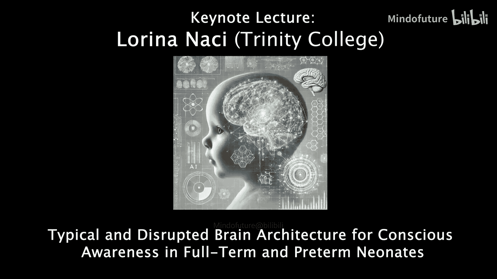
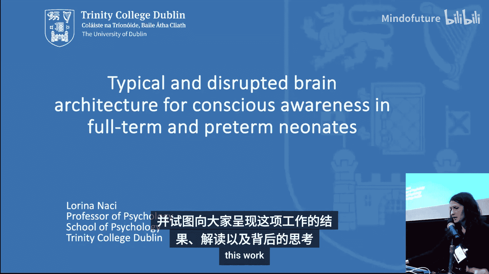
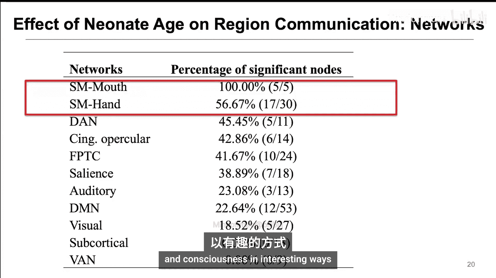
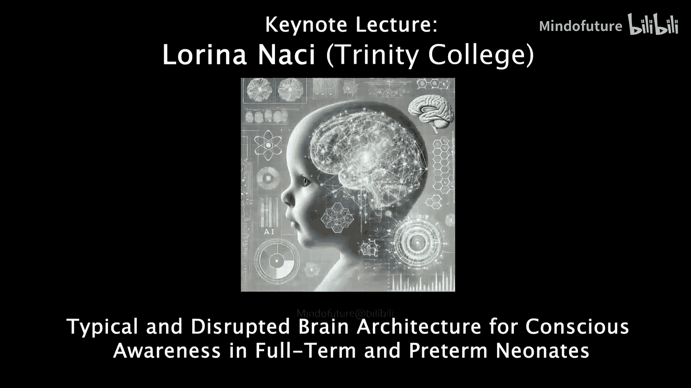

# 001：新生儿大脑结构与意识能力

在本节课中，我们将探讨新生儿大脑是否具备支持意识体验的神经结构基础。我们将通过神经影像学研究，分析婴儿大脑的功能网络组织、小世界架构和神经复杂性，并与成人进行对比，以评估婴儿早期意识能力的可能性。

---

感谢Claudia精彩的介绍。我很荣幸能来到这里，与尊敬的同事和亲爱的朋友们在一起，并很高兴今天能向大家介绍我们的工作。

这是一个非常令人兴奋的会议。这个话题是我过去十年及更长时间研究的核心。今天让我特别激动的是，我们拥有这样一个跨学科的团队，这带来了挑战和机遇。挑战在于如何将描述的粒度调整到合适的水平。我已尽力做到这一点，并在演讲中尽量简化方法细节，重点展示结果、解释以及围绕这项工作的思考。

几乎每个抱过婴儿的人都曾好奇，作为一个婴儿是什么感觉。如今，这种好奇和关注在科学家和普通大众中似乎非常普遍，但情况并非一直如此。甚至在接近1980年代时，医疗界还假设婴儿没有内在活动或内心世界，因此在没有麻醉的情况下对婴儿进行手术。可以说，我们对婴儿心智的理解和好奇心正在迅速发展。这是一个非常激动人心的时代。可以说，这个领域可能是意识科学最前沿的领域之一。

关于意识何时开始，即人类发展中意识的出现时间，存在分歧。在Tbane和Jo Fwick的带领下，我们回顾了文献，以了解研究人员在此分歧中的立场。存在两个阵营：一个阵营倾向于认为意识出现较早，大约在出生时甚至孕晚期最后几周；另一个阵营则认为意识的出现取决于更高级的认知能力，如决策、反思和内省，在这种情况下，我们需要等到生命第一年或第二年末才能说意识存在。

由于婴儿无法告诉我们他们的想法或感受，从方法论和大众视角来看，要解开他们意识的本质非常具有挑战性。但从我的角度来看，我从长期研究行为无反应人群（如严重脑损伤后变得无反应，在某些情况下可能隐藏着隐蔽意识的个体）的工作中获得启发。我们必须开发神经影像学方法来真正了解他们的意识水平。同样，通过麻醉可逆地消除意识，我们学到了很多关于意识的神经关联，以及更广泛的支持成人意识的功能神经架构特征。

我不打算回顾那部分文献，但我假设我们稍后可以讨论，你们许多人在临床背景下会了解。在临床环境中，通过观察两个维度来评估意识状态存疑的人群：**唤醒**和**觉知**。我们所有人都有这两个维度。唤醒指我们睁开眼睛、拥有睡眠-觉醒周期的能力。觉知则通过个体能否遵循指令来评估，例如在床边，医生可能会要求个体举手或追踪视野中的物体。当然，言语报告对于确定觉知非常重要。

现在，对于婴儿，这些评估觉知的工具并不可用。婴儿当然有唤醒。他们会睁开眼睛，会表现出睡眠和清醒。但客观地确定觉知确实非常具有挑战性。我认为，挑战正始于此。新生儿深刻的行为限制使得确定意识变得困难。我在此领域取得进展的方法是，观察新生儿大脑是否具备我们从成人研究中了解的、支持意识觉知的**能力**或**神经架构**。这就是我今天要讲的内容。

重要的是，这正是神经影像学发挥作用的地方。它是一个奇妙的工具，为我们提供了窥探新生儿大脑和心智的窗口，就像我们从脑损伤个体身上学到的一样。传统上，扫描新生儿很困难，因为他们需要保持静止，但技术的发展真正开启了一个进步的新时代。这里有一些来自伦敦国王学院人类发育连接组项目的图片，该项目在获取最大的婴儿MRI队列方面处于领先地位。在某些情况下，婴儿需要被包裹以在扫描中保持静止，但这是可行的。我们开始对婴儿大脑有了很多了解，但仍有很多有待探索。例如，我们知道怀孕的第三个三个月（从28周开始）对大脑发育非常重要，如皮质褶皱在此时期发育，轴突连接和神经发生在围产期完成。这是大脑生长速度超过其他所有时期的阶段。

这个队列数据的优势在于数据量大，fMRI图像具有高时间和空间分辨率。我们有282名足月出生的新生儿，以及73名早产但在相当于足月年龄时被扫描的新生儿。这对于我们研究早产对临床表现或临床意义的影响是一个非常重要的比较，因为婴儿处于相同的年龄。另一个关键的比较是，早产婴儿在足月等效年龄（37周）之前被扫描，因为这允许我们在这个群体中自然调节婴儿年龄。如果你想确定意识出现的时间点，那么拥有这个更年轻的婴儿群体就非常重要。我们还有来自人类连接组计划的176名成人数据。

在这里，我将讨论三项研究，这些研究涉及我们从许多成人研究中了解到的、似乎支持意识的神经架构特征。再次尝试从功能组织的角度切入大家对意识的理解。你们大多数人可能知道，大脑是按功能网络组织的，这些网络由不同颜色表示。功能网络是大脑中协同工作以实现特定功能的区域，它们并非专属于任何单一功能，但主要执行某些任务，并彼此协同工作。

重要的是，我们了解到两种类型的大脑网络：这里红色显示的**默认模式网络**位于大脑中部，以及**额顶网络**（包括注意和执行控制网络），它们位于大脑两侧，表现出一种互反关系，用冷暖色表示。它们会切换，但主要观点是，这是认知神经科学中最可复现的关系之一：当一个网络（如默认模式网络）活跃时，另一个网络（如额顶网络）则被抑制，它们以这种互反方式协同工作。这种关系也被证明会因各种意识状态的操作而消失，似乎是意识的一个稳健的神经关联。我稍后会详细说明，但这是我想要研究的第一个关系。

然后，我们也在研究**功能性小世界架构**。这基本上是另一个已确立的原则，即大脑以小世界方式组织，这支持了意识体验的分化与整合平衡。这意味着，大脑局部区域内的连接更密集，而跨更远大脑部分的连接则稀疏，以实现这些分化的、非常具体的表征的有效整合。小世界架构在意识状态操作下的调节方面也非常重要且可复现，但功能性小世界架构更多地捕捉了健康大脑组织的静态质量。

我们知道大脑根本不是静态的。事实上，分化与整合表征之间平衡的动态演化在25年前就被假设为意识的一个普遍特征，这就是**大脑信号的复杂性**。大脑信号越复杂，它支持意识体验的能力就越强。Tonian和Endman最先提出了这一观点，复杂性原则成为整合信息理论的基础。复杂性已被用作意识的代理指标：在行为上觉知程度较低的状态（如微意识状态或无反应觉醒状态）中，复杂性会降低。因此，它也是一个很好的测量指标。

因此，我在我的研究小组中进行了三项研究来考察这三个特征。我想在此强调，我们关注的是**能力**，理解为支持意识思维的基础设施，而不是意识觉知的内容。

第一项研究发表于三年前。当时我们甚至比现在知道的还要少。基本上，我描述了额顶网络（注意/执行控制网络）和默认模式网络。额顶网络主要对外部刺激、目标导向行为有反应；而默认模式网络则与自我参照思维、自我觉知、内省、自传体记忆等密切相关。它们表现出一种关系：当额顶网络活跃时，默认模式网络被抑制，反之亦然。这是一种非常受调控的关系。当我们开始这项研究时，甚至像我所描述的这种高阶网络是否存在于婴儿大脑中还存在争议。现在可能有两三项研究同意我们的发现，但在此之前的大多数研究表明，这些高阶网络在婴儿一岁末及之后才开始发育。这是我们希望利用我提到的大型婴儿影像队列解决的第一个空白。同时，这种互反关系也尚未被研究。这就是我们要探究的问题。当然，我们也想知道早产的影响，既从早期新生儿年龄（那些尚未达到足月的婴儿）的角度，也从临床意义的角度——早产的影响是什么。

这里有一些观察网络连接的连接矩阵图。我将以简化的方式引导你们理解。这些小方块代表每个网络内不同感兴趣区域之间的连接。重要的是，红色表示强连接，蓝色表示低连接。围绕中心对角线的方块代表每个网络内部的连接。因此，这些方块内的颜色越红，表示网络内部连接越强，该网络的身份越独特，其内部区域之间的互连性越高。DAN是背侧注意网络，ECN是执行控制网络，它们都属于额顶注意系统。

这是成人的数据，这为我们设定了连接模式的基本模板。我们有非常强的网络内部连接（红色），以及较弱的网络间连接（蓝色）。我们首先寻找的是这些网络在出生时是否存在。换句话说，它们是否具有这种独特的身份。你可以看到，从成人到足月出生，这种连接模式有所减弱，但在那些方块内仍然可以看到红色的强连接，尽管更零散。当我们观察足月等效年龄之前的婴儿时，我们可以看到这种结构在视觉上就被稀释了。

另一种更简单的呈现方式是多维尺度分析图。它允许我们以多维方式呈现不同区域的连接特征。基本上，彼此靠近的区域显示出相似的连接特征。因此，执行控制网络的组成部分彼此靠近，显示了该网络的独特身份。背侧注意网络和默认模式网络在成人大脑中也具有独特的身份。我们在三个婴儿组中寻找这一点。如果我们向右看，可以看到这些网络的组成部分彼此更靠近，区分度降低，但在统计上仍然可以将这些集群彼此区分开。因此，这从统计上告诉我们，在足月出生时，这三个网络彼此不同，所以我们说它们基于我们的定义是存在的。

当我们观察足月等效年龄之前的婴儿时，在统计上我们真的无法将这些网络彼此区分开。它们是重叠的。它们的身份存在，但更弱。对于早产但现已成长到足月等效年龄的婴儿，网络身份也存在，但较弱。

这告诉我们，这些网络在足月出生时就已存在。当早产儿达到足月等效年龄时，它们按照预设的发育轨迹发展。它们较弱，所以我们仍然可以看到早产的影响，但它们是存在的。这是第一个发现。

第二个发现是观察这些网络之间的互反关系。我用黄色高亮了网络之间的连接。这个区域代表默认模式网络和背侧注意网络之间的连接，它是蓝色的。这代表了低连接性，意味着这些网络不同时活跃。在某些情况下，它们可能是反相关的。这就是我在统计上所指的互反关系。这个区域代表背侧注意网络和执行控制网络之间的连接，颜色更暖。额顶网络通常在功能上成对工作，因此它们之间的连接更强。

在成人中，我们对互反关系的统计定义是：默认模式网络和背侧注意网络之间的连接显著低于额顶网络内部的连接。我们在成人中看到了这一点。然后，如果我们观察婴儿组，我们发现这种关系在足月出生婴儿和足月等效年龄婴儿中存在，但在更年轻的婴儿（足月等效年龄之前）中不存在。

这是第一项研究发现的简要总结。这是一个说明性的呈现。我们有这三个网络及其关系，以及四个组（三个婴儿组）。在足月等效年龄，所有这些网络及其关系都被证明存在。背侧注意网络甚至在足月等效年龄之前就开始出现，但其他两个网络没有。显然，它们正在发育，不如成人时稳健，但这对于我们的目的并不重要。我们在这里展示的是，额顶网络、默认模式网络及其关系从足月等效年龄起就存在。这些是大脑的关键网络，对于支持认知功能和意识非常重要。

这也表明第三个三个月至关重要，因为在达到发育第三个月末的足月等效年龄之前的婴儿不具备这些特征。大脑需要这段时间来发展这些特征。一些相关的破坏持续存在。总体而言，大脑中存在这些网络特征支持了意识早期出现的观点。

在第二项研究中，我们考察了小世界架构的发展。众所周知，意识觉知或意识具有分化的特性，任何你能想到的体验都会有非常生动、具体的特征（视觉、嗅觉、声音、触觉）。但同时，它们也是整合的意识体验的一部分，就像沉浸在纽约街头一样。人们认为，大脑的小世界架构通过其网络内部密集的连接（支持专门化的表征）和跨大脑的稀疏连接（支持表征的整合），促进了意识体验的这些特性。在此之前，我们并不真正知道婴儿是否具有这种小世界架构组织，以及早期新生儿年龄和早产的影响是什么。这就是我们在第二项研究中探讨的。

这里我有三个面板。关键要点是，我们有一个衡量小世界性的指标，它基本上是整合与分化之间的平衡。但我们也可以单独测量分化和整合的程度。相对于用蓝色表示的成人，所有三个婴儿组（足月、早产足月等效年龄、早产足月等效年龄前）的小世界性、分化和整合水平都较低。这是符合预期的。

我们还使用了一个更粗略的小世界组织汇总测量方法，这是一个被广泛接受的阈值测量。我们发现，超过70%的足月等效年龄之前的婴儿具有某种形式的小世界组织。因此，我称之为初步的小世界组织。但令我们惊讶的是，即使在这么小的年龄，这种小世界组织已经开始显现。当然，足月出生婴儿有一个巨大的飞跃，超过97%的婴儿基于此阈值测量具有小世界性。

这是第一个发现，要点是实际上大多数新生儿都存在小世界组织。

我们还可以分别考察早产和新生儿年龄的影响。早产的事实是比较同一年龄的足月出生婴儿和足月等效年龄婴儿。新生儿年龄则是比较更年轻的婴儿和足月出生婴儿。

当我们观察早产的影响时，发现足月等效年龄的早产儿网络分化程度较低。因此，早产在婴儿达到足月出生时仍有影响。新生儿年龄方面，更年轻的婴儿相对于较年长的婴儿，其小世界性、网络整合和小世界性整体受到更显著的破坏。

这告诉我们差异是存在的，小世界性随着婴儿度过第三个三个月而发展。

小世界性是衡量整个大脑组织方式的全局性指标。我们想观察功能更具体的区域，看看在这个时期，是否有某些区域的小世界性发展得更快或更慢。

当我们观察同一年龄早产儿的影响时，我们看到一些显著的差异。它们存在，但并不巨大。

当我们比较足月等效年龄之前的婴儿和足月出生的婴儿时，可以看到在所研究的11个网络中，有9个显示出破坏，或者说在第三个三个月左右经历了大规模的发展。因此，它们在足月等效年龄之前是受损的。

如果我们观察这些网络是什么，我们可能会收集到关于所讨论发展的功能相关性信息。根据我的第一项研究，我们预计高阶网络是在第三个三个月发展最快的网络之一，因为婴儿的心智正在发展，并试图获得应对世界的能力。但实际上，当我们对网络的影响进行排序时，我们看到最大比例的增长发生在**躯体感觉网络**（这里根据其代表的区域标记为嘴部与手部）。躯体感觉网络的这种增长超过了高阶网络（背侧注意网络、扣带盖网络、额顶控制网络）。

这真的非常有趣且令人惊讶。事实上，我们如何解释这一点？这与最近关于具身认知作用的思考以及Anna Sarah Niika（抱歉，我可能发音不正确）最近的一篇综述观点一致。该综述指出，婴儿除了为运动做准备外，大脑中躯体感觉网络的作用实际上是在促进个体意识核心功能的早期发展，包括身体边界、位置、面部、内脏状态等所有类型的发展和能力。这些可能是婴儿在第三个三个月发育的优先事项，我们的数据支持了这一观点。这解释了为什么躯体感觉网络似乎是第三个三个月发展的关键优先事项，并表明除了运动能力之外，有机体理解自身位置及其与世界相互关系的能力的起源和演变，确实是出生前和出生前后早期发展的优先事项。

因此，第二项研究的要点是：用蓝色表示的成人，以及三个婴儿组，它们的小世界性水平都低于成人，但它们都具备某种形式的小世界性。更年轻的新生儿在达到足月等效年龄之前，特别是在躯体感觉和高阶网络方面，表现出这种大规模的发展爆发。并且存在显著的早产相关差异，这些差异一直持续到足月等效年龄。但这在个体足月出生后发展中的功能相关性如何，还有待观察。

接下来，我想简要提及的第三项研究是新生儿**神经复杂性**的发展。你们可能都熟悉大脑复杂性的概念，在一些理论中，复杂性对意识至关重要，在意识障碍中，我们多次看到通过熵测量的复杂性随着意识水平的降低而降低。这是我们预期的。如果你认为婴儿在觉知能力方面是成人的某种减弱版本，那么在婴儿中可能也是如此。

但也有Harris在2014年提出的**熵脑假说**。该假说认为，实际上熵和意识并非线性关系，而是存在一种倒U型曲线关系。这意味着在倒U型曲线的顶端存在一个临界水平，正常意识可能位于此处。一方面，我们有在意识丧失状态（如昏迷、麻醉、深度睡眠）中熵高度降低的情况，这些是有序状态，大脑状态变化的灵活性和可能性非常低。但这个连续体的另一端是过度熵状态，例如迷幻状态、梦境等，这些是熵高的状态，思维可能混乱，大脑可以处于的状态类型具有高度灵活性。这对于我们试图弄清楚婴儿在这个图景中的位置非常重要，这就是我们试图确定的内容。

同样，我这里有三个之前提到的测量指标，我们有成人和三个新生儿组。从这张复杂幻灯片中要记住的第一点是，相对于用蓝色表示的成人，所有三个婴儿组都处于一种**过度熵状态**。它们的熵并不比成人低，而是比成人高。

因此，婴儿在我们的测量中处于熵谱的较高端。

我们还可以观察每个婴儿组相对于足月新生儿的熵的位置。我们发现，早产儿的熵相对于足月出生婴儿更高。这开始呈现出一致的图景。因此，这些群体并非随着年龄和早产而在这个末端按比例上升，而是以另一种方式按比例上升。似乎意识能力（或者说能力）的复杂性正在降低。当我们比较两个婴儿组（早产但一组年轻，一组较晚）时，我们发现足月等效年龄之前的早产儿（即更年轻的婴儿）相对于足月出生婴儿熵甚至更高。我们还可以观察早产儿年龄与熵的关系，在这个年轻的狭窄年龄组中，我们看到与年龄呈负相关。这再次告诉我们，熵在发育的第三个三个月随着婴儿年龄增长而降低，并且足月出生婴儿的熵高于成人。

一方面，这令人惊讶，基于我在意识障碍方面的工作，这不是我所预期的。

那么，我们如何解释足月出生婴儿的过度熵状态？这可能可以解释，这些结果尚未发表，我要求不要广泛分享，因为它们正在出版过程中。足月出生婴儿的过度熵状态可能符合Alison Gopnik的“灯笼意识”观点，该观点认为婴儿不像聚光灯式的注意力，而是具有更广泛、更不集中的注意力。我们在这里看到的过度熵状态可能是这种高度探索性状态的神经基础，婴儿作为其发展的一部分，本应表现出这种状态。这是一方面。但另一方面，我不太确定这如何与足月等效年龄的早产儿熵甚至更高这一事实相吻合。在这种情况下，可能实际上处于过度熵状态并不利于稳定的表征。基于这些数据很难判断，但我确实觉得这些结果很有趣。

由于时间关系，我不再详述。基本上，这是总体结果：在研究1和2中，我们发现了默认模式网络和额顶网络及其关系。这里的“X”表示我们在足月等效年龄之前的早产儿中没有发现这些网络，但我们确实发现了某种形式的小世界性。因此，在37周之前的年轻婴儿中，事物的发展程度并不高，但证据是零散的。另一方面，关于熵，我们发现所有三个婴儿组相对于成人都是过度熵的，并且熵实际上随着婴儿群体更年轻而按比例上升。我认为这真的很有趣。这就是我在这里打问号的原因，因为我仍在试图弄清楚这一发现的功能相关性是什么。

但让我们回到我开始的想法：有可能理解婴儿意识觉知的**能力**或**神经架构**。那么，我们学到了什么？我们如何将这些放在我们从成人那里了解的神经标记物的背景下？这一切意味着什么？我认为，我最后的观点是，我们需要谨慎，因为标记物的**敏感性**和**特异性**之间存在权衡。当我们不讨论行为时，我们必须真正评估我们正在学习什么。

当我们观察健康成人时，遵循指令和言语报告是高度特异性的觉知标记物，特别是它们标志着能动性。每个标记物都具有很高的置信度，特异性很高，但敏感性可能较低，因为在某些情况下健康成人不会表现出这些行为。然后，如果我们观察慢性脑损伤甚至更严重的个体，那么在没有行为的情况下，意志性调节或大脑活动可以被视为能动性的标记。接着，我们可以观察唤醒波动的状态，这些个体无法真正注意指令，也无法始终如一地遵循指令。这就是我未提及的研究使用自然主义电影来捕捉随时间推移的注意力的地方。这是一个更敏感的标记物，但同样，我们在这里正朝着特异性降低但敏感性更高的方向移动。当我们观察婴儿时，我提出了几个潜在的标记物，还有其他一些我与团队和Joel回顾过的标记物，包括我们的预测整合。我认为，现在我们有一组标记物，如果总体上它们指向正确的方向，即使单独来看它们不那么特异，但它们更敏感。总体上，它们共同增加了我们对内在生活或内在生活能力的信心。

总而言之，一些大脑架构特征在足月出生或足月等效年龄时已经存在，但在第三个三个月之前不存在。我认为，第三个三个月对于神经架构的发展至关重要。这些结果支持了关于觉知能力的早期出现观点。我们确实发现了围产期复杂性非线性变化的证据。有趣的是，这些结果表明婴儿的体验与成人不同。这既带来了挑战，也带来了机遇。

就未来方向而言，我们希望看到纵向数据，以便能够跟踪同一婴儿随时间的变化，并观察出生后这些标记物与正在出现的行为有何相关性。需要采用集群方法。更重要的是，我们实际上想要尝试理解作为一个婴儿是什么感觉。这就是我们试图探究的。结合我们的结果显示复杂性更高，以及婴儿体验可能与成人不同的建议，我们还有来自更大婴儿（如9个月大或之前）的证据，表明存在“感知窄化”现象，即婴儿比成人具有更广泛的能力来区分不同种族的面孔或区分非母语语音，这种更广泛的区分能力在大约9个月大时变窄。因此，与成人相比，婴儿那里发生着一些不同的事情。此外，一些研究表明，婴儿在自然信息流中对事件的时间分割感可能不同，他们可能将更长的事件分割成块，而成人则分割成更短的事件。因此，这确实将成为下一个激动人心的领域，试图理解这些测量结果告诉我们关于婴儿体验的什么。真正在这个方向上取得进展的方法是，在婴儿参与复杂刺激（如我在行为无反应群体中研究过的电影，电影对婴儿非常有吸引力）时，进行清醒婴儿的神经影像研究。这是一个两个月大的婴儿在扫描仪中观看电影时注意力的例子，来自我一位同事的工作，表明扫描婴儿的成功率很高，而这正是我们需要前进的方向。

非常感谢大家的关注。