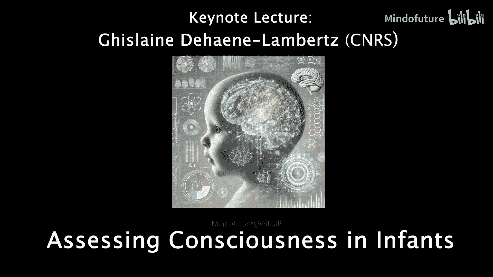
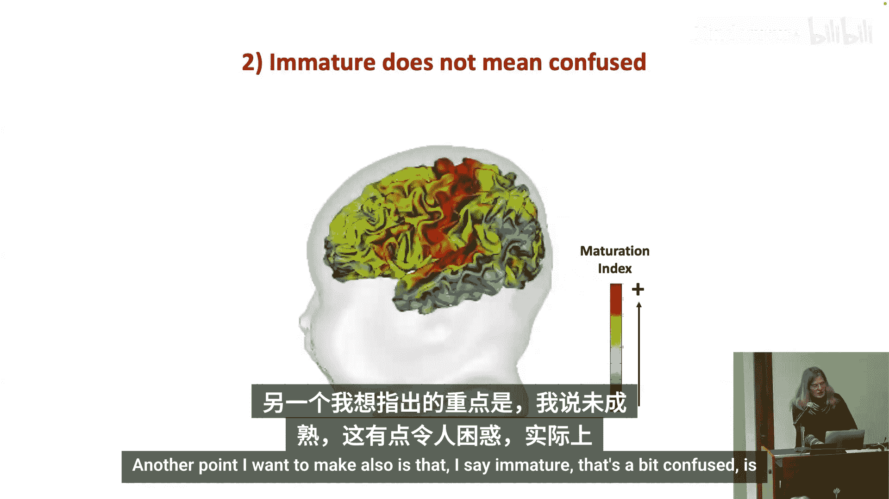
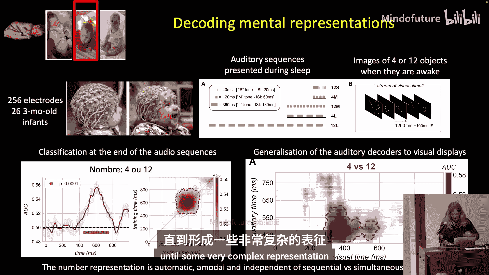
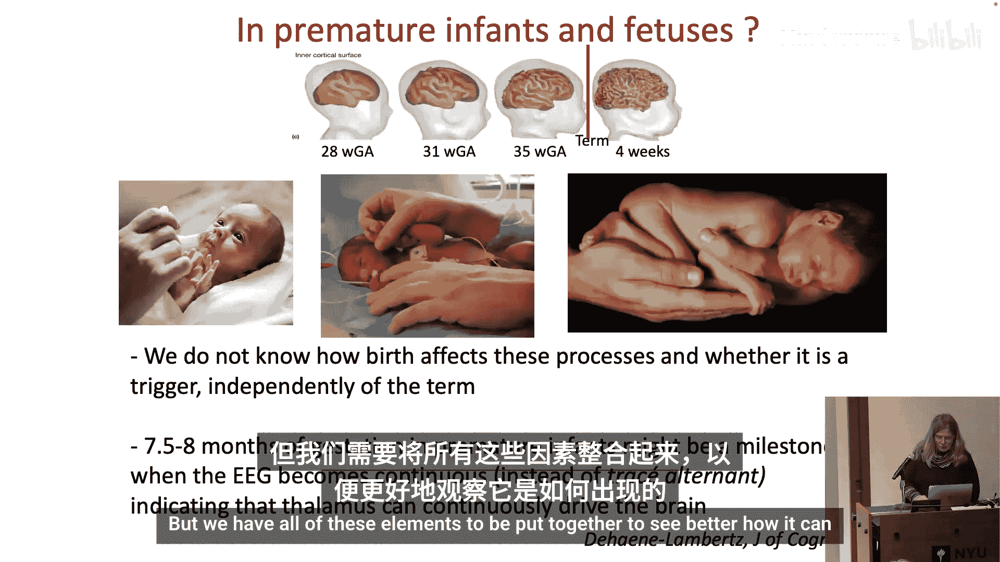
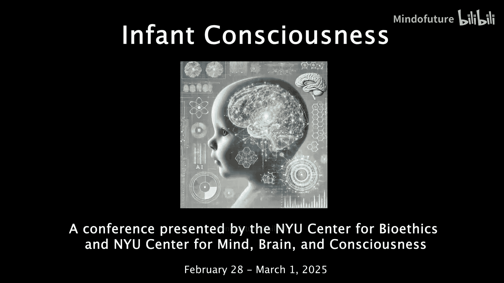

# 002：评估婴儿的意识

在本节课中，我们将跟随吉斯兰·德阿纳-朗贝尔兹博士的演讲，探讨如何评估婴儿的意识。我们将了解婴儿大脑的早期功能、复杂的认知能力，以及寻找婴儿意识存在的证据。课程将涵盖从大脑成像到行为实验的多种研究方法。

---

## 大脑早期功能与结构

上一节我们介绍了课程概述，本节中我们来看看婴儿大脑的早期发育情况。长期以来，人们认为婴儿大脑非常不成熟，因此意识问题不被考虑。然而，新的证据表明，婴儿大脑在结构上和功能上都很早就已组织起来。

*   **早期大脑成像证据**：早期的代谢成像显示，新生儿大脑的高级皮层区域（显示为蓝色）确实非常不成熟。
*   **新的结构认知**：但这并不意味着大脑是无结构的。如今的证据（如DHCP连接组项目）表明，大脑在早期就已高度结构化，并且高级区域也是功能性的。
*   **复杂认知能力**：在适当的条件下，婴儿不仅能表现出复杂的认知能力，这些能力可能不仅仅是反射性或统计性的，而是需要明确的表征，且出现时间比预期的要早。

接下来，我们将探讨这些早期能力的证据，并直接审视婴儿是否具有意识的问题。这里的“意识”指的是婴儿那种驱动他们探索世界的内在动力，这可能与注意力有关，也是我们理解婴儿如何获取外部世界信息并学习的关键。

我们将主要关注从三个月到足月，甚至早产儿阶段的婴儿。

---

## 早期功能性的证据

上一节我们了解到婴儿大脑并非一片空白，本节中我们来看看证明其早期功能性的具体证据。“不成熟”并不意味着“无功能”。

以下是利用功能磁共振成像（fMRI）等技术在婴儿中观察到的一些早期大脑活动：

*   **语言处理**：当清醒的婴儿听到母语时，其右前额叶区域会出现显著活动，这在睡眠时则观察不到。
*   **工作记忆**：当相同的句子在几秒内重复出现时，婴儿的左前额叶区域会出现活动，这与对语音旋律的识别和工作记忆有关。
*   **声音识别**：听到母亲的声音时，婴儿的中前额叶皮层（与自我和熟悉性相关）会被激活。而听到陌生声音（另一位婴儿的母亲）时，则是在右前额叶皮层和岛叶（与新奇感和价值判断更相关）出现更多活动。

这些研究表明，不仅三个月大的婴儿前额叶就有活动，而且这种活动会根据任务的不同而特异化。

此外，功能连接性研究也显示，新生儿大脑的网络结构与后期相似。虽然新生儿由于处于睡眠状态，其反应强度可能较弱，但网络的选择性模式已经存在。

最后，一项针对妊娠30周早产儿的研究显示，他们能够区分不同的音节（如“ba”和“ga”），这种对音素的区分能力在29周 gestation 时就已出现。有趣的是，他们对声音（男声/女声）变化的反应较弱，而对音素变化的反应则较强。相比之下，大鼠实验则显示对声音变化反应强烈，对音素变化反应弱。这可能意味着人类婴儿天生具有处理语音的特化网络。

综上所述，婴儿的神经系统的确很早就已组织起来，并且高级脑区也参与活动。

---

## 婴儿丰富的内在表征世界

上一节我们看到婴儿大脑很早就开始工作，本节中我们来看看他们能处理多复杂的信息。通过新的分析方法（如解码），我们发现婴儿早期就存在非常具体和复杂的心理表征。

例如，一项研究探索婴儿是否对数字有反应。通过播放听觉数字序列，并利用解码方法区分数字、节奏和时长信息，研究发现：

*   **独立的数字表征**：婴儿大脑中存在独立于节奏和时长的、特定的数字表征。
*   **跨模态泛化**：将在听觉序列上训练的解码器，应用于婴儿观看视觉物体（4个 vs. 12个）时的脑电数据，依然能够解码视觉数量信息。

这表明婴儿具有自动的、模态独立的抽象数量表征。类似地，婴儿对音素、面孔等也有稳定的早期表征网络。

所有这些都表明，婴儿的内在世界非常丰富，但这些表征的**计算**不一定需要意识参与（例如实验是在睡眠中进行的）。那么，关键问题就变成了：婴儿是否有**内在驱动力**去主动关注、探索并学习这些信息？这或许更接近我们所说的“意识”。

---

## 主动学习与信息获取

上一节我们探讨了婴儿的复杂表征能力，本节中我们来看看他们如何主动学习和获取信息。我认为这对于人类物种尤为重要，因为我们通过语言等方式主动引导婴儿学习。

要教会婴儿“这是葡萄”，需要几个条件：
1.  婴儿需要具备自上而下的注意力控制。
2.  婴儿和成人之间需要有共享注意。
3.  婴儿需要知道他们能从成人那里接收信息。
4.  最终需要一个符号系统（如语言）在双方大脑间传递概念。

研究表明，这种学习能力出现得非常早。例如，一项研究给3-4个月大的婴儿看一系列被命名为“toma”的恐龙图片，然后呈现一张鱼和一张新恐龙的图片。结果发现，被命名的婴儿会更倾向于看鱼（新奇类别），而未命名或听倒播语音的婴儿则不会。这说明**命名**帮助婴儿归纳出了“恐龙”的类别。

另一个复杂的实验在5个月大婴儿中进行，使用脑电图（EEG）。婴儿需要学习抽象的单词规则（如ABA结构：ga-ti-ga），并将其与特定图像（如一条鱼）关联。实验引入了不一致的配对和无法预测的第三种规则。

结果发现：
*   **预期与惊讶**：当出现不一致配对时，婴儿的脑电反应显示出“惊讶”效应（反应抑制）。
*   **注意力追踪**：通过闪烁背景的频率标记，可以追踪婴儿的注意力。当他们对即将出现的图像有预期时，注意力会聚焦；当感到惊讶时，注意力会扩散。
*   **预测过程**：在单词呈现后、图像出现前，脑电显示婴儿对可预测和不可预测的情况有不同的准备状态。

这些结果表明，婴儿大脑能进行复杂的操作：检测抽象结构、将其与任意图像关联、形成预期并处理意外。这需要一个稳定、明确的表征系统来整合不同信息（如视觉图像和听觉标签），而**全局工作空间**理论为此提供了一个框架。

---

## 寻找全局工作空间的证据

上一节我们假设婴儿需要全局工作空间来进行整合学习，本节中我们来看看支持这一假设的证据。全局工作空间具有几个关键特性：信息进入存在阈值、刺激间存在竞争（如注意瞬脱和掩蔽效应），以及存在自上而下的放大。

**1. 掩蔽实验中的两阶段处理**
在婴儿的视觉掩蔽实验中（如快速呈现面孔后被掩蔽），发现与成人相似的两阶段模式：
*   **早期线性阶段**：大脑反应（如P400波）的振幅和持续时间与刺激呈现时长成线性关系，这反映了感觉输入。
*   **晚期“全或无”阶段**：当呈现时间足够长时，反应达到一个阈值，出现“全或无”的进入意识的现象。
婴儿的这种转换发生得比成人晚，且波幅更小，这可能是因为其前额叶皮层不成熟、神经纤维髓鞘化不完全以及突触发生尚未完成，导致信息传递和处理速度较慢。

**2. 注意瞬脱实验中的竞争**
在注意瞬脱范式中，婴儿先注视一个中心刺激（T1，如变化的泰迪熊），随后在侧边快速呈现一个刺激（T2，如正常或杂乱的面孔）。通过调整T1和T2之间的时间间隔，并测量婴儿的眼动、瞳孔大小和脑电，发现：
*   **时间窗口**：婴儿需要约1200毫秒的间隔才能较好地注意到T2，远长于成人，再次印证其处理速度慢。
*   **注意力状态分离**：通过分析单次试验的脑电地形图接近标准P400反应的速度，可以将试验分为“深度投入T1”和“浅度投入T1”两类。
*   **竞争效应**：当婴儿深度投入T1时，无论侧边出现的是面孔还是杂乱图片，他们的眼动都没有差异，表明T2被“阻挡”了。只有当他们对T1投入较浅时，才会被T2吸引。这证明了刺激在访问注意力/意识窗口时存在竞争，是全局工作空间的一个特征。

**3. 自上而下的预期**
一项使用近红外光谱的研究简单而有力地展示了自上而下的预期。给婴儿反复呈现“哔”声后跟随笑脸的模式。在偶尔只呈现“哔”声而不呈现笑脸时，婴儿的视觉皮层仍然被激活，表明他们在**预期**视觉刺激的出现。而在只单独呈现声音或笑脸的控制组中，则没有这种跨模态激活。这明确显示了自上而下的、基于预期的神经活动。

综上所述，有充分证据表明，在妊娠晚期，婴儿已具备支持意识感知的结构和功能架构。他们能够主动保持表征内容并对其采取行动，刺激在访问中央工作空间时存在竞争，但这些过程非常缓慢。甚至在出生后第一年，意识可能也只出现在短暂的清醒窗口中。对于更早的早产儿和胎儿，情况尚不明确，需要更多研究。

---

## 总结与讨论

本节课中，我们一起学习了评估婴儿意识的多方面证据。

我们首先回顾了婴儿大脑并非不成熟和无结构，而是早期就具备功能性组织。接着，我们看到了婴儿拥有丰富的内在表征世界，能处理数字、语音等复杂信息。然后，我们探讨了婴儿的主动学习能力，以及他们如何整合信息，这引出了对**全局工作空间**理论的关注。最后，我们通过掩蔽实验、注意瞬脱实验和自上而下预期研究，找到了支持婴儿存在类似全局工作空间功能的证据，尽管其运作速度远慢于成人。

总结来说，现有证据强有力地表明，在妊娠末期的婴儿中，意识的相关基础已经存在。他们能够进行有选择性的注意、信息整合和基于预期的学习，这些都是认知主体与世界互动的重要标志。未来的研究需要进一步探索意识在更早发育阶段（如早产儿和胎儿）的表现形式，以及如何将这些科学发现应用于促进婴儿的健康认知发展。

---
*注：本教程根据吉斯兰·德阿纳-朗贝尔兹博士的演讲内容整理，旨在以简单直白的方式呈现其核心研究发现与观点。*