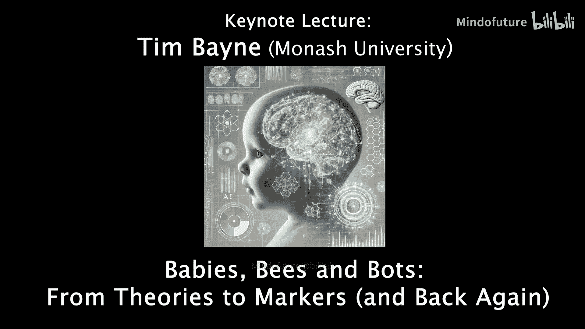
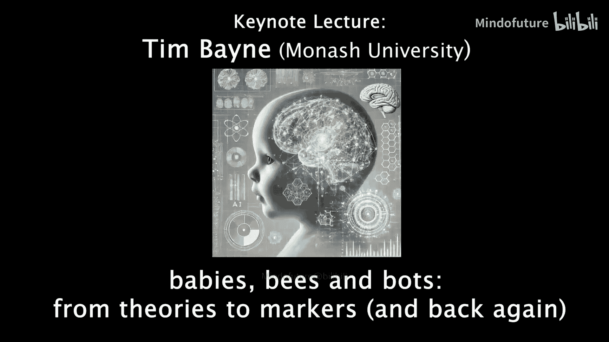

# 003：从理论到标记再回归

## 概述
在本节课中，我们将探讨一个核心问题：如何判断婴儿、蜜蜂乃至人工智能系统是否拥有意识。我们将审视两种主流的研究路径——基于理论的方法和基于标记的方法，分析它们各自的优势与面临的挑战，并思考如何在这两者之间找到更有效的平衡点。

---

## 从婴儿到蜜蜂：意识归属的起点

感谢戴夫。既然你让我有点不好意思，那我也要让你不好意思一下。我博士论文的很大一部分并非在戴夫的直接指导下完成，而是在新西兰做博士后期间。我会在任何时间把章节发给他，那时新西兰可能是凌晨两点，而亚利桑那州是早上五点，但我总能在十分钟内收到详细、有帮助的评论。这让我有了一个经验性的证据：戴夫从不睡觉，至少那时不睡。对此我非常感激。

安娜昨天提醒我们，我们讨论的是婴儿，但婴儿本应成为对话的一部分，我完全同意。所以我问我的伴侣能否带上我们的孩子，但她不太愿意让他们经历24小时的飞行，只为了我能把他们展示给你们看。所以，这里有一些照片代替。这是该物种的雄性幼体和雌性幼体。

教科书告诉我们，研究意识的最佳方式，有时甚至是唯一方式，是口头报告，即内省式的变量报告。所以我问奥托（当时四岁半）：“你意识到什么？”他说：“一切。”我问艾拉（当时一岁半），她无视了我。也许是因为她语言能力很强，或者她只是觉得这是个非常愚蠢的问题——很可能确实是。

我喜欢这张照片，它提醒我们，“意识”的词源是“共同知晓”，其中蕴含着一种主体性和第二人称元素，正如珍娜之前谈到的。我们知道婴儿本身是“无语言的”、“前语言的”。但我们也知道语言与意识之间的联系相当薄弱，我认为大型语言模型的兴起强化了这一点。这是一段47000字对话中的一个段落，如果你想读，网上都有。这是计算机科学家兼哲学家默里·沙纳汉与Claude关于意识的对话，它以一种模糊合理、带有Claude风格的方式，持续谈论着佛教、自由意志和主体性。它在谈论意识，但没多少人认为Claude真的有意识，默里肯定不这么认为。

好吧，照片中一岁半的婴儿，我想我们大多数人都认为是有意识的。如果我们再往前追溯一点呢？这是四个半月大的婴儿。我能在洛杉矶机场拍下这张照片，因为四个半月大的婴儿不怎么动，也不会翻身。所以我能拿着相机，即使有860亿个神经元，它们在四个半月时也还没怎么为运动控制连接好，我不必担心他会从换尿布台上掉下来。我们从西德昨天谈到的、很多人都在讨论的贾斯特·拉的工作中知道，四个半月大时，已经发生了各种惊人的复杂知觉加工。但智人婴儿的行为不成熟程度相当令人惊讶，尤其是当你将其与只有百万个神经元的蜜蜂所能做到的事情相比时。

这里有一份清单，列出了工蜂能执行的59种相当不同的行为，而它们的大脑甚至比20周胎儿的脑还要小得多。所以，我们有了蜜蜂，有了婴儿。让我们看看人们对意识归属的看法，作为开始对话的起点。这是一些来自两次ASSC会议（主要是科学家，一些哲学家）的调查数据。大多数人认为他们自己是有意识的，这很好。其他人呢？人们是有意识的。猴子、狗、章鱼和婴儿……我的意思是，这个调查结构不是特别严谨，因为我们不知道他们说的“婴儿”具体指什么，但婴儿在人们愿意赋予其意识的程度上，介于章鱼和蝙蝠之间。这个列表上没有蜜蜂，但我猜蜜蜂大概在鱼类附近。它们经常被当作有问题的案例讨论，因为行为复杂，但神经解剖学和进化路径却非常不同。秀丽隐杆线虫？是的，得到了一点喜爱，但低于25%。令人惊讶的是，更多人认为岩石有意识，而不是树木。也许只是有人在开玩笑，我不知道。这就是ASSC的数据。

这是大卫·查尔默斯和戴夫·特拉组织的“哲学论文”调查数据。更有帮助一些，因为我们现在知道不仅仅是“婴儿”，而是“新生儿”。大约85%的人认为新生儿有意识，同样高于鱼类——我猜这是最接近人们可能对蜜蜂看法的参照物。但有用的是，他们还包含了人工智能系统，不仅是当前的AI系统，还有未来的AI系统。我想，对于当前的AI系统，只有可怜的3.5%的人认为有意识。也许哲学家比科学家更愿意赋予婴儿意识，但有趣的是，他们比赋予鱼类、苍蝇（我猜还有蜜蜂）和当前AI系统意识更愿意赋予新生儿意识。

---

## 新生儿与出生：意识的开关？

说到新生儿，我们想说什么？昨天有很多讨论。这是我的儿子奥托，我想这是他出生后不到两小时拍的。他睡着了，这有点不寻常。据我了解，大多数婴儿看起来更像这样。在场的儿科医生可以纠正我，他们可能想纠正我的很多事情，请别犹豫，我是个哲学家。这张照片来自莱格·克兰斯和斯洛特1966年一篇非常有趣的文章《出生的压力》。但在出生后大约两小时左右，他们会变得警觉。想想看，你为什么不警觉呢？刚刚发生了什么？你从一个产前状态过来，那里非常温暖（37摄氏度，98.6华氏度），环境高度可预测，在你成熟期间变化不大，你的代谢需求得到满足，你不需要做任何事情，氧气和能量都有人供应。对于在场的毛利人来说，我发现“whenua”是一个毛利词，通常用于土地或人民，比如“tangata whenua”（土地上的人民）。所以“whenua”是土地，但它也指胎盘，我认为这非常美妙——在毛利文化中，你的胎盘就是你的土地，以那种方式支持着你，我觉得这非常有洞见。

还有许多抑制性神经调节剂，它们在某种程度上镇静着胎儿。产后状态在许多方面都非常不同。它会更冷，即使在温暖的产房里也可能更冷。你的环境变得不可预测得多，不仅仅是与产前环境不同，其内部也充满了不可预测性。昨天也提到了这一点，托肯和贾斯特之间进行了一场有趣的讨论。在某种意义上，胎儿/婴儿从一个……的状态，变成了一个现在必须自己照顾代谢和体温调节的“外温动物”。当然，母亲会帮助他们，照顾者会帮助他们，但他们现在会出汗（太热时），一段时间后会发展出发抖的能力。他们必须参与（当然是与母亲一起）摄取自己的能量，这是以前不需要做的。他们必须寻找乳房，饥饿时必须吮吸。所以，这些基本的稳态代谢过程的责任显然不仅仅是婴儿的，而是与母亲和其他照顾者共同承担的，但在某种程度上，这变成了婴儿的责任，而以前不是。而且有高水平的应激激素。难怪出生的过程会让你清醒，进入这种高度警觉的状态。

**出生会打开意识的开关吗？** 我认为这不是一个疯狂的想法。显然，这个想法已经被提出过。但我认为它真的很有趣。不过，也有怀疑和辩论的空间。也许新生儿，尤其是刚出生的，类似于处于无反应性觉醒综合征（植物人状态）的患者。他们是清醒的，但没有意识，没有有意识的觉知。这是一种可能性。也许你在新生儿身上看到的对各种刺激的选择性反应，在某种程度上类似于盲视患者。所以，存在对世界特征的某种表征，但它不是有意识的。这是怀疑论的立场。

---

## 出生之前：胎儿期的意识可能吗？

那么，出生之前呢？这是奥托19周时的扫描图，在和我们“击掌”。你可以从两种方式来看待这个。但我想大多数人会说，在这个年龄几乎没有意识存在的证据。这不仅仅是威廉·格拉夫昨天精彩展示的数据（我记得你说20周时大脑只有草莓大小），尽管草莓比蜜蜂的大脑大得多。我认为，让大多数人相信在这个年龄几乎没有合理意识前景的，是丘脑和皮层之间缺乏连接。神经元或其前体（成神经细胞）直到大约24、25、26周才真正从底板迁移到皮层。正是这一点导致大多数人（十分钟后我们会看到一些例外）认为，甚至在24周之前都没有真正的意识能力，所以还要再过五周，这里才真正存在一个严肃的问题。

这就是从四个半月到妊娠19周左右，当你向下追溯时会想到的一些问题的快速概览。显然，摆在桌面上的问题是：**意识、觉知、体验何时出现？** 我将把这些术语当作同义词使用，并且不打算定义它们。这不仅仅是关于婴儿的问题，也是关于蜜蜂、一系列非人动物、类器官、类人机器人、异种机器人以及所有即将到来的合成生物学和人工智能的问题。我们需要解决这些问题的方法，如果我们能做到的话；或者我们只能举手投降，说我们不知道。我认为，这是该领域的零假设。

---

## 两种研究路径：理论与标记

退一步看，该领域的构建方式大致有两种路径：**基于理论的方法**和**基于标记的方法**。在接下来的演讲中，我想花几分钟回顾一下基于理论的方法面临的一些相对熟悉的挑战，然后花更多时间关注基于标记的方法——我认为这种方法目前已经占据上风，或许是主导方法——并真正讨论一些我认为迫使我们回归理论方向的严峻挑战。

### 基于理论的方法及其挑战

**基于理论的方法**最抽象地讲，你在做什么？你选取你最喜欢的、你认为最合理的意识理论，试图从中推导出一些必要和充分条件。然后你审视数据——无论是行为数据、神经生理学数据、代谢数据还是其他数据。接着，你尝试利用这些必要和充分条件来设定阈值，即你认为意识尚未出现的点，以及意识已经出现的点。

这里有两个问题。一个很明显，另一个不那么明显。我将快速回顾两者。

**第一个问题是存在许多意识理论。** 这是我和阿尼尔·塞斯最近一篇综述中的表格，并不完全全面。不幸的是，不仅仅是理论众多，人们还存在分歧。回到我之前分享的ASSC数据，你可以看到人们对各种理论的置信度分布相当广泛。位居榜首的预测加工理论，在我看来根本不是一种意识理论，这有点奇怪。但贾斯特·拉会很高兴知道，全局工作空间理论位居前列。高阶思维理论位居第二或第三（取决于你是否将预测加工理论列入清单）。远程理论也在其中，许多理论都在讨论范围内。所以，我们知道存在很多争论。

这是一个问题，因为不同的理论似乎对婴儿意识产生了不同的预测。这是近期意识文献复兴中的首批讨论之一。彼得·卡拉瑟斯曾援引高阶思维理论的一个版本来论证意识在三岁之前不会出现。彼得现在不再相信高阶思维理论了，他对意识有了不同的看法，即全局工作空间理论的一个版本，所以这不再是他现在的观点。但去年也有人发表文章说三岁之前不存在意识，他并非孤例。同样在2003年，珀纳和杜奈什也援引高阶思维理论的不同处理方式，论证在一岁之前你并没有真正的意识。贾斯特·拉在她的综述论文中，借鉴全局工作空间理论，暗示大约六个月大，也许是五个月大时（昨天你暗示证据出现在那个点）。而乔纳森·伯奇在他最近的书中，虽然没有说意识从妊娠12周就存在，但他声称胎儿是“有感觉能力的候选者”，即有可信的科学证据表明从妊娠12周起可能存在意识。这是一个范围。我的意思是，这里提出一个显而易见的观点，但我认为值得提醒我们自己，基于理论的方法给出了多么广泛的观点。

如果这些观点能趋同于某个阈值，那么分歧就不是问题，但它们没有。根据其中大多数观点，19周胎龄的奥托没有意识。但根据伯奇对梅尔泽克理论的解释，他可能已经有意识七周了。根据某些观点，庆祝两岁生日的波拉（照片中）还要再过一年才有意识。我不知道你们怎么看，但我能从她脸上看到某种混合了忧虑、兴奋、自我意识的表情。她很高兴是她的生日，又有点害怕接下来会发生什么。她有点……我不知道我是否享受这个。她处于意识的边缘，但我的意思是，我能从那张脸上看到很多情绪，但如果你把阈值定在三岁，那她就还没有意识。

**第二个问题讨论得较少，但我觉得在某种程度上更有趣。** 意识理论几乎完全源自成人数据。很难说如何将它们应用于非人类群体。我指的不是验证或证明，那显然是每个人的问题。我指的是理论的具体化。不同理论以不同方式和不同程度存在这个问题。

向全局工作空间理论的倡导者致歉，但我觉得用GWT来解释这个问题最容易。这是人们在谈论GWT时经常展示的两张图：一张是人类神经实现的解剖图，另一张是GWT更抽象的功能规范图。问题是：如果你想知道一只蜜蜂、一个AI系统或一个胎儿是否拥有全局工作空间，你显然需要了解该系统。但你必须知道全局工作空间的参数是什么，才能知道如何将理论应用于那个系统。你必须知道什么才算是全局工作空间。

以蜜蜂为例。蜜蜂能有全局工作空间吗？有些人研究过这个并说，全局工作空间需要皮层，蜜蜂没有皮层。一句话，蜜蜂不能有全局工作空间。我在知名蜜蜂研究者的著作中看到过这种说法。但对我来说，这似乎太快下结论了。斯坦·德阿纳本人在谈论非人类意识时说，也许鱼可以有一个全局工作空间。也许你不需要这个（解剖结构），你需要的是更像那个（功能规范）的实现。好吧，我觉得这有点道理。如果你在谈论AI的全局工作空间，你不想固守于人脑，你想抽象出来谈论功能特征。这似乎是合适的。

但那么，允许调节的维度或参数是什么？在什么方向上调节多远？即使在婴儿身上，关于支持意识的“工作空间”何时出现也会有问题。它不会像雅典娜从宙斯头中完全成形那样一下子出现。它会一点点地、以不同方式形成。“点燃”可能会断断续续。大概会有某种类似全局工作空间的东西，而你需要判断何时你拥有了一个真正的全局工作空间。

此时有些人会坐立不安，并理解地说：这只是文字游戏，只是语义问题。为什么我们需要哲学家？嗯，这确实是文字问题。但这不仅仅是文字问题，因为我们处在一个文字很重要的领域。我们知道这有政治背景。所以我认为这里存在如何以原则性的方式具体化（例如）全局工作空间的问题。我只是以此为例，而不是你可以随意规定——当然可以，但那是作弊，那是“盗窃胜过辛劳”。

---

## 理论的价值：以伯奇的论证为例

所以，理论面临两个挑战：缺乏共识，以及不确定如何以有纪律的、经验验证的方式将理论应用于成人以外的案例。但我认为我们不应该就此拒绝理论。我不想反对理论。我认为当我们采取理论方法时，确实会发生一些非常有趣的事情。我将从演讲中抽出五分钟，转向讨论乔纳森·伯奇的书来说明这一点，因为我认为这是一本很棒的书，已经产生了影响，并将继续产生影响。书中有很多精彩内容，但我对其关于婴儿意识的处理有保留意见，所以我想确保有时间谈谈这个。

**乔纳森说了什么？** 他说他喜欢“12周提议”。胎儿应被视为有感觉能力的候选者。他并没有声称胎儿很可能有意识，这是一个技术术语。他认为从妊娠12周起，就有来自可信的、基于证据的理论视角的描述。好吧，他为什么认为从12周起就是有感觉能力的候选者？据我所知，在相关章节中有两条论证线索。

第一条我本来不打算谈，但威廉昨天精彩的演讲提出了堕胎问题，促使我提及一些内容。他部分基于德比郡和博克曼那篇颇有影响力的论文《重新思考胎儿疼痛》，其中说疼痛不需要皮层，在丘脑皮层连接建立之前（24周之前）就可能存在疼痛体验。关于那篇论文，我不打算多谈，只想说如果你对这个说法感兴趣，你需要读读所罗门斯和乔瓦尼·迪耶蒂的这篇论文。因为德比郡和博克曼引用了他们的工作，而在所罗门斯和迪耶蒂看来，他们误用了它，混淆了敏感性和特异性。我不再占用更多时间，但我认为这是一场重要的辩论，那是一篇需要关注的重要论文。

**我想关注的是乔纳森对梅尔泽克框架的使用，我认为这真的很有趣。** 我喜欢梅尔泽克对意识的处理方法（他旧的观点，他现在有了新观点，我也喜欢那个。人们总在改变观点）。他旧的观点是什么？这是一个以中脑为中心的论述，并不否认皮层为意识贡献内容，但“行动”可以说在中脑，亚皮层意识通过产生动物与其环境的整合表征来产生意识。这个表征结合了内感受和外感受信号，动物然后可以利用它来满足其稳态需求、代谢需求，指导行为。所以它整合了关于你的身体、感知信号、再传入问题的信息，告诉你你在哪里，并帮助你弄清楚下一步该做什么。

乔纳森说，一旦你承认这个图景的可信度，你就需要认真对待胎儿可能在相关中脑结构（上丘、导水管周围灰质）就位时（大约12周）就有感觉能力的想法。我的问题是：这些结构“有功能”是什么意思？我认为，如果你在梅尔泽克的观点框架内工作（他此刻正是如此），你必须看看梅尔泽克对“功能性”说了什么。这是伯奇自己将梅尔泽克观点应用于动物问题时所说的：梅尔泽克所要求的（也就是他所说的“有功能”）是，存在一个核心行为控制单元的证据，该单元构建了动物在环境中的整合模型（整个动物在环境中），从而能够为实现生物需求而灵活控制整个动物的行为。这就是这些系统在相关意义上“有功能”的含义，如果我们是在梅尔泽克的框架内工作的话。

现在，赞迪·巴伦和科林·克莱因曾说：我们喜欢梅尔泽克对人类意识的论述，我们要把它应用到昆虫身上。看起来昆虫大脑（蜜蜂大脑）中有同源的中脑结构，我们认为蜜蜂是有意识的。这完全正确。我的意思是，你可以质疑梅尔泽克的论述，但我认为这是合适的。我认为梅尔泽克的论述确实为蜜蜂意识提供了一个非常合理的故事，因为它服务于满足需求的整个大脑、整个动物的行为控制。

**但我不确定胎儿的情况。** 我不认为胎儿有一个关于自身在环境中的整合模型。我们昨天看到了一些关于嘴和手表征的非常有趣的数据。但我不认为它有一个“这是我，这是我的环境，这是我作为一个能动动物在那个环境中如何移动”的表征。胎儿的环境受到极大限制。即使你说它有，我也不认为它有一个服务于生物需求的表征。在相关意义上，它没有生物需求。我认为那是胎盘在为它做的事情。那些需求可以说已经得到满足。只有当你出生后，你才拥有生物需求，需要你作为一个整体动物去做些什么。所以，对我来说，结论有点意思：一种我认为在动物意识方面相当自由（梅尔泽克的论述认为动物意识分布非常广泛）并且在AI意识可能性方面也相对自由的观点，实际上在胎儿意识方面相对保守，几乎不支持胎儿意识。这与乔纳森的观点相反。

---

## 转向标记方法：优势与初步应用

那么，我时间控制得怎么样？你给了我大约十分钟的介绍时间。好吧，我想做的是从理论快速转向标记。我将从这里开始。我可能不在这个房间，所以我不知道讨论进行到哪里。我将从另一个房间开始，从《纽约动物意识宣言》开始，我想你们许多人都熟悉。它对哺乳动物和鸟类有强有力的科学支持。对变温动物（如鱼类、头足类、甲壳类、昆虫）存在有意识体验的“现实可能性”以及一系列其他事物（包括昆虫）感兴趣。网站上有一页总结了部分证据，你在那一页上看到的就是：**标记**。这很合理，因为在那类文件中，你无法诉诸理论，因为没人会在理论上达成一致。所以标记提供了一个更中立的起点，或者至少看起来提供了一个更中立的起点。

以下是该宣言中提到的一些潜在意识标记：
*   B1：表现出明显的玩耍行为。
*   B2：表现出快速眼动睡眠和安静睡眠。
*   B3：表现出跨模态匹配。
*   B4：表现出情境学习。
*   B5：表现出对镜像的自我导向行为。
*   B6：表现出权衡决策。
*   B7：表现出疼痛缓解行为。
*   B8：表现出疼痛镇痛。
*   B9：表现出对新颖刺激的偏好。
*   B10：表现出对熟悉刺激的偏好。

我不打算逐一细读，你们可能已经读过大部分了。我将关注两个：B1（表现出明显的玩耍行为）和B2（表现出快速眼动睡眠和安静睡眠）。我知道还有其他人表现出明显的玩耍行为：婴儿。我从未见过有人说因为你玩耍……我不知道玩耍什么时候开始。发展心理学家说，两个月？三个月？这取决于你指什么。杰西卡·巴博有一张非常有趣的海报，暗示胎儿可能会玩脐带。类似玩耍的行为。我不知道玩耍何时开始，但在这个语境下提出玩耍问题很有趣。关于快速眼动睡眠和安静睡眠何时开始出现，我认为有点模糊，但非常早。这里存在争论。我所做的只是指出这些标记与胎儿/婴儿标记之间的一些有趣联系。

---

## 标记方法的定义与验证挑战

那么，在深入探讨婴儿问题之前，让我们先思考一下“标记”是什么意思。我所说的**积极标记**，是指其存在被认为对意识的存在具有特异性（或被认为是特异性）的特征。一种单向标记需要高特异性。所以如果标记存在，你就知道意识不太可能缺席，但敏感性低或未知。你可以有**双向标记**，既高度特异又高度敏感。所以如果你有一个双向标记，那将是一件美妙的事情：标记的存在提供意识存在的证据，标记的缺失提供意识缺失的证据。我不喜欢这里使用的“签名”一词，因为它暗示100%确定，但“指标”可能更有用一点。

这里的关键问题，也是每个人都在努力解决的问题是：**你如何验证标记？** 这是个好问题。我认为对于不同的标记，你可能想尝试讲述不同的故事。我不打算重点讨论这个。标准方法，我认为我脑海中一直有的那种，大致是这样的：你有一个**基准化步骤**（尼科洛昨天在他的演讲中谈到了类似的东西）。你使用一种对比方法，有不同种类的对比，因为你可以对比成人人类的不同状态（那是你的基准化群体，你的源群体），以此来了解敏感性或特异性。然后有一个**泛化或投射步骤**，你从你的基准化群体转向你的目标群体（婴儿、蜜蜂、机器人等）。

例如，我们昨天讨论了很多这个标记：**局部-全局效应**。你有一组音调，哔哔声，然后关键的一个在这里，没有局部奇异球，但有一个全局奇异球，因为前几组建立起来的规律性不再存在。声称是，这在成人中似乎具有相当的特异性。你经常在警觉、有意识的状态下发现它（并非总是，但经常），但在深度睡眠、麻醉、植物人状态/无反应性觉醒综合征中则没有或很少发现（这里有个星号，因为有一项研究表明，大约15%的UWS患者中可以发现它）。但这没关系，因为我们已经从其他方面知道，大约15%的那些患者并非真的无意识。所以，你大概会期望在大约50%的患者中发现它。标签在这里变得非常棘手。这存在争议，我没有跟进所有文献，我猜在座有人比我更了解，但我的感觉是，大多数批评集中在其敏感性而非特异性上。如果你将其视为单向标记，你关心的是特异性而不是敏感性。

---

## 标记方法在婴儿研究中的应用

基于标记的方法我们已经看到被应用于动物文献，它也被应用于婴儿。这方面最早明确的工作是西德的工作，当然更早的工作可能背后也有类似想法。但我和乔尔、洛伊娜等人在最近一篇论文中（戴夫提到过）研究了标记集群，克莱大约在同一时间也做了同样的事情。我认为这里方法上略有新意的是，你不试图孤立地看一个标记，而是试图找出趋同的证据，你试图观察集群，看它们是否一致。所以洛伊娜谈了很多这些标记中的第一个：功能连接网络。我们研究的另一个标记不仅仅是盲视那种自下而上的注意，而是那种看起来涉及前额网络的自上而下的注意，这借鉴了恩佐·布朗的一些工作。看起来某些类型的多感官整合（如麦格克效应）在成人中需要意识，你可以无意识地获得其他类型的多感官整合，但据我们从文献中了解（我们可能错了），麦格克类效应需要意识。然后是局部-全局效应及相关的一阶/二阶奇异球范式。看起来它们并不完全一致，但这有点意思，但似乎存在一个粗略的趋同，表明意识出现得比其他人建议的要早。我们得出的结论是：意识出现得相对较早。

---

## 对标记方法的质疑与回应

现在，我不知道我还有多少时间，但我确实想谈完对标记方法的一些反对意见。以下是几个主要的反对意见：

**1. 你投入什么就得到什么。** 这有点像基于理论的方法：取决于你从哪些标记、哪些集群开始。这是亨利·泰勒和安德鲁·布伦纳在《趋势》杂志上发表的信中提出的反对意见。他们说，看，采用其他标记，实际上是珀纳和杜奈什早在2003年讨论的那些：意向性手段、行动协调、外显知识、记忆。如果你看这些标记，它们大约在一岁时出现，你得到一个……所以，为什么……他们说他们喜欢基于标记的方法，但你知道，它并没有给出一个单一的结果，没有指向一个单一的方向。它和基于理论的方法一样糟糕。

我认为这不太成立。问题是，如果你把你的标记视为单向标记而不是双向标记，那么晚期标记并不会削弱早期标记。是的，意向性手段和行动出现得晚，但它的缺失并不表示意识的缺失。所以，要让这个挑战成立，我认为你必须把这些标记视为双向标记，你必须说它们的缺失表示意识的缺失。但我认为，在这些特定标记的情况下，这相当不合理。

**2. 标记方法将标记视为神圣不可侵犯。** 我这么说的意思是，批评者可能会过来说：你认为你在婴儿X个月大时发现了意识的证据，因为他们满足了你的标记，在局部-全局测试中表现出阳性结果。但你不认为婴儿有意识。那么，为什么不把这个结果当作削弱你标记的证据呢？为什么不以此作为证据，表明你的标记实际上并不是一个好标记呢？所以，标记方法的倡导者说：T是M（标记），M是意识的标记，因此T是有意识的。当批评者说：好吧，是的，我同意，你可以在新生儿身上发现局部-全局效应。但你不认为新生儿有意识（所以你才需要标记方法）。那么，为什么不直接得出结论：这个标记在你的群体中实际上并不是意识的标记呢？

我认为，对这个挑战的适当回应，取决于你是在谈论婴儿、蜜蜂还是机器人，方式有所不同。这正是我卡住的地方。我想说，对于蜜蜂和婴儿，重要的是首先要认识到，我们并非认为它们没有意识，它们不像石头。实际上，它们不像那2%认为石头有意识的人眼中的石头。我们对它们并非确定没有意识，它们是开放案例，是候选案例，我们不确定。所以，你知道，我们想要降低对标记的信心，同时（当你思考时，这有点奇怪，但我认为这必须是对的）提高对目标有意识的置信度。但这意味着先验概率很重要。所以，我一开始提到的调查数据，有些人说，哦，那只是人们的想法，谁在乎人们怎么想？你做你的科学。但一旦你进入标记领域，你就是在调整你的置信度，所以你的先验概率很重要。我认为这是这里一个非常重要的教训。

**那Claude呢？** 你给你本地的AI系统做局部-全局测试。我不会想任何事情。当然，它们会通过局部-全局测试。这不是一个有趣的结果。为什么它不有趣？我不太知道该怎么说。是因为这个系统真的不是意识的合理候选者吗？我们对哪些东西是意识的合理候选者有一些假设，而某些AI系统就是达不到那个阈值。例如，它们没有具身化。或者，我们直觉上把局部-全局测试当作其他东西（工作记忆+？）的代理，而我们不认为（或认为我们知道）该系统没有那个“其他东西”，它没有工作记忆，没有“工作记忆+”。还是因为，嗯，它实际上确实给了你一点证据（Claude可能通过局部-全局测试的事实），但我们有所有这些巨大的否定因子，所以那淹没了我们有一点点理由认为Claude有意识的直觉。这里有不同的说法。我不确定哪个最合理，但我认为这里有一些有趣的东西值得思考。

---

## 核心挑战：投射性与成人中心主义

我将跳过这一个，用最后一个反对意见来结束，因为它确实是最棘手的。**基于标记的方法需要反投射性**。有两种思考方式：我们从成人人类的基准化群体开始（不总是神经典型，但他们必须能够说服我们他们是有意识或无意识的）。所以我们需要至少足够多的前理论标记就位，以了解这一点。然后，人类中心主义的担忧是：我们如何投射到非人类哺乳动物、爬行动物、蜜蜂和机器人身上？这些都是非常不同的系统。是什么让你认为在我们身上的标记，在其他东西身上也是标记？但我们这次演讲主要讨论的不是那些群体。你可能会说，嗯，但我们讨论的是婴儿，所以我们不必太担心那种问题，因为我们讨论的是同种。

**但这太快了。** 我认为安娜昨天的观点很好：我们确实需要担心成人中心主义。仅仅因为我们讨论的是同种，某些担忧不会出现，但其他种类的担忧会出现。我们知道大脑、意识和行为之间的关系随时间变化，我认为关于注意瞬脱的研究（随着年龄减小，注意瞬脱时间大大延长）是这一点的一个绝佳例证。我们迄今为止没有过多讨论的是，我们知道意识本身也会变化。所以，不仅仅是意识被约束在其中的功能/行为/认知包不同，我们试图把握的那个东西本身也可能具有不同的特征。为了说明这一点，我认为我们需要思考意识的结构。我是这样处理的：我们感兴趣的是一般属性——意识何时出现？但这在两个层面上被调节：全局状态层面和内容层面。全局状态，例如，有清醒、做梦、迷幻状态，有一系列不同的方式在全局层面调节意识。当然，还有不同种类的内容。

我们知道，或者至少很合理地认为，早期婴儿的全局意识状态会有点不同，它们是连续的，但与成人的会有点不同。我们也知道内容可能不同，这是昨天苏珊·乔尔的演讲中提出的问题之一。内容是什么？婴儿如何感知世界？存在知觉窄化，内容不仅仅是婴儿从少量内容开始然后变得更丰富，在某些方面，他们从丰富的内容开始，然后也会失去一些内容。所以是双向的。

所以，我们知道我们试图投射到的那个东西（我们的基准化群体在这里），不仅被封装在一个功能/行为/认知系统（这个系统不同，并且与意识的关系也不同）中，而且这个“包”本身也具有不同的特征。所以这是个难题。我不知道如何解决，我不应该把它留到我演讲的最后30秒。但我只想抛出一组想法，作为一种起点，或者至少是一种思考方式，即这个问题可能并不像最初看起来那么棘手。

那就是：即使在成人意识内部，也存在很多变异。全局状态并非单一的，这是意识科学在过去10年中发现（或以新的方式发现）的事情之一：冥想、迷幻药、自我消解、出神状态……成人体验中存在大量多样性。也有很多不同的内容。你可以探索那个空间，试图了解哪些特征更具偶然性，哪些特征更本质。这种探索反过来可能会指导关于何时可以合法地将成人标记应用于婴儿、可以沿哪些维度应用多远等决策。另一个明显的观点，但我觉得值得提醒我们自己：我们不仅有成人和婴儿，我们有一个发展轨迹。我们有四岁的孩子，他们显然是有意识的。同样，我认为西德关于注意瞬脱的工作非常精彩，因为它不仅仅是从婴儿到成人，还有一个过渡，一个轨迹。这给了你一个起点，去思考如何投射：哪些维度会连续地向下发展到婴儿期，哪些维度会改变，以及何时允许你投射，何时你会因为将成人标记应用于婴儿而陷入麻烦。

---

## 总结与展望：回归理论

我讲得太久了。最后一点：这是你希望做的。你基于你对婴儿意识的假设开发一个新的标记，然后你回到你的基准化群体，说：好吧，让我们看看在成人水平上那个标记是否存在。我的意思是，那将是……圣杯。那么，我们是否回到了理论优先的方法？是的，在某种程度上。但真的，这是一种自下而上、基于经验的理论，着眼于人类体验的丰富多样性，这正是理论一直试图做的。但我想，它们并不总是做到了，值得思考我们应该做什么，并明确这一点。

**在本节课中，我们一起探讨了判断意识存在的两种主要路径。** 我们看到了基于理论的方法虽然能提供深刻的解释框架，但面临理论分歧和难以应用于非典型案例（如婴儿、动物）的挑战。基于标记的方法提供了一个看似更中立、更易操作的起点，特别是在研究婴儿和动物意识时，但它同样面临如何选择、验证标记，以及如何将成人数据中得到的标记有效“投射”到发展中的、或结构迥异的系统上的根本性难题。最终，我们认识到，或许最有效的路径不是二选一，而是某种循环：从细致的经验观察和比较中（包括成人意识状态的多样性以及从婴儿到成人的发展轨迹）提炼出更稳健的标记和更包容的理论，再用这些理论去指导对新标记的寻找和对旧标记的修正，从而逐步逼近对意识起源更清晰的理解。这条路要求我们既保持理论的想象力，又坚守经验的严谨性。