# 004：专题研讨1 - 婴儿意识的神经相关性

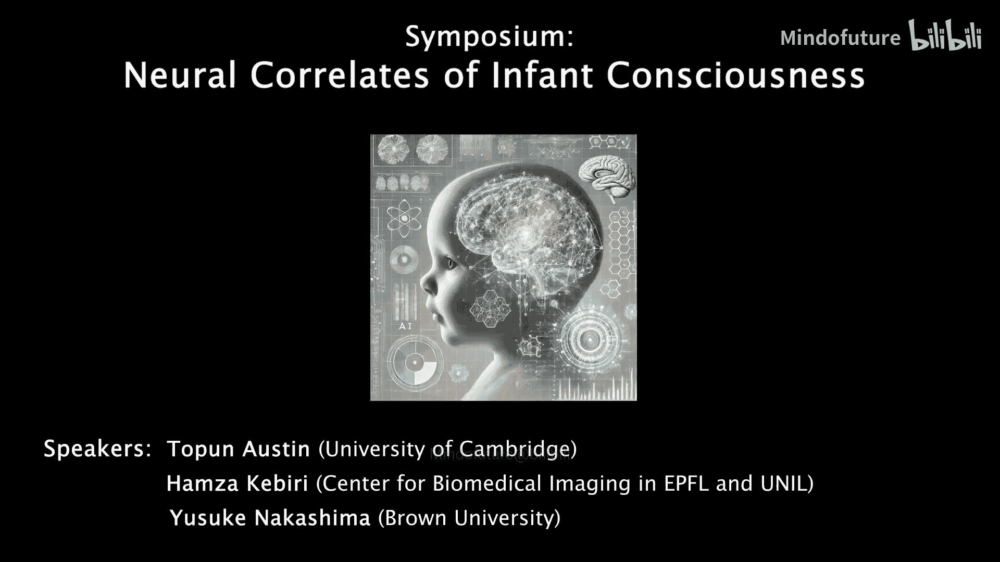

## 概述

在本节课程中，我们将探讨婴儿意识的神经基础。我们将跟随三位研究者的报告，了解他们如何通过研究睡眠、触觉、丘脑功能连接以及视觉处理机制，来探索婴儿大脑中意识是如何萌芽和发展的。这些研究从不同角度揭示了早期大脑发育与意识体验出现之间的潜在联系。

---

## 第一部分：新生儿睡眠、触觉与意识发展

非常感谢。我很荣幸有机会在这次会议上发言。

我知道克劳迪娅希望年轻的研究者来展示他们的工作。我必须承认，从年龄上讲，我并不年轻。但在意识科学领域，这对我来说是一个新的领域。能与这样一个多学科的团队交流非常棒。作为一名临床医生，我对周围的科学了解不多，感到有些压力。但我希望，我将要讨论的几个领域，能够触及意识本身。

我是一名新生儿科医生，或者说是一名婴儿医生。我照顾婴儿大约有30年了。这是我唯一能找到的我和婴儿的合影，实际上是我的儿子，25年前的照片。在我的日常工作中，我在新生儿重症监护室照顾生病和早产的婴儿。例如，这个婴儿在妊娠25周时出生，必须在保温箱里度过剩余的“孕期”，身上插满了各种管子、电线和监护仪。

在过去的30年里，我观察到我们在让这些小家伙存活方面做得越来越好。我早期的很多研究是寻找理解和预防早产儿脑损伤的方法。在这方面我们也做得更好了。我一直对那个大脑里到底在发生什么感到着迷，特别是当涉及到意识的出现时。

我认为这很重要有很多原因。但作为一名临床医生，原因之一是我们正在照顾越来越小的婴儿。我们正在处理大约22周妊娠的婴儿。一些基本的神经元前体可能还没有到位，不足以支持意识。因此，即使没有其他原因，也有很多有趣的伦理问题需要探讨。

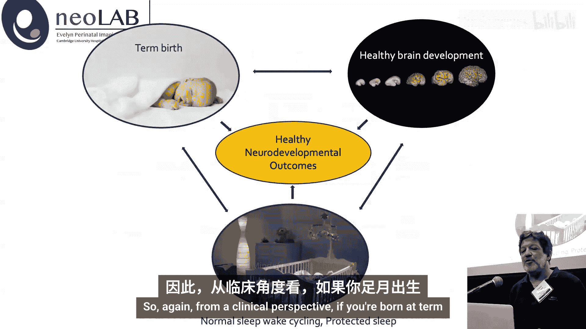

先给出一个宏观概述：我们如何构建大脑？这是从受孕到大约18岁的大脑发育过程。

开始很大程度上是一个预先编程的事件，主要与细胞增殖有关。你需要大脑中的硬件来运作。这是一个非常依赖经验、独立发生的事件，在所有婴儿中普遍发生。有趣的是，正如洛雷娜提到的，在妊娠晚期，婴儿正在从这种经验独立的世界过渡到预期出生并进入外部世界的状态。感觉系统开始发育并开始上线。你会得到我们称之为感觉敏感期，然后是感觉驱动期。同样，这很大程度上是由神经元迁移驱动的，实际的连接开始建立。

然后我们出生到这个世界，我们了解世界，我们的大脑被周围的世界塑造和建模，这是一种非常依赖经验预期的过程。同样，这很大程度上是通过突触发生、突触修剪、髓鞘形成来实现的，这些过程会持续到儿童期及以后。

作为一名新生儿科医生，我感兴趣的是妊娠晚期，从22周到足月，在那个经验预期的环境中。在某个时间点上，从受精到大约一岁，意识将会出现。

另一种看待它的方式是，我们从大脑的结构发育（早期的硬件）发展到功能连接。洛娜很好地展示了一些关于功能连接的工作。我不打算过多谈论这个。但我认为两个非常有趣的问题是：丘脑下那个在妊娠晚期出现、足月时几乎消失的巨大结构的作用是什么？以及发育中的丘脑皮层连接，它们在大约12-14周妊娠时就开始出现。在妊娠晚期这个我们照顾这些婴儿的时期，这种连接达到最大，并在足月时基本完成。

另一种看待它的方式是观察发育中的行为状态。我将新生儿视为一块海绵，准备学习世界。任何有过孩子、见过新生儿的人都知道，他们的发育速度绝对惊人。他们看起来没做什么，但正在学习观察世界等等。所以他们为此做好了准备。在妊娠期间，你从构建各种器官系统的基本结构成分开始。首先开始工作的是控制心率等的自主神经系统，然后他们开始自发的运动。接着是状态睡眠状态的发展，我认为这非常重要。然后是新生儿早期接触世界作为一种学习方式。我将重点关注睡眠和触觉，作为婴儿进入新生儿世界之前的最终完善方式。

**睡眠**。这是一篇近60年前的论文，研究了从出生到老年的睡眠。真正有趣的是新生儿睡眠在数量和质量上的差异。抱歉，任何新父母，他们确实大部分时间都在睡觉，只是不在你想要他们睡的时候。他们一半时间处于我们称之为活跃睡眠的状态，这有点像快速眼动睡眠的前身，另一半时间处于非快速眼动睡眠。随着孩子长大，这会发生巨大变化。甚至在那时，这篇论文的作者就写道，早期生命中做梦睡眠的主要作用可能在于中枢神经系统的发育。

如果你观察足月婴儿，如我所说，大约一半时间在活跃睡眠，一半在安静睡眠。如果你观察早产儿，到28周当这些睡眠状态开始出现时，绝大部分时间都处于这种活跃睡眠状态。

这是马克·布隆伯格的工作，我想他在俄亥俄州。他研究了活跃睡眠在发育中大脑中的重要性。他在大鼠身上做了很多工作，观察类似活跃睡眠的状态。在活跃睡眠中，你会看到这些抽搐动作。这些是活跃睡眠期间大脑自我产生的激活，是形成发育中的感觉和运动系统的躯体感觉地图的一部分。我不是心理学家，但这构成了具身自我感的框架，这是我们拥有的基本事物之一。我们知道我们存在，这一切在婴儿出生前就已经基本连接好了。我不知道视频是否在播放。这是一个处于活跃睡眠的婴儿。这些婴儿会做一些小动作、鬼脸、肢体运动。他们看起来好像要醒了，但其实没有，他们睡得很沉，只是处于这种活跃睡眠状态。

那么，活跃睡眠和安静睡眠是怎么回事？在活跃睡眠中，你会得到这种内源性的、强烈的神经元放电。它被视为构建世界框架的过程。安静睡眠在妊娠早期并不普遍，但会逐渐增加。这与清醒时间的增加以及丘脑皮层和皮层内神经支配模式的形成和突触发生的增加同时发生。因此，一种观点认为，在安静睡眠期间，清醒时的神经活动模式被重新激活，清醒期间形成的连接被进一步处理。它是在完善世界的地图。

我喜欢这样想：活跃睡眠就像我们早期的探险家。我们正在构建世界的框架，它看起来大致像世界。抱歉，澳大利亚似乎从那张地图上消失了。在这个比喻中，清醒就像是进入太空，观察行星本身，了解世界的样子。然后在安静睡眠期间，我们完善那张地图，最终把澳大利亚放在它应该在的位置。

我对睡眠、大脑结构发育和功能发育的这种结合很感兴趣。这是观察20周到足月之间的情况。有趣的是，睡眠状态的成熟和发展与结构和功能连接的发展是同步的。同样，大约在这个时期的某个时间点，我认为意识正在出现。

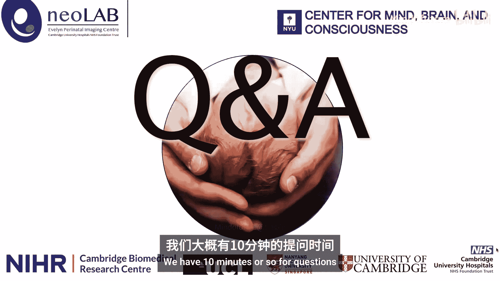

同样，从临床角度来看，如果你是足月出生，并且大脑发育健康，你会有正常的睡眠-清醒循环模式。

在新生儿重症监护室，你不在子宫里，而是在一个非常嘈杂的环境中，有很多事情发生。我们打断睡眠。我们不测量睡眠状态。我们知道早产儿在进入儿童期时会遇到问题，我们假设的原因之一可能是改变的睡眠-清醒循环不利于发展你自己的连接。

因此，我做了一些研究睡眠的工作，观察睡眠状态与大脑功能连接之间的关系。我们使用近红外光谱技术。我不知道大家是否熟悉，它是发射近红外光。这是光吸收与波长的关系图，在可见光之外的近红外区域，光可以穿透几厘米的组织。因为氧合血红蛋白和脱氧血红蛋白的吸收略有不同，如果你使用多个波长，你可以解析组织的氧合情况。使用单一光源和探测器，你可以观察整体变化。但如果你有多个光源，你可以重建图像。这是我们使用的系统，一个高密度漫射光学层析成像系统。每个模块包含三个光源和四个探测器。与标准系统相比，你可以获得非常高分辨率的大脑活动图，它们都集成在一个小帽子里，婴儿在床边佩戴。

这是朱莉的工作，她是我在疫情期间的博士生。我们很幸运，仍然被允许在产后病房研究婴儿。这是观察活跃和安静睡眠中基于种子点的相关性，这里是运动皮层。仅凭肉眼观察数据，你就可以看到活跃睡眠和安静睡眠之间存在巨大差异。我们发现，在大约30名婴儿的组中，活跃睡眠时，半球间的连接性更强；而在安静睡眠时，短程连接性更强。因此，功能活动根据睡眠状态的不同而存在差异。

我们进一步研究了这一点，因为在功能连接领域，你是在几分钟内取平均值。但实际上，在那几分钟内有很多动态变化发生。有一些方法可以以更高的时间分辨率观察数据。一种叫做协变模式的方法，你将数据分块，观察瞬时活动模式，并观察它们在那段时间内波动的变化方式。下一张幻灯片是未发表的工作，我们刚刚开始研究这个。这是观察运动皮层在活跃睡眠期间，观察这段时间内的这些协变模式。关键点是，仅凭肉眼观察数据，我们目前正在处理，活跃睡眠和安静睡眠在激活方面存在显著差异。

我们刚刚开始研究数据的另一个领域是，我们对大约33、34周的早产儿群体进行了研究，用脑电图测量他们的睡眠状态。

在最后几分钟，我想谈谈触觉。我们从睡眠过渡到触觉。触觉之所以重要，我认为它在婴儿学习和发展的方式中非常重要，这都与自我调节有关。我想任何人都见过尖叫的婴儿。他们如此专注于自我，如此不安，他们不会了解任何关于世界的事情。我们自然会做什么？嗯，我自然是走出房间。但大多数人自然会抱起婴儿并拥抱他们，将触觉视为一种安慰。

用非常简单的术语来说，婴儿的状态要么通过皮质醇（压力反应）来调节，他们需要关注，有事情发生；要么当他们处于那种亲密连接时，那是母亲或照顾者与婴儿之间产生催产素的时候。

我认为实际上，我们低估了触觉的重要性。母亲与婴儿之间的深情触摸，有证据表明它可能调节婴儿的神经发育，并且是婴儿认知和社会情感发展的基础。

我们应该把皮肤不仅仅看作是保护器官，防止外界伤害，或者只是告诉我我碰到了热的东西。它实际上是一个社会器官。如果你激活了无髓鞘的C纤维，它们会分散到大脑中更广泛的区域，而不仅仅是体感皮层，并提供大量的社会线索和社会信息。我想我们在疫情期间都体验过这一点，因为我们不被允许拥抱别人、触摸别人。这是一种自然的事情，从出生就开始了。

因此，我感兴趣的事情之一是，在这种早期阶段，母亲和婴儿的大脑之间发生了什么。这是我在新加坡的同事维姬·扬的工作，她做了很多早期父母-婴儿神经同步性的研究。她表明，神经同步性协调了婴儿皮层中的这些振荡，并训练婴儿的大脑模式以适应社会交流，并在母亲和婴儿互动的关键时刻促进接受性。

我想更进一步。那么，出生后最初几天发生了什么？我和博士生格蕾丝一起，她现在在哈佛，她观察了一组出生后最初几天的新生儿，观察不同社交和触摸条件下的神经同步性。我们在母亲和婴儿身上都放置了脑电图，然后母亲会抱着婴儿三分钟，然后慢慢地、深情地抚摸，然后进行一种快速的社交抚摸。然后我们重复实验。母亲能够通过一个海绵隔着婴儿床看到婴儿，母亲会用塑料娃娃做同样的事情。

结果很多。我担心时间，只给你们重点。如果我们观察新生儿神经激活（实际上低功率等于更多激活），它在不同社交情境和触摸类型之间存在差异。这说明婴儿能够在出生后24或48小时内区分海绵和它的母亲。并且对社交编码的母亲触摸有更强的激活。

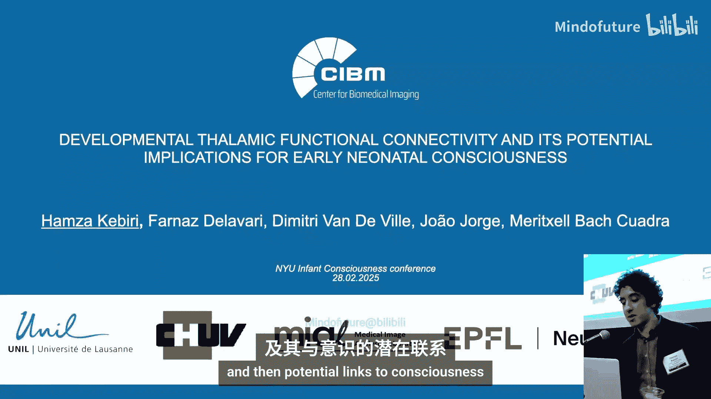

如果我们观察连接性，我们可以观察新生儿脑电图中大脑这部分和那部分之间的连接性，母亲也是如此。但我们也可以观察母亲和婴儿大脑之间，这里的一个电极和那里的同一个电极之间的连接性。这是观察个体之间的连接性。我们发现，当婴儿与母亲分离时，连接性被破坏。因此，与母亲在一起似乎增加了婴儿的连接性，当涉及到非社交触摸时，母亲和婴儿的连接性都被破坏。我想我们本能地知道如何抚摸婴儿。如果你用一种不自然的方式做某事，母亲和婴儿都能意识到。

因此，社交和触摸相关的神经激活和连接性的变化也取决于睡眠状态，这又回到了睡眠。如果你观察神经激活，新生儿大脑对社交编码的母亲触摸表现出更强的激活，无论是在活跃睡眠还是安静睡眠中，但在这种高电压、慢波的安静睡眠中则没有。我在方框里列出了四种不同的睡眠状态。

如果你观察连接性，无论是新生儿内部、母亲-新生儿大脑相关的连接性，当婴儿与母亲分离时都会被破坏，这发生在活跃睡眠和安静睡眠中。但对于母亲来说，这特定于安静睡眠。新生儿-母亲和母亲-新生儿的神经连接性都被这种快速、不自然的抚摸所破坏。

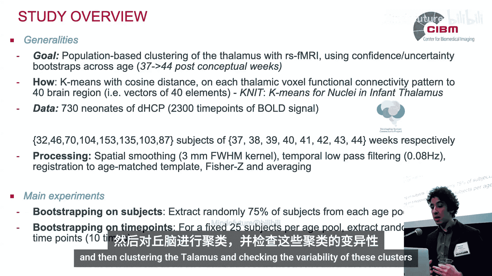

总结一下这项工作。这是三年博士工作的浓缩。新生儿大脑表现出依赖于睡眠状态的、对母亲社交线索和社交编码的触摸线索（即轻柔触摸）的反应。母亲-新生儿网络在出生后立即存在。这些是健康的足月婴儿，并对这些线索有反应，且取决于婴儿的睡眠状态。因此，我认为当我们开始评估这些婴儿处于何种睡眠状态时，这一点非常重要。

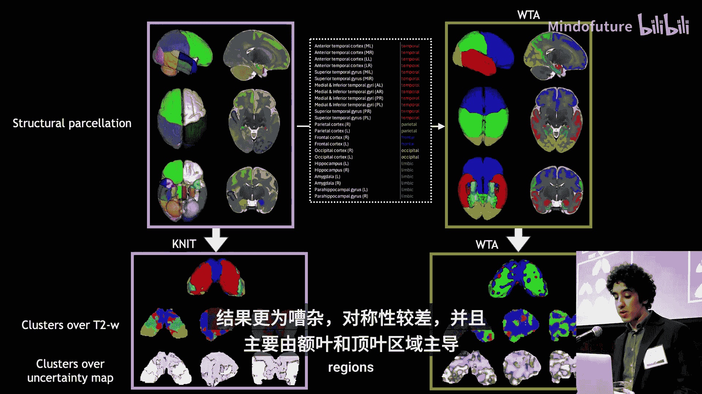

我要做一个大胆的声明。你们可以随时反驳我。在意识的发展中，我认为睡眠对于形成世界的图景以及我们在其中的位置至关重要。婴儿睡觉，他们睡觉是有原因的。他们的睡眠状态与后来生活中的非常不同。

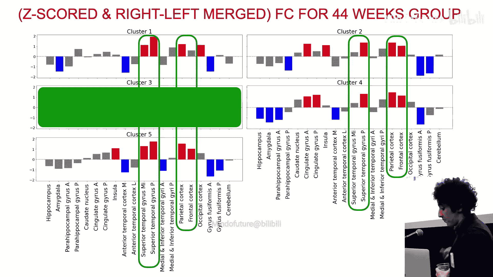

而触觉，我认为，是早期基础之一，连同其他感官事物，如气味、声音等，有助于社会情感调节，这非常重要。一旦婴儿安定下来，我们就能看到这一点。对于有脑损伤的婴儿，我们发现他们很难安定下来。我们面临的挑战之一是，他们非常易怒，很难安抚，对父母来说非常困难。他们的结局也往往较差。因此，我认为自我调节的能力对于婴儿成为外部世界的海绵至关重要。

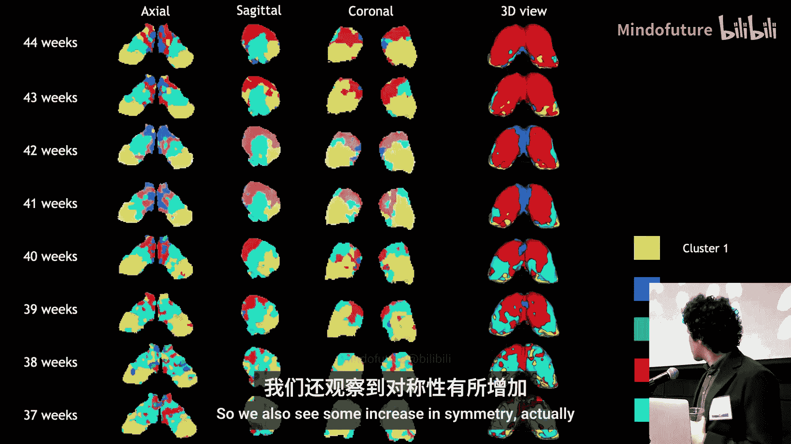

因此，我提出了这样的观点：这些是构建人脑的关键基础。

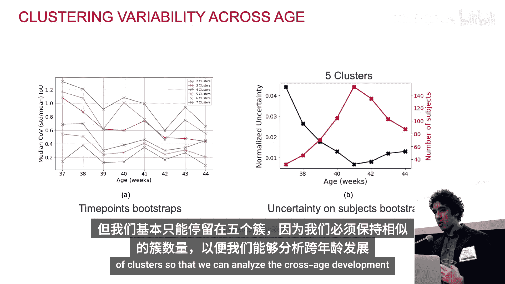

我坐在这里展示我所有聪明同事的工作。我不太确定为什么这张集体照里会出现我儿子的照片，但他确实出现了。他允许我把他婴儿时期的照片放上去。但这里展示的确实是格蕾丝、朱莉和卡的工作。我将以维克多·雨果的一句话结束：“母亲的臂弯由温柔构成，孩子们在其中安然入睡。”非常感谢。

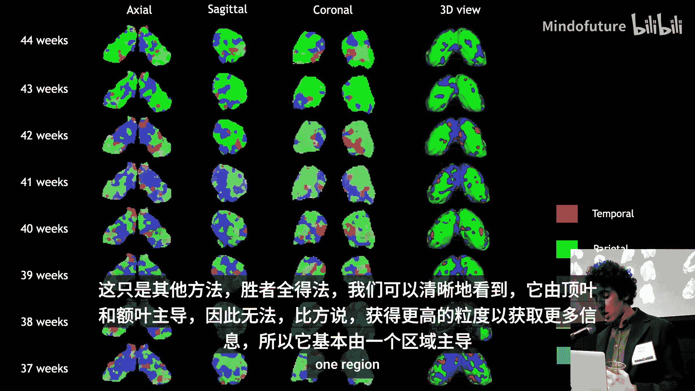

很好，我们有大约10分钟的时间提问。

我有一个问题。例如，袋鼠式护理，你把早产儿放在母亲身上，这是完美的。但我想知道，相对于你的实验，这是否真的只是针对母亲，感受她的气味、听到她的心跳等等。触觉相对于所有这些的重要性是什么？你认为让母亲进行一些触摸也很重要吗？我认为这是一个非常好的问题。这项研究是与维姬合作的，她是一位心理学家和优秀的科学家，她真的想尝试细化触摸的问题。因此，我们设计了仅仅抱着、轻柔触摸、快速触摸和假对照的范式，以专注于触摸。但你是对的，在现实世界中，母亲更加协调。当婴儿处于活跃睡眠时，他扭动和移动，给母亲暗示。那么，这是触摸问题还是其他问题？你完全正确，我承认我们应该把所有早产儿都放在母亲胸前。这应该能挽救生命，这是普遍接受的。但我们没有这样做，特别是在高收入国家，我们做得很差。我们分离母亲和婴儿。这是我的热情所在，我们需要为了各种原因把他们聚在一起。我对那种神经元连接性很感兴趣。但你是对的，我们现在正试图为早产儿设计一项研究。我想摆脱单一因素。我认为气味、声音、唱歌、音乐，那种音乐性，你知道，可能很难把它们全部分开。也许你必须对此进行聚类分析，把整个事情放在一起。有趣的是，我怀疑视觉可能在那时是最不重要的，尽管后来变得非常重要。我不知道如何推测。好的，威廉。

感谢精彩的演讲。过去十年左右新生儿学的一个热门话题是新生儿重症监护室的噪音，以及它如何干扰大脑发育。你对此有什么看法？这是一个非常好的问题，也是一个我努力推进的衍生项目，叫做“声音睡眠”，我们在婴儿车里安装了噪音计，观察婴儿的反应。我们在控制噪音方面做得并不特别好。但我们也不了解他们对什么噪音有反应。根据经验，我认为他们对人声频率更敏感，甚至可能比对子宫里的低频声音更敏感，而不是高频警报。所以我们进来听到警报声，我们认为这对婴儿很糟糕。但实际上，婴儿可能根本不在乎。但护士进来说：“谁有药柜的钥匙？”婴儿会对这个做出反应，并扰乱他们的睡眠。所以我认为控制噪音非常重要，但也要观察有害噪音。因此，安静的房间并不好。美国有一项很好的研究，比较了单间育婴室和开放式育婴室。在单间育婴室护理的婴儿语言发育延迟，因为他们听到的交流较少，刺激较少。所以，要尝试找到对他们有益的东西，但不是过度的噪音，光线等也是如此。我认为现在这非常重要，因为正如我所说，我们更擅长让他们存活，但我们需要尝试为他们优化早期环境。而且这很便宜，你知道，不制造噪音不需要任何成本。嗯。

是的，你在演讲一开始提到，丘脑皮层连接在婴儿出生时、足月时几乎达到成人水平。我相信你也知道，丘脑皮层连接在成人深度麻醉状态的研究中扮演了重要角色。最显著的事情之一是，在深度无意识的麻醉状态下，丘脑皮层活动大大减少。这些数据表明，至少在出生时，他们很可能是有意识的。是的，如果连接度很高，甚至可能在出生前一个月，他们那时也可能有意识。所以，我会同意那种早期发育的观点。我认为新生儿在围产期真正有趣的是，如果你观察神经元迁移和连接性的波动，你会先得到所有谷氨酸能神经元的迁移，然后是GABA能神经元的波动，而GABA本身在新生儿中的作用是兴奋-抑制等等，做奇怪的事情。这可能是这些婴儿处于稍高熵状态的部分原因。所以也许，早产儿在外界可能处于一种更高的意识状态，你可以推测，因为这些连接性。子宫里有一些事情可能会抑制意识，比如来自胎盘的各种激素，这会使他们处于更镇静的状态，而且观察任何胎儿意识都困难得多。乔尔在观察胎儿意识方面做了惊人的工作。但我会说，是的，你知道，丘脑皮层连接开始建立的时间点其实很早。那么，在“灯亮起”之前，你需要从丘脑到皮层有多少连接？是的，你知道，有趣的问题。

我一直对这个话题很好奇，谢谢你的演讲。我只是想知道，婴儿是否能分辨出他们是被父亲还是预期的养父母抱着和照顾？如果他们产生了那种催产素状态，他们还能分辨出这不是母亲吗？我认为这是一个非常有趣的问题。我怀疑主要的信号在于被抱着和不被抱着。我们从发育中知道，著名的罗马尼亚孤儿院故事，在共产主义政权之后，孤儿们被发现处于一个感官极度贫乏的环境中，他们遭受了严重的脑损伤。一旦你把他们送到寄养家庭，他们的发育就会迅速赶上。我认为有任何身体接触都比没有好。从进化上讲，与母亲的联系规则是有道理的，也许在政治上不正确。我是一个父亲，我仍然拥抱我的孩子，我认为这很好。在我们的新生儿病房，我们让医学生拥抱婴儿，因为父母由于各种原因可能无法一直在场。我在新加坡做一些工作，他们让祖母们进来等等。所以弄清楚这一点会很有趣。但我怀疑差异会很小。拥抱与不拥抱可能是主要差异所在。

回到你关于婴儿和母亲之间同步性的观点，你能否观察这些慢皮层电位，因为这些是脑电图中观察到的底层长波，它们同步和振荡大脑的底层结构活动？是的，这是一个非常好的问题，你指出了我知识中的一个重大空白。我的专长是功能性近红外光谱，而不是脑电图。但我的理解是，我们会观察婴儿的阿尔法波，这些是较慢的波，由新生儿驱动，而不是母亲产生的，因为母亲的，我这样说对吗，胎儿波在那时发育得不太好。所以这是一个鸡和蛋的问题，因为我们观察婴儿的这些慢波，试图看看母亲是否也有。但母亲在做其他我们没关注的事情，这说得通。

我只是想知道，你认为研究婴儿期快速眼动睡眠的关键目的在多大程度上能为我们提供关于成年期快速眼动睡眠目的的见解？这是一个非常好的问题。我被一个比我更懂睡眠的人反驳过，他说新生儿活跃睡眠是快速眼动睡眠的前身。有很多相似之处，也有很多不同之处。所以有一个学派实际上会说这种活跃睡眠成分，是的，我们进化成快速眼动和非快速眼动睡眠，它们有明确的目的，主要与记忆形成等有关，以及其他健康益处。但新生儿身上发生的是关于连接大脑，这是一个非常不同的目的。有趣的是，非常早产的婴儿大部分时间都处于那种内源性驱动的活跃睡眠状态，这与成人身上发生的情况略有不同。所以，老实说，我不确定如何回答你的问题。这是个好问题。

还有两个快速问题。嘿，抱歉，谢谢你的演讲，内容真的很有趣。我的问题是关于活跃睡眠以及你如何描述它。这不是要反驳你，就像你邀请我们做的那样。但问题是关于活跃睡眠正在构建世界的图景或我们在其中的位置这个想法。当我想到构建世界图景的经典案例时，就像构建认知地图，当你在环境中导航时，或者老鼠在迷宫中导航时，但值得注意的是，新生儿不怎么移动。我的意思是，他们动，但他们不能导航。所以，这听起来几乎像一个隐喻，说他们正在构建世界的图景。如果他们这样做的主要方式实际上是导航，那么他们这样做的具体意义是什么？这延伸了吗？是的，我认为确实如此，你完全正确。我用那个比喻，这是一个很好的说法。我花了很多时间找出这个说法的出处，但很多人不这么说，证据也很少。但对我来说，这是一种很好的思考方式：这种内源性驱动的活动不依赖于外部感觉信息，而安静睡眠则是在你“导航世界”一段时间后增加的。你所说的“导航世界”是指运动功能在世界上移动吗？我的意思是，他们确实会动。相对于他们自己，他们动得很多。早期的运动，特别是在早产儿中，是关于发展这个运动皮层的。这是将大鼠研究的工作转化过来。我所说的出生后“导航世界”更多的是感觉驱动的，气味、声音，试图理解。也许他们处于那种迷幻状态，熵值增加，所有感觉都融合在一起，他们正试图慢慢理清。你在语言发展中看到这一点，他们听到所有这些杂乱的声音，然后慢慢地提炼出音乐和语言。这就是我所说的导航的意思，因为你是对的，他们需要几个月才能真正开始导航。好的，我们没时间了，但最后一个非常快速的问题。

非常感谢，非常迷人的工作。我的问题是关于重力适应。在子宫里，你已经在水里了。那么，你是否看到皮肤受到的压力与后来被抱着时触觉的重要性之间的关系？因为重力适应是非常不同的介质。是的，我的意思是，你知道，作为胎儿是什么感觉，作为婴儿是什么感觉，作为你自己是什么感觉？我不知道，他们处于一个非常不同的环境，他们在四处移动。我们对早产儿做的一件事是，我们用毯子之类的东西把他们围起来，这样他们可以推挤东西，因为他们在液体中遇到的阻力比在空气中强得多。有一个很好的发育线索是，如果你让一个婴儿挣扎，他们会有点困难。所以我们给他们那些边界来抵抗，但事实上，这是一个有趣的问题。非常感谢你的介绍。我很高兴也很高兴站在你们面前。我是瑞士日内瓦洛桑生物医学成像中心的博士后。

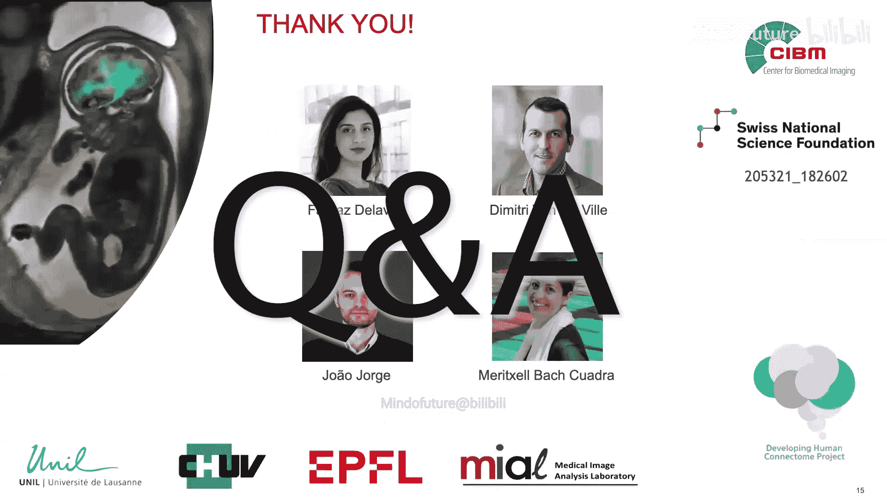

我的演讲将关于新生儿端脑的功能分区及其在发育过程中与意识的潜在联系。

我没有什么需要披露的。丘脑是大脑中一个非常重要的区域。基本上，它既负责低级感觉处理，也负责高级认知。已有一些工作尝试对新生儿丘脑进行分割。

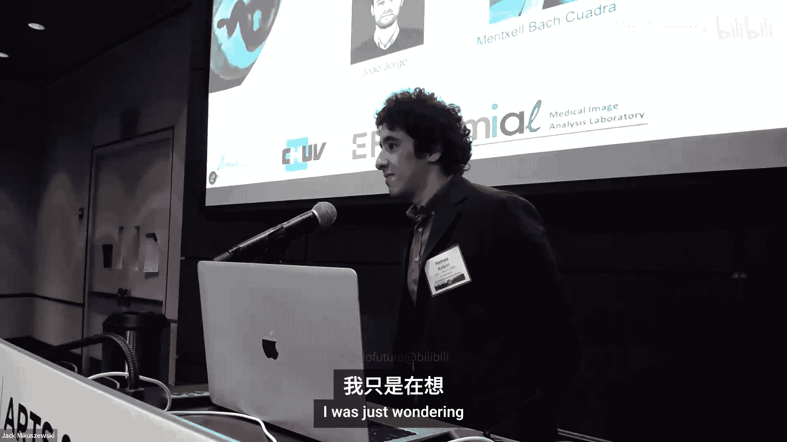

是的，这里列出了它们。它们之间有一些共同的模式。基本上，存在从后到前的梯度，也有从内侧到外侧的梯度，功能上从感觉运动到更多执行功能。

然而，正如你所见，它们也不完全匹配。我们认为这基本上是因为受试者数量可能不够高，也因为他们使用的方法基本上是赢家通吃法。所以基本上，丘脑的每个部分，每个体素（也就是3D像素），只连接到大脑的一个区域，比如皮层或皮层下区域。但事实是，可能不止如此。我们需要一种更精细的方法来量化这种全脑连接性。是的，所以基本上，它们也有一些共同的模式。主要是这种重叠的丘脑连接性到不同大脑区域，通过这种收敛特性。而且，感觉运动和躯体感觉簇占主导地位，并且没有显著的默认模式网络连接到丘脑。

所以，是的，我们试图建议的是使用大量受试者，也就是纳西教授之前展示的dHCP数据集。目标基本上是在静息态功能磁共振成像中，在群体水平上对丘脑进行分区，我们使用某种置信度/不确定性来获得更稳健的簇。为此，我们使用K均值聚类，所以基本上，丘脑中的每个体素将被表示为一个向量，表示其与不同大脑区域的功能连接性。然后想法是对这些体素进行聚类。所以，这是体素级的聚类。

是的，所以我们使用了700多名受试者。数据已经预处理好了。所以数据已经预处理了，但我们增加了一些更多的预处理步骤。基本上，为了量化这种稳健性，我们使用了对受试者或时间点的自助法，基本上只取75%的受试者或时间点，然后对丘脑进行聚类，并检查这些簇的变异性。

这里是一些结果。基本上我们可以看到双侧对称性。我们还可以看到属于同一簇的体素在物理位置上的接近性。下面，我们可以看到一些不确定性图。基本上，这是不同自助法（这里是受试者自助法）中预测标签的众数，我们可以看到在边界处更不确定，这是直观的。然后我们还将其与赢家通吃方法进行比较，基本上是将我们得到的所有标签合并到不同的脑叶。我们可以看到，结果更嘈杂，对称性更差，并且主要由额叶和顶叶区域主导。

这里的想法是从最年长的年龄组开始，也就是44周，然后向下分析这些簇的功能连接性如何变化。所以，我们实际上可以看到一些模式。例如，我们可以看到有些区域高度连接，这对于许多簇来说是相当普遍的。有一个嘈杂的簇，这个绿色簇，实际上体积非常小，所以我们会丢弃它。是的，所以有一些共同点。由于信息量很大，我们基本上合并了左右半球。我们还丢弃了功能连接性。然后我们考虑任何大于1的值，将其视为高度连接，任何小于-1的值视为断开连接。所以，再次，我们看到这些共同点，基本上所有簇都主要连接到顶叶、额叶和负责听觉处理的颞上回。但不同簇也有一些特异性，例如，簇1是唯一一个高度连接到负责视觉的枕叶皮层的簇，而簇2则连接到岛叶和前扣带皮层，所以可能与凸显网络有关。

所以，这里是丘脑核团簇在年龄发育上的结果。我们可以清楚地看到这个枕核簇，就像在成人中一样，在各个年龄都非常一致，负责视听刺激的认知处理。你还可以看到这个蓝色的凸显簇，大约在40周左右开始出现并增长。然后我们还看到这个腹外侧运动簇，呈X形。我们主要看到的是这个背侧簇，它基本上随着年龄增长而增长，我们认为它连接到额顶网络。

我们还看到对称性有所增加。是的，这只是相对体积变化，我们可以看到这是体积增加的背侧簇，以及体积减少的腹外侧运动簇。

这里的想法基本上是选择簇的数量，看看我们实际上能在多大程度上对丘脑进行跨年龄聚类。这是使用稳健性以及这些簇在使用自助法时的变化程度。我们可以清楚地看到，例如，在左侧，我们观察的婴儿年龄越大，聚类就越稳健，可重复性越高，所以我们实际上可以用更多的簇对婴儿进行聚类，基本上随着年龄增长。我们在右侧也看到了类似的结果，只是受试者数量减少了，这就是红色曲线，这可能就是我们没有从41周开始看到的原因。但我们基本上坚持使用五个簇，因为我们必须保持相似数量的簇，以便我们能够分析跨年龄发育。

这只是赢家通吃方法，我们清楚地看到它由顶叶和额叶主导，所以它不允许，比如说，高水平的粒度来获得更多信息，所以它基本上由一个区域主导。

这是双侧对称性。对于K均值方法，它更对称，但对于赢家通吃方法，对称性差得多。这与丘脑的聚类无关，所以它基本上与丘脑和不同大脑区域之间的连接性有关，独立于簇。我们清楚地看到与顶叶、额叶以及负责听觉处理的颞上回的高度连接性，以及与扣带皮层的高度连接性。我们还在大约40周时看到小脑的这种爆发。这也是一个普遍的观察结果。实际上，我们在40周左右看到某种爆发。但由于丘脑是大脑的一部分，所以它的活动实际上可能受到大脑整体连接性的调节或引导。因此，我们旨在分析感兴趣区域之间的连接性，不包括丘脑，我们看到了一些类似的模式，主要是这些额叶和顶叶区域也高度连接，扣带区域也高度连接，并且我们也看到了与丘脑相似的轨迹。然而，对于丘脑中高度连接的颞上回，它在这里实际上与其他大脑区域的高度连接性并不高，它的排名大约在第九位左右。但在丘脑中，它排名大约在第二位。所以这可能更特定于丘脑。

好的，现在，既然我们分析了所有这些结果。那么，我们实际上如何将我们的结果与意识联系起来？我查阅了文献，然后发现实际上大多数意识的神经关联历来都集中在皮层，即使考虑到丘脑，也只是扮演门控角色，这些丘脑皮层回路只是扮演门控角色。然而，有很多证据表明，也许应该给丘脑更多机会，因为有很多证据表明它确实参与了不同的意识过程。具体来说，丘脑神经元，尤其是背侧丘脑神经元的损伤，与低水平的意识状态有关，如植物状态、残疾甚至昏迷。此外，丘脑是麻醉下最受抑制的大脑区域之一，在八种麻醉剂中，它是最常被抑制的。还有证据表明，丘脑的脑刺激可以逆转意识丧失，并且丘脑神经元参与检测视觉刺激。此外，某种程度上共识认为，这些丘脑皮层纤维束的白质纤维束，我们看到的在大约16周妊娠期开始出现，可能到足月，它们对于意识是必要的。所以它们可以被视为意识的下限。然而，上限是相当开放的，我认为。

好的，这里基本上是我发现的关于丘脑在意识中作用的四种假设或理论。主要是，有一种说法认为，丘脑实际上通过丘脑皮层回路将高维的经典信息压缩成低维表征。基本上，想法是，我们有皮层-丘脑投射，向丘脑发送高维信号，而丘脑实际上发送，由于丘脑中的神经元比皮层少得多，所以压缩信息。然后通过丘脑皮层回路将信息发送回皮层。这个理论基本上通过将一种神经元类型与状态关联，另一种神经元类型与内容关联，从而将意识的状态和内容分开。然后还有另一种理论，试图统一意识的状态和内容，因为意识实际上是作为一个整体被体验的，他们认为第5层锥体神经元对于意识是必要的。想法是，任何不涉及第5层锥体神经元的过程都将是无意识的。抱歉，还有最后一个理论，也非常有趣，基本上它声称丘脑在某种程度上像一个活跃的黑板，它显示意识的内容，而这些意识内容实际上是在皮层中计算的。是的，这是一个非常有趣的理论，它使用了一些论据，比如我们实际上只意识到计算的结果，而不是计算本身。是的，所以这两种理论是可能与我们的工作相关的理论，让我们试着看看哪些核团实际上参与了意识。有这个枕核簇，在成人中也存在，基本上负责感觉整合，它可能与知觉意识有关，实际上下面的研究表明，簇1是麻醉后功能连接性变化最大的簇。还有这个内侧簇，基本上与凸显网络有关，可能，例如，与内感受意识或注意状态的调节有关。这可能与自我参照意识有关。然后是这个背侧簇，我们实际上看到它随着年龄增长而增长，我们认为它与额顶网络有关，可能与高阶目标导向的执行功能有关。

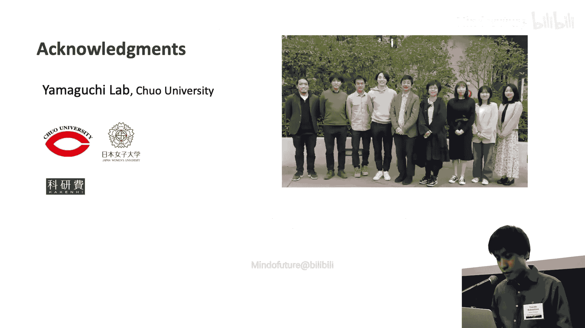

基于此，这里的假设是，也许，例如，我们看到的这种收敛的丘脑连接性，即许多丘脑体素实际上连接到许多大脑区域，或者说同一个丘脑体素连接到许多大脑区域。所以这基本上可能是瓦塔尔的整合和维度减少理论。这与现象意识以及它在某种程度上是一种低维属性，内容丰富但细节贫乏的观点是一致的。所以，是的，这可以讲得通。或者，例如，我们看到的这种跨年龄的双侧对称性增加，这可能与从更反射性和随机的早期妊娠行为，到后来更适应和结构化的反应的转变有关。然后是这个，我认为可能是这项工作的主要假设，即这个增长的背侧丘脑，我们已经看到这个背侧丘脑在活跃黑板或瓦尔的动态核心理论中非常重要。事实上，它在体积和连接趋势上都在增加。所以，以及我们也看到的这种在整体丘脑连接性以及其他大脑区域中的发育爆发，大约在41周。所以这可能也许是某种基本意识水平的出现。我的意思是，既然意识是一个梯度，或者至少我们可以说它是一个里程碑。

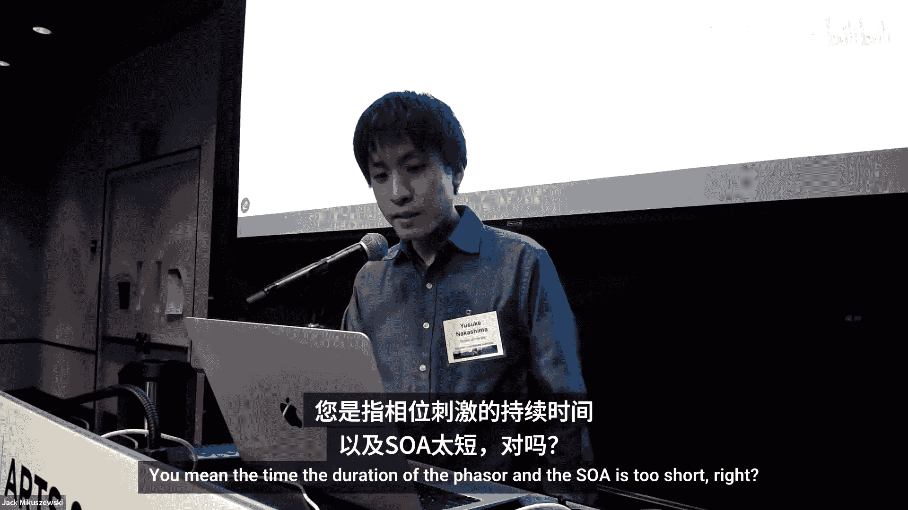

好的，这基本上只是我们研究的总结。我们看到了这种跨年龄增长的稳健性和双侧对称性。我们还看到了在41周时连接性的爆发，以及整个大脑（除了负责听觉处理的颞上回）的爆发。我们看到K均值聚类更精细，向量空间更丰富，可能比赢家通吃方法更好。这些是我们发现的四个丘脑核团，主要是枕核、内侧核、背侧核和腹外侧运动核。我们在这里提出的主要假设，我很乐意与你们讨论，是在大约41周时出现的基本意识状态。

是的，在结束之前，我只想补充一点，我对意识的知识实际上主要来自文章、书籍和纪录片，比如查尔默斯教授在YouTube上的视频，我从10或15年前就开始看了。也许我唯一的直接联系是我论文的第一阶段和意识的困难问题，但实际上我的论文是关于深度学习和胎儿成像的。是的，我一直对意识充满热情，但要找到一个学术发展的空间，比如说，一直很有挑战性。所以这些会议和活动非常受欢迎，感谢克劳迪娅组织者，是的，这些是我的同事，我也想感谢他们，也感谢你们的关注。

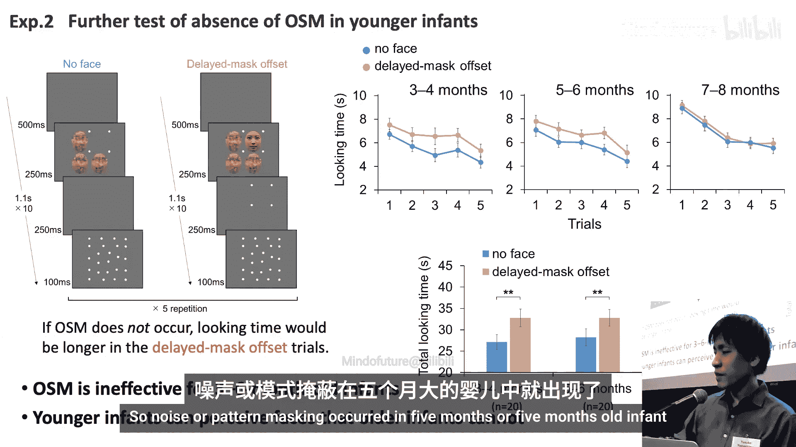

是的，谢谢。我有一个关于丘脑作用的问题。如果我没记错的话，嗅觉是独特的，因为它的信息不经过丘脑。我不知道这个证据是否已经改变，但这对于你强调丘脑是意识的神经关联可能是个问题。所以我想知道你怎么处理这个问题。这是个好问题。我认为文献仍然声称只有嗅觉不受丘脑调节。嗯。我的意思是，是的，这是个好问题。也许，也许嗅觉有其他通路。但是的，我无法给你确切的答案。亚当斯。

你提到了丘脑作为黑板。但我想知道，丘脑是否可能不是相互排斥的，而是丘脑能够实现某些类型的同步活动，从而建立一种功能性的动态核心，可以充当黑板，但这是一个必要的东西，还是丘脑作为一种黑板在做特定的工作？我的意思是，这可能是一个多尺度的故事。你还提到了第5层锥体神经元。我想知道你如何看待预测处理，因为显然预测处理不是一个充分的理论。但有一种观点认为，例如，虽然贝叶斯理论有些模糊，但在某种意义上，意识是一种基于现实的幻觉，第5层锥体神经元通过它们循环丘脑的能力，理论上可以编码预测，可能参与其中。好奇你的想法。好的，非常感谢你的问题。对于第一个问题，我认为，是的，可能是这样。我的意思是，也许我们甚至可以将其与全局工作空间理论联系起来。是的，就像有一种剧院，有一个投影仪，或者说在某些状态下有一些注意力。是的，所以我不确定。根据瓦尔的理论，这个活跃的黑板，我认为它基本上是基于一些证据或想法，例如，丘脑有很多收敛的投射。所以，与发散的投射相比，实际上到达丘脑的投射是巨大的。所以这恰恰是，也许是支持该理论的一个有力证据。但我的意思是，我同意，这只是一个理论，可能我们需要更多，是的，更多的实验来验证这一切。谢谢。

只是一个快速的问题，非常好的演讲。我只是想知道你是否观察了发育中人类连接组中的早产儿群体？这是个非常好的问题。在这项研究中，我们实际上只使用了扫描年龄，从37周到44周。我们没有真正按早产儿分组，所以没有考虑出生年龄。但这一点确实值得研究。我们当然想分开研究。但我们的目标确实是最大化受试者数量，以获得非常具有代表性的结果。谢谢，钱奈卡。

非常感谢，这真的是非常漂亮的工作。我想再次回到我的攀岩例子，因为我认为这里存在一个方法论上的挑战，即通过成人中心主义的视角来寻找意识体验的神经关联，然后将其压缩到婴儿的较低水平。我认为这是个问题，因为正如我所说，如果你采取发展的视角，那么你在第一步需要的东西，对于那一步来说是最优的，而不是最小的。它只是最优的。所以这意味着，也许我们正在寻找对于成人中心主义视角下的体验最优的区域，但不一定对于较低水平（不是指更低级，而是指更初级、最初的步骤）是最优的。那么问题将是，因为如果你真的采取发展的视角，那么你有其他类型的系统在神经系统中发育之前，在子宫里和非常早期就发育了。这些系统在构建感觉知觉中扮演着非常重要的角色。我想已经有人问过关于神经关联与身体其他类型生理信号之间关系的问题。那么，你是否设想在下一步中，将身体的生理测量与神经系统耦合起来，并观察不同类型的系统？是的，非常感谢你的问题。我认为这非常非常重要。我认为要考虑身体，我实际上在YouTube上看到了你和迈克尔·莱文的对话，我认为这是非常有趣的观点。局限于神经元可能不是，我的意思是，也许类似于局限于大脑皮层。所以也许我们应该更广泛，真的，是的，进行包括整个身体的实验，并尝试将其与大脑联系起来。是的，谢谢。

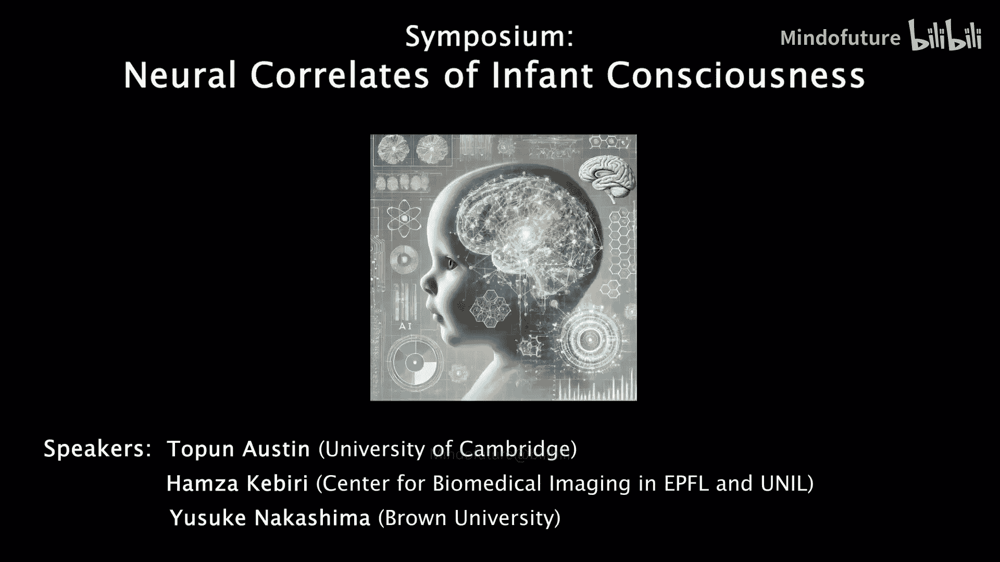

好的，太棒了。好的，谢谢有机会在这个精彩的会议上发言，我很荣幸能在这里。我目前是布朗大学的博士后，但今天我将谈论我在日本进行的研究。这是一项研究，通过反向掩蔽检查婴儿早期的未成熟处理。这项研究的目的不是检查婴儿意识。实际上，审稿人告诉我，我们不应该在行为过程中使用意识这个术语，因为我们只使用了行为测量。但是，我相信，是的，我们的发现、我们的研究可以为婴儿意识提供一些见解。所以