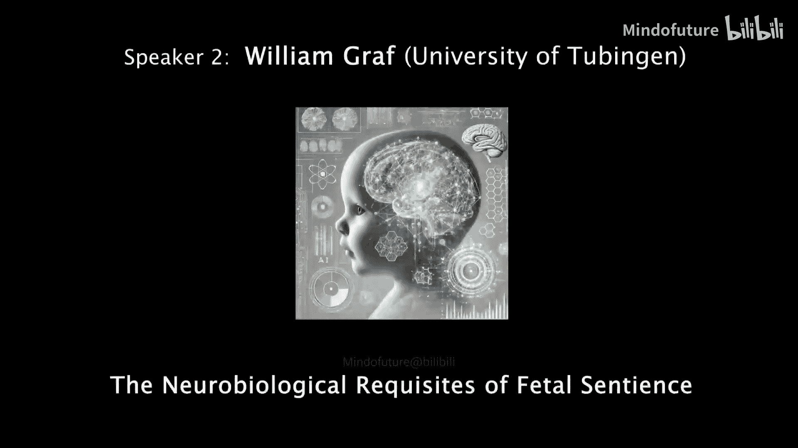
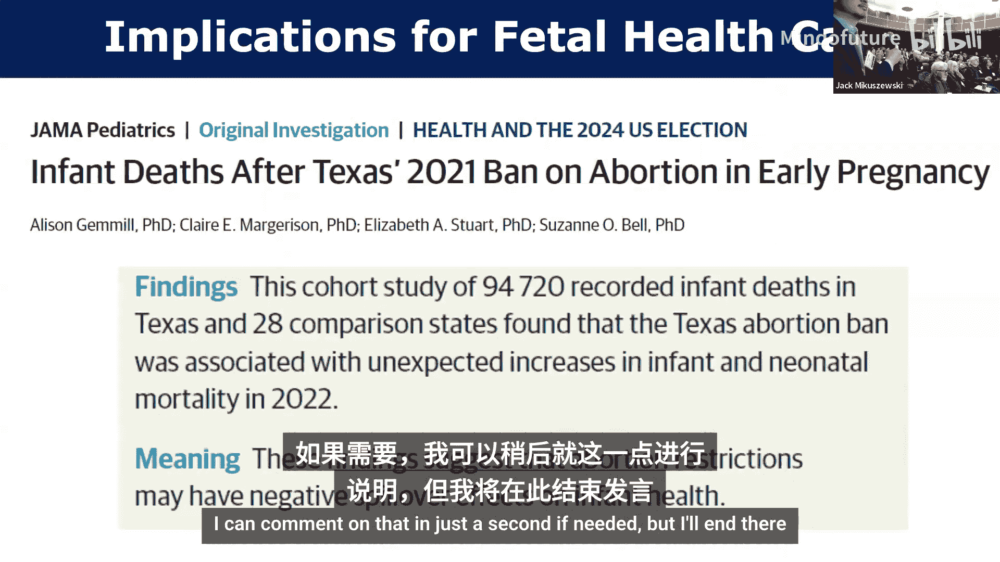
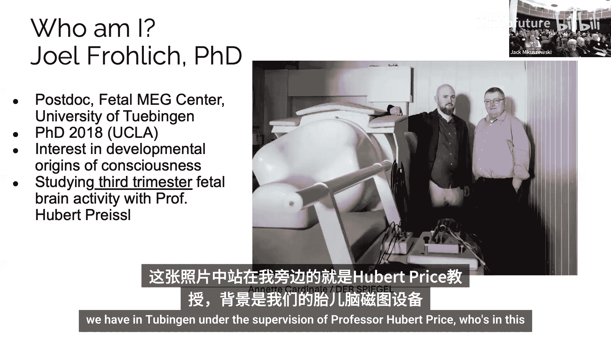
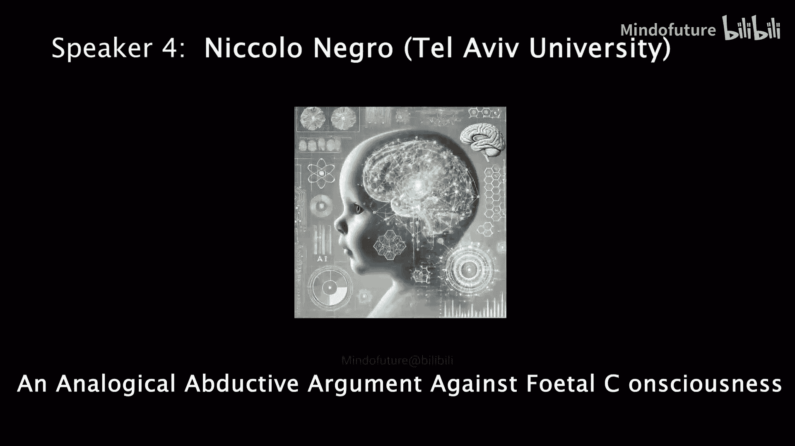
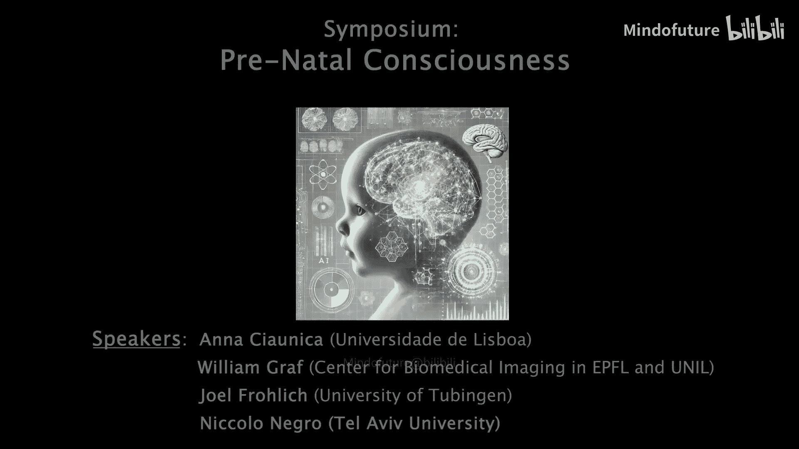

# 005：出生前意识

## 概述
在本节专题研讨中，我们将探讨出生前意识这一复杂且前沿的议题。多位学者将从哲学、神经科学、医学和认知科学等不同角度，分析胎儿意识的可能性、研究方法、伦理影响以及我们应如何构建合理的推理框架来理解这一现象。

---

## 哲学视角：具身性与发展的根源

首先，感谢主办方的邀请，非常荣幸能在纽约与各位交流。我的学术背景是哲学，曾专注于意识问题，特别是现象意识与我们经验的主观性。在座的各位想必都熟悉“知识论证”中的玛丽，她理解关于红色的一切物理知识，但从未见过红色。然而，我的思考略有不同。

我来自勃艮第，一个热爱美酒与美食的地方。因此，我的第一个想法是：谁在乎“看到”一个番茄？最重要的是“吃”掉这个番茄。所以，我想探讨的是，对于不同感官（如味觉、触觉）而言，“经验像是什么样子”的知识论证会如何？毕竟，我们需要将东西放入身体才能生存。

我忍不住加了一张与演讲无关的幻灯片，关于“现实增强”或“现实减损”。我认为一个重要的哲学问题是：我们能否饮用虚拟的葡萄酒？如果我们没有现实世界中的所有感官，虚拟现实实际上从我们这里拿走了什么？这只是题外话。

如前所述，我接受的是哲学训练，但在博士毕业后经历了一场存在主义危机。我问自己：我真的要一辈子研究番茄吗？答案是否定的。因此，我转向了实证科学，接受了认知神经科学的训练。现在，我拥有自己的实验室，研究相同的问题，但使用心理生理学、神经现象学和计算建模等方法，研究对象包括人类和人工代理。

我在伦敦进行了几年研究，然后搬到了里斯本。在伦敦的六年里，我最初是“驻校哲学家”，我的工作是提出那些科学家们不喜欢的、恼人的哲学问题。其中一个我经常问的问题是：环顾四周，为什么在研究意识的房间里看不到婴儿？当我提出这个问题时，我的科学家同事们会面面相觑，感到困惑，仿佛在说：“我们不该让哲学家来问这些傻问题。你是什么意思？我们当然没有让婴儿在房间里做研究。”但我不认为这是个傻问题，我认为这很重要。

我想强调的关键点是：当我们开始研究事物时，我们已经在使用作为成年人所拥有的特定概念透镜和工具。我们应该意识到，当我们开始研究自身和世界时，我们正在使用的这种透镜。这意味着，我们可能……我想论证的是……

到目前为止，我们已经听到了很多关于意识神经关联的精彩演讲。但我想引入身体，进行一次激进的转变，希望大家能跟上我的思路。我想说，对神经关联的关注源于我们一种默认的、成人中心主义、神经中心主义的视角，甚至可以说是男性身体中心主义的视角，稍后我会解释为什么这么说。

这之所以重要，是因为如果你想理解一个系统，假设我们想理解某个系统的基本结构或接收器，而你把它当作一个完全成熟的、已发展的系统来看待，那么你可能会非常倾向于将你在成人系统中拥有的任何属性，压缩并放入一个最小化的模型中，然后说这就是那个东西。但我不认为情况如此。

让我用一个比喻来帮助大家理解。一个系统在成熟阶段的属性，与它在发展初期的属性是非常不同的。这意味着，如果你想理解一个系统，仅仅“压缩”观察是不够的，我们需要理解它是如何发展到那个状态的。

我想回到“爬山”这个例子，因为它能说明我想强调的一个重要观点。婴儿的嗅觉系统比我们成年人发达得多，他们闻得比我们好。这并不意味着我们更不成熟，而是意味着在我们发展的特定阶段，需要某些条件到位，这些条件在那个阶段是最优的。那种认为我们从一个非常“笨”的状态开始，最终变得非常“聪明”的连续体观念，我认为是天真的。如果我们想理解系统如何发展，就需要密切关注发展过程中的每一个步骤。

如前所述，我仍然痴迷于我们经验的主观性，但现在我更痴迷的不是“意识是什么”或“自我意识是什么”，而是“我们如何变得有自我意识”。实际上，我想说一些挑衅性的话：我认为不存在“意识”这样一个东西。人们可能会问：你是什么意思？我想说，意识不是一个“东西”，不是一个名词，不是一种你可以精确定位、测量或从一个脑袋下载到另一个脑袋的心理物质。我认为它更像一个动词，是我们所做之事。不过我不会在演讲中展开这一点，因为时间有限。

我非常感兴趣的是，我们如何通过身体经验发展出自我意识。为什么？因为，正如我所说，我对任何经验的“卑微起源”非常感兴趣。我想从一些看似显而易见的事情开始。回到这张活动图片，这种成人中心主义的观念再次出现：我们谈论意识和经验时，总是与头部、大脑和神经元相关。然后我们进行“压缩”，因为我们认为意识存在于成人的大脑中，所以为了理解意识如何发展，我们只需要“压缩”并观察婴儿大脑中发生了什么。我认为这不是一个好策略，我将在接下来的演讲中尝试说服大家为什么这不是一个好策略。

关键思想是：心智和大脑……首先，我确实有一个原则性的反对意见，即严格区分大脑和身体。我认为这是默认二元论思维的副作用。在大脑和身体之间没有本体论上的理由认为大脑不应是身体的一部分。大脑是身体的一部分，我们拥有一个单一的系统，即身体系统。

但让我们假设我们接受这种观点，说：好吧，你拥有这个叫做大脑的美丽事物，但它们并非在真空中出现。它们是为了控制和确保生物体生存与繁殖而发展和进化的系统。身体并非某种像汽车一样的载具，仅仅用来为心智提供燃料和运输。实际上，心智的进化是为了确保这个动物、这个身体尽可能长久地存活，这是我们与其他生物物种（如动物）共同自豪分享的东西。

但在哺乳动物中，我们的身体也并非在真空中出现，它们出现在另一个身体内。我想强调这一点，因为我认为它超级重要。当我们谈论怀孕时，人们通常将怀孕状态与一类有能力在体内孕育婴儿的个体联系起来。但如果你从发育中的有机体的视角来看待怀孕状态，在座的各位都曾与另一个人的身体共享过你们的身体。我想说，怀孕状态是一种普遍状态。这不是一个只适用于某些人的概念，而是我们所有人开启生命的方式——在另一个人的身体内部。因此，我们不应从个体开始，也不应从大脑开始，而应从身体开始，并且不是孤立的身体，而是“身体中的身体”。所以，情况要复杂一些。

我写过这个观点：如果你想理解自我，仅仅观察自我与环境的关系是不够的，因为母亲的身体不是一个像篮子一样的被动容器，你放个鸡蛋进去，事情就发生了。它是一个活跃的、有生命的生物系统，其中存在着协商。有大量证据表明，那种认为胎儿被动地、被隔离在子宫的孤独与寂静中的普遍观点是不准确的。从最初开始，两个有机体之间就存在着活跃的、双向的共同调节。

我想激进地说，我们的生命旅程基本上极大地依赖于他者。“第二人称”是第一位的。这是两个有机体之间持续的协商，甚至在神经元出现之前，在细胞发育的层面就开始了。我认为真正有趣的问题是：你如何从一个细胞发展出一个自我？为了理解这一点，回到我之前展示的植物图像，仅仅关注成熟的植物是不够的，因为它无法告诉你太多关于发育中有机体的信息。我们需要真正回到我们生命系统的卑微细胞根源。

在人类中，这必然与另一个生命系统相连，因此那里存在着协商。在座的我们都是成功协商的产物，因为有时协商并不成功，会导致流产或其他更糟的情况。

生命系统是开放且脆弱的系统，具有自我保存机制。它们通常由细胞组成，需要通过将食物转化为可用能量来维持内部稳定状态，并生长和繁殖。我想说的是，我邀请大家暂时从神经视角后退一步，真正从发展的根源开始思考，因为神经元只是细胞的一种类型，细胞比神经元更为根本。

我想说一些更激进的观点，这是我和波士顿的一些同事共同发展的想法：大脑和身体的区分是我们从笛卡尔二元论中继承的默认观念，并且心智必然与大脑相关。但我想对此提出异议。如果我们回溯，没有细胞就不可能有神经元，所以神经元的基础是细胞。在细胞处理层面，是什么系统告诉有机体哪个是自我，哪个是非我？免疫系统对此非常重要，因为如果没有免疫系统，后续发展就无法进行。有趣的是，因为我研究具身认知领域，该领域的先驱弗朗西斯科·瓦雷拉本身就是生物学家，他对免疫系统非常着迷，写了很多关于免疫系统的文章。

所以，我想在这里提出一个警示。首先，我们需要小心，不要仅仅关注独立于身体的胎儿大脑或婴儿大脑中发生了什么。更重要的是，不要忽视和忘记另一个身体，因为正如我所说，怀孕状态是普遍状态，我们所有人都曾与另一个人的身体共享过我们的身体。这意味着生命的基本步骤从一开始就必然是具身的，并且我们依赖于他者。我非常喜欢之前关于触觉体验重要性的演讲，从生命之初就存在互动。我认为，这是新的前进方向。

新的前进方向是：不要只关注大脑，还要关注大脑与身体内其他系统的关系。一个非常明显的是心脏系统，因为其节律性，但不止于此。已经有一些出色的工作，我希望未来会有更多关于这两个系统之间关系的研究。这也是我和亚当（我想他也在场）共同撰写的观点。

我认为，通过关注我们身体经验的卑微根源，而不是只关注大脑的特殊方面，我们可以更好地理解自己。最后，我想做一个简短的自我宣传。

我正在写一本书。在法语中，如果你叫“René”，它会变成一个女性名字，比如Renée。我是一名女性哲学家，很幸运生活在当代。但如果我生活在100或200年前，我将无法站在你们面前做这个演讲，因为女性直到最近才被允许进入大学。这意味着，我们整个社会运作所依赖的概念工具箱，仅仅是由人类的一半（男性）发展起来的。我认为，我们因为没有引入另一半人类的见解而错过了很多东西。在我的书中，我设想了一个平行世界，在那里女性也被允许从事哲学。有一位名叫Renée Descartes的法国哲学家，她对心身问题感到困惑，就像我们世界的笛卡尔一样，只不过她是怀孕的。那么，从一个怀孕的女性笛卡尔的视角来看，心身问题会是什么样子？这就是我的书将要探讨的内容：如何通过不同类型的具身性（这也是我们人性的一部分）的视角，来改变哲学中的基本难题。当然，这就是我。

最后，我要感谢我的资助者，使我的想法得以实现；感谢我的实验室团队所做的出色工作；感谢主办方的邀请；当然，也感谢各位的聆听。

**问：** 您如何看待微生物组，它也是“身体内的另一个身体”？
**答：** 哦，是的。实际上，我喜欢这种开放系统和多孔系统的想法。我觉得这令人安心。

**问：** 我知道我们很多工作都集中在视觉上，谈论意识经验。但实际上，没有视觉我可以生存，没有呼吸和进食则不行。这又回到了我的番茄例子。我的勃艮第祖母常说：食物太重要了，一切都是关于食物。这就是为什么今天早上洛雷娜展示关于手部发现时，我非常高兴。我需要追踪食物在哪里。谁在乎“看到”番茄呢？对于我们这些痴迷于谜题的成年人来说是这样，但如果我们没有食物，我们根本无法到达那个阶段。所以，这意味着，如果你暂时忘记视觉，看看其他与世界互动、与世界接触的感官，比如呼吸或进食，那么我们就在不断地交换感觉信息。我们由外来物质组成。当你吸气时，你吸入氧气，因为你需要氧气生存，但你也可能吸入病毒，然后死亡。所以，正如我所说，我们是开放系统，可好可坏，因为我们依赖于他者的交换。有些人觉得这很可怕，但相反，我觉得这令人安心。我觉得那里有一座桥梁，有一种连接性。有时朋友会来，有时敌人会来，但总有人来访，你并不孤单，我觉得这真的很令人安心。

**问：** 我想回到您关于豆子和植物的图像，我想知道这是否正确描绘了我们的情况。因为婴儿或胎儿已经拥有像我们一样的身体，他们已经有了大脑网络等等。所以我认为我们更像是大树和小树的情况，而不是豆子和植物。否则，我不知道您想如何提出理解早期阶段的问题，如果您不至少作为第一步说，好吧，有东西在描述他人，我在婴儿身上测试过，直到……我卡住了，无法进展。但我不明白您想如何在没有假设的情况下，或者在胎儿中启动意识研究……也许我误解了，您认为存在一些类比或相同的东西？
**答：** 实际上，我想正面回应这一点。我想说，我的猫和胎儿可能比我们更有意识。这取决于如何定义这里的“意识”。如果思考是障碍……基本上，过度思考。实际上，我有一篇论文叫《我思故我不在》，因为我研究那些与自我脱离、过度沉浸于头脑中的人。如果你过度思考，基本上就与身体脱节了，然后你会感到不真实。但那是另一回事，我今天没有谈这个。但我想说，如果基础真的很重要，比如感官体验，那么也许我的猫、胎儿和婴儿处于一种极乐的存在状态，一种纯粹的“在”，而我们因为试图用认知透镜去理解它而失去了这种状态。实际上，这只是我的推测，但我认为这就是人们去爬山、冥想想要找回的状态——只是“在”而不思考。然后他们找回了一种纯粹的觉知、纯粹的存在状态。

**问：** 您如何……因为答案是您的方式……提出问题是为了保留等式，因为我可以回答……
**答：** 不，不，你是对的。我有两篇关于这个主题的理论工作论文，然后我想用孕妇来测试。我有一篇论文叫《经验的两种概念》，因为我认为“经验”是个人人都在用但含义众多的词之一。我想明确我们究竟用“经验”指什么。哲学家痴迷于现象学意义上的“经验像是什么样子”，这是经验的体验层面。但还有另一种方式，就像我祖母会说：我有开酒瓶的经验，因为我以前开过酒瓶。那也是经验。问题是，你可以有第一种而没有第二种。所以，就像我们通过我祖母意义上的感官与世界接触，然后我们才有了我们成年人认为是巅峰的那种复杂经验。但我不认为……这只是我的推测，但如果我们重新定义经验，允许通过感官探索环境成为一种有意识接触世界的方式，而不是意识到它的内容（不是思考的部分），而是像现象学家所说的，通过主观性的纯粹存在状态，那么我认为我们就有了不同的概念工具箱来看待这个问题。然后你可以用它来测量，例如，与孕妇的长期连接，通过运动、饮食、嗅觉或在公寓里的移动等方式在感官层面进行追踪。这将是我的初步设想。

**问：** 意识是先天的，还是在出生前后感觉运动发展中涌现的？
**答：** 实际上，正如我所说，我想停止谈论意识本身。我们不应该谈论意识本身，我们需要谈论意识是某种东西，是处理信息、体验的过程，但它不是一个东西。它不像一个灯泡，当你有足够数量的神经元连接时就会亮起，在此之前是完全黑暗，然后“砰”一声，意识出现了。它不是一个你可以像上传或下载系列剧一样，从一个脑袋下载到另一个不同身体里的物体，然后你就能永远活下去。我不认为事情是这样的。所以，正如我所说，我愿意正面回应：存在一种我所说的那种意义上的体验方式，即早期的探索，它是完全功能的，超级重要，它是一种极乐状态，不知道接下来会发生什么，这让你在那个意义上非常有意识，非常临在。

**问：** 您好。关于这种“共同具身”的观点，以及您提出的停止谈论意识何时产生的说法，我认为非常有趣，我真的很喜欢。但是否可以说，对于本次会议的主题——婴儿，您似乎更关注胎儿与母亲的共同具身？那么，我们是否可以说胎儿和母亲一起具有意识？您是否想将嵌入母亲体内的胎儿视为参与母亲所具有的意识之中？因为母亲意识到婴儿，并基于此做出决定，而婴儿并非有意地作用于它，但那里存在一种二元性。那么，我们是否可以将意识推及两者，或者说它同时发生在两者身上？
**答：** 再次强调，我不想说他们“有”意识，就像拥有一个东西一样。但我想说的是，在座的我们没有人选择活着，这就像一种驱使我们继续前进的东西，并且依赖于他者。实际上，即使在婴儿期，你也依赖于照顾者与你紧密连接来给你食物，否则你无法生存。所以，他者从最初就在那里，必须在那里。但是的，我想说，正是在这种协商过程中，你理解了什么是自我，什么是他者。如果你闭上眼睛，努力想象：当你还在另一个人体内时，你的最初感官体验会是什么样子？你已经拥有丰富的感官存在，因为母亲的心脏一直在跳动，即使在你睡觉时。所以，从最初开始，你就有一种有节奏的生活，还有运动。正如我所说，“第二人称”是第一位的，它就在那里，然后你必须协商。所以，我想论证意识不是一个名词。

**问：** 因为如果你想想洛雷娜和阿德里安·欧文的工作，能够说这群无反应的人与另一群无反应的人在道德上有重要区别——有意识与无意识，这似乎是一个非常实际和令人信服的理由，认为意识是一个存在或缺失的东西，我们区分的能力很重要。
**答：** 我理解，但道德是某种高层次的东西。你不能仅仅因为婴儿不能在法庭上被指控，就否认婴儿有意识。这是两件不同的事情。

---

## 医学与神经发育视角

非常感谢。我是一名儿科神经学家、发育儿科医生和儿科医生，也接受过胚胎学培训。能在这里我感到很谦卑。我是一名业余哲学家，对哲学感兴趣但未受过专业训练。我思考发育中的大脑，从最初开始观察了很多年。今天在这里，我问题多于答案。我在想如何在15或20分钟内谈论这个话题。我将展示一些胎儿组织，稍微谈谈突触发生。

但我想也许我们应该先稍微界定一下这个话题。我整理了10条公理，并定义了三项推测。谈谈丘脑皮质发生，展示一些组织，插入一些关于定义和信念的想法，最后谈谈这与胎儿医疗保健有什么关系。我在一个医生团队工作，为孕妇提供诊疗，她们大多在怀孕中期，胎儿出现了一些问题。所以这一切都汇集在一起，对许多人来说意义重大。

公理在很大程度上是不言自明的，我认为这些是自明之理。我所说的公理是指我们有强有力的证据，并且这是普遍可以接受的。推测是接近公理但仍有争议的。今天我将提供大量材料，其中一些我们可能无法达成一致。

**公理1：** 神经发育是连续的。我想我们都同意这一点。今天所有展示事物如何随时间变化的报告都支持这一点，无论是行为、突触可塑性、功能适应还是成像。发展区域之间的界限是人为的。最好的例子是，甚至“第一孕期”、“第二孕期”、“第三孕期”这些词也是人为发明的，实际上是由法官哈里·布莱克门在1973年罗诉韦德案的判决中发明的，他也承认这是武断的。

**公理2：** 这张幻灯片今天早上已经展示过。在座的各位都是非常专业的听众，我不必重复。我们知道大多数神经发育事件是顺序性的，并且时间非常特定。如果你错过了一个阶段，就无法回头重复那个阶段。我们从神经发生、增殖、神经母细胞迁移、神经分化开始，然后是突触发生，接着是突触修剪，最后是髓鞘形成，这个过程至少持续到成年。

**公理3：** 成熟过程是连续的。我们从干细胞开始，它们成为祖细胞，然后成为神经母细胞和胶质母细胞。它们迁移，成为成熟的神经元，并特化。不同的大脑区域以不同的速率发育。

**公理4：** 今天早上已经提到，并非所有的神经传递都是相同的，它会随时间变化。我最喜欢的例子是γ-氨基丁酸（GABA），它在早期发育中作为细胞增殖的刺激物，后来则成为成人脑中最常见、最强大的抑制性神经递质。

**公理5：** 我们可以辩论。胎儿大脑的体积、重量、质量和神经元数量并不能完全解释功能或意识。当我们想到这些胚胎有多小，尤其是在最初的12周，它们可以放在你的手掌心。我们看到孕妇在18到20周进行解剖超声检查，我们观察解剖结构并对这些大脑做出判断。我必须提醒自己，那是一个重量在40到50克之间的大脑，大小像一颗草莓。当然，大脑会快速生长。足月婴儿的大脑大约300克，五个月内翻倍，一年内翻三倍，达到900克。成人脑重约1300克，所以一岁时已达到成人脑重的三分之二。但当我们在医学上做决定时，我们谈论的是一个草莓大小的大脑。

我们可以在成像时测量这一点，你可以看到形态学，大脑如何功能性地发育。人脑中大约有860亿个神经元，其中80%位于大脑皮层。小脑是一个非常重要的器官，但只有约160亿个神经元位于大脑皮层，我们认为意识存在于这里。人类拥有最多的皮层神经元。我们可以与其他物种比较这个数字，然后比较它们的功能，但大脑大小本身并不能解释一切。

**公理6：** 胎儿和脑干反射不等于意识。这对许多观看4D超声、显示胎儿运动的人来说非常困惑。我们知道有很多脊髓和脑干反射很早就出现，我们可以列出它们：惊跳反射和打嗝在孕9周出现，周期性呼吸在10-13周，身体推力在13周，非营养性吸吮在13周，伸舌反射在18-20周。当我们谈论早期营养性吸吮时，那是婴儿可以存活的时期，这是一种生存机制。中线手部接触在23周，面部表情在25周，嗅觉反射在30周左右，瞳孔收缩在31周，协调吸吮大约在婴儿注定存活的时期。我们可以解释每一种反射的神经解剖学基础，例如，打哈欠中枢和网状激活系统，有一个环路，这背后有神经科学。但当母亲们观看产前超声时，她们可能会混淆，认为这种脑干反射实际上是更有意义的东西。

**公理7：** 丘脑皮质突触发生始于胎儿可存活期之后。这是轴突路径寻找的最后阶段，这是我接下来要展示的数据，关于22周孕龄的突触。从神经病理学角度来看，这最好通过免疫组织化学来完成，即使用抗体寻找与标记物的免疫反应性，以证明观察突触。我要展示的组织来自正常的胎儿大脑，由我的同事兼朋友哈维·巴斯收集了20多年，我与他合作了30年。这些是80个大脑，孕龄从6周到41周，是自然死产或因非神经问题终止妊娠的胎儿，所有有脑出血、染色体病变和所有大脑畸形综合征的都被排除了。所以这是我们尽力观察正常胎儿组织的努力。

这里有一个评论：定义非常重要。我们倾向于使用“孕龄”这个术语。如果你使用“受孕后年龄”，你会在文献中看到，你会相差大约14到17天。这两个术语的一个问题是，根据研究，50%的女性无法准确记住末次月经的第一天，所以我们一半时间都在做估计。所以无论你使用哪个术语，你都需要知道你在用哪一个，以便衡量年龄。

这是一个21周的胎儿，左边是成像，来自公开可用的华盛顿大学图集。但仅仅在宏观层面观察成像组织，你可以看到脑室下区、中间区、皮质板。放大后，你可以看到更多细节。在显微镜下观察实际的神经元能提供更多细节，但我们大多数时候无法接触到这些，不过我们可以从中学习。在这个年龄，这些是Cajal-Retzius神经元，在分子层有三个。这是皮质板，未来的大脑皮层。

观察26周胎儿的纤维定向分布和T2加权图像，我们现在可以看到分子层有强烈的突触素免疫反应性，延伸到皮层的第二层，丘脑皮质神经元也有强烈的免疫反应性，但在外层，第五层和第六层非常少。

33周的胎儿，此时我们可以看到分子层以及更深皮层都有强烈的突触素免疫反应性，第二层的反应性仍然较弱。

到足月时，所有层都有非常强烈的免疫细胞化学免疫反应性。所以**公理8：** 并非所有神经元都是平等的。这由圣地亚哥·拉蒙-卡哈尔在1896年左右证明，随着显微镜的开始，我们知道这些是他1905年的绘图，并因此获得了1906年诺贝尔奖，描述基本上所有神经元并不相同。

**公理9：** 并非所有突触都是平等的。这已经讨论了两千五百年。亚里士多德谈论生命元气，笛卡尔描述机械微粒，伽伐尼描述电现象。绘图者知道这些神经元连接得不太好，但直到谢灵顿在19世纪末才真正创造了“突触”这个词。如果你有机会看看这本书（在线可获取），它被比作艾萨克·牛顿的《自然哲学的数学原理》，这是一本令人难以置信的书，仅仅因为它写于125年前就非常了不起，他因此在1932年获得了诺贝尔奖。这是那本书的一个片段：“因此，鉴于这种神经元与神经元之间的连接方式在生理上的重要性，有一个术语来称呼它是方便的。引入的术语被称为‘突触’。”所以，曾经有一段时间我们没有这个词。

并非所有突触都是平等的。我们知道有些突触是永久性的，比如脊髓、颅神经、小脑皮层、纹状体。其他突触则在整个生命过程中不断演化，它们会删除并重新形成，尤其是在海马体、大脑皮层、嗅球和丘脑。

由于时间关系，我会跳过很多内容。这篇文章本月早些时候发表，是一项令人难以置信的研究。底线是：并非所有突触都是相同的，有很多不同类型的突触、神经递质效应、受体、大脑区域、可塑性、不同类型的神经元、轴突突触。这些作者将其分解到RNA水平、转录组、蛋白质组上可能出错的所有事情，他们谈论的不是连接组，而是相互作用组的概念，同样是在分子水平上。所以，它和你想要的一样复杂。

这引出了**公理10：** 神经变异或神经多样性（不是神经分歧）是无限的。为什么？因为我们有20,000到22,000个蛋白质编码基因。也许有140,000个，如果你看内含子，它们不编码蛋白质。大约五分之六的基因在大脑中表达，至少我们认为一半的基因只在大脑中表达，10%的基因组有染色体拷贝数变异，我们知道超过1000万个良性变异SNP（以前称为多态性）。然后我们有环境因素可以导致突变，范围从致畸剂、致畸时间、哪种致畸剂、母体传统，这与安娜上一小时的演讲有重叠，我同意。这本身就是一个领域。

所以，神经变异是无限的。160亿个皮层神经元，平均每个神经元有10,000个突触，取决于它的位置。所以你可以拿出计算器试着算一下，我不知道确切的数字，是1.6乘以10的13次方，也就是100万亿，超出了任何人关于复杂性的想象，而这只是大脑皮层。“复杂性”一词的定义意味着它是可适应的，这就是复杂性的含义，生物系统是可适应的。

哲学的领域，我知之甚少，但我读过一点，是“整体论”，这是哲学中研究部分与整体关系的一个领域。将大脑作为一个整体来研究，我们在脑死亡文献中这样做过，当我们观察生命末期意识丧失时，看看哪些功能丧失，以及整个大脑是否丧失。但它也可以应用于胎儿意识的出现。

那么，公理1到7谈论的是抗原一致性，公理8到10谈论的是发育多样性。那么，它是什么？我们知道轨迹是可复制的，它们有一定的顺序，时间非常精确，所有这些胎儿都以相同的方式发育，除非他们有某种遗传疾病。而在发育多样性方面，所有其他公理都说，哇，我们都不同，尤其是在这个多元、公平、包容的时代，每个人都在批评这应该是人类的下一个前沿，我认为，我们谈论所有人类、所有智人都是普遍多样的。

这引出了我的**第一项推测：** 并非所有意识都是平等的。我们还没有过多谈论这个，但当我们谈论这些胎儿时，他们不会都在同一时间出现意识，这里会有变异性。65-67%的人口智商在85到115之间。大多数婴儿在一岁左右走路，但有些在9个月，有些在14个月，他们都是正常的，有这个范围。那么，为什么意识不能也有一个分布呢？

**第二项推测：** 我认为这对本次会议非常重要，即功能连接性存在一个必需的最低阈值，其他人也写过这一点。换句话说，低于某个水平，无论是谈论草莓大小的50克20周大脑，还是基于神经元数量、丘脑皮质连接、突触数量、区域网络的20或30多孕周，低于某个水平，你就是无意识的。

**第三项推测：** 这我们可以详细讨论，我认为这仍然是一个推测，即感觉知觉先出现，自我意识随后，认知更晚。内感受先于外感受，如果你想使用17世纪的文献或术语，智慧和感知力（我今天还没听到），但可能一个先于另一个。

我的结论是：最近的医学研究和分析，特别是自2007年以来，提供了强有力的证据，证明功能性的皮层对于体验疼痛不是必需的。嗯，这不是我的定义。这是国会面前一项法案中的说法，叫做《有疼痛能力未出生儿童保护法》，上面就是这么写的。这意味着胎儿在草莓大小的大脑水平之前就能感受到疼痛，而且他们感觉到的疼痛更强烈。你可以得到人们这样的意见：“我的意见是，人类胎儿从孕20周起就具有体验疼痛的能力，如果不是更早的话。胎儿感知到的疼痛可能比足月新生儿或更大婴儿感知到的更强烈。”所以这是一种意见，来自美国司法部委托的一份报告，用于该法案。该法案已在美国众议院以多数票通过三次，在美国参议院以多数票通过两次，目前仍在审议中。但这意味着什么，我可以深入探讨。

我们观察婴儿能做什么，存在差异。这是我的孙女，10个月大的Cavin。她并不是真的在读《纽约时报》，这是一张可爱的照片。但我们也看到了这种变异性，并想回到这一点，因为我们见过婴儿，我见过8个月大就能说话的婴儿，大约八九个月就能阅读，这被描述过，我们有这种超读症现象。然后，如果你来我的诊所，你会看到很多孩子什么都做不了，这就是我们在儿童神经学中看到的。但存在巨大的差异，我想，在我今天说的所有事情中，我想提出这个概念：人类意识的出现也有一个范围，一个谱系。

最后，如果有时间讨论，我会谈谈这对胎儿医疗保健意味着什么。

**问：** 非常感谢，这非常有趣。然而，关于范围观点和最低阈值观点之间的联系，您的观点是，由于某些在某个点出现的涌现属性，需要最低阈值，但您是否有特定的证据，或者您有强有力的因果机制来说明这一点？
**答：** 国会面前的这项法案，我在这里完全不想涉及政治，这不是我的意图。是为了修改美国的刑法典，将医生在20周后提及“堕胎”一词定为刑事犯罪，因为疼痛，因为胎儿感知疼痛的能力。所以，如果你昨晚看了《新闻一小时》，有一篇关于孕产妇败血症发病率上升的报告，因为当妇女大出血或误诊时，医生不被允许照顾她们，这导致了不作为，这与胎儿疼痛无关，但有所重叠。这项德克萨斯州法律在多布斯案之前一年就发生了。所以对于我们这些从事胎儿医学的人来说，我们已经有了数据。现在全国大约一半的地区不能与携带严重畸形胎儿的母亲讨论终止妊娠的选择，德克萨斯州的两位母亲将不得不足月分娩并携带那个胎儿。我们现在已经看到有文件记录，这篇论文去年发表，导致孕产妇死亡率上升。所以这一切都回到了有疼痛能力未出生儿童法案现象，我们今天讨论的事情实际上有现实生活的后果，从我的角度来看。当然，我们相信在胎儿医学中，女性需要做出决定。我们只告知女性胎儿的健康状况。我们不是支持堕胎，与此无关。我们谈论的是胎儿健康。如果有一种信念认为，低于50克、20孕周的胎儿有强烈的疼痛反应（我认为支持这一点的证据非常有限），那么我们就会进入知识和信念之间的领域。在一个错误信息泛滥的时代，我们必须思考如何定义这些事情。

**问：** 非常感谢，真的很有趣。只是一个快速的评论，当我说我认为我们应该关注……我的意思是，因为一个健康母亲的疼痛也会被胎儿感受到。所以我们需要确保共同身体系统是快乐的，而不仅仅是其中一个。这只是个评论。我想回到您说的区别，实际上第一孕期、第二孕期、第三孕期是随机发明的人为区分。但我读到，这些区分实际上与免疫系统和胎盘的反应有关。所以这里有另一个被忽视的东西，那就是胎盘，它是两个系统之间的“关系器官”。之所以有三个孕期，是因为在前三个月，对新事物有炎症反应。这就是为什么大多数孕妇知道，前三个月你感觉不太好。然后接下来的三个月，协商成功，免疫系统协同工作以发育婴儿。然后第三部分，你需要把婴儿生出来，所以你有……爆炸。那么，您是否认为，如果我们观察两个系统之间的免疫反应关系，这种区分实际上是有意义的，而不仅仅是随机的？
**答：** 我总是认为人体中最复杂的器官系统是大脑，第二复杂的是免疫系统。那也是一个进化过程，实际上功能非常不全，这就是为什么婴儿如此容易感染。我认为在时间划分上需要提出的一些观点。实际上，我非常赞同罗诉韦德案中我们谈论的“可存活性”概念，我认为没有人真的对此有问题。现在，可存活性已经下降到大约22周，死亡率和很多残疾率大约50%，无论是22周还是23周。然后你怀孕越久，存活率越高。正如我们今天已经讨论过的，我关于时间划分武断的唯一观点是，27周和30周之间有很大的差异。在新生儿重症监护室，27周的婴儿没有足够的皮层活动来产生癫痫发作，例如，即使他们出血并有镰状细胞病，他们的脑电图也无法诊断癫痫发作，在那个水平没有足够的神经元活动来产生这个，而这在30周肯定可以发生，在30多周每周都变得非常有趣，正如我们今天早上已经听到的。但所有这些因素，这就是为什么我认为公理10，即这是无限复杂的，并且将永远超出任何人的完全理解，因为如果你深入到分子水平，当你谈论单个神经递质和蛋白质时，它就和任何人想要的一样复杂。这让我们如此谦卑。

**问：** 您好，非常感谢，演讲非常精彩。我想回到这种实际的社会影响，比如胎儿的疼痛能力。我有一个非常天真的观点：后果可能是引入一些疼痛管理到这些情况中。我想知道您对此的看法，以及这是否有助于整个辩论并将其提升到另一个层面。
**答：** 请重复一下，您是在谈论那个水平的疼痛，还是疼痛感知的可能后果，以便……对母亲有潜在好处？对我来说，这是整个讨论的关键。在什么点上，我实际上同意安东尼奥和汉娜·达马西奥在他们的多篇论文中使用不同术语但谈论稳态感觉和意识出现。疼痛感知需要意识。那么，在什么点上？然后你有所有这些胎儿反射，它们是刺激诱发的，大多数是脊髓和脑干反射。然而，这是一个连续发展的过程。基本上，我们的理解是，这在胎儿可存活期之后，可能在26周之后，刚刚出现，才会发生。这是我们的突触发生研究的偏见，其他人可以辩论这一点，但女性不会在26周堕胎，没有人有问题。让我说得非常非常清楚：堕胎是有争议的，但90%的堕胎发生在8周之前。美国妇产科学院建议女性在18到20周之间进行解剖筛查，3%有异常。这些是想要怀孕并想要健康婴儿并获得医疗保健的女性。我们现在有法律禁止医生和母亲之间讨论该怎么做，做出决定，部分是基于胎儿在那个年龄能感受到疼痛的断言。所以我个人实际上不相信这一点，我不认为那是真的。但有不同意的空间。

**问：** 我的问题确实是关于同一个问题，即：我们将提供什么证据来区分戳刺时的退缩反射和感受到疼痛？我的意思是，我同意您的观点，但……
**答：** 嗯，我认为这就是令人困惑的原因。我的意思是，如果你上网看这些4D超声，看到这些婴儿移动和做鬼脸，很多母亲会情感上地说这个婴儿在感受东西，但实际上从神经解剖学上，我们没有证据。无论如何，但……非常好的问题，谢谢。

---

## 胎儿感知的时间粒度

好的，谢谢大家来参加这个胎儿意识研讨会。我今天在这里和大家谈谈胎儿感知的时间粒度，假设也许胎儿在第三孕期是有意识的，这显然是一个开放性问题。我将向你们展示一些来自胎儿脑磁图（MEG）的证据来解决这个问题。

先简单介绍一下我的背景：我是谁，我如何对这个话题感兴趣。我是Joel Frohlich，德国蒂宾根大学胎儿MEG中心的博士后。我研究一种非常小众的MEG应用——胎儿MEG。很多人听说过成人MEG，较少人听说过胎儿MEG。我将在下一张幻灯片播放一个视频来解释胎儿应用是如何工作的。我于2018年获得加州大学洛杉矶分校的神经科学博士学位，在我的论文实验室，我研究神经发育障碍，所以我来自这个发育世界。但在我的第一个博士后期间，我研究意识障碍和睡眠。幸运的是，在蒂宾根，这两个世界汇聚在我对意识发育起源的兴趣上。我有幸使用这种在蒂宾根拥有的稀有且昂贵的工具，研究第三孕期胎儿的大脑活动，在Huber教授（照片中我旁边的人）的指导下，他是我们胎儿MEG设备的负责人。

那么，什么是胎儿MEG？这里有一个视频展示它是如何工作的。你们可能都知道成人MEG，有一个头盔罩在头上。这是一个凹面传感器阵列，贴合孕妇的腹部。你可以看到孕妇躺在设备前。我们可以使用红光LED为胎儿显示视觉刺激，红光可以穿透组织。我们也可以使用这个声音气球（MEG兼容的）播放听觉音调作为听觉刺激。

我今天将讨论一些听觉刺激数据。这项工作在我来之前就开始了，由Juliana Moser博士发起。她的工作在今天下午Dehaene-Lambertz教授的主题演讲中被简要提及。这是将局部-全局听觉奇异范式应用于胎儿。当然，这也应用于婴儿，但Juliana Moser决定将这个范式应用于胎儿。我想今天已经讨论过，所以你们大多熟悉它。这是一个被动听觉任务，至少在检测意识方面比随机猜测更准确。想法是你播放这些听觉序列。你可以在序列内和序列之间都有听觉偏差，但检测序列内的偏差是简单的，检测序列之间的偏差标准要高得多。它需要更长的工作记忆痕迹，反过来，工作记忆被认为依赖于意识。因此，有理由相信也许全局预测错误与意识有关。这自Bekinschtein等人2009年在麻醉中的研究以来一直在研究，之后也在意识障碍等领域。

这个范式今天早些时候已经讨论过，例如在主题演讲中，所以我不会讲太多细节，如果有问题稍后可以问。

直接切入Juliana Moser工作的重点：她确实发现，在刺激开始后600