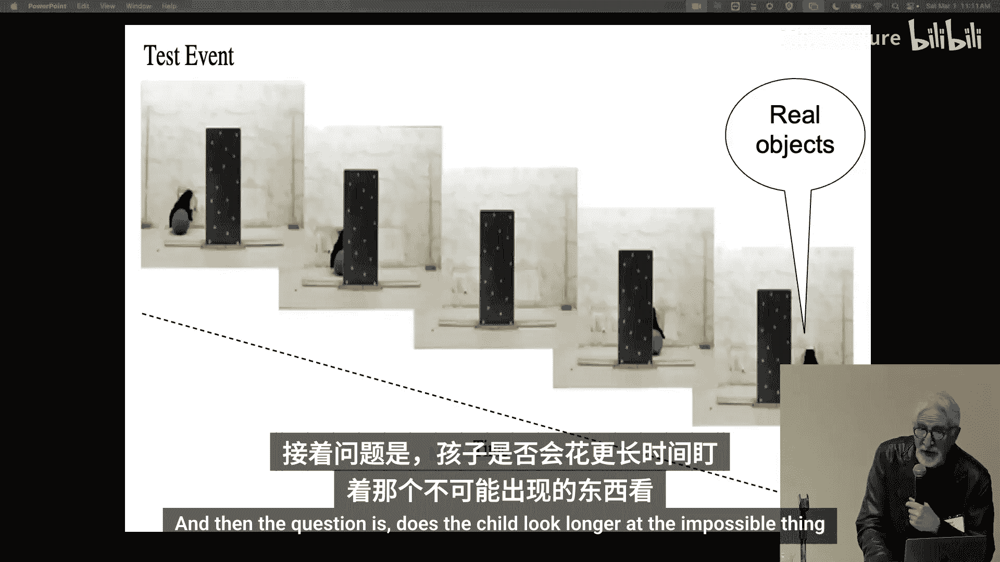
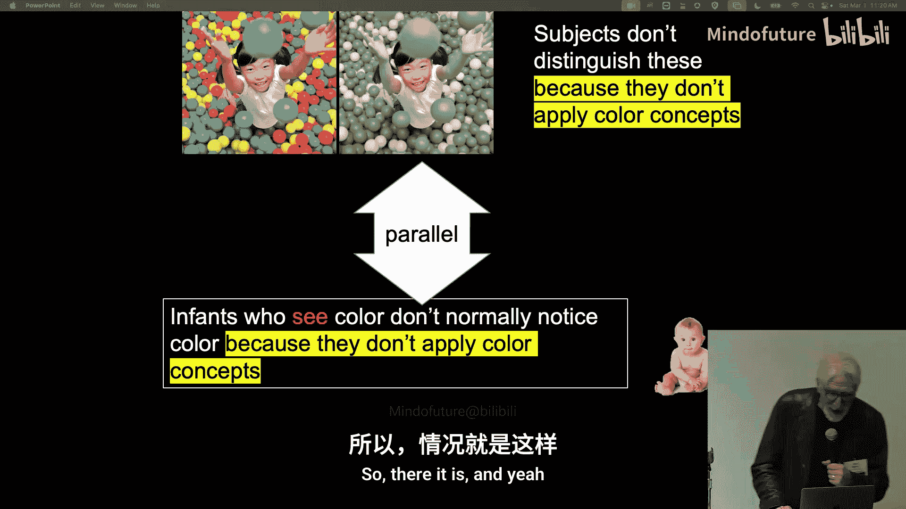
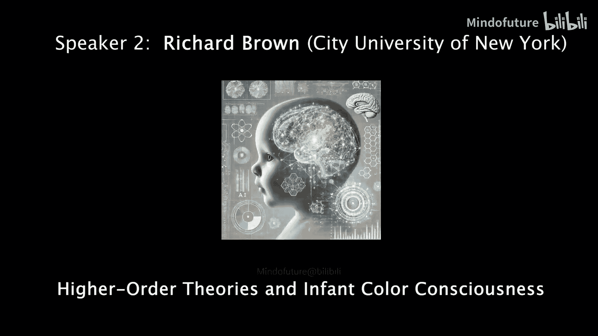
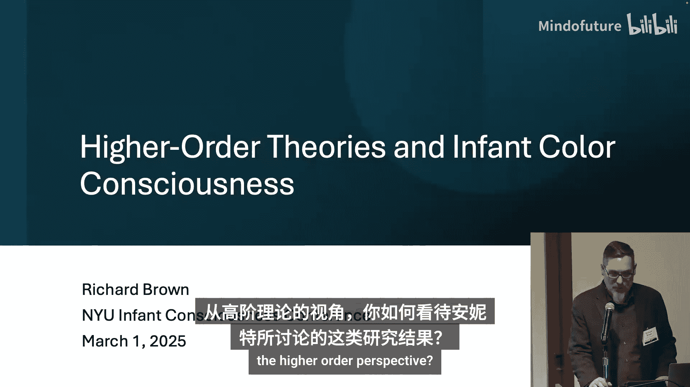
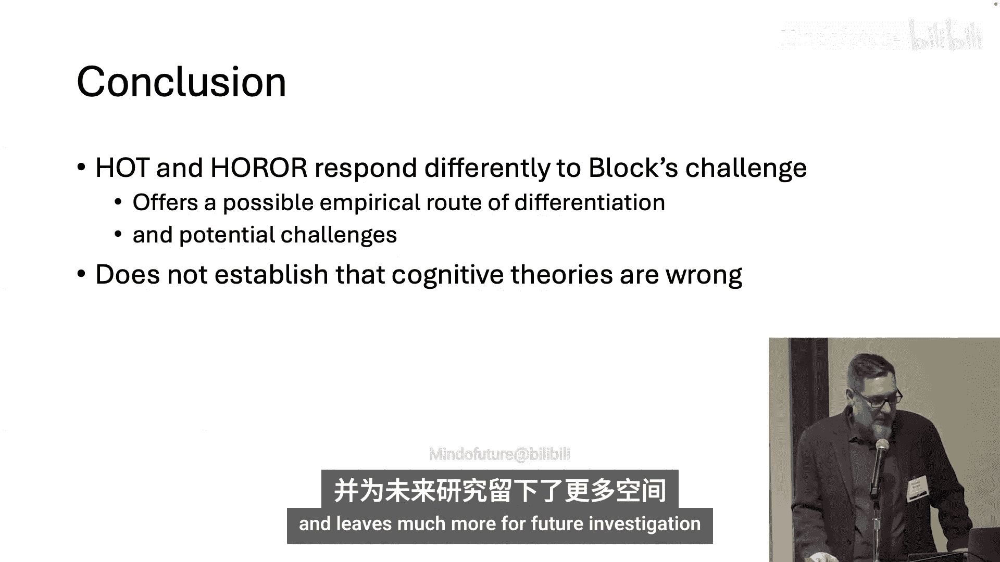
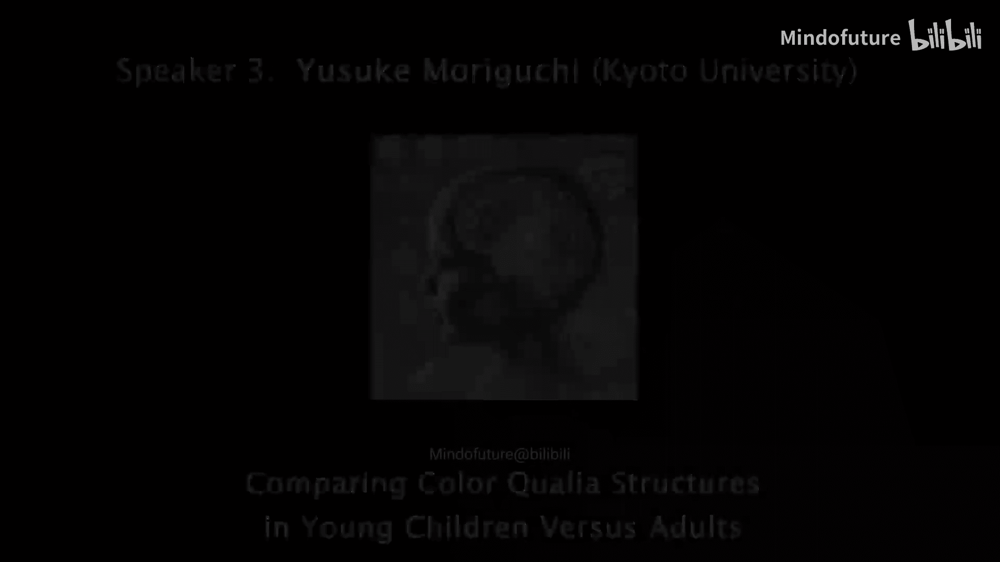
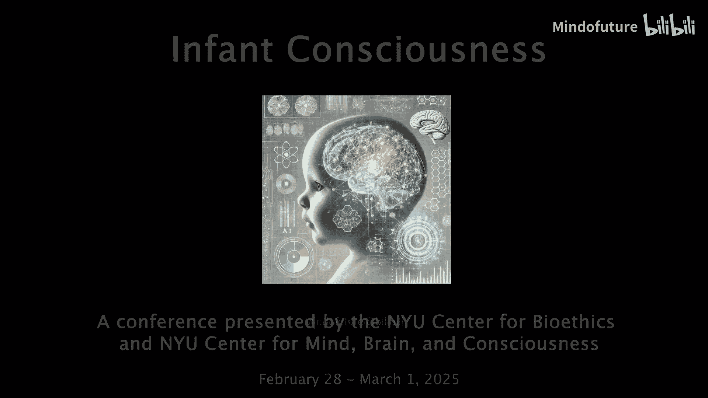

# 006：婴儿颜色感知专题研讨

在本节课中，我们将探讨婴儿的颜色感知与认知。我们将看到，婴儿虽然很早就具备了感知颜色的能力，但在相当长的一段时间内，他们并不使用颜色概念进行认知推理。这一现象为我们理解意识、感知与概念之间的关系提供了重要线索。

## 成人颜色感知的启示

上一节我们介绍了课程的主题，本节中我们来看看一个关于成人颜色感知的著名实验，它为我们理解婴儿的情况提供了重要背景。

迈克尔·科恩进行了一系列巧妙的实验。实验中，受试者观看图片，原始图片看起来是这样的：他们佩戴着眼动仪，无论他们看向哪里，那里就是彩色的，但图片其余部分不是彩色的。一个惊人的结果是，人们往往不会注意到颜色只出现在注视点周围。这就引出了一个问题：为什么？

对于这个问题，有两种解释。第一种解释是，人们并没有真正“看到”视野外围的颜色，或者说感知是稀疏的。更具体地说，正如迈克尔·科恩喜欢说的，我们拥有模糊的、概要性的、整体性的视觉表征，这些表征不会区分你未注意区域的彩色与非彩色。第二种解释是，我们未能应用颜色概念。我们没有在认知上登记彩色与非彩色之间的差异，因此在认知意义上我们没有注意到它，警报没有响起，因为这些警报与认知绑定。

我倾向于稀疏感知的观点。当然，我们今天不具体讨论这个。但我想做的是，将这个案例与婴儿颜色感知的某些方面进行比较。

## 婴儿颜色感知与概念的分离

上一节我们看到了成人可能“视而不见”的现象，本节中我们来看看婴儿的情况，并找出其中的相似之处。

我认为这两个案例存在一个平行关系。我主张，成人受试者未能区分是因为他们没有应用颜色概念。我主张，在婴儿的案例中，6到11个月大的婴儿能看到颜色，但通常不会在认知上登记颜色差异，因为他们不应用颜色概念。这就是我想指出的相似性。

他们不应用颜色概念可能有两个原因。一是他们拥有概念但不应用；二是他们根本没有这些概念。我倾向于第二种，即他们没有概念。但这个区别并不重要。需要说明的是，他们通常不应用颜色概念。我会提到一些特殊情况下他们会应用颜色概念，但这些情况罕见且特殊。核心观点是，他们通常不使用颜色进行推理。所以，他们能看到颜色，但通常不使用颜色进行推理。

## 婴儿颜色表征的三个阶段

了解了核心观点后，我们来看看婴儿颜色能力发展的具体阶段。

婴儿对颜色的表征分为三个阶段：
*   **4到6个月**：他们具备了颜色类别表征。
*   **11个月**：他们开始形成颜色概念。
*   **大约3岁**：他们才获得语言性的颜色概念。

最后一个阶段表明，婴儿掌握颜色概念极其困难。我的主张是，在6个月到11个月期间，婴儿拥有颜色感知，但通常没有颜色概念，尽管可能存在特殊情况。

## 婴儿的颜色类别感知

上一节我们概述了发展阶段，本节中我们深入探讨第一个阶段：婴儿的颜色类别感知。

我们都很熟悉颜色的类别感知，因为我们见过彩虹。彩虹是波长的连续谱带，但我们看到的是条带状，这就是类别感知。行为上的表现是，区分不同类别颜色比区分同一类别内的颜色更快、更准确。

安娜·富兰克林在苏塞克斯大学进行了关于婴儿颜色视觉的出色实验。她有多种测量婴儿颜色感知和颜色类别的方法。最简单的方法是：屏幕上显示一种颜色作为背景，上面有一个圆盘，在我们看来是另一种颜色。如果婴儿将其视为不同颜色，他们会将目光移向它。如果背景和圆盘属于不同类别，婴儿移开目光的速度会更快。可以利用这种方法来绘制他们的颜色类别图。颜色类别也可以通过其他方法绘制，结果与该方法一致。这是一个不同行为测试汇聚的绝佳案例，它们本不必汇聚，但确实汇聚了，这让你更有信心认为这是真实存在的现象。

另一种测试是习惯化。婴儿左右看到相同的东西，相同的颜色，他们会失去兴趣，开始看自己的脚。然后出现一个不同的颜色，你可以利用他们失去兴趣所需的时间作为指标，来判断是否存在不同的颜色类别，这是一种新奇偏好。不同的方法得出了相同的颜色类别。婴儿有五个跨文化的颜色类别。

那么，他们是否注意或注意到颜色呢？他们会表现出注意力。问题在于认知登记。

## 婴儿颜色认知的缺乏

上一节我们确认了婴儿具备颜色感知能力，本节中我们转向颜色认知，并论证尽管婴儿在4到6个月时就有了成人水平的颜色感知和颜色类别，但他们通常不会在认知上登记颜色。

以下是一个很好的实验：
在这个实验中，你可以有相同形状、不同颜色的物体，并存在一个婴儿需要学习的规则：如果两个物体形状相同，那么某一侧会发生很酷的事情。婴儿会学会这个规则，表现为他们会看向有酷事发生的一侧。12个月大的婴儿可以学会这个基于形状的规则，但他们刚刚开始学习基于颜色的规则（相同颜色看左侧）。直到11到12个月大，他们学习“相同颜色看左侧”这个规则仍有很大困难。

所以，这是一个例子，说明他们可以用形状完成认知任务，但不能用颜色。11个月以下的婴儿做不到这一点。当然，这需要某种对颜色同一性的认知性理解。

以下是苏珊开创的不同范式：一个某种颜色的物体从屏幕一侧出来，相关的问题是，他们是否期待出现两个物体？12个月以下的婴儿不期待出现两个物体。所以，他们不会以允许他们进行推理的方式在认知上登记颜色差异。他们使用形状和类别信息形成期望的时间，比他们通常使用颜色的时间要早好几个月。

另一个范式是特瑞·莱斯利式实验。在控制条件下，一个某种形状的物体出来又回去，然后屏幕升起，可能出现预期或非预期的结果。12个月以下的婴儿对出现两个物体并不感到惊讶。如果你有一个红色物体出来又回去，一个绿色物体出来又回去，然后出现两个红色物体，他们并不惊讶。

我正在非常快速地复述我书中一章的内容，这本书可以在牛津大学出版社网站上免费下载。我讨论的问题之一是显著性。这立刻会让人想到：也许颜色就是不如形状和类别显著？如果这是真的，它可能解释了为什么婴儿通常缺乏颜色概念，并存在如此明显的非概念性感知案例。我现在认为，显著性肯定牵涉其中，但显著性与缺乏概念密切相关。我不太清楚因果关系是哪个方向。

## 隧道效应与概念激活

上一节我们看到了婴儿在标准任务中缺乏颜色认知，本节中我们通过“隧道效应”实验，探讨他们是否拥有未被激活的颜色概念。

这里还有另一种实验，一种称为“隧道效应”的现象。你有一个非常窄的屏幕，只比物体略宽一点。一个绿球滚向屏幕，消失在其后，然后要么一个绿球，要么一个红球或其他颜色的球出现。问题是，孩子是否会对不可能的事件注视更长时间？结果发现，与宽屏幕相比，三个半月大的婴儿在窄屏幕条件下注视时间增加，这表明隧道效应起作用。但如果一个红球变成一个绿球，直到七个半月大，他们都不使用颜色信息。直到十一个半月大，他们才开始使用颜色。

这是一个重要的案例，因为它提出了一个问题：婴儿是否拥有未被激活的颜色概念？一些证据表明，威尔科克斯及其同事发现，可以训练婴儿注意颜色。他们训练九个半月大的婴儿，使其对红球变成绿球注视更长时间。但即使是经过三轮训练，七个半月大的婴儿也需要三轮训练才能做到。而且，七个半月大的婴儿无法将训练从红-绿迁移到蓝-黄。所以看起来，七个半月大的婴儿并非真正注意到颜色本身，而只是注意到特定的颜色。

以下是他们训练婴儿的方法：他们使用不同颜色的杯子做不同的事情。例如，一种颜色可能用来敲打，另一种颜色可能用来倾倒。经过反复使用不同颜色物体做不同事情的例子后，孩子们开始对颜色变化做出反应。

现在有一个有趣的问题：训练是将一个感知表征转变为一个概念表征，还是激活了一个已经存在但未激活的概念？概念表征是在推理、思维等认知过程中扮演特定角色的表征，我们可以称之为R角色。因此，我们可能会问：训练是赋予感知表征R角色，还是激活了一个未激活的R角色？

R角色做什么？其中一件事是学习规则，比如“相同颜色预测某事”。我倾向于认为，训练是赋予感知表征R角色。因为我看不出有任何理由认为，像“颜色……看左侧”这样的图式就悬置在那里，等待被激活。

## 颜色作为事物暂时属性的概念？

上一节讨论了训练如何可能赋予感知以概念角色，本节中我们探讨婴儿是否拥有将颜色视为事物暂时属性的概念。

这是一个探索这个问题的很酷的实验。6到8个月大的婴儿更喜欢看这些正常颜色的物体，而不是这些奇怪颜色的物体。人们可能会推测，这些奇怪颜色的物体在我们看来很奇怪，对婴儿来说是否也一样奇怪？

## 总结与对意识理论的启示

以下是核心发现的总结：
*   12个月以下的婴儿通常不在推理中使用颜色概念，除非有特殊刺激或特殊训练。
*   颜色概念的萌芽始于11到12个月。
*   24个月大时，他们可以使用颜色（例如，“你的玩具我的玩具，因为我的玩具是这个颜色”）。
*   直到3岁，他们才知道四个基本颜色词。需要说明的是，这可能有所提前。本世纪初的早期智商测试显示，他样本中的儿童直到7岁才掌握四个基本颜色词。

当然，现在的孩子更早掌握。你可能会问，为什么？嗯，看看塑料制品吧，这些孩子被许多不同颜色的塑料制品包围着。

1980年，梅布尔·赖斯进行了一项教学实验。她选取了一组2到3岁、不认识任何颜色词的儿童，教他们区分红色和绿色。她发现，对于大多数这些儿童，学习这个区别需要超过一千次试验，持续数周。家长们早就注意到，他们的孩子会说其他事物的词，但令人惊讶地缺乏颜色词。有一篇《科学美国人》的文章详细讨论了这一点，引用了许多家长的描述。奇怪的是，家长认为孩子知道颜色词，但实际上他们不知道。孩子们可能记住了某些事物的颜色名称，但他们实际上并不知道这些词的意思。因此，家长常常严重误解他们孩子的颜色术语能力。查尔斯·达尔文曾非常精妙地描述过这一点（虽然不是误解部分），他说：“我仔细关注了我年幼孩子的心理发展。我相信，在他们两三个孩子刚到了知道所有常见物体名称的年龄后不久，我惊讶地观察到，他们似乎完全无法给颜色和彩色版画贴上正确的名称，尽管我反复尝试教他们。我清楚地记得我曾断言他们是色盲。”在德语文献中，有一个术语形容这种现象：“Farbenstummheit”，即颜色愚钝。

总之，6个月到11个月大的孩子能看到颜色，他们有感知性的颜色类别，但通常没有颜色概念。这表明，看到颜色而不在认知上登记它是可能的。

回到稀疏感知的谬误：受试者没有在认知上登记差异，这一事实并不能表明事物看起来的方式存在差异。另一种解释是，他们没有应用相关的颜色概念。我认为同样的故事可以解释这个案例：他们未能区分是因为没有应用颜色概念。

这与意识相关，因为稀疏感知这一观点一直是意识认知理论的主要动机。正如大家肯定意识到的，最近在意识的感觉理论（如循环加工理论、整合信息理论）和意识的认知理论（全局工作空间理论、高阶理论）之间存在争议。意识的认知理论通常得出的结论是感知是稀疏的，原因是认知是稀疏的。全局工作空间理论说我们一次只能意识到一到三件事，我们的高阶思想或高阶指标非常有限。因此，这些观点都站在稀疏感知一边。而感觉理论则站在丰富感知一边。所以，这次演讲是以一种巧妙的方式倡导丰富感知的观点。

本节课中我们一起学习了婴儿颜色感知与认知分离的现象。我们看到，婴儿在生命早期就能感知和区分颜色，但将颜色整合到认知推理和概念系统中是一个缓慢且困难的过程。这一发现挑战了感知必然伴随概念化认知的观点，并为理解意识的本质——特别是丰富感知与稀疏感知的争论——提供了来自发展心理学的重要证据。对婴儿颜色认知的研究揭示，感知体验与对体验的概念化理解可以是分离的，这促使我们更细致地思考意识、感知与概念之间的复杂关系。