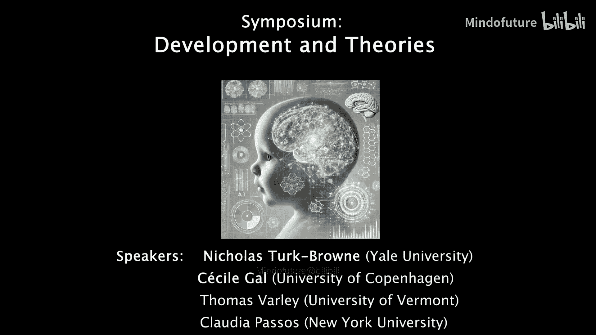
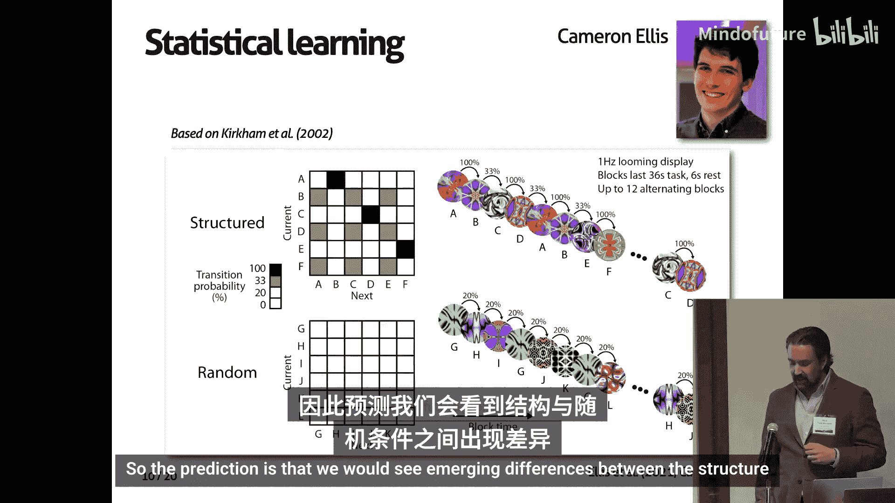
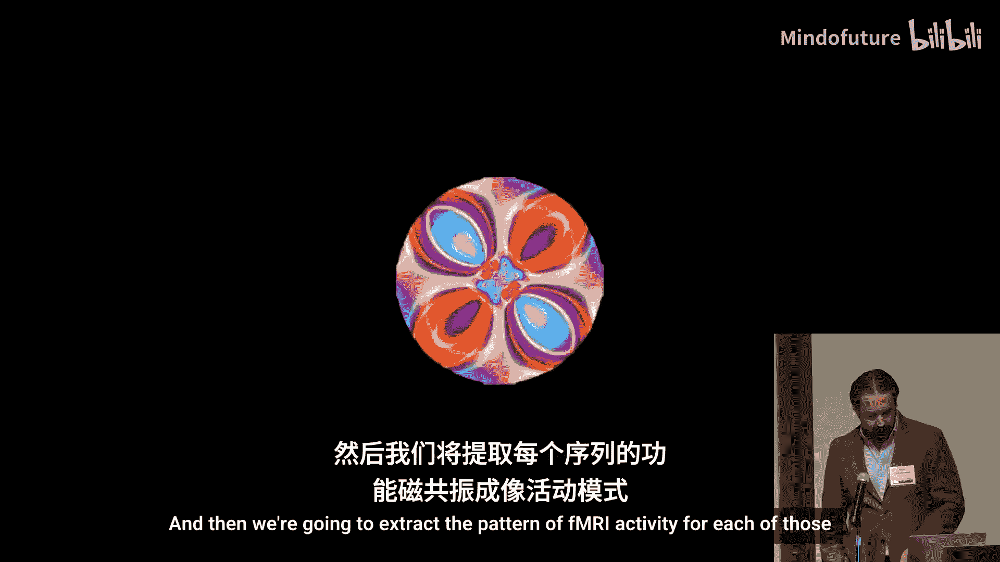
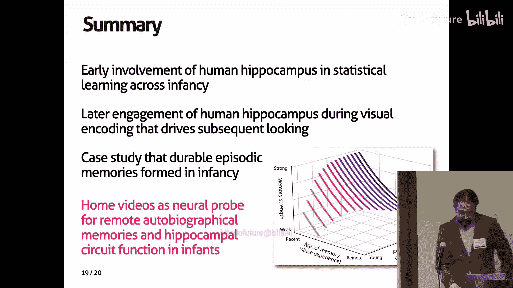
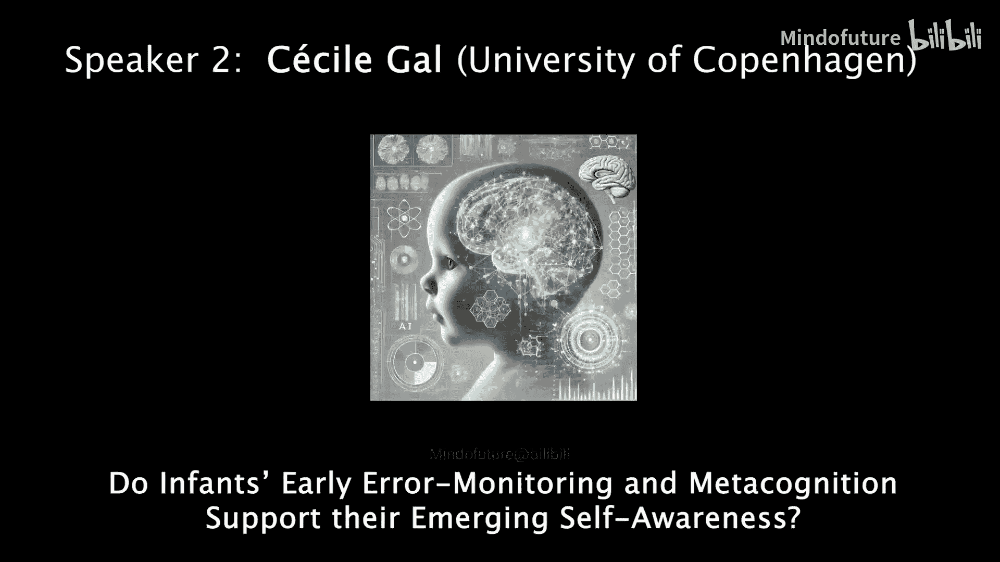
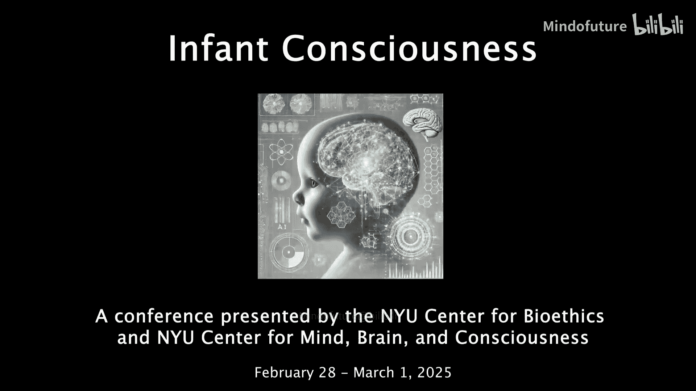

# 007：发育与理论 🧠👶

在本节课中，我们将学习纽约大学婴儿意识会议中关于婴儿大脑发育、记忆形成、元认知能力以及意识测量理论的最新研究。我们将探讨海马体在婴儿期的作用、婴儿元认知能力的证据、以及如何用信息论量化大脑的协同性，最后还将了解该领域专家们对婴儿意识核心问题的看法。

## 海马体与婴儿记忆：一个正在书写的故事 🧩

上一节我们介绍了本次会议的主题，本节中我们来看看海马体在婴儿记忆形成中的作用。传统观点认为，婴儿期缺乏情景记忆（即对特定事件的记忆）表明海马体尚未成熟。然而，新的研究线索表明，婴儿的海马体可能已经参与并支持着某种形式的记忆功能。

海马体通常与有意识的、陈述性的情景记忆相关联。例如，你可以回忆起昨晚晚餐的同伴、谈话内容、地点和时间，并能“在心理上穿越”回那个事件。

在婴儿意识的背景下，情景记忆最引人注目的一点是，我们在成年后无法回忆起婴儿期的这类记忆。今天要讨论的是一个仍在进行中的研究故事，它改变了我们对婴儿期情景记忆的看法。

通常，人们将婴儿期缺乏情景记忆归因于海马体不成熟。但一系列研究表明，海马体在婴儿期已被激活，并可能支持情景记忆的形成。

这个故事始于一个发现：海马体支持的功能远不止情景记忆。例如，统计学习（即从多个事件中提取规律的能力）也依赖于海马体。成年人的研究表明，统计学习会激活海马体，海马体的大小与统计学习能力相关，海马体损伤会破坏统计学习。

婴儿是出色的统计学习者。研究表明，即使是新生儿也能从听觉或视觉信息中提取规律。这就产生了一个难题：婴儿似乎缺乏典型的海马体功能（情景记忆），但成年人海马体支持统计学习，而婴儿又是优秀的统计学习者。

一种可能性是海马体不成熟，婴儿使用其他脑系统进行统计学习。另一种可能性是，海马体通过不同通路同时支持这两种功能。具体来说，海马体内部存在不同的信息流路径：三突触通路似乎支持对单个事件形成独立的情景记忆，而单突触通路则支持从多个事件中提取模式。

从发育角度看，这很有趣。在非人灵长类动物的追踪研究中，这两条通路具有不同的发育轨迹。单突触连接在幼年时期就已建立，而三突触连接直到成年期才出现。这种差异性的发育轨迹可能有助于调和最初的难题：也许海马体在能够存储持久的情景记忆之前，就先支持了统计学习。

这促使我们思考：婴儿的海马体是否在进行统计学习？为了验证这一点，我们开发了一系列方法。研究成人海马体通常使用功能磁共振成像（fMRI），但这对婴儿来说非常困难，因为婴儿无法保持不动，且注意力持续时间短。过去十年，我们致力于开发适用于清醒婴儿的fMRI方法，扫描了超过350名婴儿，平均每次获得5-10分钟可用的fMRI数据。

最早的研究由前研究生Cameron Ellis（现斯坦福大学教授）进行，主要关注感知和注意力问题。另一项由Tristan Yates（现与Nim Tottenham合作的博士后）进行的研究，使用隐马尔可夫模型分析婴儿观看电影时的大脑活动结构，这可能为了解婴儿体验的本质提供信息。

回到主线，我们假设海马体可能在儿童发育早期支持统计学习，早于其支持情景记忆的能力。Cameron进行了一项相对简单的研究，向婴儿展示连续的分形图案序列，其中嵌入了配对规律。我们对比了有规律结构和无规律随机序列所引发的fMRI活动。预测是，随着暴露时间增加，我们会看到结构序列与随机序列之间的差异逐渐显现。

研究结果显示，在暴露的后半段，海马体对结构序列的活动显著高于随机序列。这种随时间学习的效果不随婴儿年龄变化。海马体的体积在3到24个月间翻倍，但学习相关的交互作用不随年龄变化。这符合理论，即支持统计学习的神经回路可能比支持情景记忆的回路发育得更早。

但这些结果让我思考：证明婴儿海马体不编码情景记忆的证据有多充分？大多数关于婴儿期遗忘症的研究是回顾性调查。现在，我们有了使用fMRI研究婴儿情景记忆任务中海马体活动的方法。

Tristan的研究复制了Anthony Wagner等人在90年代末开发的“随后记忆”设计。在成人版本中，实验结束后询问参与者记住了哪些图片。对于婴儿，我们使用视觉配对比较范式。在测试试次中，呈现两个来自同一类别的物品，一个是之前见过的，一个是新的。婴儿倾向于更长时间注视熟悉的物品。我们根据随后的熟悉性偏好来编码学习阶段的试次。

结果显示，整个婴儿样本中，学习阶段海马体活动越强，预测了后来更强的熟悉性注视。有趣的是，支持情景记忆的三突触通路更多地位于海马体后部，而我们的效应也确实由后部海马体驱动。此外，虽然在整个样本中存在效应，但这完全由12个月以上的婴儿驱动。全脑分析也显示，这种效应在12个月以上婴儿的颞叶内侧区域相对特异。

这些发现引领我们走向新的方向。项目识别是一种情景记忆，但情景记忆通常包含更丰富的成分，比如项目之间的关系（谁、何时、何地）。当前，学生Lily Bem正在进行研究，受成人研究和婴儿研究的启发，探索关系记忆任务，考察婴儿是否能形成面孔与场景之间的关联，以及时空关系记忆。

最后，我们刚刚完成了一项纵向研究，追踪了7个家庭，让他们记录婴儿期的家庭视频，并每三个月扫描一次婴儿，观察他们对自身经历视频与他人经历视频的海马体反应。一项先导研究使用了SayCam数据集（Mike Frank等人收集），将头戴式摄像机戴在婴儿头上记录数年。我们扫描了其中两个家庭中较大的孩子（一个3岁，一个9岁），让他们观看自己婴儿期和他人的视频。关键结果是，只有3岁孩子的海马体能区分自我与他人的经历，而9岁孩子则不能。这表明婴儿期的经历不仅被编码，而且可能持续到幼儿早期。我们目前正在研究这些记忆为何变得难以提取。

**总结**：本节课我们一起学习了海马体在婴儿期可能同时支持统计学习和早期情景记忆编码的证据。研究表明，婴儿海马体并非完全沉默，其不同通路的发育轨迹可能解释了婴儿期记忆的特点。纵向研究提示，早期记忆可能持续存在但难以提取，这为理解婴儿期遗忘症提供了新视角。

---

## 婴儿的元认知：自我调节的早期迹象 🧐

上一节我们探讨了婴儿的记忆系统，本节中我们来看看婴儿是否具备监控和调节自身认知过程的能力，即元认知。传统上认为元认知需要概念化或自我反思能力，因此婴儿不具备。但新证据表明，婴儿可能拥有某种初步的元认知形式。

元认知可以定义为评估自身信息状态和学习效率，以调节后续认知活动和行为的能力。已有研究表明，婴儿能够以符合追踪自身不确定性的方式寻求帮助和坚持决策，并且具有监控自身错误的神经特征（错误相关负波，ERN）。

我们的实验旨在复制这些发现，并进一步探究这些初步的元认知能力是否被婴儿用于自由信息搜索和学习情境中，以及它们是否与自我意识的发展相关联。通过研究婴儿，我们有机会调查从非语言、前语言、前概念元认知能力到后期更反思性能力的发展变化。

我们通过一个纵向项目来研究，跟踪了124名婴儿，在他们12、18和24个月大时进行测试。在12个月时，我们使用眼动追踪和同步脑电图（EEG）记录，采用注视响应范式。在18个月时，对同一批婴儿进行镜子测试，以检验他们的自我识别能力。

在实践中，我们使用匹配样本任务。婴儿通过注视来控制屏幕内容，进行自由、主动的信息采样。任务类似于记忆游戏，婴儿需要配对相同的物体。他们可以先探索两张可见的卡片，然后注视顶部的卡片使其翻转，如果翻出的图案与底部某张卡片匹配，则配对成功。

我们的设计具有自适应难度，根据婴儿的表现调整图像相似度，确保有足够数量的正确和错误试次用于分析。

我们有一系列假设：
1.  **元认知监控**：如果婴儿有此能力，他们应能检测到自己犯错，并反映在大脑活动中（ERN和反馈相关负波，FRN）。
2.  **元认知控制**：如果婴儿能使用元认知控制，他们应根据先前的错误调整注视行为。
3.  **与自我意识的关系**：早期的元认知监控和控制能力可能与后期自我意识的出现相关。

以下是主要结果：

**元认知监控**：我们分析了婴儿在决策阶段的EEG活动。结果发现，在错误决策后，大脑活动在早期和晚期有两个时间窗口与正确决策显著不同，这与前人研究基本一致。在反馈阶段，正确与错误反馈引发的大脑反应也存在显著差异。这验证了我们的假设，即12个月大的婴儿可能具有某种形式的元认知错误监控。

**元认知控制**：我们分析了婴儿犯错后的行为调整。在探索阶段，婴儿在犯错后与成功后，在探索时间、注视点数量和切换次数上没有显著差异。但在决策阶段，婴儿在犯错后做出决策所需的时间显著更长。这表明他们具有某种形式的元认知控制。

**与自我意识的关系**：我们将婴儿根据18个月时的镜子测试结果（能自我识别 vs 不能）分组，回顾他们12个月时的数据。
*   **监控方面**：在18个月时能自我识别的婴儿组中，其12个月时的ERN和FRN信号在正确与错误试次间存在显著差异。而不能自我识别的婴儿组则没有这种差异（ERN窗口），FRN窗口可能有微弱差异。
*   **控制方面**：在探索阶段，能自我识别的婴儿在犯错后探索时间的变化与不能识别的婴儿有显著差异。在决策阶段，两组婴儿在决策时间或跳过决策的比例上没有差异。

**总结**：本节课我们一起学习了婴儿在12个月大时已表现出初步元认知能力的证据，包括检测自身错误（监控）和根据错误调整行为（控制）。此外，这些早期元认知能力与18个月时自我意识的出现存在关联，提示这两种功能可能在发育过程中协同发展。

---

## 量化婴儿大脑的协同性：一种意识测量的新途径 📊

上一节我们讨论了婴儿的元认知行为，本节中我们从更宏观的神经动力学角度，探讨如何量化婴儿大脑的信息处理结构，并将其与意识能力联系起来。意识似乎是大脑活动的一种涌现特性。如果我们能创建一种形式化的代数方法来量化系统显示任何涌现特性的程度，或许可以间接衡量该系统支持意识的可能性。

现有的意识复杂性度量（如Lempel-Ziv复杂度、分形维数、熵）往往存在局限，例如在随机噪声中熵值最大，但这显然不代表更高的意识水平。因此，我们需要一个能真正捕捉“整体大于部分之和”这一涌现思想的度量。

我们借助多元信息论这一形式化逻辑来描述系统各部分之间以及部分与整体之间的信息交互。其中两种交互作用尤为重要：
*   **冗余**：通过观察单个部分就能获得的信息，与同步性相关。
*   **协同**：只有同时观察所有部分才能获得的信息，且无法从任何单个或部分组合中获得。

我们需要一个可以从实际数据中计算的汇总统计量，即 **O信息**（组织信息）。如果系统的O信息为正，则系统以冗余为主导；如果为负，则以协同为主导。

O信息的计算公式为：
`Ω(X) = TC(X) - Σ_{i=1}^{n} TC(X^{-i})`
其中，`TC(X)` 是总相关度，衡量整个系统的总信息量；`TC(X^{-i})` 是排除第 `i` 个元素后系统的总相关度。如果整体信息量大于各部分信息量之和（经过调整），则存在协同信息。

我们的研究问题是：婴儿发育过程中，由O信息索引的、高阶的、协同的信息分布如何变化？我们使用了哥伦比亚大学约300名婴儿的数据（作为新生儿重症监护研究的一部分）。数据在安静睡眠状态下收集，使用124个电极记录并源定位到57个皮层区域。婴儿在约两岁时接受了贝利量表（一种认知测试）评估。部分婴儿还参与了一项“家庭养育干预”临床试验，旨在通过加强母婴互动改善预后。

我们使用了模拟退火算法来寻找具有最负O信息（即最具协同性）的最佳皮层脑区集合。我们发现，随着集合规模增大，O信息呈现U形曲线，在某个规模（约10个脑区）达到最负值，这可以视为一个“自然尺度”。

主要发现如下：
1.  **全脑O信息随年龄变化**：极早产儿（约33周）的大脑呈高度冗余主导（O信息为正）。随着发育（至45周），O信息向零漂移，在高频波段甚至变为负值（协同主导）。这表明信息架构从高度可压缩的冗余向结构化、协同的涌现转变。
2.  **最优协同集合的变化**：随着婴儿年龄增长，U形曲线的底部变深（协同性增加），且向右移动（最优协同集合包含的脑区数量增加）。这表明不仅协同性总量增加，而且越来越多的脑区被招募到这些协同集合中。
3.  **脑区参与频率**：发育早期，协同性主要位于前额叶区域，少量在枕叶。随着发育，更多脑区被招募，最终整个大脑的额、中央、颞、枕区都参与其中，形成一个“协同性支架”，而非单一的“协同性核心”。
4.  **与认知表现的关系**：婴儿期全脑O信息越负（协同性越高），预测了两年后在贝利量表上得分越高。即使在排除年龄因素后，效应依然存在。
5.  **干预措施的影响**：接受家庭养育干预的婴儿，其全脑O信息从冗余到协同的转变轨迹平滑且近乎线性。而接受标准护理的婴儿则保持冗余架构直至接近足月，然后快速追赶。这表明母婴社会互动也参与了这种协同性支架的形成。

**总结**：本节课我们一起学习了一种基于信息论量化大脑协同性的新方法O信息。研究发现，婴儿大脑在发育过程中，信息架构逐渐从冗余主导转向协同主导，这种转变与后期的认知表现相关，并受到早期社会互动的影响。如果协同性与意识存在联系，那么意识的出现可能更像一个逐渐变亮的“调光开关”，而非突然开启的“电灯开关”。

---

## 婴儿意识的五大核心问题：专家观点调查 📝

上一节我们从理论计算角度探讨了意识测量，本节中我们回归基础，梳理婴儿意识研究领域的核心问题，并展示该领域专家们对这些问题的看法。本部分旨在提供一个研究框架，而非给出个人答案。

婴儿意识研究可围绕五个核心问题展开：
1.  **方法问题**：如何研究婴儿意识？有哪些方法？
2.  **定位问题**：婴儿意识的神经基础位于何处？
3.  **存在性问题**：新生儿是否有意识？
4.  **时间问题**：意识在发育过程中何时出现？
5.  **内容问题**：婴儿的意识体验是怎样的？

此外，还有关于意识功能（为何存在）以及意识分布（哪些实体有意识）等问题。

我们对与会专家进行了问卷调查，以下是初步结果（参与者以哲学家为主，也包括心理学家和神经科学家）：

*   **存在性问题**：41%认为新生儿通常有意识，50%认为没有，9%表示不可知。
*   **时间问题**：关于意识出现时间，9%认为在孕24周前（早期产前），47%认为在孕24周后（晚期产前），11%认为在出生时，12%认为在出生后6个月内（早期产后），5%认为在6个月后（晚期产后）。关于自我意识出现时间，多数认为在6个月之后。
*   **定位问题**：44%对婴儿意识的神经基础表示不可知。在给出意见者中，多数认为在感觉皮层或皮层下系统，少于20%认为在前额叶皮层。
*   **内容问题**：87%认为婴儿有情感体验（如疼痛），79%认为有感觉体验，少数认为有认知体验或意志体验。
*   **方法问题**：62%倾向于行为标记，55%倾向于神经标记，仅少数认为理论是主要指导。
*   **分布问题**：调查还询问了其他实体的意识可能性，结果显示认可度从成人、猫、鱼、苍蝇到植物和未来人工智能系统依次递减。

**总结**：本节课我们一起梳理了婴儿意识研究的五个核心问题，并通过调查了解了当前该领域专家群体的主流看法。调查显示，对于新生儿是否有意识、意识何时出现等问题仍存在显著分歧，但行为标记和神经标记是主要研究方法，且多数专家认为婴儿具有情感和感觉体验。这些结果为未来的研究方向和哲学思考提供了重要参考。