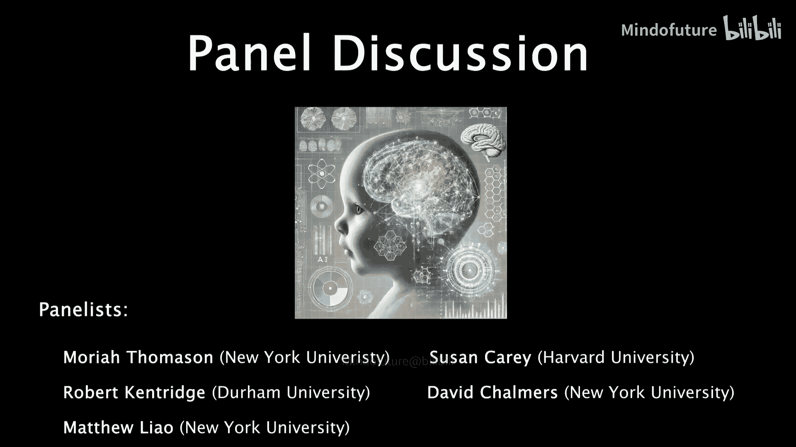
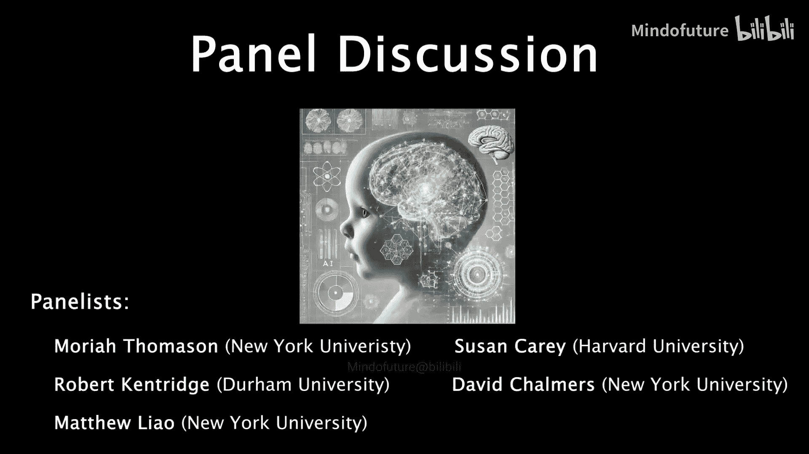

# 008：小组讨论 - 纽约大学婴儿意识会议

## 概述
在本节课程中，我们将学习纽约大学婴儿意识会议中一场小组讨论的核心内容。讨论汇集了胎儿神经影像学家、哲学家、心理学家、临床医生等多领域专家，围绕如何研究婴儿意识、使用何种证据标记、以及相关的伦理问题展开了深入探讨。我们将梳理对话中的关键论点、方法论挑战和跨学科见解。

## 胎儿大脑研究：背景与挑战
我是玛丽亚·托马斯，一名胎儿神经影像学家。我尚未有机会认识所有人，因此首先介绍一下我的背景。我为讨论带来的视角主要与研究胎儿大脑有关。我的大量工作聚焦于大脑的构建基础。我认为，理解大脑的起源故事能为我们提供一些洞见。作为一名构建复杂系统的“建筑师”，我认为理解如何开始构建一个复杂系统能让我们有所收获。启动一个复杂系统是困难的。

我将分享两个观点，这些观点在我谈论我们实验室的发现时经常出现。当人们思考胎儿思维时，有几个主题会反复出现。

**关于胎儿思维，你怎么看？**

首先，任何时候你查看神经科学数据，似乎都有一种将大脑拟人化的倾向。当我们谈论大脑如何工作时，我们赋予了它人性。正如我们各个领域的人一样，我们倾向于使用那些因我们自身感知而被操作化的词语。在我的工作中，我经常需要提醒人们，大脑并非如此——那是你在思考大脑在做什么。这一点在胎儿研究中尤为重要。

第二点是，大脑在构建过程中的任务与建成后的任务截然不同。在我早期发表的论文中，我会收到审稿意见，他们很快会告诉我，例如，前额叶-顶叶网络——一个在生命后期对注意力至关重要的网络——胎儿为什么需要它？他们会说，这没有道理，他们只期望胎儿大脑拥有那些早期系统，即感觉运动系统。但事实上，胎儿大脑为什么不能拥有它呢？因此，我不得不温和地解释，我并非将这些协同工作的脑区概念化为具有它们后来才有的功能，因为那不是它们当前必须完成的任务。它们当前的任务只是被构建出来。对它们来说，被构建远比执行注意力任务重要得多。

总之，这些是我在尝试向他人分享我的工作时经常思考的两点。因为许多看到像我这样的实验室工作的人，很可能会将这些概念从他们自身的参照系出发，套用到胎儿大脑上。因此，我确实喜欢提醒人们，这里没有“黄金标准”。事实上，这是我所在领域最大的挑战之一：当我发表一篇论文时，我无法说“哦，那是一张‘好’的图片”或“那是一张‘坏’的图片”。事实上，这非常困难，因为很多时候我的问题确实与风险有关。例如，我如何能说“这个胎儿暴露于大麻，情况很糟”？因为我曾与面临巨大挑战的人群合作，他们压力大、资源少、吸食大麻，可能一生都暴露在创伤中。我不想发表一篇论文说“那个胎儿大脑的情况很糟”，因为我没有任何依据这么说。因此，我尝试做一些巧妙的事情，比如纵向跟踪这些儿童，研究他们的发展，绘制海马体连接图谱，绘制什么是“好”的表征、什么是“坏”的表征的图谱——即预测未来更好结果的是什么——然后根据所有体素是属于“好”图谱还是“坏”图谱来重新分类。我甚至这么说都很糟糕，也许能获得一些进展。

我们真正应该说的是，我们没有办法。但我确实热爱实验，我确实热爱实际测试的机会。我认为我们可以考虑的一个有趣的对话点是，作为一个领域，我们可以进行哪些实验，以便在已讨论的一些主题上获得更多进展。

## 意识的形式：人类经验与“异形”意识
这整个周末一直困扰着我。当我们谈论意识时，我觉得我们许多人假设它就像我拥有的意识一样，即通常的五种感官、自我感等，是我如果能进入婴儿体验中就能理解的东西。

你认为是否值得区分我们经验中的意识与更奇特的意识形式？是否存在一种“作为婴儿的感受”，它与我们成年人的体验非常、非常不同？这是一个有意义的区分吗？

许多人向我建议过这一点。当然，比如人工智能意识。如果人工智能系统有意识，很可能与人类意识的方式非常不同。还有因为迷幻药诱导的意识、人类冥想中的意识，已经与我们普通的意识非常不同。

我认为这里的保守观点是，我们只是占据了可能意识空间的微小一部分，我们想尝试探索尽可能广阔的空间，但我们受到可用系统和可用证据的限制。

## 发展与意识：发育理论的重要性
我想问一个关于发育与意识之间关系的问题。对于婴儿意识，这似乎是一个发育故事。大脑在发育，连接在人类中发育。所以这是一种意识的发育理论。当你想要一个意识理论时，这是基础性的。你可以想象动物意识的发育理论，也可以想象机器意识的发育理论。

那么，当我们有那种意识理论时，我们是否需要讲述一个关于它如何形成的发育故事？这在本体论上是根本性的吗？对于发育科学家和意识科学家来说，我很乐意说，当涉及人类时，这是我的概念的一部分。我们体验到的几乎所有概念都有一个发育框架。但我也是一名发育学家，所以我不知道如何用不同的方式描述世界。即使是像压力或不确定性这样的东西，它在生命的不同时期意味着不同的东西，你有不同的需求，需要完成不同的事情。我想说的是，就你在生命某个阶段需要完成什么才能成功而言的“责任”。因此，我认为是的。

这是一个关于新生儿意识的会议，所以毫无疑问，发育必须处于中心位置。但你是否认为发育是理解意识或心智的核心教条？这是一个理论承诺。我碰巧认为，如果你至少不能想象一个从受精卵到成人心智的故事，那么你就不理解成人心智。但你不必同意这一点，这本身也是一个有趣的问题。

关于“异形”意识，如果你无法想象它，你就无法研究它，所以这很难。其次，许多思考心智发育的人假设婴儿完全是一种异形生物。例如，他们只有感觉运动基元，或者他们只有“嗡嗡作响的混乱”。所以他们想象的是一个异形心智，但这是对的吗？答案是否定的，两者都不对。你想要的是对“那是什么样子”的正面描述。

## 发育理论的必要性：普遍性与特殊性
我本来不认为发育理论是必要的。在人类的情况下，确实如此，但那是轨迹。但如果你想想戴夫谈到的人工智能意识，你可以想象你构建一个系统，它立即就有意识，没有发育阶段。但你可以想象你构建一个不需要训练的系统，或者像异形意识那样，你只是把它构建出来。所以我认为，实际上，从实践角度讲，无论如何，但从形而上学角度讲，我可以想象也许有这些外星人，他们一出现就已经有意识了，不需要经历任何发育阶段。这是一个有趣的问题，即是否结果证明存在某种核心的发育途径，你必须经历那个发育途径才能有意识，如果你不经历，你就不会有意识。有一个明显的反例，就是你提出的沼泽意识——一个系统随机出现在沼泽中，没有任何发育背景，但它可能有意识。如果那是有意识的，它看起来就是那个强主张的反例。

但等等，你想象了一个发育轨迹，但你还没有找到它。那么下一个问题是，我们有一个关于现存生物（比如人类）的发育理论，结果证明每个人类都必须经历某个发育途径。所以我认为我们显然可以有物种特异性的意识发育理论，但是否会有普遍性的理论，这在我看来似乎不太可能。也许原则上存在许多不同的发育途径可以达到那里，而人类使用的只是特定的一组。

## 临床实践中的标记与伦理困境
我有一个评论和一个问题。这个评论是对你刚才谈论的关于“黄金标准”的观察。作为一名儿科医生，实际上这就是我们对较大儿童所做的：我们询问儿童的现象学——“你哪里不舒服？”——他们会回答。对于年幼的婴儿，我们只能依赖他们的行为。新生儿科医生一旦开始观察早产儿，他们的行为库相当有限，我们依赖影像标记、其他标记等。所以我们已经在做那种事情了。有趣的是，实际上在意识研究领域，这就是你提出的方法。最终，是儿童告诉我们他们哪里不舒服。胎儿永远不会那样做，早产儿也不会那样做。

不过，问题更多地与伦理有关。作为一名临床医生，这里的“房间里的大象”是：我们应该在22周时复苏婴儿吗？整个堕胎辩论都取决于这里讨论的一些事情。我认为，作为一名科学家，你对此视而不见，只看你的实验客观地显示了什么科学，这真的很好也很重要。如果实验显示12周的胎儿有意识，那就这样。但同时，我认为值得强调为什么这些是重要的，引入伦理，引入哲学。对我来说，作为一名临床医生，被不同学科的人包围，看到这些观点，真是太棒了。有时你会走向一个极端，我认为昨天在关于20周胎儿疼痛的演讲中提到过，他们说胎儿感到剧痛，你怎么能这么说？但显然，那被一个不可信的个体政治化了。我认为我们需要细致入微，也需要决定我们的“概率平衡”是什么。作为科学家，我们想要95%的置信区间，但将意识归因于一个非常小的婴儿，是基于概率平衡，还是比例原则？我认为，拥有这些框架仍然很重要。

## 法律案例与生命质量评估
在英国有查尔斯案，在美国有一系列案件，但比如德克萨斯州的廷斯利·刘易斯案，这些医生基本上不想继续治疗，想把婴儿赶出医院。母亲一直上诉到最高法院，最高法院站在了母亲一边。当时医生们，所有这些专家，他们认为必须非常积极地治疗这个孩子，而且没有过上美好生活的前景，等等，他们不想这样做，但母亲不同意。我们实际上在论文中讨论过这个案例，有趣的是，廷斯利·刘易斯有心脏问题，他们治疗的是，他们认为孩子需要再做一次手术，经历所有这些不同的手术，为什么要让孩子承受这些，让孩子死去，这是医生的观点。现在，我们在论文中论证的是，实际上心脏问题并不妨碍你能够生活，就基本条件而言，你实际上仍然能够拥有 interpersonal relationships 等等。五年后，廷斯利仍然活着，她与母亲互动。他们送她回家，母亲决定抚养她。我们实际上联系了她的母亲和法定代表，她残疾了，但她似乎能唱歌，能和母亲一起看电视等等。所以在这个案例中，我们认为这显示出我们不应该仅仅依赖生命质量评估，而要看孩子实际上能做什么。因此，在这个案例中，我们认为医生实际上错了，因为他们只关注这会给孩子带来太多痛苦等等。

## 证据标记的层次结构：行为、神经与计算
我想请你，戴夫，多谈谈你的标记层次结构。问题是，在你思考的方式中，它在什么意义上是一个层次结构？你从植物人状态案例开始，那里没有行为，这促使我们转向神经标记，然后也许转向计算标记。听起来你在想，有行为时我们用行为，没有行为时，我们转向神经标记，没有神经标记时，我们转向计算标记。但一个问题是我们有，正如你所说，对于人工智能，我们不是缺乏行为，而是我们有太多行为，只是感觉不对，也许完全不对行为赋予权重。所以我想这是一个关于它是“击败者”的层次结构还是什么的问题。我认为真正的问题，似乎还没有被完全把握，但在我看来是根本性的问题是：如果我们从许多人想开始的地方开始（不是每个人，这很清楚），但我当然认为你倾向于开始的地方，我也倾向于开始的地方，是做科学时，你优先考虑现象学，即优先考虑那些能够内省报告的人，然后你试图从中引导出来。在我看来，如果你能做到这一点，并且优先考虑那些可以在各种领域中使用的标记，如果你能做到（我不知道是否能），你很可能会得出计算标记，它们能给你更好的概括性，更多的解释力，它们解释其他标记，它们看起来与现象学联系更紧密，捕捉结构同构等等。而行为，你得到的是多对一的关系，这使你能够说，正如人们经常想说的，你不能信任行为，你怎么知道你的存在可能只是一种幻觉，可能是非意识的，可能是被游戏化的？我想这是一个冗长的说法，只是请你更详细地阐述一下标记的层次结构，因为你没有被录音。现在为了录音，这不是一个经过深思熟虑的层次结构，就像我们在讨论中要谈什么一样。很大程度上是受到你的演讲、克劳德、尼古拉斯和其他一些人的演讲的启发。似乎在实践中，这些不同的证据来源之间存在这种有趣的结构。我当然不想把它变成一个绝对的层次结构，甚至说它完全是一个击败者的结构。我的意思是，很多情况下，它只是取决于我们拥有哪种证据、有多少证据，以及它是否有用或相关。正如在人工智能案例中，我们有很多行为证据，但它作为证据并不太有用，因为它可能以各种方式被击败，主要是因为它产生的方式。所以，也许在某个时候，我可以发展一个更严肃的认识论故事。但我确实倾向于接受关于现象学和/或言语报告的首要性的观点。那是我们关于意识的基本证据。如果我自己没有经历过意识，但也许没有与其他谈论有意识的人互动过，我认为我根本不会有任何严肃的强证据来相信或假设现象意识。

## 科学理论与证据验证
苏珊想插话。我认为你今天早上非常精彩地讨论了这些问题。但作为一名科学家，我认为事先说任何证据的排序是什么的想法是荒谬的。你必须……我不认为有任何神经标记，实际上，我们当作神经标记的东西是经过验证的，即使在我一无所知的植物人状态研究中，我在这次会议上也听到了一点。是那样吗？比如，我忘了那个全局-局部测试。他们注意到全局-局部测试中有差异，但然后他们根据其他东西验证了它，比如能够遵循命令之类的。我的意思是，你总是在来回验证。认为没有理论就能做到这一点的想法也是荒谬的。理论不像标记那样。它是一个迭代过程，你来回进行，但这是必要的。我同意苏珊的观点，神经和计算标记最终必须通过参考行为现象学证据来验证，只要你能获得关于它们的证据。这非常困难。令人感动的是在这些方面取得的进展，但与其他神经科学和心理学领域相比，这还处于非常早期的阶段。

## 言语报告的首要性与人工智能的挑战
如果言语报告和行为标记真的有那种深刻的基本优先性，并且那是我们验证这些计算标记的“标尺”，因为那是意识，对吧？好的，但那是故事。我明白了。现在我们有了具有那些言语报告和行为标记的人工智能系统。认为你……它拥有了做所有黄金标准工作的标记，这有点奇怪吗？我也有直觉觉得那不够，但从认识论的角度看，那个场景有点奇怪。它拥有了那个东西。今天为什么那行不通？是因为还必须有相关的相似性。理论告诉你那些标记与你寻找的东西之间的关系是什么，而这些条件在人工智能系统中没有得到满足。所以没有操作标记。罗布·朗对人工智能案例做了很好的分析。我们不仅仅是在寻找关于心理状态的言语报告，我们寻找的是由那些心理状态引起的言语报告。存在某种实际触发报告的内部状态，他认为在人工智能的情况下，没有太多证据相信人工智能系统的言语报告是由心理状态引起的。但你在自己的情况下有这个假设。行为……我也说了人工智能中的行为，你不知道在你自己的情况下是否如此。我们从其他人那里获得的具体理论，那是一个观点。

## 科学研究的起点：计算标记与现象学
实际上，这几乎是同一个问题，与黄金标准有关。我想要两样东西。首先，如果我们想从科学角度研究这个，我们必须从某个地方开始。如果你告诉我黄金标准将是现象学，10年、15年前，我们永远不会开始这个研究项目，因为这是你从一开始就学到的东西：我们被教导，现象学是你从认知角度解释了一切之后剩下的东西。所以如果你告诉我……这就是为什么我有点想说，从我们的角度来看，恰恰是相反的层次结构。我们从计算标记开始，然后我们转向神经标记，然后我们转向行为，这因为僵尸论证等而变得不那么有趣，我们非常认真地对待哲学家。基本上，现象学是你不想谈论的东西，因为这是你不想谈论的东西。为了什么目的？如果你在现象体验中，那是你必须谈论的。当然，但就客观测量而言，那是你不想谈论的东西，因为我们，我的意思是，你非常清楚地学到，实际上我甚至无法证明你自己有现象学，除了隐私论证等等。所以当涉及到这个时，也许幸运的是之前没有被录音，但我真的想挑战这个事实，实际上不是挑战，只是说我们必须从某个地方开始，我们知道它不完美，实际上即使我自己也有很多……是的，我对目前的神经标记不太信服，但至少它们给了我们一些信息，我认为它们正引导我们走向正确的方向，但到目前为止，我相信这是我们能做的最好的。我所有的主张都是关于现象意识的，研究现象意识是困难的，有很多东西更容易研究，研究访问意识要直接得多。所以在某种意义上，当然从所有那些其他东西开始。我们在这里是朋友，我们感兴趣的是现象意识。那么，鉴于我们在研究这个困难的主题，我们如何获得它的证据？现象学很好，但我只对一个人有，所以我们转向言语报告，这是第二位的，我们逐渐想与访问意识的计算模型等建立联系。但当你说现象学最后出现时，问题总是：在你完成其余的科学之前，甚至不要担心那个主题，你知道……是的，接触访问等等，在某个时候必须开始研究现象意识。当然，但那是你感兴趣的，也是我们要去的地方，但现在我们没有好的标记，就是这样，我认为还需要一段时间。

## 语言与内省报告的局限性
我想跟进这一点，我认为研究现象学的一个问题是，我们问人们，他们告诉我们，而作为认知心理学家，我们知道人们对自己的思维没有洞察力，他们会编造故事，他们可能出错。你可以催眠某人，给他们催眠后暗示，他们会虚构。所以不仅仅是人工智能会这样。因此，我担心对语言的依赖，并将研究婴儿视为绕过它的方法。我的意思是，音乐家呢？语言无法进入音乐的意识体验或绘画的意识体验，或任何显然需要意识的活动。但现象学的语言是残酷的，而且可能是错误的。所以，我就说到这里。

## 多层次研究的关系与整合
我认为在某种程度上是同一思路，但作为一名认知和知觉心理学家及神经科学家，我对那个层次结构感到惊讶，因为我不想只在没有行为时才转向神经基质，我想理解这些层次之间的关系。如果我们能达到现象学，那很好，但理论必须提供信息，而这几乎不是来自计算方面。所以如果我想到新生儿，我不是专家，可能也必须以不同的方式进行，但我认为在所有意识中，我显然会反对那个层次结构，我会认为我们试图看到的是关系，我可能有不同的行为甚至关联，所以我该用哪一个？我的眼动还是我意识到的东西？所以我认为这突然需要更多的细微差别，你需要计算研究至少产生一些问题，但前进的唯一方式是通过在这些不同层次之间进行思想交流，而不是仅仅求助于神经层面，如果我认为我没有另一个的话。我认为婴儿案例在这方面特别有趣和混乱，因为在这三种标记显然都扮演着核心角色。在其他一些案例中，行为标记无用；在一个案例中，神经生物学的东西不可用；在婴儿案例中，我们有行为（虽然不如成年人有用，但仍然有用），我们有神经标记可以深入研究，并且越来越多地有计算标记。是的，我并不是真的想突然说，在任何这样的案例中，我们都应该沿着层次结构往下走。我认为几乎突然地，我们需要所有这三种方法。

## 多学科合作与结构基础的重要性
非常感谢大家，这是一个绝对精彩的会议。我是丽贝卡·富勒思，一名围产期儿科神经病理学家。我听到的是，我们真的非常需要像这样的多学科会议，将理论家、心理学家等聚集在一起。我很高兴格拉夫博士和奥斯汀博士在他们的演讲中谈到了实际的胎儿大脑、实际的细胞和发育序列。因为那显然是我的偏见，但对我来说，那是黄金标准。如果你没有结构在那里，就像玛丽亚谈论的那样，就没有什么可讨论的。如果你没有成分、基础设施和你，你就不能有意识。再次，这完全取决于你如何定义意识。但作为医生，如果你无意识，那是一个很好理解的状态，或者如果你有意识障碍，意识不是拥有那些东西，清醒和有意识是意识的定义。显然，没有那些，你不可能有任何其他东西，所以那是最低限度。但我很乐意看到这种各种专家之间的对话继续下去，我希望我能让我的一些神经病理学同行来分享正在进行的工作，因为自从卡斯特罗和其他人展示的那些美丽作品以来，还有很多工作在进行，与影像的相关性，还有很多正在进行的工作，我认为可以阐明这个问题。非常感谢有机会评论。

## 大脑构建与意识能力的基础
实际上这很有效，谢谢。这真是一次非常棒的会议，我觉得我可以坐一个星期听每个人要说的话，我学到了很多。我认为从每个人那里都有很多可以学习的，因为我们在婴儿意识问题上得到了如此不同的视角。但我的评论与后面所说的非常吻合，我只是想回到你所说的，玛丽亚。作为一名认知神经科学家，我受过视觉感知训练，研究特征如何在视觉流中成为有意义的表征。我认为暂时抛开人工智能，真正将意识问题带回人类大脑如何实现它，对我们所有人来说是一个非常重要的基本原则，并且在某种程度上，特别是在婴儿意识的背景下，应该为那些标记的层次结构提供信息。所以我实际上同意你提出的层次结构，戴夫。但我认为我们领域目前的优先事项是理解大脑是如何构建的，因为如果没有那些使我们拥有现象学的能力的结构，比如拥有记忆、拥有随时间延伸的自我表征、了解世界、拥有持续注意力以便我们能思考世界并沉思其各个方面，没有这些能力，我们可能无法拥有现象学，但也许有些人会不同意，我们可以拥有这些能力，但没有实现这些能力的构建模块。所以我认为对我们领域来说，认识到至少从科学角度来看，优先事项是理解大脑是如何被赋能、大脑从开始如何发育，并非常认真地对待这一点，这真的很重要。所以也许我们还没有标记，但理解在什么时间点存在什么结构和功能能力，确实能为这场辩论提供信息。所以，只是将我们锚定在作为有意识的人类存在的物理现实中，这与机器非常不同。

## 行为标记的模糊性与挑战
我对那一点有一点小小的回应，就是在你的评论中间，有一连串可爱的行为标记：工作记忆、持续注意力……我职业生涯的一半都建立在挑选意识的行为标记上，并表明它们并非明确无误。所以我对戴夫的层次结构有一个担忧，那就是当我们看它时，我们可能会想，哦，计算层面有很高的理论，那是很难处理的东西。实际上，我认为行为标记只是对于那些不知道你职业生涯另一半基于相关行为标记表现的人来说……是的，那些标记走向一个方向，然后又走向另一个方向……比如盲视和脑色盲，患者能做事情，但患者做事的方式与我们实现相同目标的方式不同。如果你问他他的言语报告，他的体验报告与我的非常、非常不同。在表面上，你可能会认为脑色盲患者以与我们相同的方式处理波长，你可能会认为盲视受试者没有视觉，但意识被删除了。不，所有各种在正常观察者中的掩蔽实验表明，注意力的每一种方式都不一定与意识相关。所以我认为，假设行为层面很容易可能是一个错误，因为我认为它不是。就我所知，你不会打破意识与意识言语报告之间的关联，那是真的。我依赖那个，我依赖那个。或者至少我依赖患者说“不”。

## 标记方法与理论假设
关于苏珊和戴夫之间的互动，以及你试图为文化标记辩护一点，我只有一个小观点。我认为标记方法可以完全同意标记是在一些理论假设和观察的基础上建立的。但我认为主要观点是，在标记方法中，你不是从关于意识理论的假设开始，即你必须在系统中找到与意识理论的必要和充分条件相关的东西。所以你不是试图找到全局工作空间，你从标记开始。是这样吗，我正确吗？所以……当我说理论在哲学标记中，一些标记是基于意识理论的假设，比如前额叶和全局-局部范式。但你不是从意识理论的所有假设开始的。当然，你对意识有理论假设，但不是……当你……时，你并不是从赞同一个理论开始的。但问题是，当我说所有科学都是基于理论时，我指的是科学理论，而不是意识的哲学理论。是的，实际上如果你看全局工作空间的工作，它在访问意识方面非常有成效，但它是基于大量关于知觉和认知表征及其神经基础之间关系的理论。所以当我说基于理论时，我指的是那个。我不是说你当然不是从IIT理论开始并发展标记，因为那不是科学理论。标记方法提出，我们不是从赞同任何意识理论开始的，即使是科学理论。我们从标记开始，一些标记来源于理论，比如全局-局部效应，但其他标记并不来源于理论，例如，多感觉标记、巴格特效应，它不是来自一个意识理论，而是来自一个观察，即那种能力可能需要意识才能拥有。那需要理由，需要理论上的理由，但不一定完全假设一个意识理论。那不是主张。主张是它必须基于某些东西的理论基础。你预设了很多理论，很多神经科学和表征计算理论中发展起来的理论。没有替代方案，没有理论中立的标记。也许有这些……是的，5%的全球债券交易人类市场，那不是……我的意思是，相对而言，有些情况下我们不相信人们说的话。内德之前提到了失认症。人们会说黑色和蓝色。我有过这种经历，我们看脑损伤，看行为，然后说，不，我们不相信你，他们在虚构，他们不是在撒谎。所以这是真诚的内省报告。我们知道他们有心理状态，不像LIM。所以有一个关于心理状态因果关系的说法。但失认症，我认为我们并不总是把第一人称当前的内省报告视为不可侵犯的。我们有一些背景假设。我认为真的，我的意思是，必须有一个从标记到理论的连续体。实际上，我挺喜欢那句老话：语言是军队的方言。也许理论是标记。好的，语言是海军的方言。所以理论是带有海军的标记。就像，你知道，你把足够的标记放在一起，基本上你就得到了类似理论的东西。是的，标记是你拥有的东西，相对接近……我认为的方式是，你知道，有东西在认识链的近端，有东西在更远端。理论更接近……标记在证据方面非常强。标记最终是证据来源，理论我们希望不仅仅是证据来源，我们希望它们是对现象的解释，这确实需要更多。一旦你有了一个好的理论，我们可以用它来做各种各样的事情，比如产生各种标记，但然后理论本身必须基于标记，这将是一个非常漫长、复杂的协商过程，涉及所有这些证据来源，正如我们在这样的会议上看到的那样。

## 伦理意义与推论
我想就伦理意义发表几点评论，跟进马修有趣的言论。我认为使这个话题如此有趣的事情之一是，感觉有伦理上的利害关系。这在我们讨论20周胎儿疼痛可能性的演讲中体现出来，我对此持怀疑态度。马修，你在评论中提出的一个观点是，我们需要非常小心地从“某物是一个具有道德地位的福利主体”这一前提，推论出“我们必须不惜一切代价让这个东西活着”这样的结论。我认为这些推论相当危险。我想指出的另一点是，这里有另一个危险的推论：某物不是一个福利主体，因此我们可以对它为所欲为。我最喜欢的例子是死人。这是一个有争议的问题，但我不认为死人是福利主体，尽管他们曾经是。但你不能对他们为所欲为是不对的。例如，你不能把我的头放在长矛上，当我要求把我的骨灰撒在美丽的树林里时。但这并不意味着你冤枉了死者，你可能在死者生前冤枉了他们。所以反过来，如果我们能证明20周的胎儿没有意识，还不是福利主体，我认为那将非常有趣和重要。但这并不一定意味着我们对如何对待那个东西没有重要的道德义务。所以这只是说，我认为这些，正如你正确指出的，从某物是或不是福利主体的主张到进一步的道德结论的任何推论，都将非常棘手。话虽如此，我确实认为（不是每个人都会同意这一点），一个生物是否能感到疼痛的问题具有最重要的伦理意义，并且是这个领域最有趣的关联之一。是的，谢谢。我完全同意你的观点，实际上这与我的观点很吻合。你可以想想……我的意思是，关于植物是否是福利主体存在争议，但你可能认为砍倒一棵树是错误的。我同意你的死者例子也很好。关于意识在22周才真正开始的观点存在争议。在此之前，有些人可能认为你可以是一个道德主体，但没有意识。但你可能认为，正如我提到的，你有汤普森线，这取决于胎儿的位置。所以即使那是真的，仍然有女性的权利等等，那是进一步的考虑。关于疼痛，很多人，我认为这对彼得来说也是个问题，这就是我试图指出的：如果你只考虑疼痛（我认为这与意识不同），但如果你将感知和疼痛视为非常重要的东西，那么就有所有这些虫子，比如纽约的所有蟑螂，杀死它们可能是错误的。如果你接受辛格的简单救援论证，那么让它们活着实际上非常容易，你应该把你的食物到处放，让它们活着，因为这是简单救援。所以看起来你可能有一个积极的义务，把你的剩饭剩菜到处放。我不知道，这非常非常利他，非常慈善。我母亲在二战期间曾在集中营，她确实认为她有义务吃剩饭，她把它留到第二天或第三天。哦，是的，但她认为那是……她有义务把它留给蟑螂吗？不，不，吃它，你说留下它，不，留下它。首先，感谢组织这次会议和这次迷人的讨论。

## 脑机接口：模糊的标记界限
部分受到行为、神经和计算标记之间区别以及蒂姆关于言语报告并非完全可靠的观点的启发，我想提出一个有趣的特殊案例，我认为这些界限在这里变得模糊。即，一些植物人状态患者的经典工作，需要科学家解释脑成像。但现在脑机接口领域正在发生真正惊人的进步，例如埃迪·常等人的工作，你可以从大脑获得言语报告。也就是说，你训练精密的解码器模型，通过侵入性植入物读取神经活动，并可以生成语音。那么，那是什么？那是神经标记吗？在某种程度上，有一个模型，有一个计算模型在观察大脑活动，所以它是神经标记。是言语行为吗？是的，我的意思是，它在说话。是计算标记吗？是的，因为解释神经活动以产生行为需要模型。我不知道这意味着什么，但这让我想到，只要我们认为模型在工作，并且我们没有理由认为它不是，因为这个人可能认可它所说的，那么这对我来说会有一些可信度。即使是经典的植物人状态工作，很多也是通过遵循一个命令或另一个命令来说“是”或“否”。所以我想知道我们给予计算机从大脑活动生成的语音什么地位？因为我们的语音是从大脑活动生成的。所以你只是有一个计算中间体，那更差还是类似？大家怎么看？这实际上将整个领域联系起来，或者在人工智能中做类似的事情，有一整套机制可解释性领域，我们试图获取一个巨大的神经网络，并找出训练解码器来弄清楚它可能在处理什么，也许最终类似于心理状态，但也许至少是某些形式的表征。因为这里的一个问题是，你训练这些系统的 ground truth 是什么？对于神经科学，你可以从相对正常的患者开始，我们知道他们在想什么，并通过言语报告验证，然后我们用那来弄清楚，好吧，这与他们在想那个有关。我不知道具体是什么。人们使用的是验证，在你谈论的意识障碍工作中。但我不确定它是否完全像言语报告。我的意思是，想要一个心理状态的言语报告，是因为你访问了那个心理状态。感觉更像是它可能类似于反射反应，不一定是最……最近的不是通过特定的语音模式，而是像你从大脑解码一些语音信号，这是一个开放的问题，实际上在这个案例中体验到了什么。人们想说这是……实际上，主体是有意识的，理解对话，并且主体能够说话。你将它与脑接口进行比较，然后你可以实时进行，并与这个人互动，这个人完全活着，做一些手势，他们除了对话外不能说话。并且在其他患者或通过这个患者的反射上验证，这个患者完全完整，大概。

## 身体在意识中的作用：被忽视的维度
非常感谢，这真的非常迷人，感谢组织这次会议。我有一种感觉，我们有一个三角形，我们有大脑（神经方面），然后我们有行为，然后有现象学，中间有一个大洞，缺少了什么东西。你如何把这些放在一起？对我来说，这个大洞是身体，是身体的生理学，它实际上将行为与大脑连接起来，并维持着现象学。实际上，回到关于患者的讨论，大概这个患者已经通过身体经历了生活中的某些事件，并被编码在大脑的某个地方，不是凭空出现的。它是通过经历而来的。因为我们谈论的是发育中的事物，而且……我很抱歉来自一个非常不同的视角，我仍然觉得这次会议非常神经中心主义，停留在头脑中，我想把它从头脑中拿出来。实际上，第一批神经不是在大脑中发育，而是在肠道中发育，有大量可靠的工作表明，我们的意识感知依赖于或神经活动高度依赖于与大脑相连的心脏活动。存在非常活跃的脑-体相互作用。例如，你在收缩期与舒张期呈现相同的刺激，你看不到相同的东西。所以那里有巨大的变化。你对这个领域和我们展示中的这个大洞有什么感觉？这是关于……身体在哪里？

## 不同意识类型的发展顺序
海报环节有一张关于婴儿内感受发育的可爱海报，那是一个很好的起点。另一种方法是将那个包含大脑的三角形节点扩展，将身体包括进来。所以意识的物理基础可能不仅仅是大脑。所以，是的，那会是……我不知道那是否会满足填补中间空洞的冲动，但以某种方式，那会是另一种将身体纳入的方式。我只是想扩展并呼应苏珊娜和玛丽莎·卡拉斯科所说的一些事情。我真的认为这个神经标记的事情没有意义，我们根本不知道这发生在大脑的哪里。拉斯·波尔达表明，我们甚至无法从文献中对布洛卡区进行反向推理，你可以，但这样做在数学上几乎不合理。现在去获取现象意识的神经标记或类似的东西，并说这是婴儿中存在的标记，我根本看不到。所以我实际上属于寻找这些行为标记的阵营，但我认为在那里我们遇到了一个不同的问题，你们也暗示了，那就是这也是基于理论的，不是苏珊娜说的意识理论，而是基于理论的，因为你必须构想什么构成一个好的标记。所以如果我在研究情景记忆，我对如何构建一个任务，以符合我认为的计算和表征，有一个概念。如果我对意识没有相同的操作定义，作为一个实验者，我看不到在婴儿中构建一个任务以允许我这样做的良好机会。我认为可能有所帮助的是，既有一个关于意识感知正在发生什么的过程模型，也有你们提到的关于这个东西的功能是什么的会议。如果我对这些问题没有答案，我想出实验设计的能力将非常、非常困难。除了言语报告，我们拥有的最理论中立的行为标记是什么？有没有相对理论中立的行为标记？它被束缚在我们的概念中，你被困在一个概念三明治中，你有概念行为概念……当你没有任何理论时，一切都回到你……没有理论中立的观察。

## 意识类型的多样性与发展顺序
是的，谢谢。我想我的问题有点跟在……的问题之后。我听到了许多不同类型的意识：内感受意识、情感意识、感觉运动意识、知觉意识、认知意识，但也许我错过了很多，我肯定错过了很多。但我没有真正被告知它们如何连接，或者它们之间是否存在发展顺序。例如，我对玛丽亚所说的感到非常震惊，当她有点愤怒地说，人们会说“哦，只有大脑的这个部分必须发育”，不，它们都同时发育。所以这是否意味着事实上意识的所有方面都同时发展？还是存在我们可以追踪的发展顺序？如果是这样，是否也存在一种层次性的复杂程度？另外，是否可以想象，如果存在发展顺序（我作为一个在这些问题上的外行倾向于认为必须有，因为一种生命必要性顺序），那么你能想象某个东西有意识但没有经历那些阶段吗？然后，如果你必须经历那些阶段，那是否告诉我们，我们可能因为专注于认知方面而错过了什么，而不是考虑所有那些你知道的、相互依赖的、种类繁多的意识类型？这是一个很长的问题，但我的意思是，我听到了不同类型的意识，但从未真正听到关于它们的发展故事和它们各自联系的内容。我们说了所有那些。

## 时间管理与总结
我要注意时间。我真的很感谢那个观点。再次，我实际上会去那个……我不是专家来回应这个，我感觉我听到的是，我们确实思考不同的层次，感觉那些层次确实有发展阶段。我会留给其他人来说。我认为认识到这一点很重要，我们思考……也许我们不想把它们排成一个顺序，但例如，我们决定将什么视为意识表征的方式，我们将使用不同的标记来表示在不同阶段，那对我来说是一个信号，因为人类（谈论人类意识）给我们反应的能力，与那个人能够向我们展示什么有关。再次，我认为这确实与你提出的论点有关，即它需要拥有什么来完成那个时间的任务。所以我认为你的挫败感是可以理解的。但是……我看这次会议的方式是，它主要是关于视觉意识，视觉体验，我们甚至不知道如何回答那个问题。事实上，我们还没有为所有其他种类回答它，你知道，那只是我们甚至不知道如何为它做。所以也许我们必须同时为所有种类做，但那更令人生畏，对吧？别忘了BBB boop，那是听觉的。很多人谈论我们的银行。我认为那是我的钱，那将……我的意思是，婴儿需要那个，有一个非常早期的功能角色，通过母亲的母乳，黑色，我们知道它不去家庭，它有一个不同的……崩溃所有事实不同群体的可怕连接，它是一个非常特殊的系统，我认为那是通过……我认为那首先出现，但问题是，你可能需要的系统首先出现，那些难以研究的系统，它们不那么认知，因为工作，它们与可能首先出现的东西有一种反比关系。但是……它是认知的东西，我认为我们最终主要通过言语报告获得。不，言语报告是关于我是否看到它。我的意思是，它是关于现象的，是关于现象学的证据。我怀疑我只是同意。所以记忆，当我们看到颜色时，我认为我们最终报告的是关于外部世界物体性质的东西，我们实际上并不报告我们的现象学，只有当我们的现象学与实际我们会报告的关于外部世界物体颜色的东西分离时。我认为记忆发生得非常早，那被称为……我的意思是，那甚至在你出生前就发生了，是的，习惯化。所以请继续，我认为人们……哦，天哪。所以几点评论，我希望它们有意义。我有点像学术杂种/孤儿，我有时会进入这些辩论，感觉就像我在离婚中间，我不太知道该怎么感觉。例如，就理论而言，有时似乎你想忠实于他们的主张，但很多时候似乎他们使用不同的语言，甚至不是在谈论相同的 explanandum。一些差异可能被夸大了，因为可能每个人都在看大象的不同侧面。但我想我只是……问题是，之前有人评论击败者，我不知道我是否完全理解其重要性。然后是一个建议和一个评论。所以你提到了神经标记，我认为你是对的，但我也想知道像超扫描工作实际上可能非常有启发性，就某些区域而言，当人们进行类似的意义建构时，显示出个体间的高度一致性。所以可以做出很多有影响力的跳跃，但我不确定是否像你说的那样无望。建议问题：当你谈论这个三角形时，我想知道这是否对应一种我使用的方法，我称之为玛丽安现象学。所以基本上就像……它是一个三角形。所以基本上采取像玛丽安层次，然后你像填字谜一样使用它们，然后考虑像这些随附层次。那类似于三角形想法吗？每个层次都在约束其他层次？三角形怎么样？所以弗朗西斯，就像你有一个计算功能描述、一个机制实现描述和一个算法描述，然后你在其中一些之间进行，在你无法在一个上取得进展的地方，你可能能够为其他层次提供信息，这帮助你潜在地在不同类型的系统之间移动，在这些系统中你可能对功能如何实现无知。例如，像变压器的潜在空间，或像从大脑解码，可能如果你有一个算法描述，你可以在它们之间移动。可能没有意义，但我们应该谈谈。我们有三个层次，我们有安娜的三角形