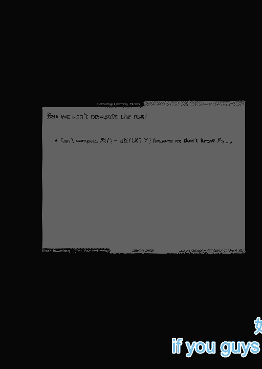
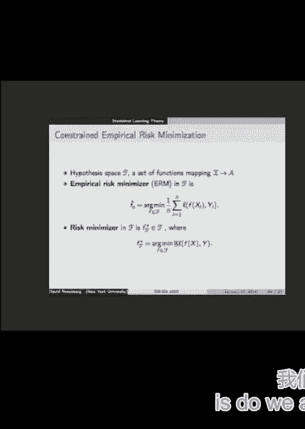

# 1：统计学习理论基础 🧠

在本节课中，我们将学习机器学习的核心理论基础——统计学习理论。我们将从决策理论的基本概念开始，逐步构建出经验风险最小化的框架，并探讨如何在实际中通过优化算法（如梯度下降）来寻找最优的决策函数。

---

## 课程概述与后勤安排 📋

课程网页已发布在GitHub上，请花时间阅读课程大纲和重要日期。本学期我们将使用Piazza进行课程讨论和答疑，这是提问的首选方式。

课程安排如下：
*   **周三课程**：标准讲座，时间为晚上7点10分至9点。
*   **周四时段会议**：额外的必修课程，通常用于扩展周三内容或补充数学主题。

课程评分构成如下：
*   **作业（约8次）**：占总分的40%。
*   **考试（两次）**：占总分的40%。
*   **项目**：占总分的20%，包括最终报告和海报展示。
*   **额外加分**：通过完成可选作业或在课堂/Piazza上积极贡献获得，最多可将最终成绩提高半个等级。

第一份作业将于明天发布，提交需使用NYU课堂系统并以PDF格式完成。合作完成作业是可以的，但需独立撰写解决方案并注明合作者。

---

## 从决策到学习：问题形式化 🎯

在数据科学中，我们通常需要根据输入信息采取行动或做出预测。为了系统地解决这类问题，我们首先需要将其形式化。

### 核心组成部分

一个典型的机器学习场景包含以下四个核心部分：

1.  **输入 (X)**：系统接收到的信息，例如一张图片、一段音频或一组特征。输入空间记为 `𝒳`。
2.  **行动 (A)**：系统根据输入产生的输出，例如一个分类标签、一个数值或一个概率。行动空间记为 `𝒜`。
3.  **结果 (Y)**：世界给出的真实结果或反馈，例如图片中是否有动物的真实情况。结果空间记为 `𝒴`。
4.  **损失函数 (L)**：用于评估行动 `A` 相对于真实结果 `Y` 好坏的函数，记为 `L(A, Y)`。损失越小越好。

这个过程可以描述为：我们观察输入 `X`，通过某个策略（即决策函数）采取行动 `A`，然后世界揭示结果 `Y`，最后我们用 `L(A, Y)` 来评估这次行动。

### 经典问题示例

以下是几个机器学习问题的形式化示例：

*   **线性回归**：
    *   输入空间 `𝒳 = ℝ^d` (d维特征向量)
    *   行动/结果空间 `𝒜 = 𝒴 = ℝ` (预测一个实数值)
    *   损失函数 `L(A, Y) = 1/2 (A - Y)^2` (平方损失)

*   **逻辑回归（用于分类）**：
    *   输入空间 `𝒳 = ℝ^d`
    *   行动空间 `𝒜 = [0, 1]` (预测一个介于0和1之间的数，常解释为概率)
    *   结果空间 `𝒴 = {0, 1}` (真实的类别标签)
    *   损失函数常使用交叉熵损失。

*   **支持向量机 (SVM)**：
    *   输入空间 `𝒳 = ℝ^d`
    *   行动空间 `𝒜 = ℝ` (产生一个得分，正数代表正类)
    *   结果空间 `𝒴 = {0, 1}` 或 `{-1, +1}`
    *   损失函数如合页损失 (Hinge Loss)。

---

## 统计学习理论框架 📊

上一节我们定义了单次预测的评估方式。本节中，我们来看看如何评估和寻找一个整体的、优秀的预测策略（即决策函数）。

### 风险：理想的评估标准

我们假设存在一个未知的数据生成分布 `P(X, Y)`，我们观察到的所有数据都来自这个分布。决策函数 `f` 的质量由其**风险 (Risk)** 或**期望损失 (Expected Loss)** 来衡量：

`R(f) = 𝔼[L(f(X), Y)]`

其中期望 `𝔼` 是对联合分布 `P(X, Y)` 取的。风险 `R(f)` 越小，表示决策函数 `f` 在平均意义上表现得越好。在所有可能的函数中，能达到最小风险的函数 `f*` 称为**贝叶斯决策函数**，它是我们学习的终极目标。

**示例**：
*   **在平方损失下**，贝叶斯决策函数是条件期望：`f*(x) = 𝔼[Y | X=x]`。
*   **在0-1损失（分类错误率）下**，贝叶斯决策函数是选择后验概率最大的类别：`f*(x) = argmax_c P(Y=c | X=x)`。

### 经验风险：现实的替代方案

然而，我们无法直接计算风险，因为我们不知道真实分布 `P(X, Y)`。我们拥有的是一组从该分布中独立同分布采样得到的训练数据 `D_n = {(x1, y1), ..., (xn, yn)}`。

根据大数定律，我们可以用**经验风险 (Empirical Risk)** 来近似真实风险：

`R̂_n(f) = (1/n) Σ_{i=1}^n L(f(x_i), y_i)`

经验风险 `R̂_n(f)` 是风险 `R(f)` 的一个无偏且一致的估计量。当数据量 `n` 足够大时，`R̂_n(f)` 会非常接近 `R(f)`。

---

## 经验风险最小化及其挑战 ⚠️

既然我们可以用经验风险来评估函数，一个直接的想法是：在所有可能的函数中，选择那个在训练数据上表现最好的，即最小化经验风险的函数。这被称为**经验风险最小化 (Empirical Risk Minimization, ERM)**：

`f̂ = argmin_f R̂_n(f)`

### 过拟合问题

然而，不加限制的ERM会导致严重的**过拟合 (Overfitting)**。考虑一个极端例子：假设我们只关心在有限的训练数据点上预测正确。我们可以构造一个函数，它仅在训练数据点上有正确的预测，在其他所有输入上都给出错误预测。这个函数的经验风险为0（完美拟合训练数据），但其真实风险却可能非常高（在实际应用中表现糟糕）。这是因为函数“记住”了训练数据，而没有学到能够泛化到新数据的规律。

### 假设空间：引入归纳偏好

为了解决过拟合，我们需要将搜索范围限制在一个合理的函数集合内，这个集合称为**假设空间 (Hypothesis Space)**，记为 `ℱ`。假设空间体现了我们对问题解的预先假设或偏好，例如“函数应该是平滑的”或“函数是线性的”。

于是，我们转向**受限的经验风险最小化**：

`f̂ = argmin_{f ∈ ℱ} R̂_n(f)`

同时，我们也可以定义在假设空间 `ℱ` 内的最优风险函数：

`f*_ℱ = argmin_{f ∈ ℱ} R(f)`

通过精心设计假设空间 `ℱ`，我们可以在保持模型表达能力的同时，有效控制过拟合的风险。

---

## 优化方法：梯度下降 🚀

上一节我们定义了要优化的目标（经验风险）。本节中，我们来看看如何通过数值优化方法，在实际中找到假设空间中的经验风险最小化器 `f̂`。我们以最常见的线性回归为例。

### 问题设定

在线性回归中，我们的假设空间是线性函数集合：`ℱ = { f(x) = w^T x | w ∈ ℝ^d }`。使用平方损失，经验风险最小化问题转化为：

`min_w R̂_n(w) = min_w (1/(2n)) Σ_{i=1}^n (w^T x_i - y_i)^2`

### 梯度下降法

梯度下降法是一种迭代优化算法。其核心思想是：函数在某一点的梯度方向指向该点函数值增长最快的方向。因此，沿着梯度的反方向移动，函数值就会下降。

**算法步骤**：
1.  初始化参数向量 `w`（例如，随机初始化）。
2.  重复以下步骤直到满足停止条件：
    a. 计算当前 `w` 处目标函数的梯度 `∇R̂_n(w)`。
    b. 更新参数：`w ← w - η * ∇R̂_n(w)`，其中 `η` 是**学习率 (Learning Rate)** 或步长。

对于线性回归，梯度为：`∇R̂_n(w) = (1/n) Σ_{i=1}^n (w^T x_i - y_i) x_i`

### 随机梯度下降法

标准的梯度下降（又称批量梯度下降）在每一步都需要计算整个训练集上损失的平均梯度，这在数据集很大时计算代价高昂。

**随机梯度下降 (Stochastic Gradient Descent, SGD)** 对此进行了改进：在每一步，我们**随机均匀抽取一个样本** `(x_i, y_i)`，并用该样本的损失梯度来估计整体梯度，然后进行更新：

`w ← w - η * ∇L(w^T x_i, y_i) = w - η * (w^T x_i - y_i) x_i`

**小批量梯度下降**是介于两者之间的方法，每次随机抽取一小批（如32个）样本计算平均梯度进行更新。SGD和小批量梯度下降虽然每一步的方向有噪声，但计算效率极高，且在大数据场景下通常能更快地收敛到较好的解。

**学习率设置**：学习率 `η` 的选择至关重要。太小会导致收敛慢，太大会导致震荡甚至发散。实践中，可以采用学习率衰减策略（如随时间 `t` 减小：`η_t = η0 / (1 + γ*t)`），或使用更高级的优化器（如Adam）。

---

## 总结 📝

本节课我们一起学习了统计学习理论的基础框架：

1.  **问题形式化**：我们将机器学习问题分解为输入 `X`、行动 `A`、结果 `Y` 和损失函数 `L` 四个部分。决策函数 `f: 𝒳 → 𝒜` 是我们的学习目标。
2.  **评估标准**：我们引入了**风险** `R(f)` 作为衡量决策函数好坏的理想标准，但由于分布未知，我们使用**经验风险** `R̂_n(f)` 来近似它。
3.  **学习范式**：直接最小化经验风险会导致**过拟合**。因此，我们通过限制搜索范围到一个合理的**假设空间** `ℱ` 来进行**受限的经验风险最小化**。
4.  **优化实现**：为了求解这个最小化问题，我们介绍了**梯度下降法**及其在大数据下的高效变体——**随机梯度下降法**和**小批量梯度下降法**。

这个框架为理解后续各种具体的机器学习模型（如线性模型、支持向量机、神经网络）奠定了坚实的理论基础。在接下来的课程中，我们将深入探索不同的假设空间和优化技巧。