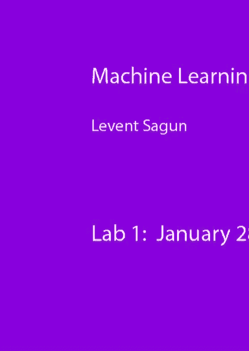
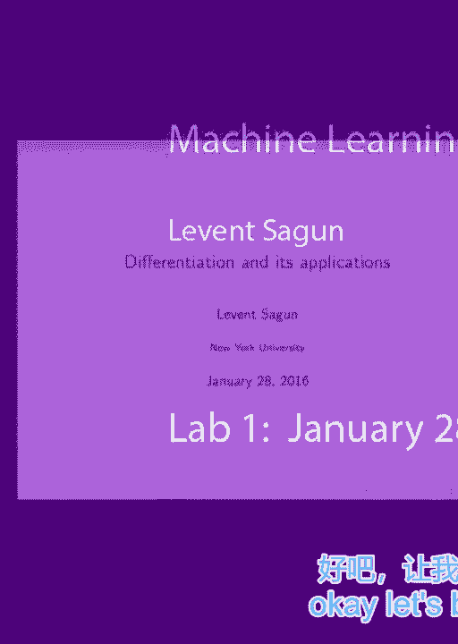
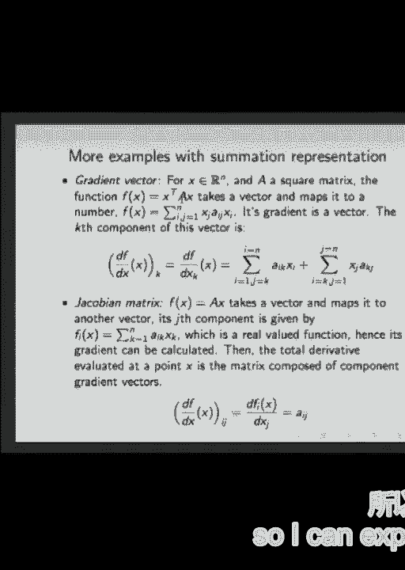
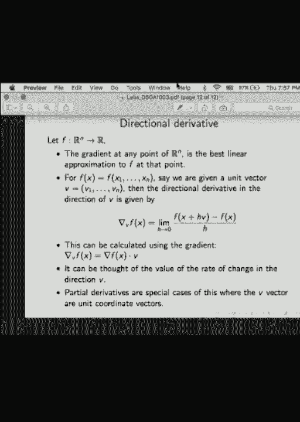

# 2：2. 梯度下降与矩阵微分基础 🧮

在本节课中，我们将学习梯度下降的基本思想，以及如何对涉及矩阵和向量的函数进行微分。我们会从一个简单的例子开始，逐步理解梯度、导数以及如何利用它们来寻找函数的最小值。

---

## 概述：从实际问题到梯度下降

在深入研究函数的导数和求导之前，让我们从一个实际生活中的例子开始。在一个典型的问题中，你有一个观察到的输入，你设计一个过程来接受这个输入并将其转化为某种输出。同时，你拥有真实的标签。你会将你的输出与真实标签进行比较。如果你的输出与真实观察值偏差很大，你就想施加一些惩罚。这个惩罚取决于你如何构建你的成本函数。它可能是线性的、二次的，或者是0-1损失函数。

一个简单而有趣的例子是，我们有一个矩阵 **A** 和观测值 **b**。我们定义损失函数 **L(x)** 为输出 **Ax** 与目标 **b** 之间差值的平方范数的一半。我们的目标是最小化这个损失函数。

**公式：** `L(x) = 1/2 * ||Ax - b||²`

当然，有各种专门的方法（如线性代数方法）来解决这个最小化问题。但为了今天的主题——微分，我们将探讨基于梯度的方法。如果我们尝试使用某种基于梯度的方法，会发生什么？这个函数 **L(x)** 定义了一个巨大的空间，在这个空间的每一点，**L(x)** 都指定了一个值，描述了一个像多山地表一样的曲面。你的初始点在这个表面上，你计算梯度，梯度指向最陡峭的上升方向。取其负值，就指向最陡峭的下降方向。然后你沿着这个方向走几步。这个过程会把你带向函数值更低的地方。

所以，最终目标是找到 **L(x)** 的一个低值。我们称这个过程为优化，特别是最小化。

---

## 理解更新规则

你可以看到更新规则，它看起来像一个有点滑稽的箭头（例如：`x ← x - η ∇L(x)`）。对数学家来说，一开始这可能看起来很奇怪：这不是一个等式。如果两边都有 **x**，我把它们抵消掉会发生什么？这个符号是什么意思？

记住风景和运动粒子的类比。更新规则实际上是描述你移动步骤的方式。每次，左手边是你当前的位置，右手边是你的下一个位置。你只是按照给定的规则，用下一个位置替换当前位置。

让我们专注于理解所有这些符号的含义。现在看起来可能微不足道，但最终它会变得非常有用。

**更新规则示例：** `x ← x - η ∇L(x)`

*   **x**：我们将观测值表示为向量，它是一排数字。
*   **←**：箭头表示替换过程，用右手边更新左手边。
*   **-**：负号。注意，你不能直接从向量中减去一个标量。这里的操作是向量减法，所以我们需要确保操作两侧的对象都是向量。这是一个常见的错误。
*   **η**：这是一个标量，称为学习率，它告诉你步长有多大。如果太大，就像徒步旅行者迈出巨大的步伐，可能会越过山谷，导致发散。如果太小，则需要很多微小的步骤，收敛会很慢。
*   **∇L(x)**：这是梯度。**L(x)** 是一个将向量映射为实数的函数（标量函数）。它的梯度 **∇L(x)** 是一个向量，由 **L** 对 **x** 每个分量的偏导数组成。

因此，`η ∇L(x)` 是标量与向量的乘法。最后，`x - η ∇L(x)` 是从一个向量中减去另一个向量，这是有效的操作。

---

## 计算一个具体例子的梯度

现在假设我们在二维空间工作，**A** 是一个 2x2 矩阵，**b** 是一个二维向量。我们有损失函数的具体形式：

**公式：** `L(x) = 1/2 * ||Ax - b||²`

目标是找到这个函数的导数（梯度）。我们有两个分量 **x₁** 和 **x₂**。梯度 **∇L(x)** 的第一个分量是 **∂L/∂x₁**，第二个分量是 **∂L/∂x₂**。

首先，我们按分量写出 **Ax - b**：
*   第一行：`a₁₁ x₁ + a₁₂ x₂ - b₁`
*   第二行：`a₂₁ x₁ + a₂₂ x₂ - b₂`

向量 **v = Ax - b** 的平方范数是其分量的平方和：`||v||² = v₁² + v₂²`。

所以，`L(x) = 1/2 * [ (a₁₁ x₁ + a₁₂ x₂ - b₁)² + (a₂₁ x₁ + a₂₂ x₂ - b₂)² ]`

现在我们对 **x₁** 求偏导，使用链式法则：

**公式：**
`∂L/∂x₁ = (a₁₁ x₁ + a₁₂ x₂ - b₁) * a₁₁ + (a₂₁ x₁ + a₂₂ x₂ - b₂) * a₂₁`

类似地，对 **x₂** 求偏导：

**公式：**
`∂L/∂x₂ = (a₁₁ x₁ + a₁₂ x₂ - b₁) * a₁₂ + (a₂₁ x₁ + a₂₂ x₂ - b₂) * a₂₂`

---

## 寻求更简洁的矩阵表示法

如果你想把上面的表达式写下来并用 Python 编码，除非有一个很好的矩阵形式，否则会相当冗长。你不想为每个分量都写出完整的表达式。你想要一个简洁的账户来书写东西。

以下是两个有用的例子：

**1. 二次型：**
考虑函数 `f(x) = xᵀ A x`，其中 **A** 是对称矩阵。这是一个标量函数。它的梯度是 `∇f(x) = (A + Aᵀ)x`。当 **A** 对称时，简化为 `2Ax`。

**推导思路：** 可以将 `xᵀ A x` 写为求和形式 `Σᵢ Σⱼ Aᵢⱼ xᵢ xⱼ`。求导时，利用乘积法则，将一项视为常数对另一项求导。

**2. 向量值函数的雅可比矩阵：**
如果函数 **f: ℝⁿ → ℝᵐ** 输出一个向量，那么它的导数是一个矩阵，称为雅可比矩阵。雅可比矩阵的第 **i** 行是第 **i** 个输出分量函数的梯度（作为行向量）。

最简单的例子是矩阵乘法：`f(x) = A x`。它的雅可比矩阵就是矩阵 **A** 本身。

**公式：** 如果 `f(x) = A x`，则 `J_f(x) = A`。

---

## 梯度下降与临界点

让我们回到梯度下降。徒步旅行者的目标是沿着最陡峭的下降方向前进。那么，什么时候停止呢？

教授的笔记中提到了四个停止标准，但它们都指向同一个概念：临界点。当梯度向量的范数（大小）为零或非常接近零时，你就到达了一个临界点。在这一点上，没有下降方向，所以你停下来。

临界点可以是：
*   **局部最小值**：你处在山谷底部。
*   **局部最大值**：你处在山顶。
*   **鞍点**：在一个方向上是山谷，在另一个方向上是山脊，例如函数 `f(x, y) = x² - y²` 在 (0,0) 的点。

为了分类一个临界点，我们需要看二阶导数（对于多变量函数，是海森矩阵）。海森矩阵是一个对称矩阵。

**海森矩阵与特征值：**
*   如果海森矩阵的所有特征值都为正，则该点是**局部最小值**。
*   如果所有特征值都为负，则是**局部最大值**。
*   如果特征值有正有负，则是**鞍点**。
*   如果有些特征值为零，则情况可能是退化的（例如，平坦的区域）。

---

## 总结与注意事项

本节课中，我们一起学习了：
1.  **梯度下降的基本原理**：通过沿着负梯度方向更新参数来最小化函数。
2.  **理解更新规则**：仔细识别公式中的每个符号（向量、标量、操作符）至关重要，避免常见错误。
3.  **计算梯度**：对于像 `L(x) = 1/2 * ||Ax - b||²` 这样的函数，我们展示了如何通过分量求导来计算梯度。
4.  **矩阵微分**：介绍了二次型 `xᵀ A x` 的梯度和向量值函数 `Ax` 的雅可比矩阵，这些提供了更简洁的表示。
5.  **临界点**：梯度为零的点。通过分析海森矩阵的特征值，可以判断它是局部最小值、最大值还是鞍点。

**重要提醒：** 梯度下降定理（保证收敛到最小值）通常要求函数是凸的。对于非凸函数，你可能会收敛到局部最小值或鞍点。理解定理成立的条件并思考如何构造反例打破这些条件，是深入理解的关键。

请通过练习来巩固这些概念，特别是注意在求和与求导过程中正确处理索引，这是常见的错误来源。