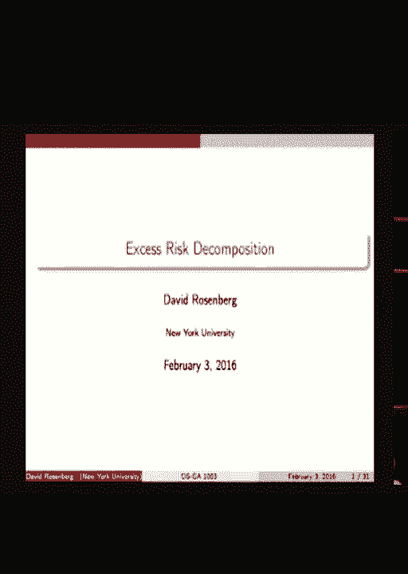
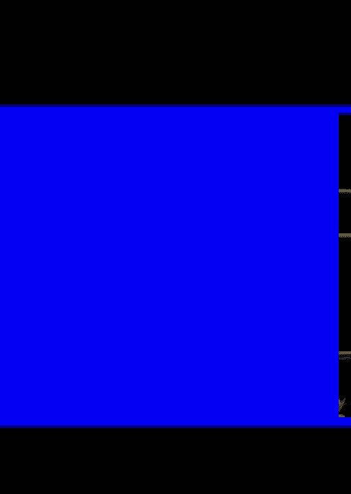
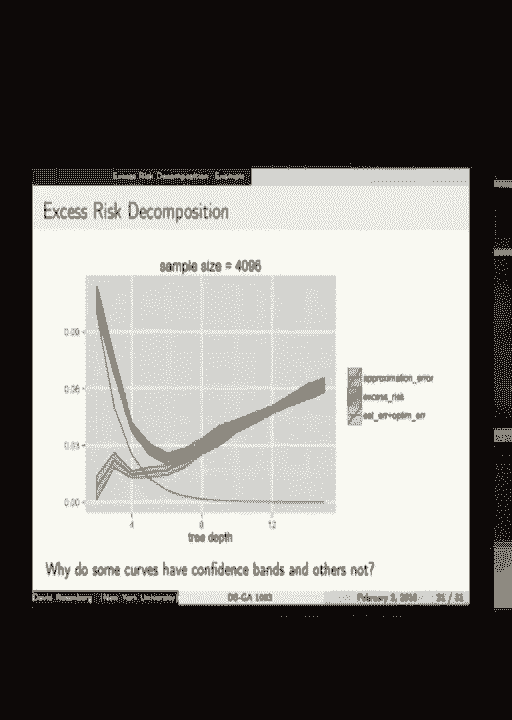
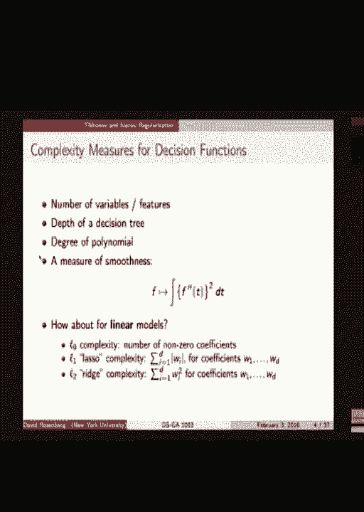
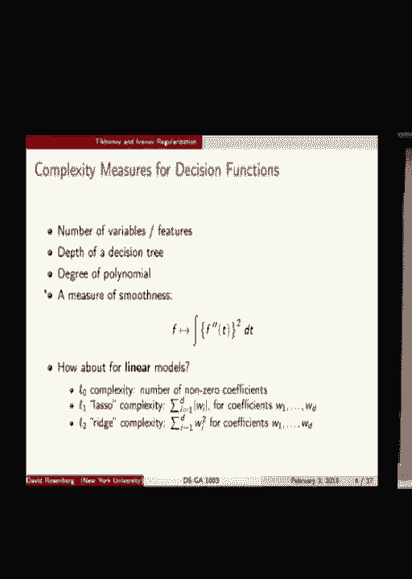
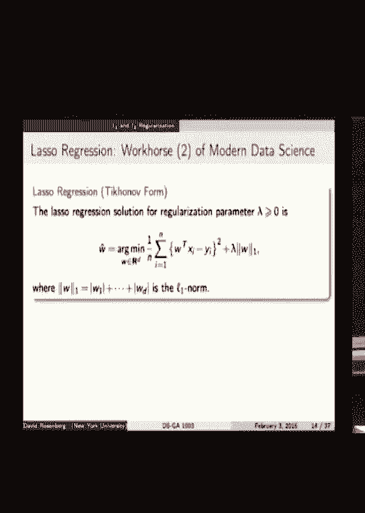
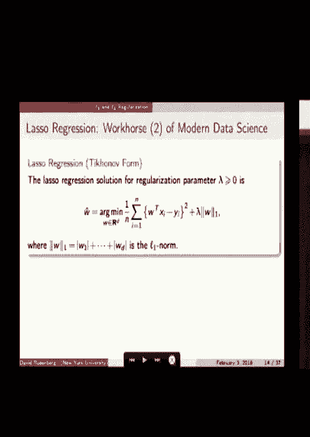

# 3：风险分解与正则化 🧠

在本节课中，我们将学习机器学习中的核心概念：风险分解、假设空间以及两种重要的正则化方法——L1（Lasso）和L2（Ridge）回归。我们将从理论框架出发，理解模型性能的构成，并探讨如何通过正则化技术来平衡模型的复杂度和泛化能力。

***

## 课程后勤与复习

上一节我们介绍了统计学习理论的基础。现在，我们先处理一些课程后勤事项。

以下是关于课程讨论平台Piazza的说明：
*   所有注册课程的同学都应加入Piazza。
*   讨论区已经非常活跃，已有大约50条帖子。
*   请在提问前先阅读已有问题，避免重复提问。
*   鼓励同学们互相帮助回答问题。

通过帮助他人参与讨论，可以减轻讲师的工作负担。同时，阅读他人的问题也能带来很多收获。

***

## 今日课程概述

今天我们将深入探讨以下内容：
1.  **风险分解**：理解模型总误差的来源。
2.  **假设空间**：学习如何通过限制假设空间来控制模型复杂度。
3.  **正则化算法**：具体学习L1（Lasso）和L2（Ridge）正则化在回归问题中的应用。
4.  **优化方法**：简要讨论如何优化带有正则化项的目标函数。

明天我们将继续探讨Lasso和Ridge回归的一些有趣特性，并开始讨论分类损失函数。预告一下，下周的课程在数学上可能最具挑战性，内容密集，建议提前预习已上传的往年资料。

***

## 风险分解：理解模型误差的来源

首先，我们快速复习一下上节课的统计学习理论核心概念：
*   **输入/输出空间**：决策函数 `f` 接收输入 `x` 并产生输出（或动作）`a`。
*   **损失函数** `L`：根据预测动作 `a` 和真实输出 `y` 给出一个损失值，值越小越好。
*   **风险** `R(f)`：决策函数 `f` 的期望损失，这是评估函数的黄金标准，计算公式为 `R(f) = E[L(f(x), y)]`。
*   **贝叶斯最优决策函数** `f*`：在所有可能函数中最小化风险的函数，其对应的风险称为**贝叶斯风险**。
*   **经验风险** `R_emp(f)`：由于我们不知道真实的数据分布，只能用数据集 `D` 上的平均损失来近似风险，即 `R_emp(f) = (1/n) * Σ L(f(x_i), y_i)`。
*   **假设空间** `F`：为了避免过拟合，我们不优化所有函数，而是将搜索范围限制在一个预先定义的函数集合内，例如线性函数、多项式或决策树。

### 风险分解的可视化

我们可以通过一个图来理解不同函数之间的关系：
1.  **所有可能函数**：构成一个大的空间。
2.  **贝叶斯最优函数** `f*`：位于这个空间中的某处，具有最小的可能风险 `R(f*)`。
3.  **假设空间** `F`：是我们选择的一个函数子集。
4.  **假设空间内最优函数** `f_F`：在子集 `F` 中风险最小的函数，其风险 `R(f_F) >= R(f*)`。
5.  **经验风险最小化器** `f_hat`：基于有限数据集，在 `F` 中最小化经验风险 `R_emp` 得到的函数。

### 误差分解

基于以上定义，我们可以分解**经验风险最小化器** `f_hat` 的**过剩风险**（即其风险与贝叶斯风险的差距）：
`R(f_hat) - R(f*) = [R(f_hat) - R(f_F)] + [R(f_F) - R(f*)]`

这个分解包含两部分：
1.  **估计误差**：`R(f_hat) - R(f_F)`。这是由于我们只有有限数据样本，无法精确找到 `f_F` 而产生的误差。**估计误差是随机的**，因为它依赖于抽样的数据集。假设空间 `F` 越大，估计误差通常越大（更容易过拟合）。
2.  **近似误差**：`R(f_F) - R(f*)`。这是由于我们将搜索范围限制在 `F` 内，而最优函数 `f*` 可能不在 `F` 中而产生的误差。**近似误差是非随机的**，是假设空间 `F` 本身的性质。假设空间 `F` 越大，近似误差通常越小。

**数据科学家的核心工作**就是在近似误差和估计误差之间进行权衡，通过选择合适的假设空间 `F` 来最小化总过剩风险。

### 优化误差

在实际中，我们可能无法精确计算出经验风险最小化器 `f_hat`，只能通过优化算法（如梯度下降）得到一个近似解 `f_tilde`。这引入了第三类误差：
*   **优化误差**：`R(f_tilde) - R(f_hat)`。这是我们使用的算法无法找到精确的 `f_hat` 而产生的误差。

因此，完整的过剩风险分解为：
`R(f_tilde) - R(f*) = [R(f_tilde) - R(f_hat)] + [R(f_hat) - R(f_F)] + [R(f_F) - R(f*)]`
即：**优化误差 + 估计误差 + 近似误差**。

***

## 示例：决策树的风险分解

为了使概念更具体，我们来看一个分类问题的玩具示例。

**问题设置**：
*   输入空间：单位正方形 `[0,1] x [0,1]`。
*   输入分布：正方形上的均匀分布。
*   输出（类别）：蓝色或橙色。对于点 `(x1, x2)`，若 `x1 > x2`，其为橙色的概率是0.9；若 `x1 <= x2`，其为橙色的概率是0.1。
*   **贝叶斯风险**：即使使用最优决策函数（预测对角线以下为橙色，以上为蓝色），错误率也有10%。

**假设空间**：我们使用**二叉决策树**。树通过一系列基于坐标的阈值问题（如“x1 <= t1?”）将输入空间划分为矩形区域，并在每个区域（叶节点）预测一个类别。
我们考虑嵌套的假设空间序列：`F_d` 表示所有深度不超过 `d` 的决策树集合。

**实验结果**：
*   **近似误差**：随着树深度 `d` 增加（假设空间变大），类中最优树 `f_F` 的风险下降，逐渐接近贝叶斯风险（10%）。这说明近似误差在减小。
*   **估计误差+优化误差**：随着树深度 `d` 增加，从数据中学习得到的树 `f_tilde` 的风险先下降后上升，呈现经典的U形曲线。
    *   当树太浅（`d`小）时，模型能力不足，风险高（欠拟合）。
    *   当树太深（`d`大）时，模型过于复杂，对训练数据过拟合，导致在新数据上风险上升。
    *   最优的树深度需要在两者之间取得平衡。

这个例子清晰地展示了通过调整假设空间大小（树的深度），如何在近似误差和估计误差之间进行权衡。

***

## 正则化：控制假设空间的实用方法

上一节我们介绍了通过选择不同大小的假设空间来权衡误差。在实践中，一种非常有效且常用的方法是**正则化**。

### 伊万诺夫正则化与吉洪诺夫正则化

核心思想是为假设空间中的函数 `f` 定义一个**复杂度度量** `Ω(f)`（例如，线性模型中系数的L2范数、决策树的深度）。通过控制复杂度，我们可以定义一系列嵌套的假设空间。

有两种等价的实现形式：
1.  **伊万诺夫正则化（硬约束）**：在假设空间 `F` 中，附加一个复杂度约束。
    `f_hat = argmin_{f in F} R_emp(f)， subject to Ω(f) <= R`
    这里 `R` 是复杂度上限，直接定义了假设空间 `F_R = {f in F: Ω(f) <= R}`。

2.  **吉洪诺夫正则化（软惩罚）**：将复杂度作为惩罚项加入经验风险。
    `f_hat = argmin_{f in F} [ R_emp(f) + λ * Ω(f) ]`
    这里 `λ >= 0` 是正则化系数。`λ` 越大，对复杂度的惩罚越重，得到的函数越简单。

对于许多常见设置（如接下来要讲的回归问题），这两种形式是等价的，即对于每个 `R`，都存在一个 `λ` 使得两者解相同，反之亦然。

***

## L2正则化：岭回归

现在我们将正则化思想应用到线性回归中。假设我们的函数空间是线性函数 `f(x) = w^T x`。

**普通最小二乘法（OLS）** 最小化经验风险（平方损失）：
`min_w (1/n) Σ (y_i - w^T x_i)^2`
当特征很多或特征间存在多重共线性时，OLS容易过拟合，系数 `w` 可能变得很大且不稳定。

**岭回归（Ridge Regression）** 通过吉洪诺夫正则化（L2惩罚）来解决这个问题：
`min_w [ (1/n) Σ (y_i - w^T x_i)^2 + λ * ||w||_2^2 ]`
其中 `||w||_2^2 = Σ w_j^2` 是系数向量的L2范数平方。

**效果**：
*   惩罚项 `λ * ||w||_2^2` 会倾向于让系数 `w` 整体变小，但通常不会恰好为0。
*   随着 `λ` 从无穷大变化到0，解路径上所有系数平滑地从0变化到OLS解。
*   对应的伊万诺夫形式是：`min_w (1/n) Σ (y_i - w^T x_i)^2， subject to ||w||_2^2 <= R`。

***

## L1正则化：Lasso回归

Lasso回归采用L1范数作为复杂度惩罚：
`min_w [ (1/n) Σ (y_i - w^T x_i)^2 + λ * ||w||_1 ]`
其中 `||w||_1 = Σ |w_j|` 是系数向量的L1范数。

**关键特性——稀疏性**：
与岭回归不同，Lasso的正则化路径显示，随着 `λ` 从大到小变化，许多系数会**保持为0**，直到某个阈值后才变为非零。这意味着Lasso可以自动进行**特征选择**，最终模型可能只依赖于一部分特征。

**为什么需要稀疏性？**
1.  **可解释性**：模型只使用少数特征，更容易理解和解释。
2.  **特征成本**：收集或计算特征可能有成本，稀疏模型可以节省开支。
3.  **计算与存储效率**：预测时只需要计算少数特征，速度快，存储开销小。
4.  **预处理**：可作为特征选择步骤，筛选出的特征再用于更复杂的模型。

***

## 几何视角：为什么Lasso导致稀疏解？

我们可以从几何角度直观理解Lasso和Ridge的区别。考虑一个只有两个参数 `w1, w2` 的简单情况。

*   **L2约束（岭回归）**：约束条件 `w1^2 + w2^2 <= R` 在平面上是一个**圆盘**。最小化经验风险等价于寻找一个椭圆（等经验风险线）与这个圆盘的切点。这个切点通常不在坐标轴上，所以两个系数一般都不为零。
*   **L1约束（Lasso）**：约束条件 `|w1| + |w2| <= R` 在平面上是一个**菱形**。椭圆与菱形的切点有很高的概率出现在菱形的**角点**上，而角点恰好对应某一个坐标为0（例如 `(R, 0)` 或 `(0, R)`），这就产生了稀疏解。

这种“碰角”现象使得Lasso倾向于产生稀疏模型，而Ridge则倾向于产生稠密但系数较小的模型。

***

## 总结

本节课我们一起学习了机器学习模型评估与改进的核心框架：
1.  **风险分解**：将模型的过剩风险分解为**近似误差**、**估计误差**和**优化误差**，理解了模型性能的各个来源。
2.  **假设空间**：通过限制假设空间可以控制模型复杂度，但需要在近似误差（空间太小）和估计误差（空间太大导致过拟合）之间权衡。
3.  **正则化**：介绍了通过复杂度度量来控制假设空间大小的两种实用方法——伊万诺夫（硬约束）和吉洪诺夫（软惩罚）正则化。
4.  **L2与L1正则化**：深入探讨了**岭回归（L2）** 和**Lasso回归（L1）**。岭回归通过收缩系数来稳定模型，而Lasso回归则能产生稀疏解，自动进行特征选择。
5.  **几何解释**：从优化几何的角度理解了Lasso产生稀疏解的原因。

理解这些概念是构建有效、可解释且泛化能力强的机器学习模型的基础。下一节课我们将继续探讨这些正则化方法的更多性质。