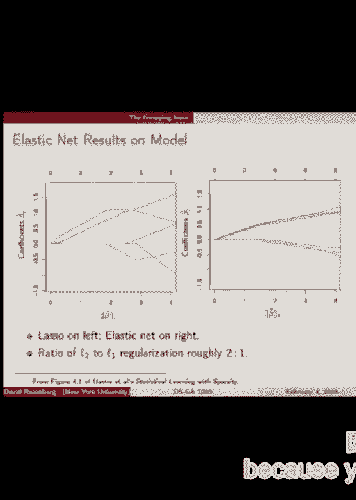

# 4：Lasso 优化与正则化对比 🧠

在本节课中，我们将学习如何优化 Lasso 回归模型，并深入比较 Lasso 与 Ridge 正则化的不同特性。我们将探讨处理 L1 正则化不可微问题的技巧，并分析当特征高度相关时，不同正则化方法如何影响模型权重。

---

## 1. Lasso 优化问题回顾

上一节我们介绍了 Lasso 回归的目标函数。本节中我们来看看如何优化这个包含不可微 L1 范数的目标函数。

Lasso 的目标函数是平均平方损失加上 L1 正则化项，其形式为：
`目标函数 = 平均平方损失 + λ * ||W||₁`
其中 `||W||₁` 是系数向量 `W` 的 L1 范数（绝对值之和）。

直接应用梯度下降会遇到问题，因为 L1 范数在零点不可微分。

---

## 2. 处理不可微性的技巧：正负部分分解

为了解决 L1 范数不可微的问题，我们引入一个常用技巧：将任意实数分解为其正部分和负部分。

对于任意实数 `A`，我们定义：
*   **正部分** `A⁺`：如果 `A > 0`，则 `A⁺ = A`；否则 `A⁺ = 0`。
*   **负部分** `A⁻`：如果 `A < 0`，则 `A⁻ = |A|`；否则 `A⁻ = 0`。

基于此，我们可以得到两个有用的等式：
1.  `A = A⁺ - A⁻`
2.  `|A| = A⁺ + A⁻`

现在，我们将这个技巧应用于系数向量 `W`。我们把 `W` 的每个分量 `W_j` 分解为 `W_j⁺` 和 `W_j⁻`，从而将 `W` 表示为两个新向量的差：`W = W⁺ - W⁻`。同时，L1 范数可以重写为：`||W||₁ = sum(W⁺) + sum(W⁻)`。

通过这种分解，我们成功地将不可微的绝对值函数转换成了可微的形式，但代价是变量数量翻倍（从 `D` 个变为 `2D` 个），并且需要对 `W⁺` 和 `W⁻` 施加非负约束。

---

## 3. 投影随机梯度下降法

上一节我们通过变量分解得到了一个可微但带有约束的目标函数。本节中我们来看看如何使用投影随机梯度下降法来求解。

投影随机梯度下降法在标准随机梯度下降的基础上增加了一个“投影”步骤。其流程如下：

以下是投影随机梯度下降的基本步骤：
1.  计算当前点关于目标函数的（随机）梯度。
2.  沿着梯度反方向移动一个步长（随机梯度下降步）。
3.  检查新得到的点是否违反了约束（即 `W⁺` 或 `W⁻` 的分量是否变为负值）。
4.  如果违反约束，则将负值分量“投影”回零（即截断为0），使其重新满足非负约束。

这种方法直观且易于实现，特别适合处理此类简单的非负约束。

---

## 4. 坐标下降法

除了基于梯度的方法，坐标下降法是另一种常用于优化Lasso的有效方法。它的核心思想是每次只优化一个变量，而固定其他所有变量。

在坐标下降法中，我们循环遍历每一个系数 `W_j`。在第 `j` 步，我们求解以下子问题：
`W_j_new = argmin_{W_j} [目标函数(W_1, ..., W_j, ..., W_D)]`
其中，除了 `W_j`，其他所有系数 `W_k (k ≠ j)` 都保持固定。

令人惊讶的是，对于Lasso问题，这个一维子问题存在闭式解。具体形式如下：
`W_j_new = S(C_j / (Σ X_ij²), λ / (Σ X_ij²))`
其中 `S` 是软阈值函数，`C_j` 是一个与第 `j` 个特征和当前残差相关的统计量。

坐标下降法在每次迭代中更新一个系数，效率很高，尤其适用于高维问题。

---

## 5. Lasso与Ridge正则化的深入对比

理解了优化方法后，我们回到模型本身，深入比较Lasso和Ridge正则化的本质区别。

考虑一个简单的思想实验：假设我们只有一个特征 `X1`，用线性回归拟合得到最佳模型 `Y = 4 * X1`。现在引入一个与 `X1` 完全相同的冗余特征 `X2`（即 `X2 = X1`）。

在这种情况下，许多不同的系数组合都能得到相同的预测结果（例如 `[4, 0]`, `[2, 2]`, `[1, 3]`），因为只要 `W1 + W2 = 4`，预测函数就相同。

以下是不同系数组合及其对应的正则化惩罚：
*   系数 `[4, 0]`: L1范数 = 4， L2范数 = 16
*   系数 `[2, 2]`: L1范数 = 4， L2范数 = 8
*   系数 `[1, 3]`: L1范数 = 4， L2范数 = 10

**核心结论**：
*   **Lasso (L1)**：对于一组信息完全相同的特征，Lasso正则化不关心权重如何在它们之间分配，只要系数的绝对值和相同即可。它可能随机地将权重赋给其中一个或几个，甚至将某些系数压缩至零，从而产生稀疏解。
*   **Ridge (L2)**：L2正则化倾向于在高度相关的特征之间**均匀分配**权重（如 `[2, 2]`），因为这样可以最小化系数的平方和。

在实际应用中，特征往往高度相关而非完全相等。Lasso可能只从一组相关特征中挑选一个代表，而Ridge则会使用整组特征并赋予相近的权重。如果目标是预测的稳健性（通过对多个噪声版本取平均来降低方差），Ridge或类似方法通常更优。

---

## 6. 弹性网：结合L1与L2的优点

上一节我们看到L1和L2各有特点。本节中我们来看看如何结合二者之长。

弹性网正则化通过在目标函数中同时加入L1和L2惩罚项来结合两者的优点：
`目标函数 = 平均平方损失 + λ₁ * ||W||₁ + λ₂ * ||W||₂²`

这种方法旨在：
1.  保留L1正则化产生稀疏解的能力，有助于特征选择。
2.  引入L2正则化促使高度相关特征的权重趋于相等，提高模型的稳定性和预测能力。

实验表明，在面对一组相关特征时，弹性网能够使它们的系数值保持接近，同时仍能将无关特征的系数压缩至零，从而获得更稳健的预测模型。

---

## 总结

本节课中我们一起学习了以下核心内容：
1.  **Lasso优化**：通过**正负部分分解**将不可微的L1范数转化为带约束的可微问题，并可用**投影随机梯度下降**求解。**坐标下降法**因其子问题有闭式解，也是求解Lasso的高效方法。
2.  **正则化对比**：通过思想实验，我们深入理解了**Lasso (L1)** 和 **Ridge (L2)** 正则化的根本区别。L1对相关特征的权重分配不敏感，可能导致稀疏但可能不稳定的解；L2则倾向于在相关特征间均匀分配权重，提升稳健性。
3.  **弹性网**：结合L1和L2惩罚的**弹性网**正则化，能够同时进行特征选择和提升模型在相关特征组上的稳定性，是一种实用的折中方案。

理解这些优化方法和正则化特性的差异，将帮助我们在实际建模中根据数据特点和业务目标（如追求可解释性、稀疏性或预测稳健性）选择最合适的模型。