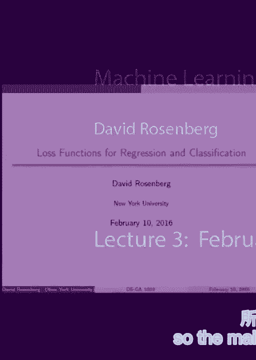
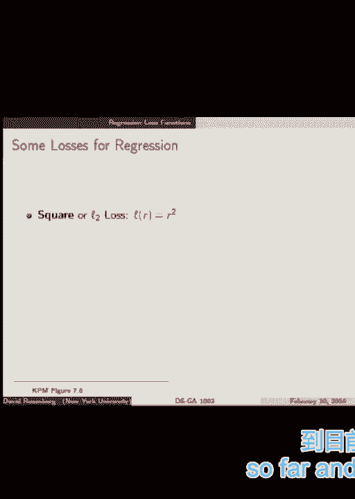

# 5：支持向量机与凸优化入门 🧠






在本节课中，我们将要学习支持向量机（SVM）的核心思想。我们将从损失函数开始，讨论分类与回归中不同的损失选择及其特性。接着，我们会进入一个关于凸优化和拉格朗日对偶性的独立单元，这些工具对于理解SVM至关重要。最后，我们将把这些理论应用到SVM上，推导其原始形式和对偶形式，并解释支持向量等关键概念。

---

## 1. 损失函数探讨 📉

在机器学习中，损失函数用于衡量模型预测值与真实值之间的差异。我们首先讨论回归问题中的损失函数。

### 1.1 回归损失函数

在回归中，我们预测实数值。损失函数通常依赖于**残差**，即真实值 `y` 与预测值 `ŷ` 之间的差异：`r = y - ŷ`。

大多数回归损失函数可以表示为残差的函数。然而，在某些场景下，比例的误差（如预测值是真实值的两倍）可能比绝对差值更重要。这时，通常可以对目标变量进行变换（如对数变换），使损失函数再次依赖于差值。

以下是几种常见的回归损失函数：

*   **平方损失（L2损失）**：`L(ŷ, y) = (y - ŷ)²`。这是最常用的损失，但对异常值不鲁棒，因为它会放大大的误差。
*   **绝对损失（L1损失）**：`L(ŷ, y) = |y - ŷ|`。比平方损失更鲁棒，因为它对异常值的惩罚增长是线性的而非二次的。但它不可微。
*   **Huber损失**：在残差较小时使用二次惩罚，在残差较大时使用线性惩罚。它是平滑且可微的，是鲁棒性与可优化性的一个折衷。

在实践中，平方损失和绝对损失最为常用。

### 1.2 分类损失函数

在二分类问题中，我们通常将类别标记为 `-1` 和 `+1`。我们允许模型预测一个实数值 `f(x)`，称为**分数**。预测类别由分数的符号决定。

一个关键概念是**间隔**：`margin = y * f(x)`。
*   正间隔表示预测正确，且值越大表示置信度越高。
*   负间隔表示预测错误，且值越小（负得越多）表示错误越严重。

大多数分类损失可以用间隔来表示。以下是几种重要的分类损失函数：

*   **0-1损失**：`L(f(x), y) = 0` 如果 `y*f(x) > 0`，否则为 `1`。它直接衡量分类错误，但非凸、不可微，优化是NP难问题。
*   **铰链损失（Hinge Loss / SVM损失）**：`L(f(x), y) = max(0, 1 - y*f(x))`。它是0-1损失的一个凸上界，在间隔大于1时惩罚为0。它是支持向量机使用的损失。
*   **逻辑损失（Logistic Loss）**：`L(f(x), y) = log(1 + exp(-y*f(x)))`。它处处可微，并且其分数可以解释为概率。它是逻辑回归使用的损失。
*   **平方损失（用于分类）**：`L(f(x), y) = (1 - y*f(x))²`。它对于分类任务通常不鲁棒，因为即使间隔很大（预测很自信且正确），它也会施加惩罚，并且对标签噪声敏感。

对于分类，铰链损失和逻辑损失是主要的选择。

---

上一节我们介绍了用于分类和回归的各种损失函数。本节中，我们将深入探讨优化这些损失函数所需的数学工具——凸优化。

## 2. 凸优化与拉格朗日对偶性 ⚙️

许多机器学习问题可以归结为最小化一个目标函数（如经验风险）。凸优化为我们提供了解决一大类问题的高效且理论保证良好的框架。

### 2.1 凸集与凸函数

*   **凸集**：集合中任意两点之间的线段仍然包含在该集合内。
*   **凸函数**：定义在凸集上的函数，其图像上任意两点之间的线段位于图像上方（或重合）。数学定义为：对于任意 `θ ∈ [0,1]`，有 `f(θx + (1-θ)y) ≤ θf(x) + (1-θ)f(y)`。

凸函数的关键性质是：任何局部最小值都是全局最小值。这确保了像梯度下降这样的算法不会陷入非全局最优的局部最小点。

### 2.2 一般优化问题形式

一个一般的约束优化问题可以写成：
```
最小化 f₀(x)
满足约束 fᵢ(x) ≤ 0, i = 1, ..., m
         hᵢ(x) = 0, i = 1, ..., p
```
其中 `x` 是优化变量，`f₀` 是目标函数，`fᵢ` 是不等式约束，`hᵢ` 是等式约束。满足所有约束的 `x` 的集合称为**可行集**。

### 2.3 拉格朗日函数与对偶性

为了处理约束，我们引入**拉格朗日函数**：
```
L(x, λ, ν) = f₀(x) + Σᵢ λᵢ fᵢ(x) + Σᵢ νᵢ hᵢ(x)
```
其中 `λᵢ ≥ 0` 和 `νᵢ` 称为**拉格朗日乘子**（或对偶变量）。

**原始问题**的最优值 `p*` 可以重新表述为：
```
p* = infₓ [ sup_{λ≥0, ν} L(x, λ, ν) ]
```

**拉格朗日对偶函数**定义为拉格朗日函数关于原始变量的下确界：
```
g(λ, ν) = infₓ L(x, λ, ν)
```

**对偶问题**则是最大化这个对偶函数：
```
d* = sup_{λ≥0, ν} g(λ, ν)
```

根据**弱对偶性**，恒有 `d* ≤ p*`。对偶问题总是凹的（最大化问题），可能比原始问题更容易求解。

### 2.4 强对偶性与互补松弛性

对于**凸优化问题**（即 `f₀` 和 `fᵢ` 是凸函数，`hᵢ` 是仿射函数），在满足某些约束资格（如Slater条件：存在一个严格满足所有不等式约束的点）时，我们有**强对偶性**，即 `p* = d*`。

当强对偶性成立时，设 `x*` 和 `λ*` 分别是原始和对偶问题的最优解，则满足**互补松弛性**：
```
λᵢ* · fᵢ(x*) = 0, 对于所有 i
```
这意味着对于每个不等式约束，要么拉格朗日乘子 `λᵢ*` 为零，要么约束在最优解处是紧的（即 `fᵢ(x*) = 0`）。这一性质将帮助我们分析支持向量机的解。

---

掌握了凸优化和对偶性的基本工具后，我们现在可以将其应用于本节课的核心——支持向量机。

## 3. 支持向量机（SVM）推导与应用 🛡️

支持向量机是一种强大的分类器，其目标是找到一个最大间隔的决策边界。

### 3.1 SVM的原始形式

对于线性模型 `f(x) = wᵀx + b`，使用铰链损失并加上L2正则化，SVM的优化问题（原始形式）为：
```
最小化 (1/2)||w||² + (C/n) Σᵢ max(0, 1 - yᵢ(wᵀxᵢ + b))
```
其中 `C` 是控制正则化强度与损失权重之间平衡的超参数。

为了应用凸优化理论，我们引入松弛变量 `ξᵢ ≥ 0`，将问题重写为标准的凸二次规划形式：
```
最小化 (1/2)||w||² + (C/n) Σᵢ ξᵢ
满足约束 yᵢ(wᵀxᵢ + b) ≥ 1 - ξᵢ, 对于所有 i
         ξᵢ ≥ 0, 对于所有 i
```
这是一个具有凸二次目标和线性约束的问题，满足强对偶性条件。

### 3.2 SVM的对偶形式

通过构造上述问题的拉格朗日函数，并利用强对偶性，我们可以推导出SVM的**对偶问题**：
```
最大化 Σᵢ αᵢ - (1/2) Σᵢ Σⱼ αᵢ αⱼ yᵢ yⱼ (xᵢᵀ xⱼ)
满足约束 0 ≤ αᵢ ≤ C/n, 对于所有 i
         Σᵢ αᵢ yᵢ = 0
```
这里 `αᵢ` 是对偶变量，每个对应一个训练样本。

从对偶问题的解 `α*`，我们可以恢复原始最优解：
*   **权重向量**：`w* = Σᵢ αᵢ* yᵢ xᵢ`
*   **偏置项**：选择任意一个满足 `0 < αᵢ* < C/n` 的样本 `j`，计算 `b* = yⱼ - Σᵢ αᵢ* yᵢ (xᵢᵀ xⱼ)`。实践中常对所有满足该条件的样本计算结果并取平均以提高稳健性。

### 3.3 支持向量与解的洞察

从对偶形式和互补松弛性，我们可以获得关于SVM解的重要洞察：

*   **支持向量**：只有那些 `αᵢ* > 0` 对应的训练样本 `xᵢ` 才会出现在 `w*` 的表达式中，这些样本被称为**支持向量**。它们决定了最终的决策边界。
*   **间隔与系数的关系**：
    *   若 `αᵢ* = 0`，则样本位于间隔正确的一侧（`yᵢ f*(xᵢ) ≥ 1`），且对模型没有贡献。
    *   若 `0 < αᵢ* < C/n`，则样本正好位于间隔边界上（`yᵢ f*(xᵢ) = 1`）。
    *   若 `αᵢ* = C/n`，则样本位于间隔内部或错误一侧（`yᵢ f*(xᵢ) ≤ 1`），可能是异常点或难以分类的点。
*   **核技巧的启示**：在对偶问题的目标函数中，输入特征 `x` 仅以**内积** `xᵢᵀ xⱼ` 的形式出现。这允许我们使用“核函数” `K(xᵢ, xⱼ)` 隐式地将数据映射到高维空间进行计算，而无需知道映射函数的具体形式，这是SVM能够处理非线性问题的关键。

---

## 总结 📚

本节课中我们一起学习了：
1.  **损失函数**：回顾了回归中的平方损失、绝对损失和Huber损失，以及分类中的0-1损失、铰链损失和逻辑损失，理解了它们的特性和适用场景。
2.  **凸优化基础**：学习了凸集、凸函数的定义，以及一般约束优化问题的拉格朗日对偶框架。我们理解了弱对偶性、强对偶性以及互补松弛性这些核心概念。
3.  **支持向量机**：将SVM的原始优化问题形式化为一个凸二次规划问题。通过拉格朗日对偶性，我们推导出了SVM的对偶形式，并从中获得了关于解的结构的重要洞察，包括权重向量的表示、支持向量的概念以及间隔与对偶变量之间的关系。

这些知识为我们理解SVM的工作原理及其高效优化方法奠定了坚实的基础。在下节课中，我们将探讨如何利用对偶形式中出现的**内积**，通过核方法使SVM能够解决非线性分类问题。