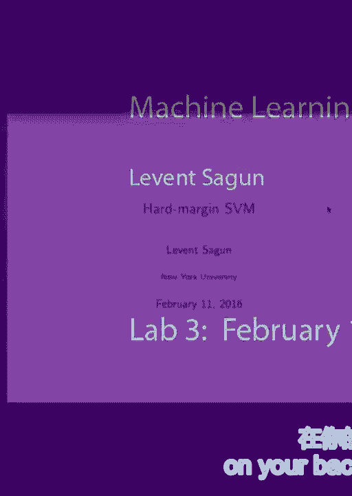
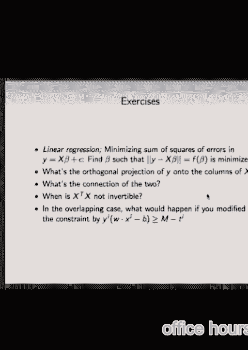

# 6：从零构建支持向量机目标函数 🧠

在本节课中，我们将从零开始，一步步推导出支持向量机的目标函数。我们将从基本概念出发，理解什么是“好的”分类器，如何用数学语言描述它，并最终构建出支持向量机的核心优化问题。通过这个过程，你将深刻理解支持向量机背后的原理，并能自己设计出类似的损失函数。

## 什么是“好的”分类器？ 🤔

上一节我们提到了分类问题，本节中我们来看看如何量化一个分类器的好坏。

当我们有一堆数据点，并希望用一个“分离器”（即决策边界）将它们分成不同类别时，我们会发现存在无数个可能的分离器。那么，如何判断哪个分离器更好呢？

一个好的分离器应该能清晰地区分不同类别的数据点。一个直观的想法是，它应该让不同类别的点尽可能远离决策边界。这个“远离”的程度，就是我们接下来要定义的“间隔”。

以下是判断分离器好坏的一些思路：

*   **损失函数**：通过一个函数来衡量分类错误的代价，目标是最小化这个代价。
*   **决策边界**：如果数据是线性可分的（即不同类别的数据点可以被一个超平面完美分开），那么我们可以找到一个超平面作为决策边界。
*   **凸包**：包含一组数据点的最小凸体。如果两个类别的凸包不相交，则数据是线性可分的。

## 定义间隔与超平面 📏

上一节我们讨论了好的分类器的概念，本节中我们来看看如何用数学来定义“间隔”和“分离器”——即超平面。

我们定义间隔为 **`间隔 = y * f(x)`**。
*   **`y`** 是数据点的真实标签，通常取值为 **`+1`** 或 **`-1`**。
*   **`f(x)`** 是我们的分类器函数在数据点 `x` 上的输出值。

我们的目标是最大化这个间隔。直观上，最大化两个类别最近点之间的距离，其“中点”所在的超平面就是能最大化间隔的决策边界。

那么，如何表示一个超平面呢？在二维空间中，一条直线可以表示为：

**`y = m*x + b`**

为了推广到更高维度（超平面），我们使用线性代数的形式。一个超平面可以由以下方程定义的所有点 `x` 的集合来描述：

**`w · x + b = 0`**

其中：
*   **`w`** 是一个向量，决定了超平面的方向。
*   **`b`** 是一个标量，决定了超平面的偏移。
*   **`·`** 表示点积。

这个方程 **`L(x) = w · x + b`** 本身是一个线性函数。它的零点集合 **`{x | L(x)=0}`** 构成了超平面。对于超平面一侧的点，`L(x) > 0`；对于另一侧的点，`L(x) < 0`。

## 构建完美可分情况下的目标函数 🎯

上一节我们定义了超平面，本节中我们基于数据完美线性可分的理想情况，来构建最初的目标函数。

假设我们的数据点 `(x_i, y_i)` 可以被一个超平面完美分开。这意味着对于所有数据点，分类函数 `L(x_i) = w · x_i + b` 的符号与标签 `y_i` 一致。因此，对于所有点，有：

**`y_i * L(x_i) > 0`**

我们不仅希望它们同号，还希望它们远离决策边界。设 `M` 为所有数据点中，`y_i * L(x_i)` 的最小值，这个 `M` 就被定义为“间隔”。我们希望最大化这个间隔 `M`。

同时，向量 `w` 可以任意缩放（因为同时缩放 `w` 和 `b` 不会改变超平面）。为了方便，我们可以对 `w` 增加一个约束，例如令 **`||w|| = 1`**（`w` 的范数为1）。

于是，我们的优化问题可以写为：
1.  **最大化** 间隔 `M`。
2.  **满足约束**：`y_i * (w · x_i + b) >= M`，对于所有数据点 `i`。
3.  **满足约束**：`||w|| = 1`。

## 问题转化：从最大化间隔到最小化范数 🔄

上一节我们得到了一个带约束的最大化问题，本节中我们通过一个巧妙的缩放技巧，将其转化为一个更易求解的等价问题。

由于 `w` 可以自由缩放，我们令 **`w' = w / M`**，**`b' = b / M`**。将这个缩放关系代入原来的约束 `y_i * (w · x_i + b) >= M`，两边同时除以 `M`，得到新的约束：

**`y_i * (w' · x_i + b') >= 1`**

同时，原来的约束 `||w|| = 1` 意味着 **`||w'|| = 1 / M`**。因此，最大化间隔 `M` 等价于最小化 **`||w'||`**。

于是，优化问题被转化为：
1.  **最小化** **`(1/2) * ||w'||^2`**（乘以1/2是为了后续求导方便，不影响最优解）。
2.  **满足约束**：`y_i * (w' · x_i + b') >= 1`，对于所有数据点 `i`。

这是一个带有线性不等式约束的凸二次规划问题，求解起来更加标准和方便。

## 引入松弛变量：处理不可分数据 🛡️

上一节我们处理了理想的可分情况，本节中我们面对现实——数据往往不是完美线性可分的。我们需要修改目标函数以容忍一些错误。

我们引入“松弛变量” `ξ_i`（读作“xi i”）来度量每个数据点允许违反间隔约束的程度。修改后的约束条件变为：

**`y_i * (w · x_i + b) >= 1 - ξ_i`**

其中 **`ξ_i >= 0`**。`ξ_i = 0` 表示该点满足原始约束；`ξ_i > 0` 表示该点进入了间隔区域或分类错误。

我们不希望松弛变量过大，否则分类器会过于容忍错误。因此，在目标函数中，我们加入对松弛变量总和的惩罚。新的优化问题变为：

1.  **最小化** **`(1/2) * ||w||^2 + C * (∑ ξ_i)`**
2.  **满足约束**：`y_i * (w · x_i + b) >= 1 - ξ_i`，对于所有数据点 `i`。
3.  **满足约束**：`ξ_i >= 0`，对于所有数据点 `i`。

这里，**`C`** 是一个大于0的超参数，它控制了我们对分类错误的容忍程度：
*   `C` 越大，对错误的惩罚越大，间隔可能变窄，倾向于在训练集上做到更少的错误（可能过拟合）。
*   `C` 越小，对错误的惩罚越小，间隔可能变宽，模型更简单（可能欠拟合）。

## 总结 📝

本节课中，我们一起学习了支持向量机核心目标函数的构建过程。

我们从寻找“好的”分类器出发，定义了**间隔**的概念。然后，我们用数学语言**超平面**来描述决策边界。在数据完美可分的理想情况下，我们构建了**最大化间隔**的原始问题。通过巧妙的缩放，我们将其转化为一个等价的、更易求解的**最小化权重范数**的凸优化问题。

最后，为了处理现实中常见的不可分数据，我们引入了**松弛变量** `ξ_i` 和惩罚参数 **`C`**，得到了支持向量机最终的标准形式优化问题：在最小化权重范数（控制模型复杂度）和最小化分类错误之间取得平衡。

这个推导过程揭示了支持向量机不仅追求分类正确，更追求决策边界的**稳健性**（最大间隔），这也是其名称“支持向量”的由来——最终的解仅由那些位于间隔边界上（`y_i * (w · x_i + b) = 1`）或内部的“支持向量”所决定。