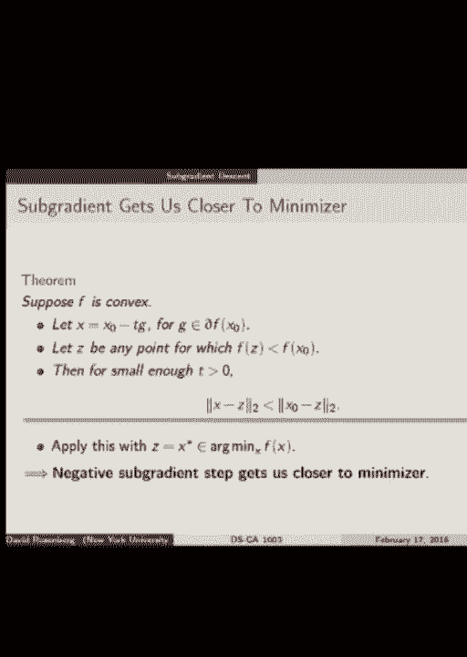
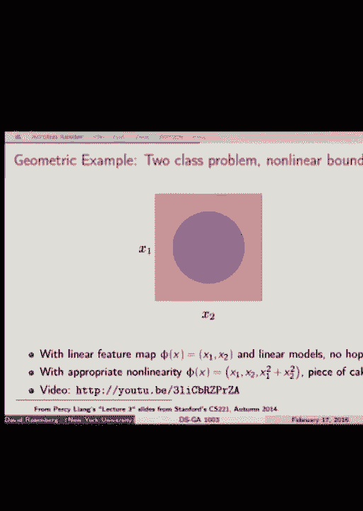
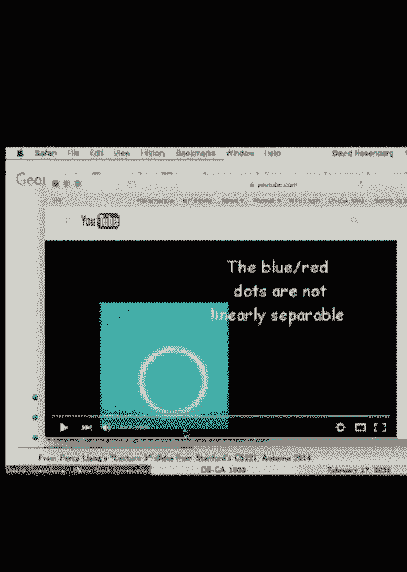
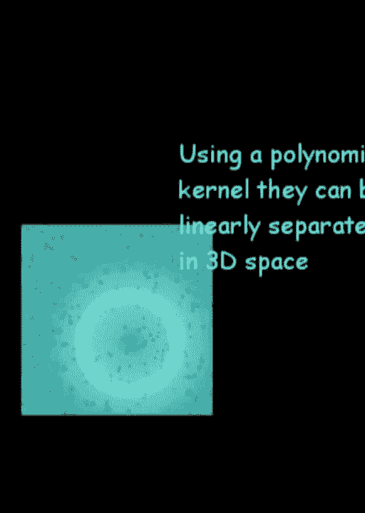
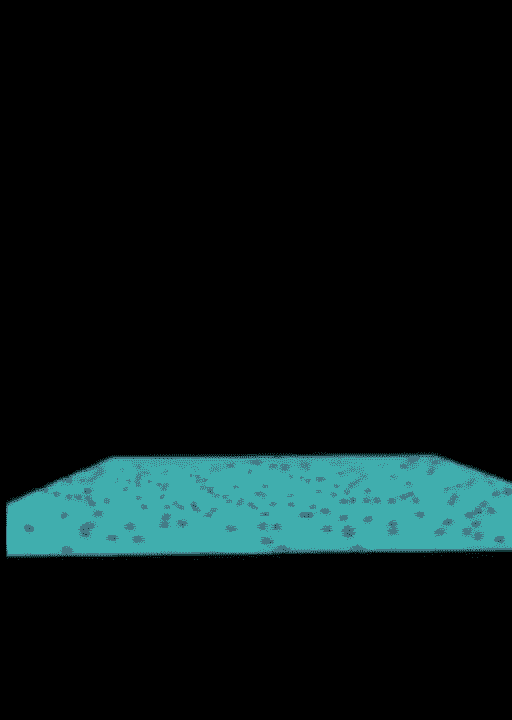

# 7：机器学习优化与特征工程教程 📚

在本节课中，我们将学习机器学习中的核心优化方法，包括梯度下降、随机梯度下降以及次梯度下降的原理与应用。同时，我们也将探讨特征工程的基本概念，了解如何通过特征提取和变换来提升模型的表达能力。

---

## 1. 优化方法概述 🔍

上一节我们介绍了机器学习的基本框架，本节中我们来看看如何通过优化算法来找到模型的最佳参数。

优化方法的一般形式是：在参数空间中找到一个起始点 \( x_0 \)，然后通过迭代逐步更新参数。每次迭代时，我们选择一个搜索方向 \( v_k \) 和一个步长 \( t_k \)，然后按照以下公式更新参数：

\[
x_{k+1} = x_k + t_k \cdot v_k
\]

需要注意的是，\( v_k \) 不一定是单位向量，而 \( t_k \) 通常被称为步长因子，它表示在搜索方向上的缩放倍数，而不是实际移动的距离。

---

## 2. 方向导数与下降方向 📉

在优化过程中，我们经常需要判断某个方向是否是“下降方向”。方向导数的定义如下：

\[
\nabla_v f(x) = \lim_{h \to 0} \frac{f(x + h v) - f(x)}{h}
\]

如果方向导数小于零，即 \( \nabla_v f(x) < 0 \)，那么方向 \( v \) 就是下降方向。这意味着沿着该方向移动一小步，函数值会减小。

对于可微函数，方向导数可以表示为梯度与方向的内积：

\[
\nabla_v f(x) = \nabla f(x)^T v
\]

因此，任意方向 \( v \) 是下降方向的条件是：

\[
\nabla f(x)^T v < 0
\]

---

## 3. 梯度下降法 📈

梯度下降法是一种常用的优化方法，其核心思想是沿着负梯度方向更新参数。更新公式如下：

\[
x_{k+1} = x_k - t \cdot \nabla f(x_k)
\]

其中，\( t \) 是步长。梯度下降法要求函数是可微的，并且步长需要适当选择，以确保收敛。

以下是梯度下降法的基本步骤：

1. 初始化参数 \( x_0 \)。
2. 计算当前点的梯度 \( \nabla f(x_k) \)。
3. 沿着负梯度方向更新参数：\( x_{k+1} = x_k - t \cdot \nabla f(x_k) \)。
4. 重复步骤2和3，直到满足停止条件。

---

## 4. 随机梯度下降法 🔄

随机梯度下降法是梯度下降法的一种变体，适用于大规模数据集。其核心思想是每次迭代时随机选择一个样本（或一小批样本）来估计梯度，从而加速计算。

假设我们的目标函数是正则化的经验风险：

\[
J(w) = \frac{1}{n} \sum_{i=1}^n L(w, x_i, y_i) + \lambda \Omega(w)
\]

我们可以将其重写为：

\[
J(w) = \frac{1}{n} \sum_{i=1}^n h_i(w)
\]

其中，\( h_i(w) = L(w, x_i, y_i) + \lambda \Omega(w) \)。在随机梯度下降中，我们随机选择一个样本 \( i \)，并用 \( \nabla h_i(w) \) 来近似 \( \nabla J(w) \)。

更新公式为：

\[
w_{k+1} = w_k - t \cdot \nabla h_i(w_k)
\]

随机梯度下降的优点是计算效率高，但收敛速度可能较慢。

---

## 5. 次梯度下降法 📉

对于不可微的函数（如绝对值函数），我们无法直接使用梯度下降法。这时，次梯度下降法成为一种有效的替代方法。

次梯度 \( g \) 的定义是：对于凸函数 \( f \)，如果向量 \( g \) 满足以下条件，则称 \( g \) 是 \( f \) 在点 \( x \) 的次梯度：

\[
f(y) \geq f(x) + g^T (y - x), \quad \forall y
\]

次梯度下降法的更新公式为：

\[
x_{k+1} = x_k - t \cdot g
\]

其中，\( g \) 是 \( f \) 在 \( x_k \) 处的次梯度。需要注意的是，负次梯度方向不一定是下降方向，但通过适当选择步长，次梯度下降法仍然可以收敛到全局最小值。

---

## 6. 特征工程基础 🛠️

特征工程是机器学习中至关重要的一环，它通过提取和变换特征来提升模型的表达能力。特征工程的核心任务是将原始输入空间映射到实值特征空间。

以下是特征工程的几个关键概念：

1. **特征提取**：将原始输入（如文本、图像）转换为实值特征向量。
2. **特征模板**：通过一组规则自动生成大量特征，减少人工设计的工作量。
3. **稀疏表示**：对于大多数特征值为零的情况，只存储非零特征及其值，以节省空间。

---

## 7. 非线性特征编码 🌟

线性模型的表达能力有限，但通过非线性特征编码，我们可以捕捉数据中的复杂模式。以下是几种常见的非线性编码方法：

1. **非单调性**：通过添加平方项或其他变换，使模型能够拟合非单调关系。
2. **饱和度**：通过对数变换或分桶方法，处理特征值的尺度差异。
3. **特征交互**：通过引入特征之间的乘积项，捕捉特征之间的相互作用。

例如，对于身高和体重的关系，我们可以添加以下特征：

\[
\phi(x) = [1, h, w, h^2, w^2, h \cdot w]
\]

这样，线性模型可以拟合更复杂的决策边界。

---

## 8. 核方法简介 🔗

核方法是一种通过核函数在高维特征空间中计算内积的技巧，从而避免显式构造高维特征。核函数的定义如下：

\[
K(x, y) = \langle \phi(x), \phi(y) \rangle
\]

其中，\( \phi \) 是特征映射。通过核方法，我们可以在低维空间中高效计算高维特征的内积，从而提升计算效率。

例如，对于二次特征映射，核函数可以表示为：

\[
K(x, y) = (x^T y + 1)^2
\]

这样，我们无需显式构造二次特征，就能在二次特征空间中计算内积。

---

## 总结 📝

本节课中我们一起学习了机器学习中的优化方法，包括梯度下降、随机梯度下降和次梯度下降的原理与应用。同时，我们也探讨了特征工程的基本概念，了解了如何通过特征提取、非线性编码和核方法提升模型的表达能力。这些知识将为后续的机器学习实践打下坚实的基础。