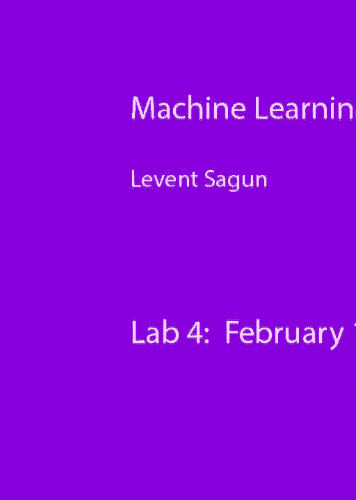
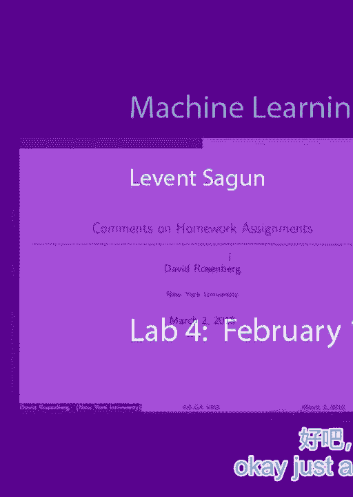
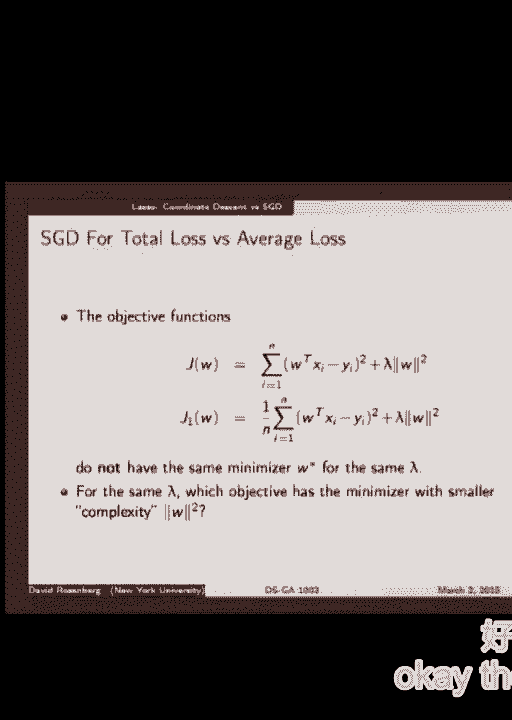
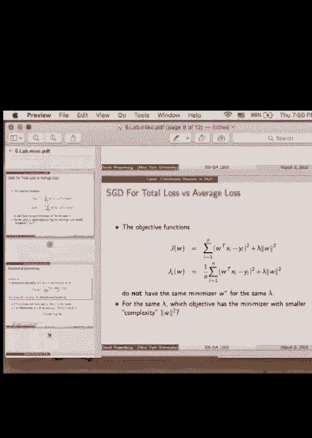
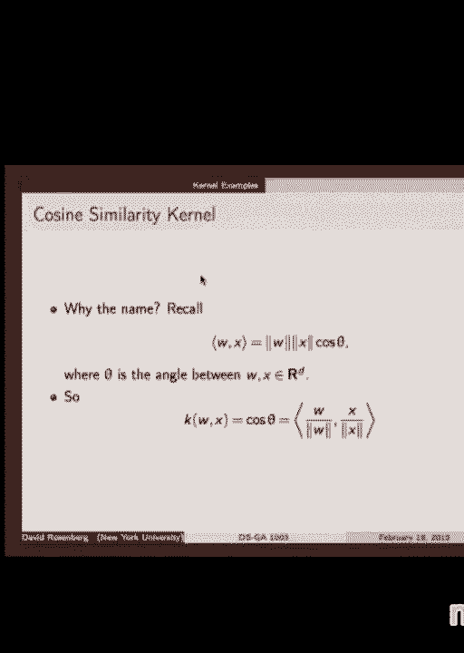

# 8：梯度下降、正则化与核方法基础 🧠

在本节课中，我们将回顾梯度下降与随机梯度下降的核心概念，探讨损失函数平均化的重要性，并初步了解核方法的基本思想。我们将通过公式和代码来阐明核心概念，确保内容简单易懂。

## 概述 📋

本节课将涵盖以下内容：
1.  梯度下降与随机梯度下降的对比。
2.  平均损失与总损失的区别及其影响。
3.  正则化参数的作用与调整策略。
4.  核方法的基本概念及其在文本比较中的应用。

---

## 梯度下降与随机梯度下降回顾 🔄

上一节我们介绍了优化算法的基本目标。本节中，我们来看看两种核心优化方法：梯度下降和随机梯度下降。

梯度下降通过计算整个数据集的平均梯度来更新参数。其更新公式为：
`w = w - η * ∇J(w)`
其中，`η` 是学习率，`∇J(w)` 是损失函数 `J` 关于参数 `w` 的梯度。

随机梯度下降则每次只使用一个（或一小批）样本来估计梯度，更新公式为：
`w = w - η * ∇J_i(w)`
其中，`∇J_i(w)` 是单个样本 `i` 的损失梯度。

以下是两种方法的关键区别：

*   **计算效率**：SGD 的计算成本远低于 GD，尤其在大数据集上。
*   **更新噪声**：SGD 的更新方向有噪声，可能导致收敛路径不稳定。
*   **收敛速度**：SGD 通常能更快地接近最小值区域，但可能在最优点附近震荡。

## 平均损失与总损失 📊

上一节我们比较了两种优化策略。本节中我们来看看损失函数的不同形式如何影响优化过程。

使用总损失时，梯度步长是每个样本梯度之和。使用平均损失时，梯度步长是每个样本梯度的平均值。两者关系为：
`∇J_total(w) = n * ∇J_avg(w)`
其中 `n` 是样本总数。

这意味着，如果不进行平均化，梯度下降的步长大小约是随机梯度下降步长的 `n` 倍。为了使 SGD 和 GD 的更新步长尺度可比，通常建议使用平均损失。

使用平均损失还有另一个重要优势：如果数据中存在冗余，小批量 SGD 的梯度方向可以很好地近似整个数据集的梯度方向，从而在节省计算时间的同时，保持接近 GD 的优化效果。

## 正则化参数调整 ⚖️

上一节我们讨论了损失函数的形式。本节中我们来看看如何通过正则化来控制模型复杂度。

正则化通过在损失函数中添加一个惩罚项来防止过拟合。常见的 L2 正则化损失函数为：
`J_reg(w) = J(w) + λ * ||w||^2`
其中，`λ` 是正则化强度参数。

正则化参数 `λ` 的调整策略如下：

*   **λ 过大**：模型会过度惩罚权重，导致所有参数趋近于零，模型过于简单，可能欠拟合。
*   **λ 过小**：正则化效果微弱，模型可能倾向于拟合训练数据中的噪声，导致过拟合。
*   **调整方法**：通常从一个较大的 `λ` 值开始，逐步减小，观察模型在验证集上的性能，找到平衡点。

需要注意的是，当使用总损失和平均损失时，即使 `λ` 值相同，其对应的实际正则化强度也不同。若要使两者最小化后得到相同复杂度的模型，需要对 `λ` 进行相应缩放（例如，在平均损失中使用的 `λ` 应约为总损失中的 `λ/n`）。

## 核方法初步：文本相似性比较 📖

上一节我们探讨了模型内部的优化与正则化。本节中我们将视角转向模型如何衡量输入数据之间的相似性，即核方法的基础。

核函数 `K(x, z)` 是一个接收两个输入并返回一个实数的函数，用于衡量 `x` 和 `z` 之间的相似性。一个简单的核函数是向量内积。

例如，在比较两段文本时：
1.  首先进行特征提取，将每段文本转化为特征向量（如词频向量）。
2.  然后对向量进行归一化处理，使其范数为1。
3.  最后计算两个归一化向量的内积作为相似度得分。

内积之所以能作为核函数，是因为它诱导了一个具有角度概念的空间。两个向量 `v` 和 `x` 的内积与其夹角 `θ` 的余弦相关：
`v·x = ||v|| * ||x|| * cosθ`
当向量被归一化后，内积直接等于 `cosθ`，其值越接近1，表示两个向量方向越相似。

内积空间是一种特殊的度量空间，它不仅定义了距离（范数），还定义了角度，这使其成为定义核函数的理想选择。

---

## 总结 🎯

本节课中我们一起学习了：
1.  **梯度下降与随机梯度下降**：GD 准确但计算成本高；SGD 高效但带有噪声，适合大数据集。
2.  **损失函数的选择**：使用平均损失可以使 GD 和 SGD 的更新步长尺度一致，并利用数据冗余提升 SGD 效率。
3.  **正则化**：通过 `λ` 参数控制模型复杂度，防止过拟合，调整时需要权衡偏差与方差。
4.  **核方法基础**：核函数用于度量数据间的相似性，内积是一个基本的核函数，它在归一化后可以反映向量间的角度相似性。

理解这些基础概念，是掌握更复杂机器学习模型和优化技术的关键。