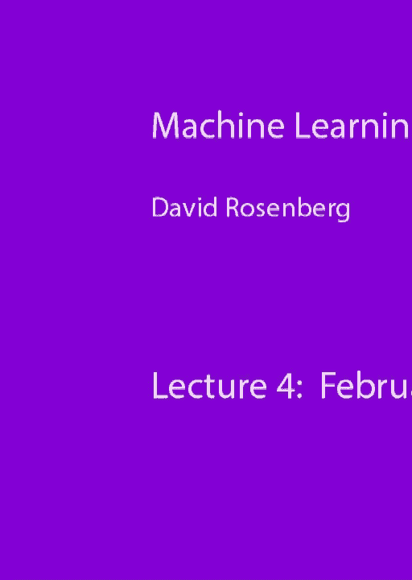
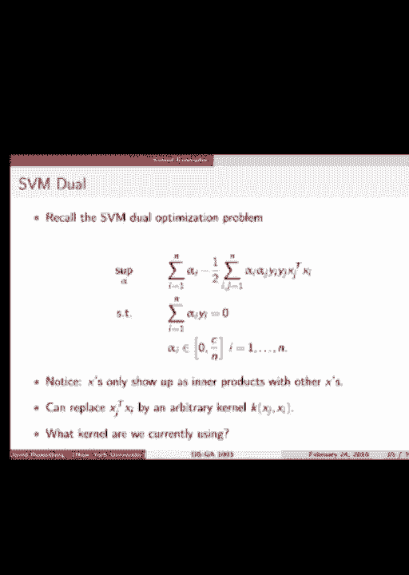
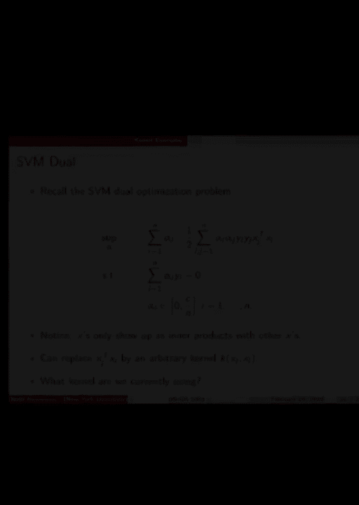

# 9：核方法入门 🧠

在本节课中，我们将学习核方法的核心概念。我们将从回顾内积空间和希尔伯特空间的基础知识开始，然后深入探讨核方法的动机、代表性定理，以及如何将线性模型“核化”以处理高维甚至无限维特征空间。最后，我们会介绍一些常见的核函数。

---

## 回顾：内积空间与希尔伯特空间

上一节我们讨论了线性模型的基础。本节中，我们来看看支撑核方法的数学基础：内积空间和希尔伯特空间。

一个**内积空间**是一个向量空间，并配备了一个内积运算。内积可以诱导出一个范数。例如，常见的 L2 范数就可以写成向量与自身内积的平方根：`||x|| = sqrt(<x, x>)`。然而，并非所有范数都能这样表示，例如 L1 范数就不能写成某个内积诱导的形式。

**正交性**是内积空间中的一个关键概念。如果两个向量 `x` 和 `y` 的内积为零，则称它们正交，记作 `x ⟂ y`。正交性引出了著名的**毕达哥拉斯定理**：如果 `x ⟂ y`，那么 `||x + y||² = ||x||² + ||y||²`。

在机器学习中，我们经常需要将一个向量投影到一个子空间上，以找到“最近”的点。在**希尔伯特空间**（即完备的内积空间）中，这种投影总是存在且唯一的，这由**投影定理**保证。

---

## 核方法的动机 🎯

我们已经学习了许多学习方法，如线性回归、岭回归、LASSO、支持向量机和感知器。它们有一个共同点：其假设空间都是由输入特征的线性函数构成的。

具体来说，我们有一个从原始抽象输入空间 `X` 到特征空间 `H`（例如 `R^d`）的映射 `ψ`。我们的模型是特征空间中向量的线性函数：`f(x) = <w, ψ(x)>`。

为了获得更具表现力的模型，我们需要使用高维甚至无限维的特征空间。但这带来了两个问题：
1.  过拟合风险。
2.  计算和内存成本高昂。

正则化（如岭回归）可以解决第一个问题。而**核方法**正是为了解决第二个问题而设计的，特别是在使用 L2 正则化时。

---

## 核函数与核技巧

观察许多线性模型（如 SVM）的目标函数和预测公式，我们发现对输入数据 `x` 的引用总是以内积 `<ψ(x_i), ψ(x_j)>` 的形式出现。

我们定义**核函数** `K`，它直接计算两个原始输入之间的这个内积：
`K(x, z) = <ψ(x), ψ(z)>`

核函数可以理解为衡量两个输入相似度的分数。**核技巧**的精髓在于，我们无需显式计算高维特征映射 `ψ(x)`，只需直接计算核函数 `K(x, z)`。有时，计算核函数比先映射再求内积要高效得多。

例如，在支持向量机的对偶问题中，所有数据点都以 `K(x_i, x_j)` 的形式出现，这自然就是核化的形式。

---

## 代表性定理 📜

上一节我们看到了核函数的形式。本节中，我们通过一个强大的定理来理解为何许多模型的解都具有特定的形式。

考虑一个广义的优化问题，其目标函数 `J(w)` 包含一个关于 `w` 的范数的非递减正则项 `R(||w||)`，和一个关于内积 `<w, ψ(x_i)>` 的损失函数 `L`。

**代表性定理**指出，上述优化问题的任意解 `w*` 都可以表示为训练数据特征向量的线性组合：
`w* = Σ_{i=1}^n α_i * ψ(x_i)`

这意味着最优解位于训练数据特征向量张成的子空间中。这个定理适用于岭回归、支持向量机等使用 L2 正则化的模型。

**证明思路**：
1.  设 `M` 为所有 `ψ(x_i)` 张成的子空间。
2.  将任意解 `w*` 正交投影到 `M` 上，得到 `w`。
3.  根据投影定理，`||w|| ≤ ||w*||`，因此 `R(||w||) ≤ R(||w*||)`。
4.  由于 `w* - w` 与 `M` 正交，可以证明对于所有数据点，有 `<w*, ψ(x_i)> = <w, ψ(x_i)>`。因此损失项 `L` 的值不变。
5.  综合起来，`J(w) ≤ J(w*)`。由于 `w*` 是最小值，所以 `w` 也是一个最小值，且具有 `w = Σ α_i ψ(x_i)` 的形式。

---

## 模型的核化

根据代表性定理，我们可以将解 `w*` 代入模型，从而得到完全用核函数表示的**核化模型**。

*   **预测函数**：对于新输入 `x`，预测值为
    `f(x) = <w*, ψ(x)> = Σ_{i=1}^n α_i * <ψ(x_i), ψ(x)> = Σ_{i=1}^n α_i * K(x_i, x)`
*   **正则项**：`||w*||² = <w*, w*> = Σ_{i=1}^n Σ_{j=1}^n α_i α_j K(x_i, x_j)`
*   **优化问题**：将上述形式代入原目标函数 `J(w)`，我们可以得到一个新的优化问题，其优化变量是系数 `α = (α_1, ..., α_n)`，而不是原始的特征空间权重 `w`。优化通常在 `R^n` 中进行，而不是在高维特征空间 `H` 中，当 `n`（样本数）远小于 `d`（特征维数）时，这带来了计算优势。

---

## 常见核函数示例

以下是一些常用的核函数：

*   **线性核**：`K(x, z) = x^T z`
    *   对应于恒等特征映射 `ψ(x) = x`，即原始空间的内积。

*   **多项式核**：`K(x, z) = (x^T z + c)^d`
    *   对应于所有阶数不超过 `d` 的单项式组合构成的特征空间。即使这个特征空间维数很高，核函数计算依然简单。

*   **高斯核（RBF核）**：`K(x, z) = exp(-γ * ||x - z||²)`
    *   这是一个最常用的非线性核。它对应于一个无限维的特征空间。函数值随两点距离增大而指数衰减，完美体现了“相似度”的概念。使用该核的模型预测函数是多个以训练样本为中心的高斯函数的线性组合，可以拟合非常复杂的形状。

**如何验证一个函数是有效的核函数？**
一个对称函数 `K(x, z)` 是有效核函数的充要条件是：对于任意有限个输入点 `{x_1, ..., x_m}`，对应的**核矩阵** `[K(x_i, x_j)]` 是半正定的。此外，核函数在正数乘、相加和相乘运算下仍然是核函数。

---

## 总结

本节课中我们一起学习了核方法的核心思想。我们从内积空间和投影定理的数学基础出发，探讨了为提升模型表现力而使用高维特征空间所带来的计算挑战。核方法通过**核技巧**巧妙地规避了显式计算高维特征向量的开销。**代表性定理**从理论上解释了为何像SVM、岭回归等模型的解可以表示为训练数据的线性组合，从而自然导出模型的核化形式。最后，我们介绍了几种常见的核函数，并了解了判定有效核函数的条件。核方法是机器学习中连接线性模型与非线性能力的重要桥梁。