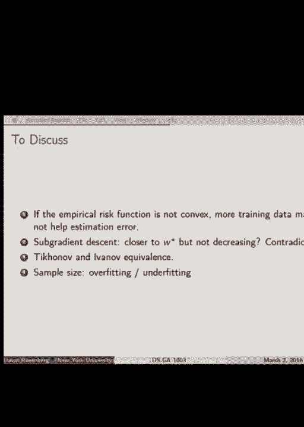
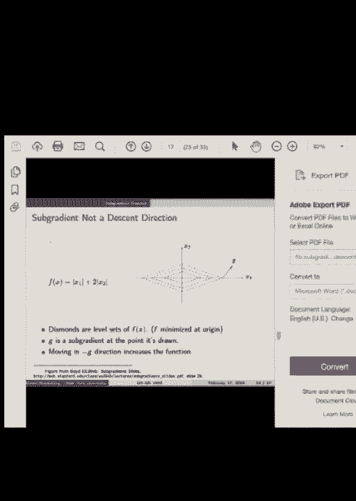
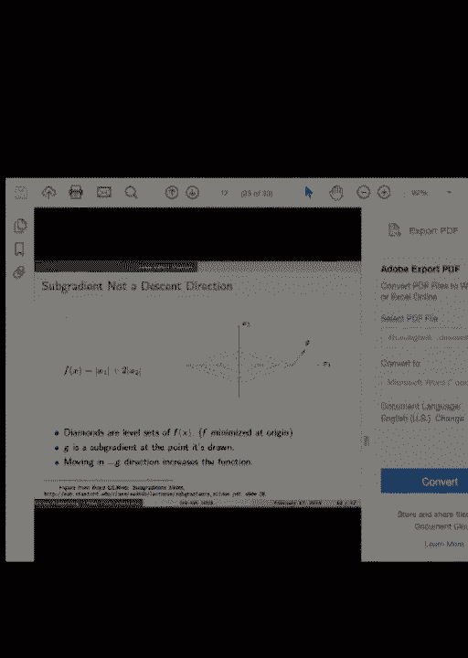
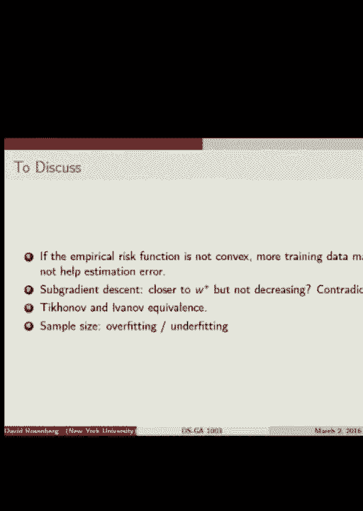
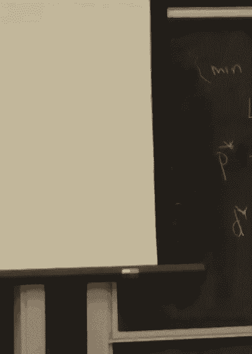

# 11：分类决策树与优化理论回顾 🌳

在本节课中，我们将要学习分类决策树的基本原理，并回顾一些重要的优化理论概念，包括对偶性和互补松弛条件。

---

## 分类决策树

上一节我们介绍了回归树，本节中我们来看看分类树。分类树是决策树用于分类任务的一种形式。与回归树类似，它通过一系列基于特征的判断将输入空间划分为不同的矩形区域，并在每个叶节点给出一个预测。

### 树的结构与预测

分类树同样是二叉树结构。在每个节点，我们选择一个特征和一个分割点，将数据分成左右两个子集。最终，每个输入样本会到达一个叶节点，该节点对应输入空间中的一个特定区域。

对于分类问题，每个叶节点的预测值是该节点内训练样本中出现最频繁的类别。我们也可以预测类别的概率分布，即每个类别的相对比例。

设区域 $R_m$ 中有 $n_m$ 个训练样本。定义 $\hat{p}_{mk}$ 为区域 $R_m$ 中第 $k$ 类样本的比例：
$$\hat{p}_{mk} = \frac{1}{n_m} \sum_{i \in R_m} I(y_i = k)$$

我们的预测类别 $k(m)$ 是比例最高的类别：
$$k(m) = \arg\max_k \hat{p}_{mk}$$

该叶节点的估计误分类率为 $1 - \hat{p}_{mk(m)}$。

### 如何选择最佳分割

构建树的核心问题是如何为每个节点选择最佳的分割特征和分割点。这需要一个衡量分割好坏的准则，即“节点不纯度”度量。

以下是几种常见的节点不纯度度量（以二分类为例，其中 $p$ 是正类样本比例）：
*   **误分类错误率**： $1 - \max(p, 1-p)$
*   **基尼指数**： $2p(1-p)$
*   **交叉熵/信息增益**： $-p \log p - (1-p) \log (1-p)$

这些度量在 $p=0.5$（最不纯）时最大，在 $p=0$ 或 $p=1$（最纯）时最小。基尼指数和交叉熵在构建树时更常用，因为它们对节点纯度的变化更敏感，倾向于产生更纯的节点。

对于一个将节点分割为左子节点 $R_L$ 和右子节点 $R_R$ 的分割，其总体不纯度是左右子节点不纯度的加权平均：
$$\text{不纯度} = \frac{n_L}{n_L + n_R} \cdot \text{不纯度}(R_L) + \frac{n_R}{n_L + n_R} \cdot \text{不纯度}(R_R)$$

我们遍历所有可能的特征和分割点，选择使该加权不纯度最小的分割。

关于寻找分割点的技巧：对于连续特征，我们只需要在训练样本在该特征上的取值之间进行检查，因为在这些值之间移动分割点不会改变训练数据的划分结果。

### 树的剪枝与特性

与回归树类似，分类树在生长后也可能需要剪枝以控制复杂度、防止过拟合。一个常见的做法是：虽然可能使用基尼指数或交叉熵来生长树，但在剪枝时使用误分类错误率作为准则，因为我们的最终目标是降低误分类率。

决策树有几个重要特性：
1.  **无需数据标准化**：树的分裂只依赖于特征的顺序，而不关心特征的尺度或具体数值大小。因此，对特征进行标准化、中心化等预处理对决策树没有影响。
2.  **可处理有序特征**：只要特征值可以比较大小（有序），就可以用于决策树。对于无序的分类特征，算法需要调整，例如通过选择特征子集进行分割。
3.  **预测非平滑**：决策树的预测是分段常数函数，在区域边界处不连续。

---

## 优化理论回顾

在课程的后半部分，我们回顾了与支持向量机（SVM）相关的优化理论，特别是拉格朗日对偶性。

### 原始问题与拉格朗日函数

考虑一个带约束的优化问题（原始问题）：
$$\min_w \phi(w) \quad \text{s.t.} \quad \Omega(w) \leq R$$

我们引入拉格朗日乘子 $\lambda \geq 0$，构造拉格朗日函数：
$$L(w, \lambda) = \phi(w) + \lambda (\Omega(w) - R)$$

可以证明，原始问题等价于：
$$p^* = \min_w \max_{\lambda \geq 0} L(w, \lambda)$$

### 对偶问题

交换最小化和最大化的顺序，得到对偶问题：
$$d^* = \max_{\lambda \geq 0} \min_w L(w, \lambda)$$

定义对偶函数 $g(\lambda) = \min_w L(w, \lambda)$，则对偶问题是 $\max_{\lambda \geq 0} g(\lambda)$。

根据**弱对偶性**，始终有 $d^* \leq p^*$。

### 强对偶性与KKT条件

当 $d^* = p^*$ 时，称为**强对偶性**。对于一个凸优化问题（目标函数 $\phi$ 和约束函数 $\Omega$ 均为凸函数），如果存在一个“严格可行”点（即满足 $\Omega(w) < R$ 的点），则强对偶性成立（Slater条件）。

在强对偶性成立的前提下，设原始问题的最优解为 $w^*$，对偶问题的最优解为 $\lambda^*$，它们满足**KKT条件**，其中包括重要的**互补松弛条件**：
$$\lambda^* (\Omega(w^*) - R) = 0$$

这意味着，如果约束不是紧的（即 $\Omega(w^*) < R$），则必有 $\lambda^* = 0$；如果 $\lambda^* > 0$，则约束必是紧的（即 $\Omega(w^*) = R$）。

---

## 总结

本节课中我们一起学习了以下内容：
1.  **分类决策树**的原理，包括如何利用基尼指数或交叉熵等不纯度度量来选择最佳分割，以及决策树无需数据标准化、可处理有序特征等重要特性。
2.  **优化理论中的对偶性**，包括原始问题、对偶问题的形式，弱对偶性与强对偶性的概念，以及强对偶性成立的条件（凸问题加Slater条件）和由此导出的互补松弛条件。

这些知识是理解许多机器学习模型（如SVM）和算法的基础。