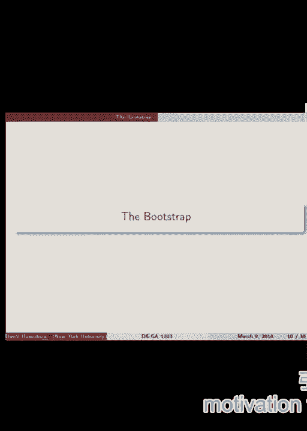
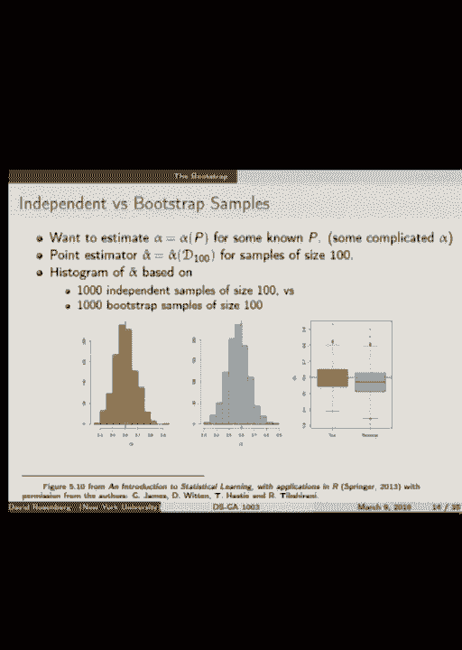
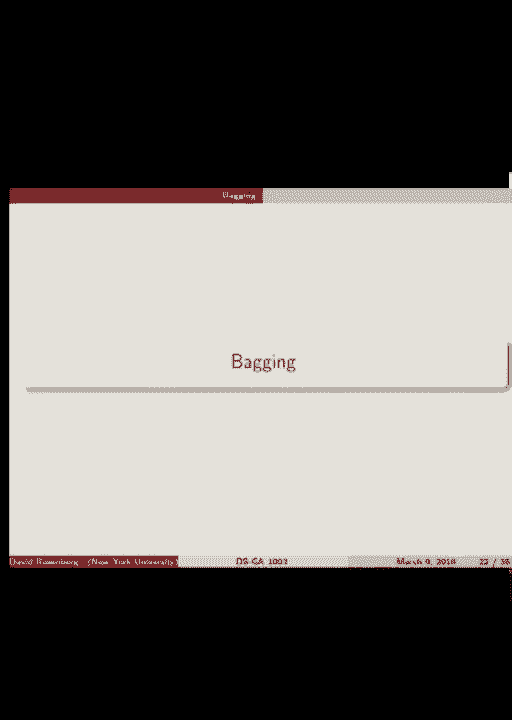
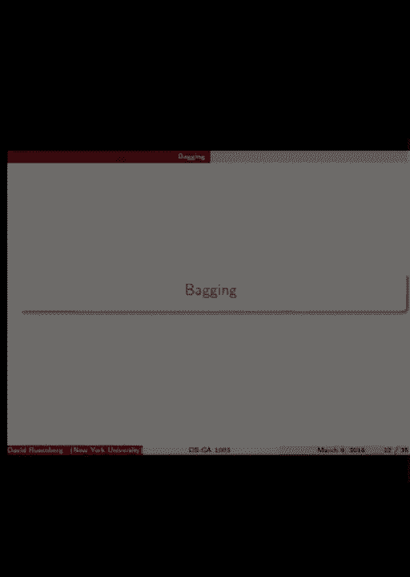
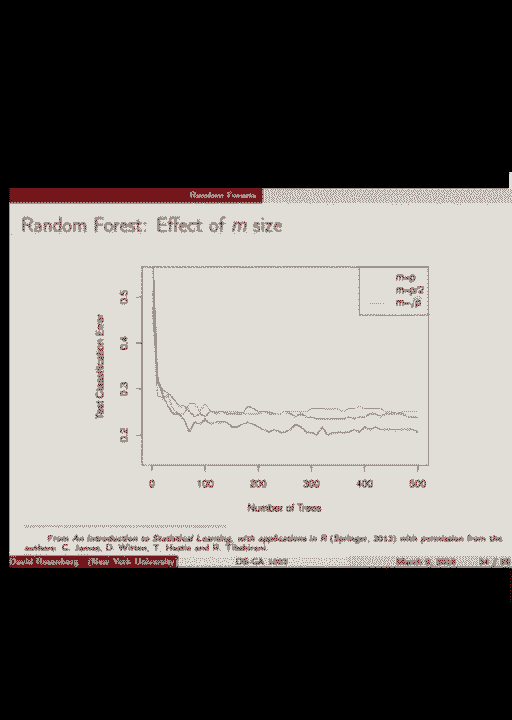
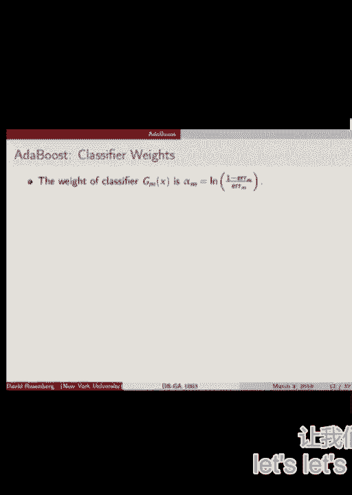

# 12：集成方法入门 🧠

在本节课中，我们将要学习集成方法，这是一种通过组合多个模型来提升预测性能的强大技术。我们将重点介绍自助法、袋装法和随机森林，并简要了解提升方法的基本思想。课程内容将涵盖核心概念、数学原理以及它们在实际中的应用。

---

## 回顾：偏差与方差 📊

上一节我们介绍了集成方法的动机，本节中我们来看看理解模型性能的两个核心概念：偏差与方差。首先，我们需要明确一些统计学基本术语。

**参数**是概率分布 `P` 的一个函数。例如，均值 `μ`、方差 `σ²`、中位数等都是分布的参数。我们可以将其表示为 `μ = μ(P)`，表明 `μ` 是作用于分布本身的一个函数。

**统计量**是数据样本 `D` 的一个函数。如果一个统计量的目的是估计一个参数，那么它就被称为**点估计量**。例如，`μ̂` 是数据的一个函数，用于估计参数 `μ`。

对于一个实值参数 `μ` 及其估计量 `μ̂`，我们可以定义其偏差和方差：
*   **偏差**：`Bias(μ̂) = E[μ̂] - μ`
    *   如果 `E[μ̂] = μ`，则估计量是无偏的。
*   **方差**：`Var(μ̂) = E[(μ̂ - E[μ̂])²]`

偏差和方差描述的是估计量 `μ̂` 作为一个函数的性质，而不是针对某个特定数据样本。它们依赖于估计量的函数形式以及数据背后的真实分布 `P`。

---

## 自助法：从单个样本估计分布 🔄

上一节我们讨论了如何用多个独立样本来估计统计量的分布，但在现实中我们通常只有一个样本。本节中我们来看看如何通过**自助法**来解决这个问题。

自助法的核心思想是：既然我们无法从原始分布 `P` 中重复抽样，我们就从已有的单个样本 `D_N`（大小为 `N`）中进行**有放回地重复抽样**，来模拟“新样本”的生成过程。

一个**自助样本**是从原始数据集 `D_N` 中有放回地随机抽取 `N` 次所得到的样本。由于是有放回抽样，自助样本中会包含重复的原始数据点，同时也会遗漏大约 37% (`≈ 1/e`) 的原始数据点。

以下是自助法的基本步骤：
1.  从原始数据集 `D_N` 中，通过有放回抽样，生成 `B` 个自助样本（每个大小均为 `N`）。
2.  对每个自助样本，计算我们关心的统计量（例如 `μ̂`）。
3.  将这 `B` 个统计量的结果视为来自 `μ̂` 抽样分布的近似，进而可以估计其方差、置信区间等。

自助法是一种基于单个样本估计统计量分布的有效策略。虽然其理论依据复杂，但实践证明它在许多情况下都非常有效。

---

## 袋装法：降低预测方差 🛍️

上一节我们介绍了自助法，本节中我们来看看如何利用它来改进机器学习模型，这种方法称为**袋装法**。

设想一个理想情况：如果我们有 `B` 个独立的训练集，在每个训练集上训练一个模型，然后将这 `B` 个模型的预测结果进行平均（对于回归问题）或投票（对于分类问题）。由于模型之间相互独立，这种平均操作可以显著降低预测的方差，而期望值保持不变。

然而，现实中我们只有一个训练集。袋装法的思路是：用自助样本代替独立的训练集。
1.  从原始训练集生成 `B` 个自助样本。
2.  在每个自助样本上独立地训练一个基学习器（例如决策树），得到 `B` 个模型 `f̂¹, f̂², ..., f̂ᴮ`。
3.  对于新样本 `x`，组合所有模型的预测：
    *   **回归**：`f̂_bag(x) = (1/B) * Σ f̂ᵇ(x)`
    *   **分类**：采用多数投票或对预测概率取平均。

袋装法特别适用于**高方差、低偏差**的基学习器（例如未剪枝的深度决策树）。因为袋装法主要作用是降低方差，而对偏差影响不大。线性回归等本身方差较小的模型，从袋装法中获益有限。

袋装法还有一个有用的副产品：**袋外误差估计**。由于每个自助样本平均只包含约63%的原始数据，剩下的约37%的数据自然构成了该模型的验证集。我们可以用这些“袋外”数据来评估模型性能，无需单独划分验证集。

---

## 随机森林：改进的袋装法 🌲

上一节我们介绍了袋装法，本节中我们来看看其一个著名且强大的变体——**随机森林**。它通过引入额外的随机性来进一步提升模型性能。

袋装法中使用自助样本，但由此训练出的模型之间可能仍然存在较高的相关性，这限制了方差减少的效果。随机森林在袋装法的基础上，对决策树的构建过程进行了关键修改：

在决策树的每个节点需要分裂时，随机森林不是从所有 `d` 个特征中选择最优特征，而是先随机选取一个特征子集（通常大小为 `√d` 或 `log₂(d)`），然后仅在这个子集中选择最优分裂特征。

以下是随机森林的核心步骤：
1.  从原始训练集生成 `B` 个自助样本。
2.  对于每个自助样本，构建一棵深度决策树。在构建树的每个节点时：
    a. 随机选择 `m` 个特征（`m ≈ √d`）。
    b. 从这 `m` 个特征中选择最佳分裂点。
3.  将训练得到的 `B` 棵树组合起来，通过投票或平均进行预测。

这种随机特征选择带来了两大好处：
1.  **进一步降低方差**：树与树之间的相关性降低，使得模型集成的方差减少效果更佳。
2.  **提升计算效率**：每个节点只需评估少量特征，加快了单棵树的训练速度。

随机森林通常使用深度、未剪枝的树作为基学习器（保持低偏差），依靠集成来控制过拟合（降低高方差）。参数 `B`（树的数量）和 `m`（每次分裂考虑的特征数）可以通过交叉验证来调整。

---

## 提升方法简介：顺序构建强模型 🚀

之前我们讨论的袋装法和随机森林属于**并行集成方法**，模型独立构建。本节我们简要介绍另一大类：**顺序集成方法**，以**提升方法**为代表。

提升方法的核心思想是**顺序地**训练一系列弱学习器（仅比随机猜测略好的简单模型，如决策树桩），每个新模型都专注于纠正前一个模型所犯的错误。

经典的AdaBoost算法流程概述如下：
1.  初始化所有训练样本的权重为相等值。
2.  对于 `m = 1` 到 `M`（轮次）：
    a. 使用当前的样本权重训练一个弱学习器 `G_m(x)`。
    b. 计算 `G_m(x)` 在加权训练集上的误差率。
    c. 根据误差率计算该弱学习器的权重 `α_m`（表现越好，权重越高）。
    d. 更新样本权重：增加被 `G_m(x)` 分类错误样本的权重，减少正确分类样本的权重。
3.  组合所有弱学习器，形成最终强分类器：`G(x) = sign( Σ α_m * G_m(x) )`。

通过重新调整样本权重，提升方法迫使后续的模型更加关注之前难以正确分类的样本。最终通过加权投票的方式结合所有弱学习器。提升方法能够将一系列弱模型组合成一个非常强大的模型，是集成学习中另一项里程碑式的技术。

---

## 总结 📝

本节课中我们一起学习了集成方法的基础知识。我们从偏差和方差的统计概念出发，理解了模型误差的构成。接着，我们探讨了**自助法**，这是一种利用重抽样来估计统计量分布的强大工具。

基于自助法，我们学习了**袋装法**，它通过组合多个在自助样本上训练的模型来降低预测方差。然后，我们深入了解了**随机森林**，它通过在决策树构建中引入随机特征选择，进一步降低了模型间的相关性，从而获得了更优异的性能。

最后，我们简要介绍了**提升方法**的思路，它通过顺序训练并聚焦于错误样本来构建强大的集成模型。集成方法是现代机器学习中不可或缺的工具，能够有效提升模型的稳定性和预测精度。