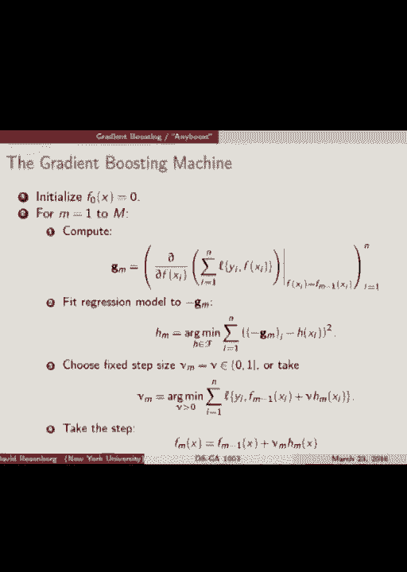
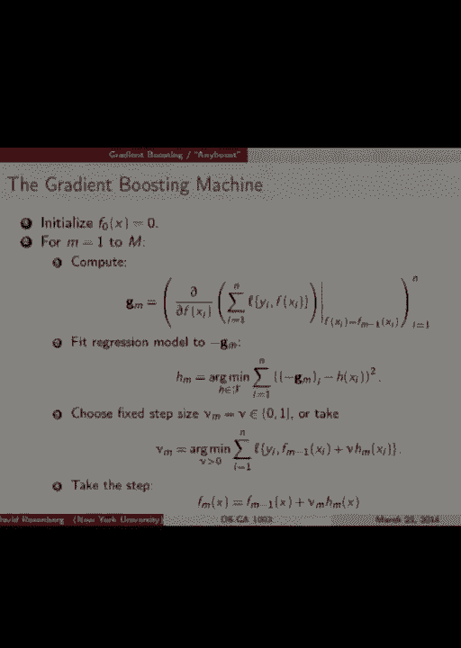
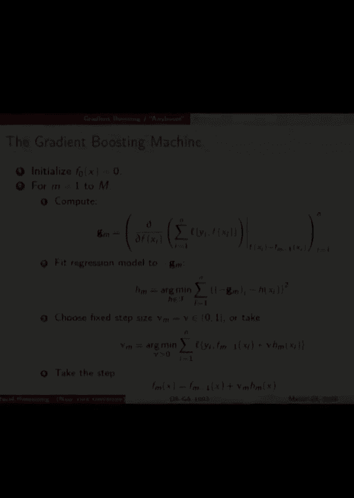

# 13：提升方法（Boosting）全面介绍 🚀

在本节课中，我们将要学习提升方法（Boosting），这是一种强大的顺序集成学习技术。我们将从 AdaBoost 算法开始，逐步理解其工作原理，并将其置于一个更通用的“前向分阶段加性建模”框架中，最后探讨其推广形式。

---

## 回顾：集成方法与 Boosting 概念

上一节我们介绍了集成方法的整体概念。本节中我们来看看顺序集成方法，即 Boosting。

其核心思想是顺序构建多个模型。首先构建一个模型，分析其在哪些数据点上表现好，哪些表现差。然后增加那些表现不佳的数据点的重要性（权重），再构建一个新模型来尝试修正前一个模型的错误。如此反复，每一步都试图改进前一步的不足之处。

我们从“弱分类器”的概念开始。弱分类器是一种分类器，其性能至少比随机猜测（50%准确率）要好。在 AdaBoost 的设定中，我们处理严格的二分类问题（标签为 -1 和 +1），并且弱学习器输出的是硬分类（非概率分数）。

**核心问题**：给定一个弱假设空间（例如决策树桩），我们能否通过某种方式组合从这个空间中选择的多个分类器，使其在训练集上的表现远超“比随机稍好”的水平？

为了实现这一点，我们需要“加权训练集”的概念。每个训练样本都有一个非负的实值权重，我们的目标是最小化加权经验风险，即损失函数的加权平均值，而不仅仅是简单平均。

如果我们有一个可以最小化加权经验风险的算法，那很好。如果没有，我们可以通过“按权重重新采样”的技巧来利用一个只能最小化普通经验风险的“黑盒”算法。具体做法是：将权重归一化为一个概率分布，然后根据这个分布对原始训练集进行重采样（有放回）。在新采样得到的大数据集中，样本出现的频率与其权重成正比，从而使得在新数据集上的普通经验风险近似等于原问题的加权经验风险。

---

## AdaBoost 算法框架 🧩

上一节我们介绍了 Boosting 的基本思想和加权训练集。本节中我们深入看看 AdaBoost 的具体算法框架。

AdaBoost 的粗略框架如下：
1.  从给所有训练样本分配相同权重开始。
2.  进入多轮迭代。在每一轮中：
    *   使用当前加权的训练集，拟合一个弱分类器。
    *   计算这个弱分类器的加权错误率。
    *   根据错误率计算该分类器的权重（组合系数）。
    *   根据分类结果更新样本权重：增加被错误分类样本的权重。
3.  将多轮得到的弱分类器进行加权线性组合，得到最终预测函数。对于分类问题，取该实数值的符号作为最终类别。

**一个关键点**：新增的分类器可能只在之前分错的点上表现更好，而在其他点上表现变差。但由于最终结果是所有分类器的加权组合，之前那些在多数点上表现良好的分类器仍然起作用，这是一个动态平衡的过程。

以下是算法中几个核心部分的详解：

### 1. 弱分类器的权重 (α_m)

设第 `m` 轮弱分类器 `G_m` 的加权错误率为 `ε_m`。该分类器在最终线性组合中的权重 `α_m` 由以下公式计算：
`α_m = (1/2) * ln((1 - ε_m) / ε_m)`

**公式解读**：
*   当 `ε_m` 很小（分类器很好）时，`(1 - ε_m)/ε_m` 很大，`α_m` 也很大，意味着这个好分类器在最终投票中占很大权重。
*   当 `ε_m` 接近 0.5（和随机猜测差不多）时，`α_m` 接近 0。
*   当 `ε_m > 0.5` 时，`α_m` 为负。但 AdaBoost 要求弱分类器至少比随机好（`ε_m < 0.5`），所以 `α_m` 始终为正。

### 2. 样本权重的更新

样本权重的更新也依赖于 `α_m`。设更新前样本 `i` 的权重为 `w_i`。
*   如果 `G_m` 正确分类了样本 `i`，其新权重为：`w_i * exp(-α_m)`
*   如果 `G_m` 错误分类了样本 `i`，其新权重为：`w_i * exp(+α_m)`

**直观理解**：
*   由于 `α_m > 0`，`exp(α_m) > 1`，`exp(-α_m) < 1`。
*   因此，错误分类的样本权重会增大，正确分类的样本权重会减小。
*   增大的幅度 `exp(α_m)` 与分类器权重 `α_m` 相关：分类器越好（`α_m`越大），它分错的样本权重提升得越多，迫使后续的分类器更加关注这些“难”样本。

在实际实现中，每轮更新后会对所有权重进行归一化，使其和为1，方便下一轮计算加权错误率。

---

## AdaBoost 训练过程图解 🎨

上一节我们介绍了 AdaBoost 的数学公式。本节中我们通过一个可视化例子来直观理解其训练过程。

考虑一个二维空间中的二分类问题（红点和蓝点）。我们使用“决策树桩”（在单个特征上的一次分裂）作为弱分类器。

*   **第一轮**：所有点权重相同。弱分类器（一条垂直分割线）可能将大部分点分类正确，但会错分一些点（例如，红圈中的蓝点）。
*   **第二轮**：被第一轮错分的点权重变大（图中点变大）。新的弱分类器会倾向于在权重大的区域（即上一轮错误区域）做出更正确的判断。它可能会在另一维度上画一条水平分割线来修正部分错误。
*   **后续轮次**：过程持续。被反复错分的点权重变得非常大。每个新的弱分类器都试图修正当前组合模型仍然表现不佳的区域。
*   **最终模型**：将多轮得到的决策树桩（垂直线、水平线等）进行加权组合，其决策边界会变得非常复杂和非线性，远超单个决策树桩的能力。

这个例子展示了 Boosting 如何将许多简单的“弱”模型组合成一个强大的“强”模型。

---

## AdaBoost 的理论保证：训练误差界 📉

上一节我们直观感受了 AdaBoost 的工作过程。本节中我们来看看它为什么有效，即其理论保证。

AdaBoost 有一个关于训练误差的重要定理。定义第 `m` 轮弱分类器的“边缘”（Margin）为 `γ_m = 1/2 - ε_m`，它衡量了该分类器比随机猜测好多少。

**定理**：设最终分类器为 `G(x) = sign(∑ α_m G_m(x))`。其训练集上的 0-1 错误率 `R_train` 满足：
`R_train ≤ ∏_{m=1}^M [2 * sqrt(ε_m * (1-ε_m))] = ∏_{m=1}^M sqrt(1 - 4γ_m^2)`

**结论解读**：
*   乘积项 `sqrt(1 - 4γ_m^2)` 小于 1。
*   只要每一轮的弱分类器都略好于随机猜测（即 `ε_m < 0.5`，`γ_m > 0`），这个上界就会随着轮数 `M` 的增加而**指数级下降**。
*   这意味着，如果数据能被弱分类器的线性组合完美分开，并且每一轮都能找到比随机稍好的弱分类器，AdaBoost 的训练误差可以迅速降至零。

**示例**：假设每一轮都能保证 `ε_m ≤ 0.4`（即 `γ_m ≥ 0.1`）。那么上界约为 `(0.98)^M`。当 `M=200` 时，上界约为 0.018。这表明训练误差会快速减小。

---

## 从算法到框架：前向分阶段加性建模 🔄

上一节我们分析了 AdaBoost 自身的性质。本节中我们将看到，AdaBoost 可以被视为一个更通用框架的特例。

AdaBoost 最初以一种特定的迭代算法形式提出。但我们可以从“损失函数最小化”的角度重新审视它，这更符合我们熟悉的机器学习范式（如线性回归、SVM）。

这个通用框架称为**前向分阶段加性建模（Forward Stagewise Additive Modeling）**。其目标是：通过迭代地添加新的基学习器（弱分类器）来最小化一个指定的损失函数 `L`。

**算法流程**：
1.  初始化模型，例如 `f_0(x) = 0`。
2.  对于 `m = 1` 到 `M`：
    a.  固定之前已添加的所有模型 `f_{m-1}(x)`。
    b.  寻找一个基学习器 `g_m(x)` 和系数 `β_m`，使得添加到当前模型后，损失函数减小最多：
        `(β_m, g_m) = argmin_{β, g} ∑_{i=1}^N L(y_i, f_{m-1}(x_i) + β * g(x_i))`
    c.  更新模型：`f_m(x) = f_{m-1}(x) + β_m * g_m(x)`。

**关键发现**：可以证明，当损失函数 `L` 取为**指数损失（Exponential Loss）**，即 `L(y, f(x)) = exp(-y * f(x))`，并且基学习器 `g(x)` 输出为 `{-1, +1}` 时，通过前向分阶段加性建模得到的最优解，其每一步更新恰好等价于 AdaBoost 算法中的 `α_m` 和 `G_m` 的更新规则。

这意味着，AdaBoost 本质上是在**最小化指数损失函数**。这为我们理解 AdaBoost 提供了一种新的视角：它不再是一个神秘的“配方”，而是一种针对特定损失函数的优化算法。

---

## 推广：梯度提升（Gradient Boosting）📈

上一节我们将 AdaBoost 纳入了损失函数最小化的框架。本节中我们自然可以问：能否将这种方法推广到其他损失函数？

答案是肯定的，这就是**梯度提升（Gradient Boosting）**。

在梯度提升中，我们不再局限于指数损失。对于任何可微的损失函数 `L`（例如平方损失用于回归，对数损失用于分类），我们都可以使用前向分阶段加性建模。

然而，直接求解每一步的 `(β_m, g_m)` 可能很困难。梯度提升采用了一种巧妙的近似方法：**用损失函数的负梯度作为当前模型残差的近似**。

**梯度提升算法流程**：
1.  初始化一个常数值模型，如 `f_0(x) = argmin_c ∑ L(y_i, c)`。
2.  对于 `m = 1` 到 `M`：
    a.  对每个样本 `i`，计算当前模型的负梯度（即伪残差）：
        `r_{im} = - [∂L(y_i, f(x_i)) / ∂f(x_i)]_{f=f_{m-1}}`
    b.  用一个基学习器（通常是回归树）`g_m(x)` 去拟合这些伪残差 `{r_{im}}`（作为新的目标值）。
    c.  通过线搜索确定步长 `ρ_m`，以最小化损失：`ρ_m = argmin_ρ ∑ L(y_i, f_{m-1}(x_i) + ρ * g_m(x_i))`。
    d.  更新模型：`f_m(x) = f_{m-1}(x) + ρ_m * g_m(x)`。

**与 AdaBoost 的关系**：可以证明，当损失函数为指数损失时，计算出的伪残差恰好与 AdaBoost 中权重更新的方向一致。因此，AdaBoost 是梯度提升在指数损失下的一个特例。

梯度提升的威力在于其通用性。通过选择不同的损失函数，它可以灵活地应用于回归、分类、排序等多种任务。其现代实现（如 XGBoost, LightGBM, CatBoost）在效率和精度上都非常出色，是数据科学竞赛和工业应用中的常用工具。

---

## 总结与思考 💡

本节课中我们一起学习了提升方法（Boosting）的核心内容。

我们从 **AdaBoost** 这个具体的算法入手，理解了其通过迭代调整样本权重、组合弱分类器来提升性能的直观过程。我们探讨了其理论训练误差上界，明白了只要弱学习器持续提供比随机猜测略好的假设，性能就能指数提升。

接着，我们将 AdaBoost 放入了更通用的**前向分阶段加性建模**框架中，发现它实际上是在最小化**指数损失函数**。这一视角将 AdaBoost 从一种特定算法提升为一种基于损失函数优化的建模思想。

最后，我们将其进一步推广到**梯度提升**，它通过拟合损失函数的负梯度（伪残差）来工作，能够兼容几乎任何可微的损失函数，从而成为一个极其强大和灵活的机器学习框架。

Boosting 方法，特别是其现代变体，通过将许多简单模型（如浅层决策树）的智慧结合起来，常常能产生预测能力极强的模型，是机器学习工具箱中不可或缺的利器。