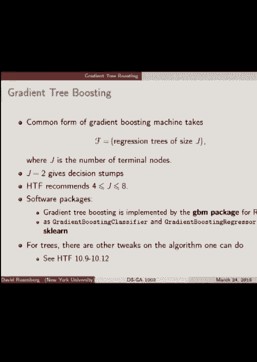
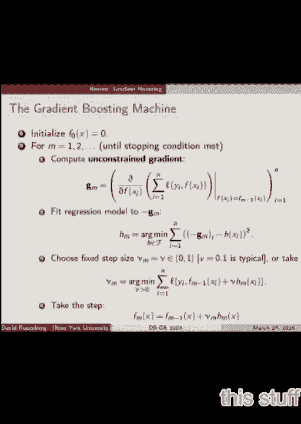
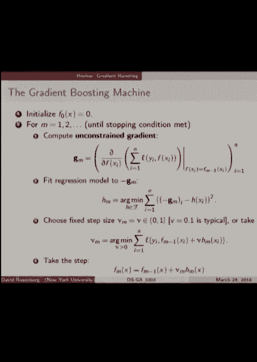
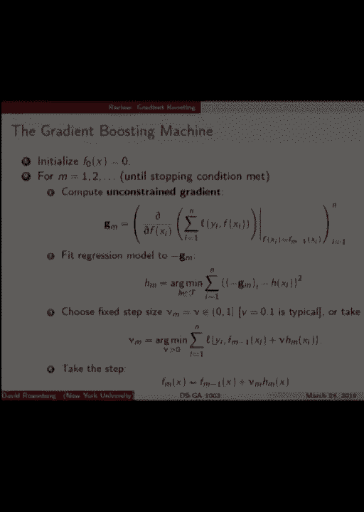

# 14：梯度提升算法详解 🌳

在本节课中，我们将深入学习梯度提升算法。我们将从算法的基本步骤开始，逐步理解其工作原理、关键参数以及在实际应用中的一些重要变体。课程内容将涵盖从理论公式到实践调优的各个方面，旨在让初学者能够清晰地掌握这一强大的机器学习技术。

---

## 算法概述与初始化

梯度提升是一种集成学习方法，它通过迭代地添加弱学习器（通常是决策树）来构建一个强大的预测模型。算法的核心思想是每一步都沿着损失函数减少最快的方向（即负梯度方向）前进，但将这一步“投影”到我们选定的基假设空间中。

首先，我们将预测函数初始化为零：
`F_0(x) = 0`

然后，我们开始分阶段（M 个阶段）构建模型。在每一步 `m`，我们都会向当前模型添加一个新的基学习器 `h_m(x)`，并乘以一个步长 `λ`。

---

## 计算梯度方向

上一节我们介绍了算法的初始化，本节中我们来看看每一步是如何确定添加哪个函数的。

关键的第一步是计算当前模型预测的“梯度”。我们想知道如何直接调整对每个训练样本的预测，以最大程度地减少总损失。这通过计算损失函数 `L` 关于当前模型预测 `F_{m-1}(x_i)` 的偏导数来实现。

对于第 `i` 个训练样本，其梯度分量为：
`g_{m,i} = ∂L(y_i, F_{m-1}(x_i)) / ∂F_{m-1}(x_i)`

将所有训练样本的梯度分量堆叠起来，就得到了第 `m` 步的梯度向量 `g_m`。这个向量指明了在函数空间中，无约束情况下最优的局部调整方向（即负梯度方向 `-g_m`）。

---

## 将梯度投影到假设空间

我们得到了无约束的优化方向，但我们需要添加的函数必须来自我们预先选定的基假设空间 `H`（例如，所有深度为 3 的决策树）。因此，我们不能直接添加 `-g_m`。

我们需要在基假设空间 `H` 中找到一个函数 `h_m`，使其尽可能接近这个理想的负梯度方向。这可以形式化为一个回归问题：

`h_m = argmin_{h∈H} Σ_{i=1}^n [ -g_{m,i} - h(x_i) ]^2`

换句话说，我们试图用基学习器 `h` 去拟合当前残差（即负梯度）。找到这个 `h_m` 后，我们将其乘以步长 `λ`，并添加到现有模型中：
`F_m(x) = F_{m-1}(x) + λ * h_m(x)`

---

## 算法输入与特性

以下是使用梯度提升算法前需要准备或决定的几个关键组成部分：

1.  **损失函数**：需要是可微的，例如平方损失、对数损失等。
2.  **基学习器空间**：通常是回归树，需要选择树的深度或叶子节点数量。
3.  **回归求解算法**：用于求解上述投影问题（即拟合 `h_m`）。
4.  **迭代步数 M**：一个重要的停止标准，防止过拟合。
5.  **步长 λ**：控制每步的贡献，通常较小的步长（如 0.1）效果更好，但需要更多迭代。

梯度提升的强大之处在于其灵活性。它可以适配任何可微的损失函数，并且在实际应用中（尤其是在结构化数据上），基于树的梯度提升（如 XGBoost、LightGBM）通常是效果最好的方法之一。

---

## 基学习器：决策树

在实践中，最常用的基学习器是决策树，特别是浅树（即树桩）或限制叶子节点数量（如 4-8 个）的树。

最终预测函数的形式是基学习器的线性组合。例如，使用决策树桩时，模型形式如下：
`F(x) = Σ_{m=1}^M λ * [ α_{m,1} * I(x_j ≤ t_m) + α_{m,2} * I(x_j > t_m) ]`

这里有一个重要的限制：**特征间的交互作用必须已经存在于基学习器中**。提升过程只是线性组合这些基学习器，不会创造新的特征交互。因此，如果使用决策树桩（单层决策），最终模型也无法捕获特征间的交互。使用更深的树（允许在内部节点进行多次判断）作为基学习器，模型就能自动学习特征间复杂的交互关系。

---

## 参数调优与正则化

梯度提升有几个关键参数可以调整以优化性能并防止过拟合：

1.  **步长 λ**：较小的步长（如 0.01, 0.1）通常能获得更好的测试性能，模型更平滑，但需要更多的迭代次数（M）来达到相同的训练误差。
2.  **子采样（行采样）**：也称为随机梯度提升。每一步不是使用全部数据计算梯度，而是随机采样一部分数据（例如 50%）。这既能加速训练，也是一种有效的正则化手段。
3.  **列采样**：在构建每棵树时，随机采样一部分特征。这与随机森林中的思想类似，能有效防止过拟合，并且在一些现代实现（如 XGBoost）中被认为非常有效。
4.  **树的相关参数**：如树的最大深度、叶子节点数量等，直接控制了基学习器的复杂度。

---

## 进阶变体：XGBoost 与牛顿法

标准的梯度提升使用一阶梯度信息。更高级的方法可以使用二阶信息（牛顿法），以更快的速度逼近最小值。

牛顿法的思想是：在当前点用二阶泰勒展开（一个二次函数）局部近似目标函数，然后直接一步走到该二次函数的最小值点。在梯度提升的框架下，使用牛顿步方向有时比纯梯度方向更高效。

**XGBoost** 是一个著名的梯度提升实现，它的主要特点包括：
*   使用了牛顿法进行优化。
*   系统地引入了列采样作为正则化方法。
*   在工程实现上做了大量优化，支持并行计算、处理缺失值等，使其非常高效且适用于大规模数据。

---

## 总结

本节课中我们一起学习了梯度提升算法的核心原理。我们从初始化一个零模型开始，通过迭代计算损失函数的梯度，并将负梯度方向投影到基假设空间（如决策树）中来选择要添加的弱学习器。我们讨论了步长、迭代次数、子采样等关键参数对模型性能的影响，并理解了特征交互作用是如何通过基学习器引入的。最后，我们简要介绍了 XGBoost 等高级变体如何利用二阶信息和工程优化来提升算法效率和效果。梯度提升因其强大的预测能力和灵活性，已成为机器学习实践中不可或缺的工具之一。