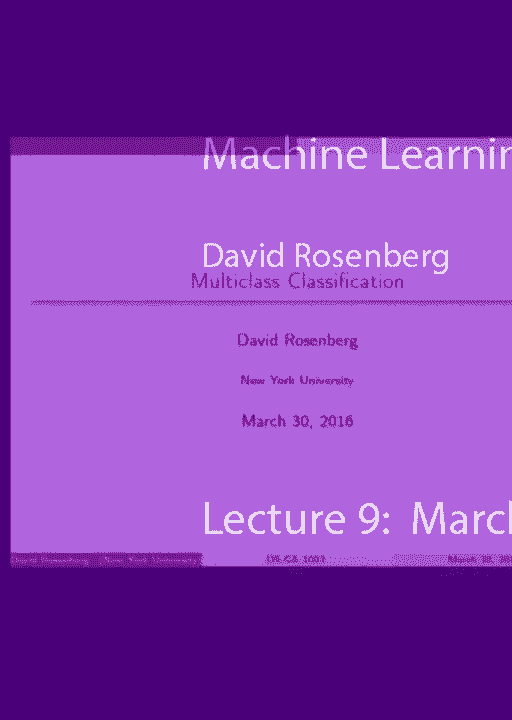
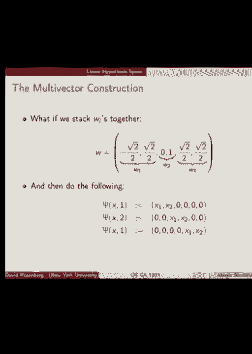
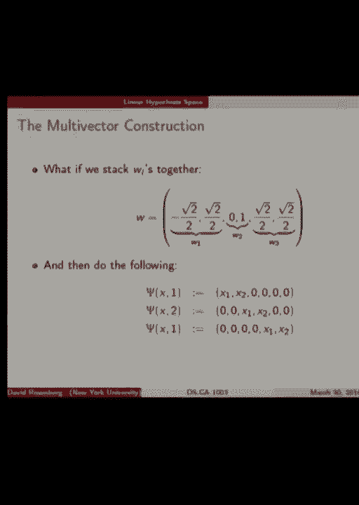
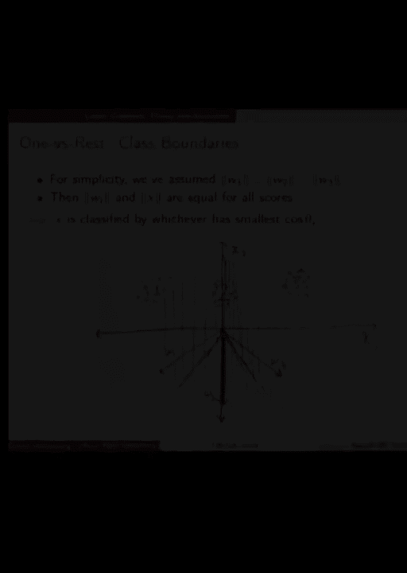
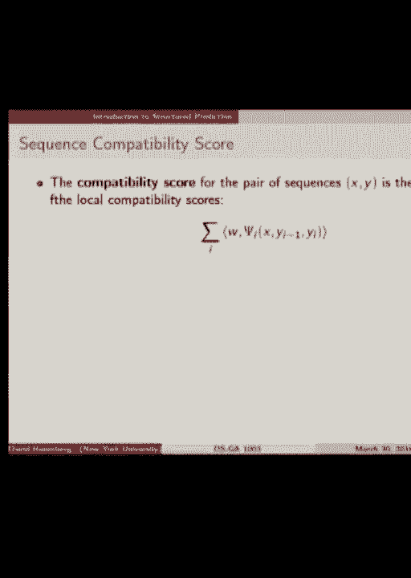
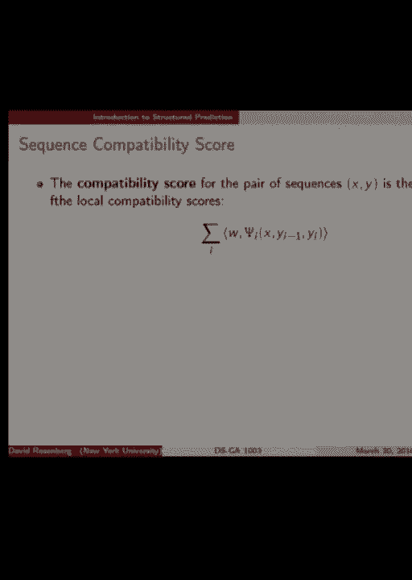
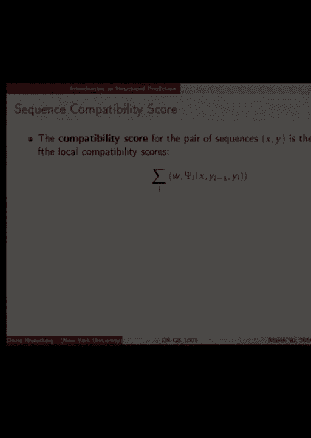

# 15：多分类与结构化预测入门 🧠

在本节课中，我们将学习多分类问题的基本概念，并探索如何将二分类方法扩展到多分类场景。我们将重点介绍一种名为“一对多”的降维方法，并分析其局限性。随后，我们将引入一个更通用的“兼容性函数”框架，并在此框架下探讨线性多分类方法。最后，我们会简要介绍结构化预测的概念，为处理更复杂的输出空间（如序列标签）打下基础。

## 从二分类到多分类：一对多方法

上一节我们回顾了二分类的基本原理。本节中，我们来看看如何利用已有的二分类器来解决多分类问题。一种直观的策略是“一对多”方法。

以下是“一对多”方法的基本步骤：
1.  对于 K 个类别中的每一个类别 i，训练一个独立的二分类器。
2.  每个分类器 h_i 的目标是将类别 i 的样本（作为正类）与所有其他类别的样本（作为负类）区分开。
3.  对于一个新的输入 x，我们让所有 K 个分类器对其进行评分或预测。
4.  最终的预测结果是给出最高评分或最确信预测的那个类别，即 `argmax_i h_i(x)`。

这种方法虽然简单，但在某些数据分布下可能失效，例如当不同类别的决策区域并非线性可分，或者存在分类器“认领”重叠区域的情况时。

## 线性分类器的几何视角回顾

为了理解后续内容，我们需要重温线性分类器的几何意义。对于一个二分类线性得分函数 `score(x) = w^T x`（这里暂不考虑偏置项），其预测规则为：若 `w^T x > 0` 则预测为正类，否则预测为负类。

从几何上看，`w^T x` 等于向量 w 和 x 的模长乘以它们夹角的余弦值：`||w|| * ||x|| * cos(θ)`。因此，预测为正类等价于要求夹角 θ 的余弦值为正，即 θ 在 (-90°, 90°) 之间。这意味着向量 x 需要落在由法向量 w 定义的超平面的“正面”一侧。

## 多分类的线性方法框架

一对多方法的局限性促使我们寻找更自然的多分类建模方式。我们引入一个更通用的框架：兼容性函数。

我们不再为每个类别训练独立的函数，而是定义一个统一的兼容性函数 `h(x, y)`，它接受输入 x 和候选输出 y（即类别），并输出一个表示两者匹配程度的分数。最终的预测规则是选择兼容性最高的类别：
`预测y = argmax_{y ∈ Y} h(x, y)`

对于线性模型，我们将兼容性函数定义为特征向量与参数向量的内积：
`h(x, y) = w^T · Ψ(x, y)`
其中，`Ψ(x, y)` 是一个**类敏感特征映射**，它将 (x, y) 对共同映射到一个特征向量空间。参数向量 w 则在这个空间中被学习。

## 构建类敏感特征映射

如何构造 `Ψ(x, y)` 是关键。一种直接的方法是“多向量”法，它本质上复制了“一对多”的线性版本。

假设原始输入特征为 x ∈ R^d，共有 K 个类别。我们可以定义 `Ψ(x, y=i)` 为一个长度为 K*d 的向量，其结构如下：
-   仅在对应于第 i 个类别的 d 维块中放置原始特征向量 x。
-   其他 (K-1) 个 d 维块全部置为 0。
此时，参数向量 w 也被相应地划分为 K 个 d 维子向量 `[w1, w2, ..., wK]`。计算内积 `w^T · Ψ(x, y=i)` 的结果恰好就是 `wi^T x`。这样，最大化兼容性分数就等价于在 K 个线性分类器 `wi^T x` 中选择得分最高的一个。

更高级的特征映射可以融合 x 和 y 的交互信息。例如，在文本分类中，特征可以是“当前单词是‘apple’且类别是‘名词’”。在广告推荐中，特征可以是“用户对体育感兴趣且广告与体育相关”。这类特征能够更精细地刻画输入与特定输出之间的关联。

## 多类别支持向量机

有了兼容性函数的框架，我们就可以定义损失函数并进行学习了。受二分类支持向量机的启发，我们为多分类问题定义间隔。

对于一个训练样本 `(xi, yi)`，我们希望正确类别 yi 的兼容性分数远高于其他所有错误类别 y‘。即，我们希望对于所有 `y‘ ≠ yi`，有：
`h(xi, yi) > h(xi, y‘)`
更严格地，我们希望这个差距至少达到一个目标间隔 Δ(yi, y‘)，其中 Δ 可以是一个常数（如1），也可以是一个根据错误严重程度定制的损失函数（例如，在词性标注中，混淆两个相似词性的惩罚较小）。

因此，我们可以定义样本 (xi, yi) 上的合页损失为：
`L(xi, yi) = max(0, max_{y‘≠yi} [Δ(yi, y‘) + h(xi, y‘) - h(xi, yi)])`
这个损失鼓励正确类别的分数比其他类别高出至少 Δ 的幅度。

多类别支持向量机的目标就是最小化所有训练样本的损失之和，并加上对参数 w 的正则项（如 L2 正则化）：
`最小化: λ||w||^2 + (1/n) * Σ_i L(xi, yi)`

## 结构化预测简介

当输出空间 Y 非常大且具有内部结构时（例如，Y 是所有可能的词性标签序列），我们就进入了**结构化预测**的领域。直接枚举所有可能的 y 来计算 `argmax` 是不可行的。

解决的关键在于利用输出空间的结构，使得兼容性函数 `h(x, y) = w^T · Ψ(x, y)` 能够分解为局部贡献的和。例如，在序列标注问题中，我们可以设计特征函数，使其只依赖于输入 x 的局部窗口和输出 y 中相邻的标签。
`Ψ(x, y) = Σ_{局部片段} ψ_局部(x, y的局部)`
这样，全局特征向量就是所有局部特征向量的和。由于这种可加性，寻找使得 `w^T · Ψ(x, y)` 最大的 y 可以通过高效的动态规划算法（如维特比算法）来完成，而无需遍历指数级数量的可能序列。

## 总结

本节课中我们一起学习了多分类问题的核心思想。我们从简单的“一对多”降维方法出发，指出了其不足，进而引入了一个基于兼容性函数的通用线性框架。通过定义类敏感特征映射 `Ψ(x, y)`，我们将多分类问题转化为学习一个统一的参数向量 w。我们还将二分类支持向量机的间隔思想推广到多类别场景，定义了多类别支持向量机的目标函数。最后，我们简要介绍了结构化预测的概念，说明了当输出空间具有结构时，如何通过分解特征函数并利用动态规划来高效地进行预测。这套框架是许多现代分类和序列标注模型的基础。