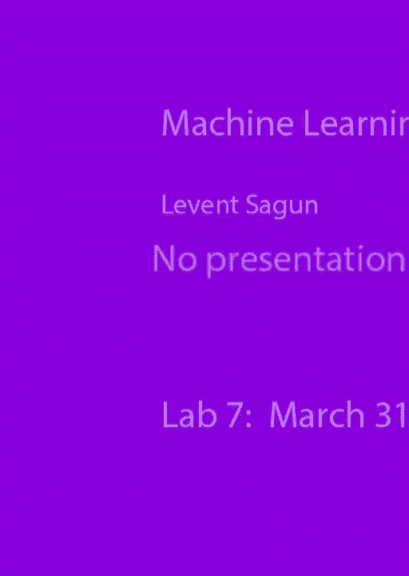

# 16：广义线性模型与考试复习 📚

在本节课中，我们将学习广义线性模型（GLM）的概率设定，并理解其与最小二乘法的联系。随后，我们将回顾近期考试中的关键题目，涵盖支持向量机（SVM）、优化方法以及感知机等内容。

---

## 广义线性模型与概率设定 🔍

上一节我们介绍了项目中的一些问题，本节中我们来看看广义线性模型。它本质上是一种概率设定。我们将通过一个例子，展示广义线性模型如何与最小化平方范数（即最小二乘法）相关联。

我们的假设空间由一系列函数组成，这些函数将输入映射到具有参数化均值和方差的高斯分布。你可以想象，给定一个输入，模型会输出一个对应的高斯分布。因此，目标是为每个输入 **x** 找到参数，使得 **f(x)** 是一个高斯密度函数。

我们使用标准差 **σ²**。找到参数 **v** 就确定了函数 **f**。因此，**f** 依赖于 **v** 并以 **x** 为输入。我们可以将预测 **y** 的密度函数写作以下形式：

**p(y | x; v) = N(y; wᵀx, σ²)**

这表示在给定 **x** 和参数 **v**（其中包含 **w**）的条件下，**y** 服从均值为 **wᵀx**、方差为 **σ²** 的正态分布。

如果我们有一组独立同分布的数据 **{(xᵢ, yᵢ)}**，其联合概率密度（似然函数）为所有单个数据点概率密度的乘积：

**L(v) = ∏ᵢ p(yᵢ | xᵢ; v)**

在概率设定下，我们的目标是找到能最大化这个似然函数的参数 **v**（或 **w**）。即：

**w* = argmax_w L(w)**

---

## 从最大似然到最小二乘法 ➡️

在正态性假设下，最大化似然函数等价于最大化其对数似然函数，因为对数函数是单调的，不改变最大值点的位置。

对似然函数取对数并展开后，我们会发现，最大化对数似然函数等价于最小化以下表达式：

**∑ᵢ (yᵢ - wᵀxᵢ)²**

这正是我们熟悉的最小二乘损失函数。

因此，**在假设误差服从正态分布且方差固定的前提下，使用最大似然估计得到的参数，与最小二乘法得到的解是一致的**。这建立了概率模型与经典线性回归之间的桥梁。

---

## 考试题目回顾与解析 📝

上一部分我们探讨了理论模型，现在我们来分析考试中的具体题目。

### 1. 支持向量机（SVM）与硬间隔

第一个问题涉及线性可分数据。题目要求找到“最大化间隔的超平面”，但关键前提是**硬间隔**，即不允许任何分类错误（松弛变量为0）。

以下是核心要点：
*   目标是找到一个能**完全正确分隔**所有数据点的超平面。
*   即使这意味着为了分类正确而牺牲“间隔”的宽度，也必须优先保证所有点都被正确分类。
*   在硬间隔SVM中，“分隔超平面”的定义本身就要求它必须将所有点分开。

### 2. 特征变换与线性可分

第二个问题展示了一个在原始二维空间中线性不可分的数据集（例如，点分布呈“X”形或“V”形）。题目要求“找到能使数据线性可分的特征”。

解决此类问题有两种思路：
1.  **构造非线性分类器**：在原始空间中直接使用非线性函数（如抛物线）作为决策边界。
2.  **特征映射**：将数据点通过一个函数 **Φ** 映射到更高维的空间，使得在新空间中数据是线性可分的。

以下是可行的特征映射示例：
*   **使用平方项**：例如，映射 **Φ(x₁, x₂) = (x₁, x₂, x₁² + x₂²)**。这相当于将数据点“抬升”到一个三维抛物面上，从而可以用一个平面（线性分类器）分隔。
*   **使用绝对值**：例如，映射 **Φ(x₁, x₂) = (|x₁|, x₂)**。这相当于将第二、四象限的点“反射”到第一象限，使得原本“V”形的数据变成两条可分的簇。

**关键**：选取一个点（如 (-1, 2)）手动计算其在新特征空间中的坐标（如 (1, 2)），有助于理解映射如何改变数据的几何结构。

### 3. 优化中的步长方向

第三个问题考察了在优化凸函数 **J(v)** 时，沿特定方向更新参数的效果。题目给出了三种情况：

以下是每种情况的判断：
1.  **凸且可微**：沿负梯度方向，以足够小的步长 **η** 更新。这**保证**会使函数值下降，并**保证**会向最优解靠近。
2.  **凸但不可微**：沿负次梯度方向更新。这**不一定**保证函数值下降（存在反例），但**保证**会向最优解靠近（有定理保证）。
3.  **凸函数之和（如经验风险）**：随机沿其中一个分量函数的梯度方向更新（如SGD）。这**既不保证**函数值立即下降，也**不保证**立即向整体最优解靠近。但长期来看，在适当条件下，它能收敛到最优解。

### 4. 岭回归（Ridge Regression）

第四个问题要求推导岭回归的解。岭回归的目标函数是：

**J(w) = ||Xw - y||² + λ||w||²**

通过对 **w** 求导并令导数为零，可以得到正规方程：

**XᵀXw + λIw = Xᵀy**

进而解得：

**w* = (XᵀX + λI)⁻¹Xᵀy**

**关键点**：由于 **λ > 0**，矩阵 **(XᵀX + λI)** 总是可逆的（即使 **XᵀX** 不可逆），这解决了普通线性回归中可能存在的数值不稳定问题。

### 5. 感知机与合页损失（Hinge Loss）

第五个问题涉及感知机算法。感知机的损失函数是合页损失（Hinge Loss）的一个特例：

**loss = max(0, -y_i * (wᵀx_i))**

这与支持向量机中使用的间隔损失在形式上是相同的。其中 **y_i * (wᵀx_i)** 被称为“函数间隔”。

题目要求：
1.  **写出超平面完美分隔数据的条件**：即对于所有数据点 **i**，满足 **y_i * (wᵀx_i) > 0**。
2.  **讨论损失为零与完美可分的关系**：损失为零**不一定**意味着完美可分。例如，当权重 **w = 0** 时，损失也为零，但显然无法分隔任何数据。因此，命题“损失为零 ⇒ 完美可分”是**错误**的。

### 6. 正则化感知机与拉格朗日对偶

第六个问题探讨了正则化感知机的对偶形式。原始问题是带约束的优化：

**min_w J(w)   s.t.   ||w||² ≥ 1**

我们可以通过引入拉格朗日乘子 **λ (λ ≥ 0)**，构造拉格朗日函数：

**L(w, λ) = J(w) + λ(1 - ||w||²)**

原始问题等价于 **min_w max_{λ≥0} L(w, λ)**。其对偶问题是交换极值顺序：**max_{λ≥0} min_w L(w, λ)**。

**为什么对偶问题的最优值与原始问题相同？**
考虑内层的 **max_{λ≥0}** 操作：
*   如果约束被违反（即 **1 - ||w||² > 0**），那么通过取 **λ → ∞**，**L(w, λ)** 会趋于无穷大。
*   如果约束被满足（即 **1 - ||w||² ≤ 0**），那么最优的 **λ** 为 0，此时 **L(w, 0) = J(w)**。
因此，外层的 **min_w** 操作实际上就是在满足约束 **||w||² ≥ 1** 的条件下最小化 **J(w)**，这与原始问题一致。

---

## 总结 🎯

本节课中我们一起学习了：
1.  **广义线性模型（GLM）** 的概率解释，并推导出在正态假设下，其最大似然估计等价于**最小二乘法**。
2.  回顾了考试中的核心题型，包括：
    *   **硬间隔SVM** 必须完全分类正确。
    *   通过**特征映射**（如平方项、绝对值）解决线性不可分问题。
    *   优化中，**梯度方向**更新对于凸可微函数的良好性质，以及**随机梯度下降**的不同行为。
    *   **岭回归** 的推导及其解的良好性质。
    *   **感知机损失** 与合页损失的关系，以及损失函数的局限性。
    *   带约束优化问题的**拉格朗日对偶**形式及其等价性。

希望本次复习能帮助你巩固这些机器学习中的重要概念。