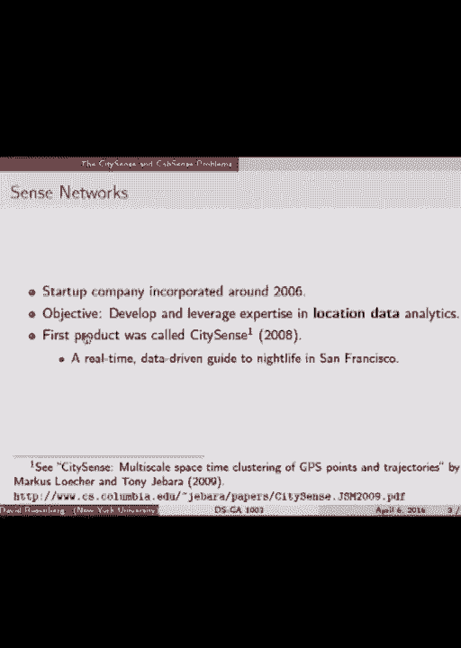
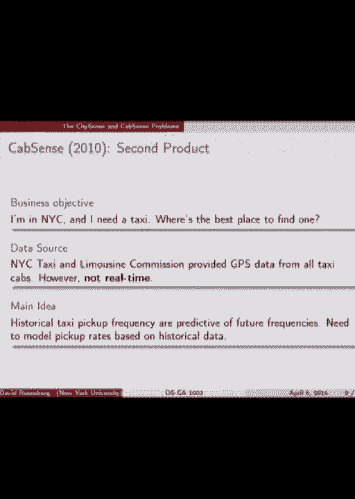
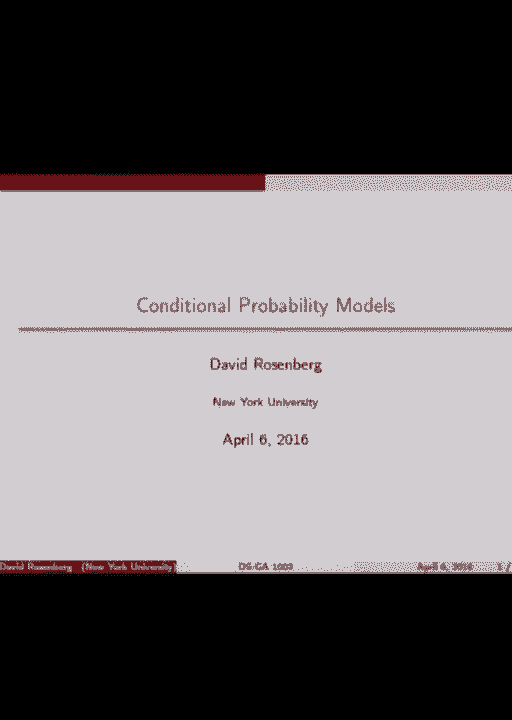
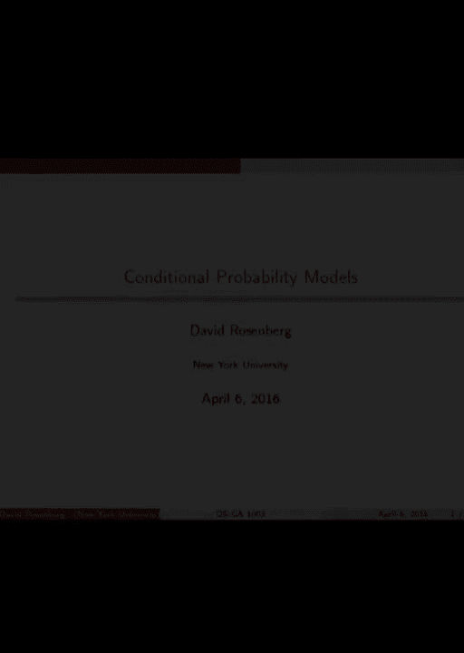
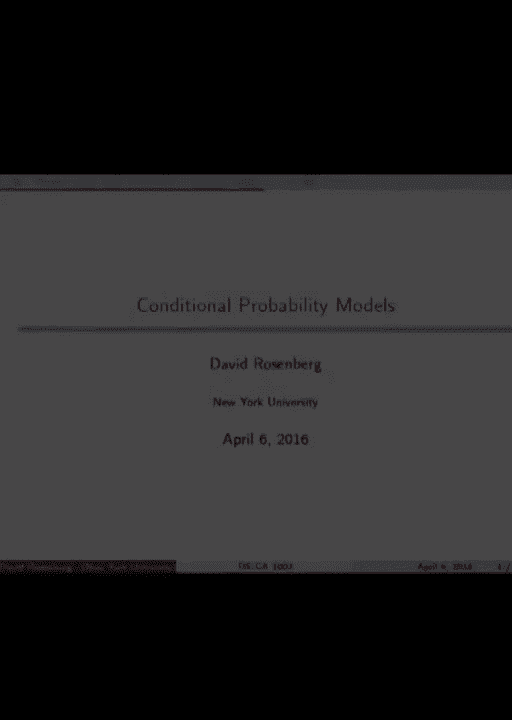
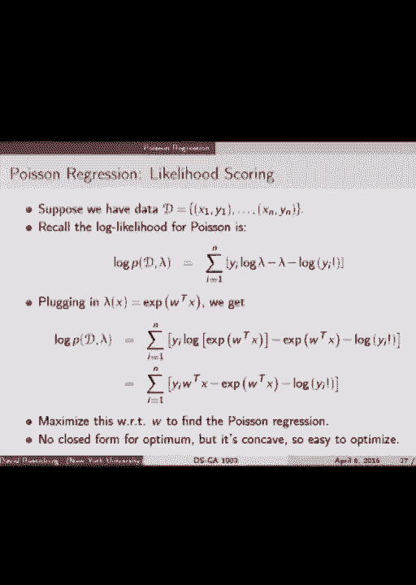

# 17：概率模型与广义回归 📊

在本节课中，我们将学习一种新的动作空间：输出上的概率分布。我们将探讨如何预测概率分布，而不是单一的类别或数值，并了解这在数据科学问题（如异常检测）中的应用。课程将涵盖概率模型的基本概念、评估方法，并介绍逻辑回归、泊松回归等广义线性模型。

---

## 概述

到目前为止，我们已经讨论了几种不同类型的动作空间。假设空间包含许多决策函数，每个决策函数从输入空间获取一个输入，并在动作空间中给出一个输出。我们讨论过的动作空间包括：
*   回归中的实数线。
*   硬分类中的 `{-1, +1}`。
*   多类分类中的离散有限集 `{1, ..., K}`。

今天，我们将引入一个新的动作空间：**输出上的概率分布**。这意味着，对于多类问题，我们不是输出单个类别，而是输出类别集合上的一个概率分布。

---

## 动机：城市感知项目

为了理解这种方法的动机，让我们看一个实际项目：城市感知（CitySense）。这个项目的目标是成为位置数据的专家，其第一款产品是旧金山夜生活的实时指南。它需要回答：“当前哪些地方异常热门？”

数据科学的核心问题是：**如何判断某个地点在特定时间是否“异常流行”？**

我们使用的数据集是出租车GPS轨迹数据，特别是出租车的下车地点，作为人们前往某地的标志。我们需要：
1.  建立典型行为的模型（例如，城市某区域在一天中不同时间的典型出租车下车次数）。
2.  实时观察实际数据，并与模型预测进行比较，以发现异常（如意外的音乐会）。

---

## 预测概率分布的优势

假设我们的输出空间是实数（即回归问题）。我们想要获取一个输入 `x`，并输出给定 `x` 时 `y` 的概率分布 `P(y|x)`。

拥有预测分布 `P(y|x)` 后，我们可以做很多事情：
*   **优化任意损失函数**：例如，要最小化平方损失，可以预测该分布的期望值 `E[y|x]`；要最小化绝对损失，可以预测该分布的中位数。
*   **衡量事件的异常程度**：例如，在出租车接送预测中，如果模型预测分布为泊松(λ=40)，而实际观察到100次接送，我们可以计算 `P(y >= 100 | x)` 来衡量该事件有多不寻常。
*   **计算预测区间**：可以找到值 `a` 和 `b`，使得 `P(a <= y <= b | x) = 0.95`，从而得到一个95%的预测区间。

---

## 数据与问题设定

我们的数据是纽约市的出租车接送数据。我们将城市空间划分为网格单元，时间按小时划分。因此，每个数据点可以表示为：
*   **输入 `x`**：网格单元ID、周几、小时。
*   **输出 `y`**：该网格单元在该小时内观察到的接送次数（计数数据）。

**预测问题**：给定一个查询（如“周三晚上8点，在网格单元G”），我们想要输出该地点该时段接送次数的概率分布。

**数据划分的注意事项**：由于数据具有时间序列特性，在划分训练集和测试集时，应按时间顺序划分（例如，用前N周的数据训练，用之后的数据测试），以模拟模型在实际部署中只能使用历史数据进行预测的场景。

---

## 建模方法：分层 vs. 合并

在建模时，我们面临一个偏差-方差的权衡：
*   **完全分层**：为每个网格单元和每个小时单独建立一个模型。这减少了偏差（因为模型专门针对该条件），但增加了方差（因为每个模型可用的数据很少）。
*   **合并**：将多个网格单元或时间段的数据合并在一起建立一个模型。这减少了方差（因为使用了更多数据），但可能增加偏差（因为忽略了不同条件间的差异）。

选择分层还是合并，取决于我们是否有足够的数据来可靠地估计每个独立条件下的分布。

---

## 评估预测分布：似然

如何评估一个预测分布 `P_hat(y|x)` 的好坏？一个标准方法是使用**似然**。

**定义**：对于观测到的数据集 `D = {(x_i, y_i)}`，预测分布 `P_hat` 的似然是 `P_hat` 分配给这些数据的概率（或概率密度）的乘积：
`L(P_hat; D) = ∏_i P_hat(y_i | x_i)`

我们通常使用**对数似然**，因为它更易于计算和优化：
`log L(P_hat; D) = ∑_i log P_hat(y_i | x_i)`

**评估准则**：一个好的预测分布应该给新数据（测试集）赋予高的似然值。因此，我们可以通过比较不同模型在测试集上的平均对数似然来评估它们。

---

## 参数模型与最大似然估计

我们通常使用**参数模型**，即一个由参数 `θ` 索引的概率分布族 `P(y; θ)`。例如：
*   泊松分布：`P(k; λ) = (e^{-λ} λ^k) / k!`，参数 `θ = λ`。
*   高斯分布：参数 `θ = (μ, σ^2)`。

**最大似然估计**：给定数据集 `D`，我们寻找能最大化数据似然（或对数似然）的参数值 `θ_hat`：
`θ_hat = argmax_θ ∑_i log P(y_i; θ)`

这等价于在经验风险最小化框架中，最小化负对数似然损失。

---

## 广义回归框架

现在，我们将概率建模扩展到有输入 `x` 的情况，这被称为**广义回归**。我们的目标是学习一个决策函数 `f`，它接收输入 `x`，并输出 `y` 的一个概率分布 `P(y|x)`。

**框架设定**：
*   **动作空间**：概率密度函数或概率质量函数的集合。
*   **损失函数**：负对数似然 `l(f(x), y) = -log f(x)[y]`，其中 `f(x)[y]` 是模型 `f` 在输入 `x` 下为观测值 `y` 分配的概率。
*   **经验风险**：`R_emp(f) = (1/n) ∑_i -log f(x_i)[y_i]`

我们的目标是在假设空间 `H` 中找到一个函数 `f`，以最小化经验风险。

---

## 示例一：逻辑回归（伯努利回归）

当输出 `y` 是二元的（例如 `{0, 1}`），我们使用伯努利分布。逻辑回归预测 `y=1` 的概率为：
`P(y=1|x) = σ(w^T x) = 1 / (1 + e^{-w^T x})`
其中 `σ` 是逻辑函数（sigmoid函数），它将线性分数 `w^T x` 映射到 `(0, 1)` 区间。

**模型拟合**：通过最大似然估计（即最小化负对数似然损失）来学习参数 `w`。正则化项（如L2正则化）可以加入损失函数中以防止过拟合。

---

## 示例二：多项式逻辑回归（多类分类）

当输出 `y` 有 `K` 个类别时，我们预测一个类别上的分布（多项分布）。首先，为每个类别 `k` 计算一个线性分数：`s_k = w_k^T x`。
然后，使用 **softmax** 函数将这些分数转换为概率：
`P(y=k|x) = e^{s_k} / ∑_{j=1}^K e^{s_j}`
softmax 函数确保所有类别的概率之和为1，且每个概率都大于0。

**模型拟合**：同样通过最小化负对数似然损失来学习所有参数 `{w_1, ..., w_K}`。

---

## 示例三：泊松回归

当输出 `y` 是计数数据时（如出租车接送次数），泊松分布是一个自然的选择。泊松回归预测泊松分布的参数 `λ`（即期望计数）为：
`λ = exp(w^T x)`
这里使用指数函数 `exp` 作为连接函数，确保 `λ > 0`。

**模型拟合**：使用泊松分布的概率质量函数构建似然，并通过最大似然估计学习参数 `w`。

---

## 广义线性模型

逻辑回归、多项式回归和泊松回归都是**广义线性模型**的特例。GLM的统一模式是：
1.  线性预测器：`η = w^T x`。
2.  连接函数：通过一个单调可微的连接函数 `g`，将线性预测器 `η` 与分布参数的均值 `μ` 联系起来：`g(μ) = η`。
3.  指数族分布：响应变量 `y` 服从一个指数族分布（如伯努利、多项式、泊松、高斯等）。

这种统一的框架允许我们为各种类型的数据（二值、计数、连续值等）系统地构建概率预测模型。

---

## 总结

在本节课中，我们一起学习了：
1.  **预测概率分布**的概念及其在提供不确定性度量和决策支持方面的优势。
2.  使用**似然**作为评估预测分布质量的核心准则。
3.  **最大似然估计**作为拟合参数概率模型的基本方法。
4.  将概率建模纳入监督学习框架，引入**广义回归**，其中动作空间是概率分布。
5.  几个重要的广义线性模型实例：**逻辑回归**（用于二分类）、**多项式逻辑回归**（用于多分类）和**泊松回归**（用于计数数据）。

通过预测完整的概率分布，而不仅仅是单个值，我们的模型能够传达更多信息，支持更复杂的决策，并更好地量化预测的不确定性。